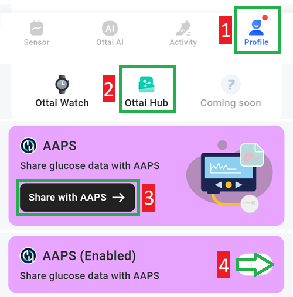

# Ottai M8

## Usar o M8 com o app Ottai

-   Baixe e instale o apk de <https://play.google.com/store/apps/details?id=com.ottai.seas>. Para a versão chinesa do Ottai, use <https://ottai.com.cn/70ICjxAI4i>

-   Iniciar o sensor

- Select **Syai/Ottai** in [**Configuration → BG Source**](#Config-Builder-bg-source).

Ative a transmissão (broadcast) no app Ottai:

1. Selecione Profile (Perfil)
2. Ottai hub
3. Toque em Share with AAPS e aceite o acordo de transferência de dados para terceiros
4. Ative Share glucose data with AAPS (compartilhar dados de glicose com o AAPS)

