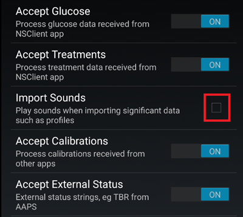
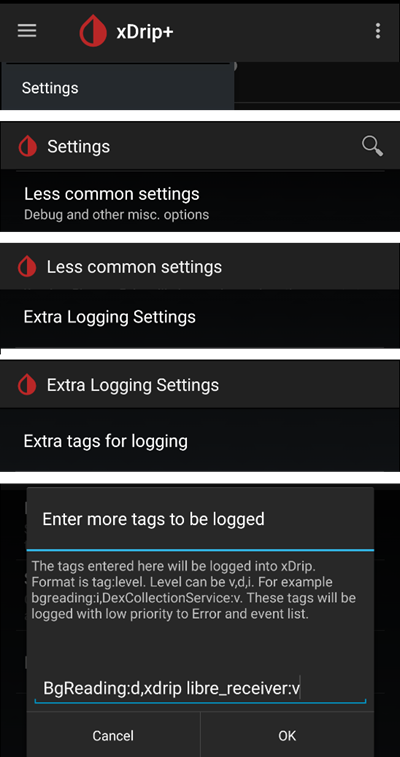

# Configurações do xDrip

Se ainda não estiver configurado, baixe e instale a versão mais recente do xDrip na [página de versões do xDrip](https://github.com/NightscoutFoundation/xDrip/releases).

Desative a otimização de bateria e permita a atividade em segundo plano para o aplicativo xDrip.

## Configurações básicas para todos os sistemas CGM e FGM

### Desativar o envio ao Nightscout

Você não deve deixar nenhum outro app enviar dados (glicose e tratamentos) para o Nightscout.

→ Menu hambúrguer (1) → Settings (2) → Cloud Upload (3) -> Nightscout Sync (REST-API)(4) → Desligue (**OFF**) `Enabled` (5)

#### Desativar a calibração automática e os tratamentos

Verifique se `Automatic Calibration` (7) está desativado. Se a caixa de `Automatic Calibration` estiver marcada, ative `Download treatments` (6) uma vez, depois desmarque a caixa de `Automatic Calibration` e desative `Download treatments` de novo.

Toque em `Extra Options`(8)

    {admonition} Aviso de segurança
    :class: warning
    Você deve desativar "Upload treatments" no xDrip; caso contrário, os tratamentos podem ser duplicados no AAPS, o que leva a valores errados de COB e IOB.

Desative `Upload treatments`(9) e garanta que você **NÃO** vai usar `Back-fill data` (11).

A opção `Alert on failures` também deve ser desativada (10). Caso contrário, você vai receber um alarme a cada 5 minutos se houver problemas de Wi-Fi/rede móvel ou se o servidor não estiver disponível.

### **Inter-app Settings** (Broadcast)

Se você vai usar o AAPS e os dados devem ser enviados, por exemplo, ao AAPS, você precisa ativar a transmissão (broadcast) no xDrip, em Inter-App settings.

→ Menu hambúrguer (1) → Settings (2) → Inter-app settings (3) → Broadcast locally **ON** (4)

Para que os valores no AAPS sejam idênticos aos do xDrip, você deve ativar `Send the displayed glucose value` (5).

Ative Compatible Broadcast (6).

Se você também ativou `Accept treatments` no xDrip e `Ativar transmissões para xDrip+` no plugin xDrip do AAPS, o xDrip vai receber do AAPS as informações de insulina, carboidratos e taxa basal.

Se você ativar `Accept Calibrations`, o xDrip vai usar as calibrações do AAPS. Tenha cuidado ao usar esta função com sensores Dexcom: leia [isto](https://navid200.github.io/xDrip/docs/Calibrate-G6.html) primeiro.

Lembre-se de desativar Import Sounds para evitar que o xDrip toque um som toda vez que o AAPS enviar uma mudança de basal/perfil.

(xdrip-identify-receiver)=

#### Identify receiver (identificar receptor)

- Se você encontrar problemas com a transmissão local (o AAPS não recebe valores de BG do xDrip), vá em → Menu hambúrguer (1) Settings (2) → Inter-app settings (3) → Identify receiver (7) e digite `info.nightscout.androidaps` para a compilação do AAPS (se você usa a compilação PumpControl, digite `info.nightscout.aapspumpcontrol`!!).
- Atenção: a correção automática às vezes muda o i para letra maiúscula. Você **deve usar somente letras minúsculas** ao digitar `info.nightscout.androidaps` (ou `info.nightscout.aapspumpcontrol` para o PumpControl). Um I maiúsculo impediria o aplicativo de receber valores de BG do xDrip.
    
    

## Usar o AAPS para calibrar no xDrip

- Se você quer poder usar o AAPS para calibrar, vá no xDrip em Settings → Interapp Compatibility → Accept Calibrations e selecione ON. 
- Você também pode querer rever as opções em Settings → Less Common Settings → Advanced Calibration Settings.

## Dexcom sensors

Tudo o que se refere ao próprio sensor e transmissor Dexcom (iniciar, parar, substituir, calibrar, resolver problemas) está documentado e atualizado na [documentação Dexcom do xDrip](https://navid200.github.io/xDrip/docs/Dexcom_page.html). Siga essas instruções para o sensor; as configurações que conectam o xDrip ao **AAPS** (descritas acima nesta página) são a única parte específica do AAPS.

### Dexcom G6 e ONE

- Configure o xDrip seguindo as [configurações recomendadas](https://navid200.github.io/xDrip/docs/G6-Recommended-Settings.html).
- Os transmissores Dexcom G6 e ONE podem ser conectados ao mesmo tempo ao receptor Dexcom (ou, como alternativa, à bomba t:slim) e a um app no seu telefone.
- Ao usar o xDrip como receptor, desinstale primeiro o app da Dexcom. **Você não pode conectar o xDrip e o aplicativo Dexcom ao transmissor ao mesmo tempo!**
- Se você precisa do Clarity e quer aproveitar as funções do xDrip, use o [Build Your Own Dexcom App](#DexcomG6-if-using-g6-with-build-your-own-dexcom-app) com transmissão local para o xDrip, ou use o xDrip como aplicativo Companion, recebendo notificações do aplicativo oficial da Dexcom (com possíveis atrasos nas leituras de BG).

#### Reinício do sensor

- Com os transmissores atuais, o xDrip sempre usa o [algoritmo nativo](https://navid200.github.io/xDrip/docs/Native-Algorithm.html) do transmissor; não há motivo para desativá-lo.
- Os [reinícios preventivos](https://navid200.github.io/xDrip/docs/Preemptive-Restart.html) só funcionam em transmissores antigos (firmware 1.6.5.25 ou anterior), onde são necessários para evitar que o sensor pare depois de 10 dias. Os transmissores recentes (Firefly) os ignoram.
- Reiniciar um sensor em um transmissor Firefly exige [remover o transmissor](https://navid200.github.io/xDrip/docs/Remove-transmitter.html), e as leituras podem ter erros grandes depois do reinício, o que é perigoso com o loop: leia [Reiniciar um sensor](https://navid200.github.io/xDrip/docs/Restart-G6-sensor.html) por inteiro e [calibre com cuidado](https://navid200.github.io/xDrip/docs/Calibrate-after-G6Restart.html).

(xdrip-connect-g6-transmitter-for-the-first-time)=

#### Iniciar, parar e substituir sensores

Siga as instruções:

- [Iniciar um transmissor G6 ou ONE](https://navid200.github.io/xDrip/docs/Starting-G6.html)
- [Parar e iniciar um sensor G6 ou ONE](https://navid200.github.io/xDrip/docs/Dexcom/StartG6Sensor.html)
- [Remover o transmissor de um sensor](https://navid200.github.io/xDrip/docs/Remove-transmitter.html)
- A [vida útil do transmissor](https://navid200.github.io/xDrip/docs/Transmitter-lifetime.html) só pode ser estendida ([hard reset](https://navid200.github.io/xDrip/docs/Hard-Reset.html)) em transmissores com bateria trocada ou modificados, não no Firefly.

(xdrip-replace-transmitter)=

#### Substituir um transmissor

- Desligue o receptor original da Dexcom (se usado) e não o ligue de novo antes de o xDrip mostrar leituras.
- Esqueça o dispositivo no xDrip (System Status → Forget Device) E nas configurações de Bluetooth do smartphone (aparece como DexcomXX, onde XX são os dois últimos dígitos do número de série do transmissor).
- Mantenha o transmissor antigo fora do alcance do Bluetooth para evitar uma nova conexão.
- Depois, siga [Iniciar um transmissor G6 ou ONE](https://navid200.github.io/xDrip/docs/Starting-G6.html).

### Dexcom G7, ONE+ e Stelo

- Siga as [instruções para G7, ONE+ e Stelo](https://navid200.github.io/xDrip/docs/Dexcom/G7.html) (é necessária uma versão recente do xDrip — veja a página do link).
- Veja também a [página Dexcom G7, ONE+ e Stelo](../CompatibleCgms/DexcomG7.md) para as configurações disponíveis com o **AAPS**.

(xdrip-troubleshooting-dexcom-g5-g6-and-xdrip)=

### Resolução de problemas do Dexcom e do xDrip

- [Resolução de problemas de conexão do G6/ONE](https://navid200.github.io/xDrip/docs/Connectivity-troubleshoot.html)
- [Resolução de problemas do G7/ONE+/Stelo](https://navid200.github.io/xDrip/docs/Dexcom/G7_Troubleshooting.html)
- [Problema ao iniciar um novo sensor](https://navid200.github.io/xDrip/docs/Dexcom/SensorFailedStart.html)
- Lista completa: veja **Troubleshooting** na [página Dexcom do xDrip](https://navid200.github.io/xDrip/docs/Dexcom_page.html).

## Libre 1

- Configure sua ponte NFC para Bluetooth no xDrip
    
    → Menu hambúrguer (1) → Settings (2) → Less common settings (3) → Bluetooth Settings (4)

- Em Bluetooth Settings, marque as caixas exatamente como nas capturas de tela abaixo (5)
    
    - Desative os watchdogs, porque eles reiniciam o Bluetooth do telefone e interrompem a conexão com a bomba.
    
    

- Você pode tentar ativar as seguintes configurações (7)
    
    - Use scanning (usar escaneamento)
    - Trust Auto-Connect
    - Use Background Scans

- Se você perde facilmente a conexão com a ponte (bridge) ou tem dificuldade para recuperar a conexão, **DESATIVE-AS** (8).
    
    

- Deixe todas as outras opções desativadas, a menos que você saiba por que quer ativá-las.
    
    

### Nível de bateria do leitor inteligente Libre

- O nível de bateria de pontes como MiaoMiao e Bubble pode ser mostrado no AAPS (não o do Blucon).
- Os detalhes estão na [página de telas](#screens-sensor-level-battery).

### Conectar o transmissor Libre e iniciar o sensor

- Se o seu sensor exigir (Libre 2 UE e Libre 1 EUA), instale o algoritmo "out of process" mais recente.

- O seu sensor já deve ter sido iniciado com o aplicativo do fabricante ou com o leitor (o xDrip não pode iniciar nem parar sensores Libre).

- Defina a fonte de dados como Libre Bluetooth.
    
    → Menu hambúrguer (1) → Settings (2) → Selecione Libre Bluetooth em Hardware Data source (3)
    
    

- Escaneie o Bluetooth e conecte a ponte.
    
    → Menu hambúrguer (1) → Scan Bluetooth (2) → Scan (3)
    
    - Se o xDrip não encontrar a ponte, verifique se ela não está conectada ao aplicativo do fabricante. Coloque-a para carregar e reinicie-a.
    
    

- Inicie o sensor no xDrip.
    
        {admonition} Aviso de segurança
        :class: warning
        Não use os dados do sensor antes do fim do aquecimento de uma hora: os valores podem ser extremamente altos e causar decisões erradas no AAPS.
    
    → Menu hambúrguer (1) → Start sensor (2) → Start sensor (3) → Defina a hora exata em que você o iniciou com o leitor ou o aplicativo do fabricante. Se você não o iniciou hoje, responda "Not Today" (4).

(xdrip-libre2-patched-app)=

## Aplicativo Libre 2 modificado

- Defina a fonte de dados como aplicativo Libre modificado.
    
    → Menu hambúrguer (1) → Settings (2) → Selecione Libre (patched App) em Hardware Data source (3)
    
    

- Você pode adicionar `BgReading:d,xdrip libre_receiver:v` em Less Common Settings->Extra Logging Settings->Extra tags for logging. Isso vai registrar mensagens de erro adicionais para a resolução de problemas.

