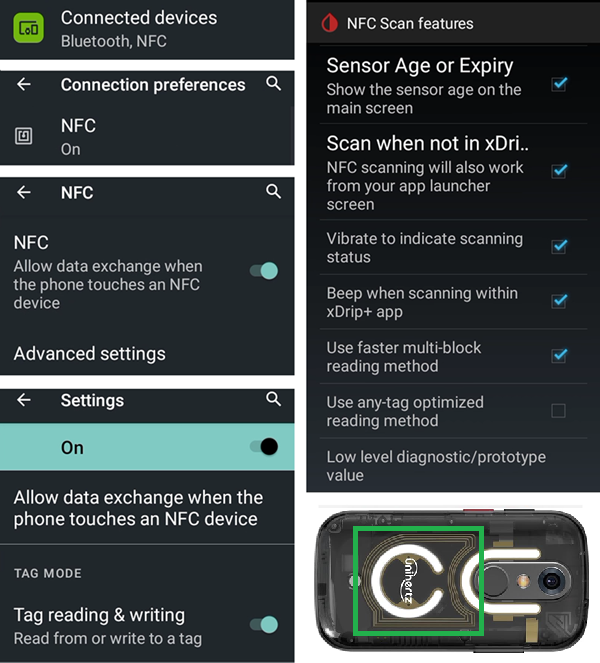

# Jelly

## Jelly Star Mini

**Features**

* Android 13
* 8 GB RAM

**Vantagens**

* Ele é muito pequeno.
* Mesmo que você avise as pessoas, elas podem não ver o aparelho como um smartphone normal e vão aceitar mais facilmente uma exceção quando telefones normalmente não são permitidos.

**Desvantagens**

* Recomendado só para loopers com experiência (algumas configurações são difíceis de reconhecer; você precisa saber, pela experiência com um telefone Android grande com AAPS, como e onde cada coisa fica. Alguns botões do AAPS são difíceis de tocar: é preciso um toque cuidadoso, e com dedos grossos não dá.)
* Só pode ser usado como telefone do loop (LooperPhone). É melhor ter um smartphone normal no bolso. 

### Otimização da duração da bateria

O Jelly vem com fortes recursos de otimização que **devem** ser desativados para o AAPS (e para outros apps DIY como BYODA, xDrip, OOP2, Juggluco etc.).

Você pode deixar a Assistência inteligente ativada, mas ela **deve ser desativada para os apps DIY**.

Você pode ativar o NFC para sensores Libre.

### Otimização da duração da bateria

Para evitar interferência com o **AAPS**, o 'uso da bateria' do Jelly Star deve ser desativado selecionando 'sem restrições' para o **AAPS** (e para outros **apps DIY** como BYODA, xDrip, OOP2, Juggluco etc.).

### Google Play Protect

Lembre-se de desativar o Google Play Protect.

### Conexão remota para o Wear apk

Em alguns smartwatches, como o Samsung Galaxy, a opção 'Remote Connection' (Conexão remota) nos Advanced Features (Recursos avançados) do Samsung Galaxy deve estar **ativada** para usar o Jelly, o **Wear.apk** & o **AAPS** remotamente via Wi-Fi.

