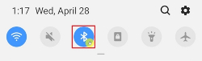
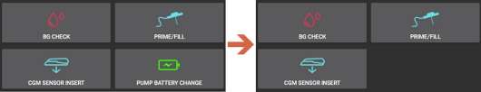

# Diaconn G8

```{contents} Table of contents
:depth: 1
:local: true
```

## Recursos da bomba com o AAPS

* Comunica-se com o **AAPS** pelo Bluetooth do próprio celular, sem um dispositivo de comunicação adicional.
* As mudanças de horário de verão e de fuso horário devem ser feitas manualmente.

## Pareamento Bluetooth da bomba de insulina

- Toque no **menu** (☰) no canto superior esquerdo.


- Toque em **Configuração** > **Bomba** e selecione **Diaconn G8**.


Depois de selecionado, o cartão **Diaconn G8** mostra dois botões, **Configurações** e **Abrir plugin**:


**Configurações** abre as configurações do driver da Diaconn G8 (veja [Configuração de opções da bomba de insulina Diaconn G8](#diaconn-g8-insulin-pump-option-setting) abaixo).

**Abrir plugin** (ou **Gerenciar** > **Bomba**) abre a tela da bomba Diaconn G8. Antes de a bomba ser pareada, ela fica assim:


```{admonition} Older screenshot
:class: note
A captura de tela acima é de uma versão anterior do **AAPS**. No **AAPS** 4, o pareamento começa pelo botão **Parear** na tela da bomba; não existe a configuração **Bomba selecionada**.
```

- Na tela da bomba, toque em **Parear**. A tela **Pareamento de bomba Diaconn** se abre e o **AAPS** procura bombas próximas.
- Toque no número do modelo da sua bomba de insulina quando ele aparecer na lista (por exemplo, **DIACONN-65010**).


- Há duas formas de ver o número do seu modelo:

1. Os últimos 5 dígitos do número de série (SN) na parte de trás da bomba.
2. Clique no botão O > Information > BLE > últimos 5 dígitos.


- Depois de selecionar sua bomba, aparece uma janela pedindo um código PIN. Digite o número PIN mostrado na sua bomba para concluir a conexão.

 

- Quando aparecer **Pareamento concluído!**, toque em **OK** para voltar à tela da bomba.

## Verificação do status da bomba e sincronização dos logs

- Depois que sua bomba estiver conectada, abra a tela da bomba (**Gerenciar** > **Bomba**). Ela mostra o status da bomba (bateria, reservatório, última conexão, último bólus, taxa basal e mais).
- Toque em **Atualizar** para conectar à bomba, atualizar o status e sincronizar os logs.
- Toque em **Histórico da Bomba** para ver o histórico lido da bomba.


```{admonition} Older screenshot
:class: note
A captura de tela acima é de uma versão anterior do **AAPS**. No **AAPS** 4, o status da bomba é mostrado na tela da bomba (**Gerenciar** > **Bomba**) e sincronizado com o botão **Atualizar**.
```

(diaconn-g8-bluetooth-troubleshooting)=

## Solução de problemas de Bluetooth

**O que fazer quando a conexão Bluetooth com a bomba é instável.**

### Método 1) Reinicie o AAPS e depois verifique a bomba novamente

- Toque no **menu** (☰) no canto superior esquerdo.
- Toque em **Sair** na parte de baixo do menu.


- Inicie o **AAPS** novamente e verifique a conexão com a bomba.

### Método 2) Se o primeiro método não funcionar, desconecte o Bluetooth e conecte de novo.

- Pressione e segure o botão Bluetooth na parte de cima por cerca de 3 segundos.



- Clique no botão de configuração da bomba de insulina Diaconn G8 pareada.


- Desfaça o pareamento.


- No **AAPS**, abra a tela da bomba (**Gerenciar** > **Bomba**), toque em **Desfazer pareamento** e confirme **Redefinir informações de pareamento?**.
- Repita o processo de pareamento Bluetooth da bomba (veja acima).

## Mais informações

(diaconn-g8-insulin-pump-option-setting)=

### Configuração de opções da bomba de insulina Diaconn G8

- **Configuração** > **Bomba** > **Diaconn G8** > **Configurações**
- Ou, na tela da bomba (**Gerenciar** > **Bomba**), toque no ícone de configurações (engrenagem) no canto superior direito.


- **Velocidade do bólus** define a velocidade com que a bomba aplica um bólus.
- Se a opção **Registrar troca de reservatório** estiver ativada, os detalhes são enviados automaticamente para o careportal quando ocorre um evento "Troca de insulina".
- Se a opção **Registrar troca de agulha** estiver ativada, os detalhes são enviados automaticamente para o careportal quando ocorre um evento "Troca de cânula".
- Se a opção **Registrar troca de tubo** estiver ativada, os detalhes são adicionados automaticamente como uma nota quando ocorre um evento "Troca de tubo".
- Se a opção **Registrar troca de bateria** estiver ativada, os detalhes são enviados automaticamente para o careportal quando ocorre um evento "Troca de bateria". Você também pode registrar uma troca de bateria manualmente com **Gerenciar** > **Troca de Bateria da Bomba**. (Observação: para trocar a bateria, pare todas as funções de infusão em andamento antes de continuar.)
- **Diaconn Cloud Sync** envia os logs da bomba para a Diaconn Cloud.



```{admonition} Older screenshot
:class: note
A captura de tela acima é de uma versão anterior do **AAPS**. No **AAPS** 4, uma troca de bateria é registrada com **Gerenciar** > **Troca de Bateria da Bomba**; não existe a aba **Ações**.
```

### Função de bólus estendido

- Se você usar o bólus estendido, o loop fechado será desativado.
- Veja [esta página](#extended-bolus-and-why-they-wont-work-in-closed-loop-environment) para saber por que o bólus estendido não funciona em um ambiente de loop fechado.

## Onde obter ajuda

O desenvolvimento do driver da Diaconn G8 é feito pela comunidade de forma **voluntária**. Antes de pedir ajuda:

1. **Leia** a seção correspondente desta documentação para confirmar como a função deve funcionar.
2. **Pergunte** no canal *#AAPS* do [Discord](https://discord.gg/4fQUWHZ4Mw) ou em um dos outros [canais da comunidade](../GettingHelp/WhereCanIGetHelp.md).
3. **Informe um bug** procurando nos [issues existentes](https://github.com/nightscout/AndroidAPS/issues); se o seu não estiver na lista, abra um [novo issue](https://github.com/nightscout/AndroidAPS/issues) e anexe seus [arquivos de log](../GettingHelp/AccessingLogFiles.md).

Ao pedir ajuda, informe a marca e o modelo do seu celular, a versão do Android, a versão do **AAPS** e uma descrição simples do problema (o que mudou, quando funcionou pela última vez).
