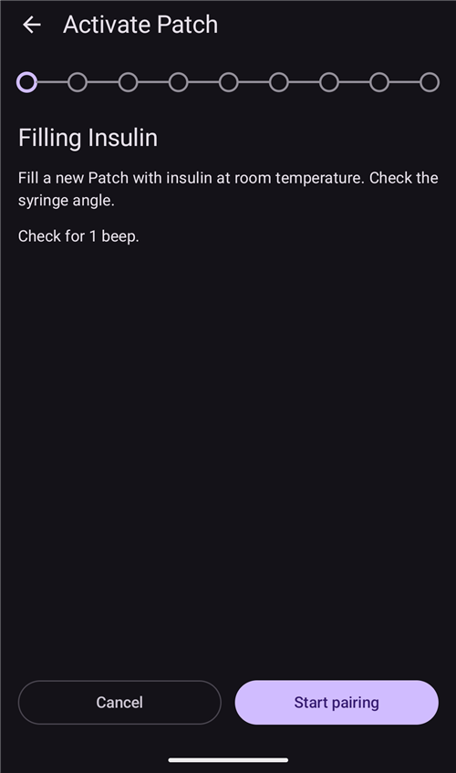

# EOPatch2

O patch precisa de insulina de ação rápida U-100, como NovoRapid ou Humalog. Use a insulina de ação rápida que o seu médico receitou para você.

A menor dose que o patch pode aplicar é 0,05 U. Defina todas as taxas basais do seu **Perfil** com pelo menos 0,05 U/h, em passos de 0,05 U/h. Caso contrário, o **AAPS** arredonda cada taxa para o valor de 0,05 U/h mais próximo (nunca para 0) e usa as taxas que o patch realmente aplica, então o total de insulina por dia fica um pouco diferente do seu **Perfil**. Da mesma forma, os bólus devem ser de pelo menos 0,05 U.

```{contents} Table of contents
:depth: 1
:local: true
```

## Recursos da bomba com o AAPS

* Comunica-se com o **AAPS** pelo Bluetooth do próprio celular, sem um dispositivo de comunicação adicional.
* As mudanças de horário de verão e de fuso horário devem ser feitas manualmente.

## Configuração da bomba

1. Abra o **menu** (☰) no canto superior esquerdo da tela principal do **AAPS** e selecione **Configuração**.
1. Na seção **Bomba**, selecione **EOPatch2**.
1. Pressione a tecla Voltar para retornar à tela principal.

 

Depois de selecionado, o cartão **EOPatch2** mostra dois botões, **Configurações** e **Abrir plugin**:


## Configurações

Abra as configurações do EOPatch2 de uma destas duas formas:

* pressione **Configurações** no cartão **EOPatch2** em **Configuração**, ou
* abra a tela da bomba (**Gerenciar** → **Bomba**) e pressione o ícone de engrenagem no canto superior direito.

Há três configurações:


### Reservatório baixo [Unidades]

Um aviso aparece quando a insulina restante no patch cai para esta quantidade ou menos. Você pode definir de 10 a 50 U, em passos de 5 U. O padrão é 10 U.

### Lembrete de Expiração

Lembra você de quanto tempo falta para o patch atual expirar. Você pode definir de 1 a 24 horas, em passos de 1 hora. O padrão é 4 horas.

### Lembrete do sinal sonoro do patch

Quando esta opção está ligada, o patch emite um bipe quando um bólus, um bólus estendido ou uma basal temporária começa e quando termina. Ela não tem efeito sobre a sua basal normal. O padrão é desligado.

## Ativar um novo patch

### Abrir o assistente de ativação

Abra a tela da bomba com **Gerenciar** → **Bomba** (ou pressione **Abrir plugin** no cartão **EOPatch2** em **Configuração**). Quando nenhum patch está ativo, a tela mostra **Não ativado** e um botão **Ativar patch** na parte de baixo.

Pressione **Ativar patch** para iniciar o assistente.


O assistente guia você em cada etapa. A linha de pontos na parte de cima mostra em que ponto você está.

```{note}
Se você nunca ativou um **Perfil** no **AAPS**, o assistente mostra primeiro uma página **Perfil necessário**. Selecione o perfil a usar e pressione **Ativar perfil**.
```

### Preencher com insulina

Insira a agulha da seringa na porta de preenchimento de insulina do patch. Empurre o êmbolo devagar para encher o patch. Quando houver mais de 80 U no patch, ele emite um bipe e liga (inicializa).

Quando ouvir o bipe, pressione **Iniciar pareamento**.



```{warning}
- Não gire a alavanca de inserção da agulha até que o assistente peça. Girar a alavanca cedo demais pode causar problemas sérios durante o preenchimento ou a verificação de segurança.
- O patch comporta de 80 a 200 U. Se você colocar menos de 80 U, o patch não funciona.
- Tire a insulina da geladeira 15 a 30 minutos antes de preencher, para que ela fique em temperatura ambiente. A insulina deve estar a pelo menos 10 °C.
```

### Pareamento do patch

O **AAPS** agora tenta parear com o patch automaticamente. Durante o pareamento, aparecem dois pedidos de pareamento Bluetooth do Android. Pressione **OK** no primeiro. Pressione **OK** de novo no segundo, que mostra uma chave de acesso (passkey).

```{warning}
- Mantenha o patch e o seu celular a no máximo 30 cm um do outro durante o pareamento.
- Depois que o patch inicializa, ele emite um bipe a cada 3 minutos até que o pareamento termine.
- Você deve terminar a ativação do patch em até 60 minutos depois que ele inicializa. Se não conseguir, descarte o patch.
```

  

```{admonition} Older screenshot
:class: note
As duas capturas de tela do pareamento Bluetooth são de uma versão anterior do **AAPS**: a tela do **AAPS** por trás do pedido de pareamento do Android é diferente no **AAPS** 4.
```

### Selecionar insulina

Selecione a insulina com que você preencheu o patch e pressione **Seguinte**. O **AAPS** aplica uma troca de perfil com essa insulina após a ativação.

### Prepare-se para colocar o patch

Retire a fita adesiva do patch e pressione **Seguinte**.

Se uma agulha estiver para fora, ou se o patch estiver molhado, sujo ou com a fita adesiva dobrada, pressione **Descartar** e use um patch novo.


### Local

Esta etapa só aparece se **Gerenciar rodízio do local da bomba** estiver ativado nas configurações de rotação do local. Toque no lugar do desenho do corpo onde você vai colocar o patch e pressione **Seguinte**, ou pressione **Ignorar**.

### Colocando o patch

A insulina deve ir para um local com tecido gorduroso sob a pele, mas com poucos nervos ou vasos sanguíneos. O abdômen, o braço ou a coxa são boas escolhas. Limpe e seque o local e depois cole o patch na pele.

Verifique o local de infusão e depois pressione **Iniciar verificação de segurança**.

```{warning}
- Pressione as bordas da fita do patch de forma uniforme, para que todo o patch fique bem colado na pele.
- Se o patch não colar por completo, pode entrar ar entre o patch e a pele. Isso enfraquece o adesivo e a resistência à água do patch.
```


### Verificação de segurança

A verificação de segurança leva cerca de 30 segundos. Quando ela termina, o patch emite um bipe. Se ela falhar, pressione **Tentar novamente**.

```{warning}
Para um uso seguro, não gire a alavanca de inserção da agulha até que a verificação de segurança esteja concluída.
```

 

```{admonition} Older screenshot
:class: note
As capturas de tela de **Prepare-se para colocar o patch** até **Verificação de segurança** são de uma versão anterior do **AAPS** e podem ser diferentes no **AAPS** 4.
```

### Inserindo a agulha

Segure o patch com firmeza. Gire a alavanca de inserção da agulha para cima em mais de 100° para inserir a agulha. O patch emite um bipe quando a agulha é inserida corretamente. Depois, continue girando a alavanca até o fim para removê-la. Pressione **Seguinte**.

```{caution}
Se você for para a próxima etapa sem ouvir o bipe, aparece um **Erro de inserção da agulha**. Confira o bipe e pressione **Tentar novamente**. Se o erro continuar, pressione **Descartar** para desativar o patch.
```

### Ativação do patch concluída

A última página confirma que o patch está ativo e que ele vai lembrar você quando estiver perto do prazo de expiração. Pressione **Finalizar** para voltar à tela da bomba.

## Descartar o patch

Troque o patch quando ele estiver com pouca insulina, quando expirar ou se estiver com defeito. Recomendamos usar cada patch por no máximo 84 horas depois que ele inicializa.

1. Abra a tela da bomba (**Gerenciar** → **Bomba**). Enquanto um patch estiver ativo, pressione **Descartar patch**.
1. A página **Descartar patch** mostra o tempo restante e a insulina restante no patch. Pressione **Descartar patch**.
1. Uma caixa de diálogo pede que você confirme. Pressione **Descartar patch** de novo.
1. Quando o patch for desativado, o assistente mostra **O descarte do patch foi concluído.** Retire o patch do corpo e pressione **Confirmar**.

Depois disso, o assistente segue direto para a ativação de um novo patch (veja acima). Pressione a seta de voltar se quiser parar aqui.

Enquanto nenhum patch estiver ativo, o **AAPS** mostra a bomba como suspensa e registra uma basal temporária de 0 U/h, para que nenhuma insulina basal seja contada no IOB até que o próximo patch seja ativado.

   

```{admonition} Older screenshot
:class: note
A captura de tela acima é de uma versão anterior do **AAPS**. No **AAPS** 4, você abre a tela da bomba em **Gerenciar** → **Bomba**, e o botão nela se chama **Descartar patch**.
```

```{admonition} If the patch does not respond
:class: warning
Se o **AAPS** não conseguir se comunicar com o patch, pode aparecer uma página sobre desligar o alarme do patch manualmente: retire o patch do corpo, descole a fita adesiva e use um clipe para pressionar com firmeza o furo ao lado da porta de preenchimento de insulina.

A página **Descartar patch** também tem um botão **Redefinição forçada**. Ele apenas remove o patch do **AAPS**, sem enviar nenhum comando ao patch. O patch continua aplicando insulina até a bateria acabar ou até você desligá-lo manualmente. Use-o somente se o descarte normal falhar, e retire o patch do corpo.
```

## Suspender e retomar a administração de insulina

Suspender a administração de insulina também cancela qualquer bólus estendido e basal temporária. Quando você retoma, eles **não** são reiniciados. Enquanto a administração de insulina estiver suspensa, o patch emite um bipe a cada 15 minutos.

### Suspender a administração de insulina

1. Abra a tela da bomba (**Gerenciar** → **Bomba**) e pressione **Suspender bomba**.
1. Uma caixa de diálogo explica o que será suspenso. Pressione **Confirmar**.
1. Na caixa de diálogo **Tempo de suspensão da basal**, escolha por quanto tempo suspender: 30 min, 1 hora, 1 hora 30 min ou 2 horas. Pressione **Confirmar**.

A administração de insulina fica suspensa pelo tempo que você escolheu.

  

```{admonition} Older screenshot
:class: note
A captura de tela acima é de uma versão anterior do **AAPS**. No **AAPS** 4, você abre a tela da bomba em **Gerenciar** → **Bomba**, e o botão nela se chama **Suspender bomba**.
```

### Retomar a administração de insulina

1. Abra a tela da bomba (**Gerenciar** → **Bomba**) e pressione **Retomar bomba**.
1. Na caixa de diálogo **Retomar administração de insulina**, pressione **Confirmar**.

 

```{admonition} Older screenshot
:class: note
A captura de tela acima é de uma versão anterior do **AAPS**. No **AAPS** 4, você abre a tela da bomba em **Gerenciar** → **Bomba**, e o botão nela se chama **Retomar bomba**.
```

```{warning}
Quando o tempo de suspensão termina, o **AAPS** mostra o aviso **Fim da suspensão de insulina**. A administração de insulina **não** é reiniciada até que você a confirme. Se você não confirmar, pode ter hiperglicemia.
```

(eopatch2-alarms-and-warnings)=

## Alarmes e avisos

### Alarmes

Os alarmes são para situações urgentes, de prioridade máxima, e exigem uma ação sua imediatamente. O **AAPS** toca um alarme que continua até você confirmá-lo, e mostra a mensagem como notificação na tela **Visão geral**. Um alarme significa que há um problema com o patch em uso. Em muitos casos, o patch precisa ser descartado e substituído por um novo.

Quando você pressiona **Confirmar** na notificação, o **AAPS** trata o alarme. Na maioria dos alarmes, isso desativa o patch. No alarme **Temperatura inadequada**, o botão é **Tentar novamente**.

 

```{admonition} Older screenshot
:class: note
As capturas de tela dos alarmes são de uma versão anterior do **AAPS** e podem ser diferentes no **AAPS** 4.
```

Os diferentes alarmes são explicados abaixo.

| Alarme                      | Explicação                                                                                                                                                             |
| --------------------------- | ---------------------------------------------------------------------------------------------------------------------------------------------------------------------- |
| Reservatório vazio          | O patch ficou sem insulina.                                                                                                                                            |
| Patch expirado              | O tempo de uso do patch acabou e ele não pode mais aplicar insulina.                                                                                                   |
| Oclusão                     | O caminho da insulina no patch parece estar bloqueado.                                                                                                                 |
| Falha no autoteste ao ligar | O patch encontrou um erro inesperado no autoteste depois de inicializar.                                                                                               |
| Temperatura inadequada      | O patch está fora da sua temperatura normal de operação enquanto você o ativa ou usa. Leve o patch para um lugar com temperatura adequada (4,4 a 37 °C).               |
| Erro de inserção da agulha  | A agulha não foi inserida corretamente durante a ativação. Verifique se a borda de inserção da agulha do patch e a alavanca de inserção da agulha estão em linha reta. |
| Erro na bateria do patch    | A bateria interna do patch está quase acabando e o patch vai desligar.                                                                                                 |
| Erro na ativação do patch   | O patch não foi totalmente ativado em até 60 minutos depois de inicializar.                                                                                            |
| Erro do patch               | O patch encontrou um erro inesperado durante a ativação ou o uso.                                                                                                      |

### Avisos

Os avisos são para situações de prioridade média ou baixa. Um aviso aparece como notificação na tela **Visão geral**.


```{admonition} Older screenshot
:class: note
Esta captura de tela é de uma versão anterior do **AAPS**: no **AAPS** 4, o aviso aparece na tela principal, que tem outra aparência.
```

Os diferentes avisos são explicados abaixo.

| Aviso                        | Explicação                                                                                                                            |
| ---------------------------- | ------------------------------------------------------------------------------------------------------------------------------------- |
| Fim da suspensão de insulina | O tempo de suspensão que você escolheu acabou. Pressione **Retomar bomba** na notificação para reiniciar a administração de insulina. |
| Reservatório baixo           | A insulina restante no patch está abaixo da quantidade definida em **Alertas de Reservatório Baixo**.                                 |
| Vida útil do patch expirada  | O período de uso do patch acabou.                                                                                                     |
| O patch expirará em breve    | O patch deve ser descartado em 1 hora.                                                                                                |
| Ativação do patch incompleta | A ativação do patch foi interrompida por mais de 3 minutos depois do pareamento. Abra a tela da bomba e termine a ativação do patch.  |
| Bateria do patch fraca       | A bateria do patch está fraca.                                                                                                        |

## Onde obter ajuda

O desenvolvimento do driver do EOPatch2 é feito pela comunidade de forma **voluntária**. Antes de pedir ajuda:

1. **Leia** a seção correspondente desta documentação para confirmar como a função deve funcionar.
2. **Pergunte** no canal *#AAPS* do [Discord](https://discord.gg/4fQUWHZ4Mw) ou em um dos outros [canais da comunidade](../GettingHelp/WhereCanIGetHelp.md).
3. **Informe um bug** procurando nos [issues existentes](https://github.com/nightscout/AndroidAPS/issues); se o seu não estiver na lista, abra um [novo issue](https://github.com/nightscout/AndroidAPS/issues) e anexe seus [arquivos de log](../GettingHelp/AccessingLogFiles.md).

Ao pedir ajuda, informe a marca e o modelo do seu celular, a versão do Android, a versão do **AAPS** e uma descrição simples do problema (o que mudou, quando funcionou pela última vez).
