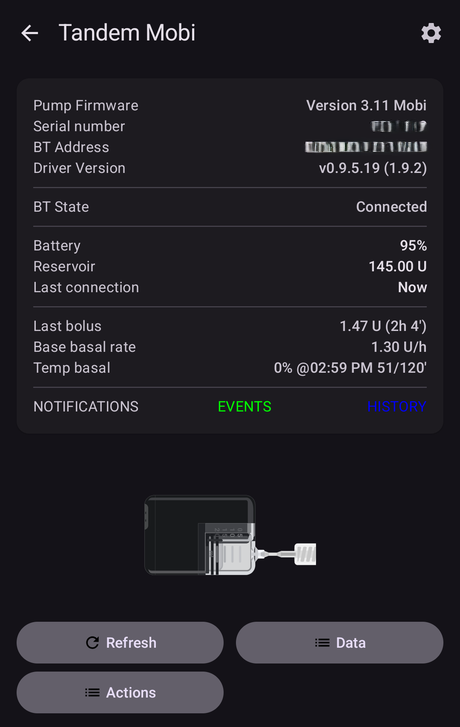

# Drivers de bombas futuros (possíveis)

This is a list of some pumps on the market, the status of their support in other looping systems, and their status in AAPS. At the end there is some information about what a pump needs to be "Loop capable".

    {contents} Índice
    :depth: 1
    :local: true

## Bombas em fase de integração no AAPS

**Em breve:** os drivers destas bombas estão em desenvolvimento e já funcionam em versões de teste.

Omnipod 5 ([Site](https://www.omnipod.com/))

Tandem: t:Mobi ([Site](https://www.tandemdiabetes.com/))

## Bombas compatíveis com loop

### Kaleido ([Site](https://www.hellokaleido.com/))

**Status de loop:** a bomba é candidata a loop, mas o protocolo ainda é desconhecido. O fabricante não tem interesse em código aberto.

**Requisito de hardware para o AAPS:** nenhum. Parece ter Bluetooth.

### Tandem: t:slim X3 ([Site](https://www.tandemdiabetes.com/about-us/pipeline))

**Status de loop:** possível candidata a loop no futuro. A esperança é que a t:slim X3 permita controle total pelo celular, o que possibilitaria o suporte no AAPS, mas o prazo e as funções ainda são desconhecidos.

**Requisito de hardware para o AAPS:** nenhum. Espera-se que ela tenha Bluetooth.

**Comentários:** ainda não foi lançada. A t:slim X3 parece ser repetidamente deixada em segundo plano no planejamento da Tandem, em favor da t:Mobi (incluindo uma versão sem tubo) e da Sigi (a bomba de patch da empresa).

### Twiist ([Site](https://www.twiist.com/))

**Status de loop:** candidata a loop.

**Requisito de hardware para o AAPS:** nenhum. Ela tem Bluetooth.

### Bomba de insulina Willcare ([Site](http://shinmyungmedi.com/en/))

**Loop status:** At the moment it is not a Loop candidate, but their staff contacted us and they are interested in making the pump loopable (it seems to be missing only the get/set profile commands).

**Requisito de hardware para o AAPS:** nenhum. Parece ter Bluetooth.

**Comentários:** como a empresa tem interesse em integração com o AAPS, ela mesma pode fazer a implementação.

### Ypsopump ([Site](https://www.ypsomed.com/))

**Status de loop:** candidata a loop. O protocolo Bluetooth da bomba foi decifrado pela comunidade (engenharia reversa), então a comunicação com ela é possível em princípio.

**Requisito de hardware para o AAPS:** nenhum. Ela tem Bluetooth.

**Comentários:** a Ypsopump protege a sua comunicação Bluetooth com uma criptografia forte de terceiros. Trabalhar com ela é tecnicamente difícil, o que torna difícil criar e manter um driver confiável. Ainda não há um driver do AAPS pronto para uso real.

## Bombas que não são mais vendidas (empresas que não operam mais)

### Animas Vibe

### Animas Ping

### Cellnovo

### Accu-Chek Insight

**Comentários:** fim do suporte em março de 2025.

## Bombas não compatíveis com loop

### Medtronic Bluetooth

**Comentários:** a Medtronic [desistiu](https://www.tidepool.org/blog/tidepool-loop-partner-update-ace-pumps).

### Tandem: t:slim X2 ([Site](https://www.tandemdiabetes.com/))

**Comentários:** o protocolo Bluetooth da Tandem foi decifrado (engenharia reversa), mas na t:slim X2 só é possível aplicar bólus — a basal não pode ser controlada — então ela não pode ser usada com segurança para loop. É pouco provável que isso mude, a menos que a Tandem permita o controle total da X2 pelo celular, o que provavelmente viria com a t:slim X3.

### Accu-Chek Solo

**Comentários:** a comunidade ainda não conseguiu se comunicar com a bomba Solo.

## Requisitos para que uma bomba seja compatível com loop

**Pré-requisito**

- A bomba precisa ter algum tipo de controle remoto. (BT, radiofrequência etc.)
- O protocolo foi hackeado/documentado/etc.

**Requisito mínimo**

- Definir taxa basal temporária
- Obter status
- Cancelar taxa basal temporária

**Para oref1 (SMB) ou para dar bólus:**

- Definir bólus

**Bom ter**

- Cancelar bólus
- Obter perfil basal (quase um requisito)
- Definir perfil basal (bom ter)
- Ler histórico 

**Outros (não obrigatório, mas bom ter)**

- Definir bólus estendido
- Cancelar bólus estendido
- Ler histórico
- Ler TDD

### Suporte a outras bombas

Se você quiser saber o status de outras bombas, fale conosco no Discord.