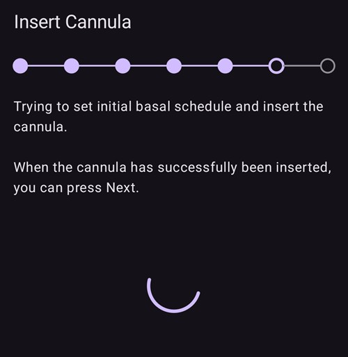
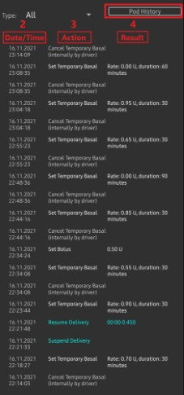
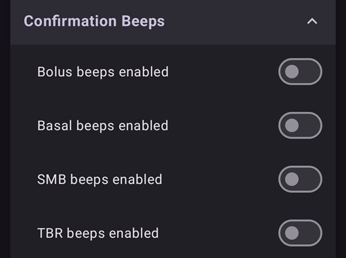

# Omnipod DASH

Estas instruções são para configurar a bomba da geração **Omnipod DASH** **(NÃO o Omnipod Eros)**. O driver DASH é uma forma bem estabelecida de fazer loop com o Omnipod.

```{contents} Table of contents
:depth: 1
:local: true
```

## Especificações do Omnipod DASH

Principais características do **Omnipod DASH** ('DASH'):

- Os pods DASH são identificados por uma **tampa azul da agulha** (o pod EROS, mais antigo, tem uma tampa transparente). Fora isso, os pods são idênticos em dimensões físicas.
- O DASH não precisa de um dispositivo de ligação/ponte BLE (NÃO é necessário RileyLink, OrangeLink ou EmaLink).
- A conexão Bluetooth do DASH é usada só quando um comando é enviado (por exemplo, um bólus), e é desconectada logo depois do envio do comando.
- O **AAPS** vai esperar o pod ficar acessível para enviar comandos.
- Na ativação do pod, o **AAPS** vai encontrar um novo pod DASH e se conectar a ele.
- Alcance esperado a partir do telefone: 5-10 metros (pode variar).

(omnipod-dash-constraints)=

## Restrições/problemas conhecidos do Omnipod DASH no AAPS
- A recomendação geral é usar o **AAPS** no Android 14 ou 16. A comunidade relatou muitos [problemas](https://github.com/nightscout/AndroidAPS/issues/3471) com o Android 15. Mas, se você usa o Android 15, provavelmente vai precisar ligar o **Vínculo Bluetooth** (na seção **Configurações Avançadas** das [Configurações do Dash](#omnipod-dash-advanced-settings)) para ativar e usar os Pods com sucesso; veja [Resolução de problemas](../GettingHelp/GeneralTroubleshooting.md) para mais informações sobre as configurações de vínculo.
- Mudanças de horário de verão e de fuso horário não são aplicadas automaticamente. Depois de uma mudança de relógio, você precisa atualizar o pod manualmente: pressione **Atualizar** na tela da bomba DASH e depois pressione **Configurar a hora** (mostrado quando os fusos horários do pod e do telefone são diferentes) ou faça uma **Troca de Perfil** (veja [Mudança de fuso horário com o Omnipod Dash](#timezone-traveling-with-pumps)).
- O Dash só aceita taxa basal em passos de 0,05 U/h. Se você tentar definir a basal com passos de 0,01 no seu **perfil do AAPS**, o AAPS não vai mostrar um aviso, mesmo que o pod arredonde a taxa para passos de 0,05. Se você abrir o **Histórico do Pod** na tela da bomba DASH, ele vai mostrar que foi definida uma basal de 0,05. Isso também significa que a menor taxa basal permitida pelo DASH no **AAPS** é 0,05 U/h.
- O arquivo de configurações contém a sessão do Pod ativo. Exporte as suas configurações depois de cada ativação de Pod, e leia [Exportar e importar configurações](#omnipod-dash-export-import) antes de importar configurações.
- Ao definir um novo perfil basal, o DASH vai suspender a administração antes de definir o novo **Perfil** basal. Se houver uma interrupção ou um erro de comunicação, o perfil basal não vai reiniciar automaticamente. Veja a seção [Retomar a administração de insulina](#omnipod-dash-resuming-insulin-delivery) para mais detalhes.
- Se os alertas estiverem configurados e o pod estiver perto de expirar, o pod vai continuar bipando até os alertas serem silenciados; veja [Silenciar alertas do Pod](#omnipod-dash-silencing-pod-alerts) para mais detalhes.
- Existem vários problemas conhecidos com o Bluetooth que podem causar problemas na ativação do pod. Veja [Problemas relacionados ao Bluetooth](../GettingHelp/BluetoothTroubleshooting.md) para o problema conhecido e as soluções para esses problemas.

(hardware-software-requirements)=

(omnipod-dash-hardware-software-requirements)=
## Requisitos de hardware e software

- O Omnipod DASH é identificado pela tampa azul da agulha.


- **Um telefone Android compatível** com Bluetooth Low Energy (BLE) (veja [Telefones](../Getting-Started/Phones.md) para mais informações); além disso, as informações abaixo vão ajudar você com outros pontos importantes para ativar e usar o DASH com sucesso em um telefone compatível:
    -  O driver Omnipod Dash do **AAPS** se conecta ao Pod DASH por Bluetooth.  
      O **AAPS** estabelece automaticamente uma nova conexão Bluetooth com o Pod toda vez que precisa enviar um comando (por exemplo, um bólus); depois de enviar o comando, a conexão Bluetooth é desconectada imediatamente.
       - **NOTA:**
         - A conexão Bluetooth pode ser interrompida/perturbada por outros dispositivos Bluetooth ligados ao telefone que executa o **AAPS**, como fones de ouvido etc. Dispositivos como esses podem causar erros de conexão ou problemas na ativação do pod em alguns modelos de telefone. É uma boa ideia ver a lista de [configurações de hardware testadas](https://docs.google.com/spreadsheets/u/1/d/e/2PACX-1vScCNaIguEZVTVFAgpv1kXHdsHl3fs6xT6RB2Z1CeVJ561AvvqGwxMhlmSHk4J056gMCAQE02sAWJvT/pubhtml?gid=683363241&single=true) para conhecer configurações que funcionam ao escolher o telefone para usar com o Omnipod DASH.
         - Existem vários problemas conhecidos com o Bluetooth que podem causar problemas na ativação do pod (veja [Resolução de problemas](#troubleshooting) para conselhos sobre outros problemas de Bluetooth), especialmente a seção [Problemas relacionados ao Bluetooth](#omnipod-dash-bluetooth-related-issues).
    - O telefone precisa ter **Android 12 ou mais novo**, com o **AAPS** compilado e instalado seguindo as instruções de [**Compilar o APK**](../SettingUpAaps/BuildingAaps.md). Use sempre a versão mais recente lançada.
- Um [**Monitor Contínuo de Glicose (CGM)**](../Getting-Started/CompatiblesCgms.md) compatível

As instruções abaixo explicam como ativar uma nova sessão de pod usando o **AAPS**. Espere até o seu Pod atual estar perto de expirar, porque você vai precisar ativar um novo Pod com o **AAPS**. Depois que um pod é desativado, ele não pode ser reutilizado/reativado; a desativação é definitiva.

## Antes de começar

Tenha certeza de que você leu e entendeu todo este guia, leu e entendeu a seção **Antes de começar**, e também **[Restrições e problemas do Omnipod e do AAPS](#omnipod-dash-constraints)**, para evitar um problema conhecido.

### **SEGURANÇA EM PRIMEIRO LUGAR** - Você **NÃO DEVE** tentar conectar o **AAPS** a um pod pela primeira vez sem ter acesso a tudo o que está abaixo:
1. Pods extras (3 ou mais de reserva)
2. Insulina de reserva e material para MDI
3. Um PDM Omnipod funcionando (caso o **AAPS** falhe)
4. Telefones compatíveis são obrigatórios! (Veja [Requisitos de hardware/software](#hardware-software-requirements))
5. A versão correta do AAPS compilada e instalada

### O seu PDM Omnipod Dash vai ficar sem uso depois que o driver Dash do AAPS ativar o seu pod.
- Antes de usar o **AAPS**, você ou o seu cuidador precisavam controlar o Pod com o PDM Omnipod (ou, em algumas regiões, com um aplicativo de telefone) para enviar comandos ao seu DASH (por exemplo, um bólus).
- O DASH só aceita a conexão de um único dispositivo Bluetooth (por exemplo, PDM ou telefone) para controlar e enviar comandos.
- O dispositivo que ativa o pod com sucesso é, a partir desse momento, o único dispositivo que pode se comunicar com esse Pod. Isso significa que, depois de ativar um DASH com o seu telefone Android usando o **AAPS**, **você não vai mais poder usar o seu PDM com esse pod!** Enquanto esse Pod estiver ativo, o driver Dash do **AAPS** no seu telefone Android é o novo PDM do seu pod.
- **NÃO jogue fora o seu PDM!** É recomendado guardá-lo como reserva e para emergências, por exemplo quando você perder o telefone ou o **AAPS** não estiver funcionando corretamente.

### O seu pod **NÃO VAI** parar de administrar insulina quando não estiver conectado ao AAPS.
As taxas basais padrão são programadas no pod na ativação, como definidas no [**Perfil**](../SettingUpAaps/YourAapsProfile.md) ativo atual.  
Enquanto o **AAPS** estiver funcionando, ele envia comandos de ajuste da taxa basal que duram no máximo 120 minutos.  
Quando, por algum motivo, o pod não recebe nenhum comando novo (por exemplo, porque a comunicação foi perdida por causa da distância Pod ➜ telefone), o pod volta automaticamente para as taxas basais padrão definidas no seu [**Perfil**](../SettingUpAaps/YourAapsProfile.md).

### Os Perfis do AAPS não aceitam intervalos de taxa basal de 30 minutos
Se você é novo no **AAPS** e está configurando o seu [**Perfil**](../SettingUpAaps/YourAapsProfile.md) de taxa basal pela primeira vez, saiba que taxas basais que começam na meia hora não são suportadas. Por exemplo, se no seu PDM Omnipod você tem uma taxa basal de 1,1 unidade que começa às 09:30 e dura 2 horas, terminando às 11:30, não é possível reproduzir exatamente este **Perfil** basal no **AAPS**.  
Você vai precisar mudar esta taxa basal de 1,1 unidade para o intervalo 9:00-11:00 ou 10:00-12:00. Mesmo que o próprio hardware do DASH aceite intervalos de 30 minutos no **Perfil** basal, o **AAPS** NÃO aceita esta função.

### Taxas basais de 0 U/h no Perfil NÃO são aceitas no AAPS
Embora o DASH aceite uma taxa basal zero, o **AAPS** usa múltiplos da taxa basal do **Perfil** do usuário para decidir o tratamento automático; ele não funciona com uma taxa basal zero.  
Em vez disso, uma taxa basal zero temporária pode ser obtida com a função "Desconectar bomba", ou com uma combinação de Desativar loop/basal temporária ou Suspender loop/basal temporária.  
**OBSERVAÇÃO:** A menor taxa basal permitida pelo DASH no **AAPS** é 0,05 U/h.

## Selecionar o Dash no AAPS

Existem **duas** formas de selecionar o driver Omnipod DASH no **AAPS**:

### Opção 1: Novas instalações

Quando você instala o **AAPS** pela primeira vez, o **Assistente de Configuração** guia você pelas principais funções e pelos requisitos de instalação do **AAPS**. Quando chegar à etapa **Bomba**, selecione **Omnipod Dash**.


Se você ainda não tem certeza, pode selecionar **Bomba virtual** por enquanto e selecionar o **Omnipod Dash** depois de configurar o **AAPS** (veja a Opção 2).

(omnipod-dash-option-2-config-builder)=
### Opção 2: A tela Configuração

Em uma instalação existente, você pode selecionar a bomba **Omnipod Dash** na tela **Configuração**:

1. Abra o **menu** (☰) no canto superior esquerdo da tela principal e selecione **Configuração**.
2. Toque em **Bomba** e selecione o botão de opção do **Omnipod Dash** (*"Integração da bomba para o Omnipod Dash (o novo modelo habilitado com Bluetooth com uma agulha de tampa azul)."*).

3. Depois de selecionado, o cartão **Omnipod Dash** mostra dois botões:
   - **Configurações** abre as [Configurações do Dash](#omnipod-dash-settings).
   - **Abrir plugin** abre a [tela da bomba DASH](#omnipod-dash-tab).

   

### Verificar a seleção do driver Omnipod

Para verificar se o **Omnipod Dash** está selecionado, abra **Gerenciar** (navegação inferior da tela principal) e toque em **Bomba**. A tela da bomba DASH abre, como mostrado na próxima seção.

(omnipod-dash-tab)=

## The DASH pump screen

A tela da bomba DASH é onde você gerencia os seus pods: ativa e desativa os pods, atualiza o status do pod, silencia alertas e vê o histórico do pod. Abra a tela com **Gerenciar** > **Bomba**, ou com **Abrir plugin** no cartão **Omnipod Dash** em **Configuração** > **Bomba**.

Esta é a tela sem um pod ativo:


E esta é a tela com um pod ativo:


O ícone **Configurações** (engrenagem) no canto superior direito abre as [Configurações do Dash](#omnipod-dash-settings).

***OBSERVAÇÃO:** Se um campo na tela da bomba mostrar (incerto), pressione **Atualizar** para atualizar o status do pod.*

### Campos

- **Endereço Bluetooth:** O endereço Bluetooth do pod.

- **Qualidade da conexão:** Com que confiabilidade o **AAPS** se conecta ao pod, mostrado como *conexões bem-sucedidas / todas as tentativas de conexão :: taxa de sucesso*, por exemplo `412/420 :: 98.10 %`. Depois de mais de 50 conexões bem-sucedidas, o valor fica amarelo abaixo de 90% e vermelho abaixo de 70%. Um valor baixo indica um problema de Bluetooth (veja [Problemas relacionados ao Bluetooth](#omnipod-dash-bluetooth-related-issues)).

- **Status da entrega:** O status bruto da administração informado pelo pod. Este campo só é mostrado em builds no modo de engenharia (engineering mode).

- **ID único:** O ID único que o **AAPS** deu ao pod durante a ativação.

- **Número do LOT:** O número do lote de produção do pod.

- **Número sequencial:** O número de sequência do pod.

- **Versão do firmware:** As versões do firmware e do Bluetooth do pod.

- **Tempo no Pod:** A hora atual no pod, com o seu fuso horário. O texto fica vermelho quando o fuso horário do pod é diferente do fuso horário do telefone, e amarelo quando a hora do pod está errada em mais de 10 minutos.

- **Pod expira:** A data e a hora em que o pod expira (72 horas depois da ativação). O texto fica amarelo nas últimas 4 horas antes desse momento. Ele nunca fica vermelho, porque o pod continua administrando insulina depois disso.

- **Fim obrigatório do Pod:** O fim do período de tolerância do pod (8 horas depois de **Pod expira**, para uma vida máxima do pod de 80 horas). O texto fica amarelo quando o período de tolerância começa (em **Pod expira**) e vermelho nas últimas 4 horas antes do fim obrigatório. Durante o período de tolerância, ele também mostra o tempo restante, por exemplo *(17m restantes)*. O pod para de administrar insulina no fim obrigatório e precisa ser trocado.

- **Status do Pod:** O estado do pod: **Nenhum Pod Ativo**, **Configuração em andamento**, **Funcionando**, **Suspenso** ou, depois de uma falha do pod, **ALARM**.

- **Última conexão:** Há quanto tempo o **AAPS** se comunicou com o pod pela última vez.

  - *Momentos atrás* - menos de 10 segundos atrás.

  - *Há menos de um minuto* - entre 10 e 60 segundos atrás.

  - *XX minutos atrás* - mais de 1 minuto atrás (e *X horas e XX minutos atrás* depois de uma hora).

- **Último bólus:** A quantidade do último bólus enviado ao pod e há quanto tempo ele foi dado. Um bólus não confirmado é marcado como (incerto).

- **Taxa Basal de base:** A taxa basal programada para a hora atual no seu **Perfil** basal.

- **Taxa Basal Temporária:** A taxa basal temporária (TBR) que está em andamento, com a hora de início e a duração. Este campo só é mostrado enquanto uma TBR está em andamento.

- **Reservatório:** Mostra *Mais de 50 U restantes* quando restam mais de 50 unidades no reservatório. Abaixo de 50 unidades, a quantidade exata é mostrada. O valor fica vermelho abaixo de 20 unidades.

- **Total entregue:** A quantidade total de insulina administrada a partir do reservatório. Isso inclui a insulina usada na purga.

- **Alertas ativos do Pod:** Alertas que estão ativos no pod agora, por exemplo *Pod vai expirar em breve* ou *Reservatório baixo*.

- **Erros:** A falha do pod, se o pod falhou, mostrada em vermelho como *Falha do Pod:* seguido do código e do nome da falha, por exemplo *Falha do Pod: 020 ALARM_OCCLUDED*. Veja o [Histórico do Pod](#omnipod-dash-view-pod-history) e os arquivos de log para erros passados e informações mais detalhadas. Veja [Falhas do Pod](#omnipod-dash-pod-failures).

- **Notificação do PDM:** Mostrado só depois de uma falha do pod. Mostra a falha do jeito que o PDM Omnipod teria mostrado: um título (por exemplo *Oclusão detectada*, *Reservatório vazio* ou *Pod expirado*), o que aconteceu (por exemplo *A administração de insulina foi interrompida. Troque o Pod agora.*) e um código *Ref:*.

### Botões

Os botões na parte de baixo da tela da bomba mudam conforme o estado do pod. Só são mostrados os botões que fazem sentido naquele momento.

- **Atualizar:** Pede ao pod o seu status atual.
  - *Use para atualizar o status do pod e para limpar campos que mostram (incerto).*
  - *Veja a seção [Resolução de problemas](#omnipod-dash-troubleshooting) abaixo para mais informações.*

- **Silenciar alertas:** Para os bipes de alerta do pod (por exemplo, expiração do pod ou reservatório baixo). Mostrado só enquanto o pod tem um alerta ativo. Veja [Silenciar alertas do Pod](#omnipod-dash-silencing-pod-alerts).

- **Reiniciar a administração:** Retoma a administração de insulina em um pod suspenso. Mostrado só quando a administração está suspensa. Veja [Retomar a administração de insulina](#omnipod-dash-resuming-insulin-delivery).

- **Configurar a hora:** Atualiza o pod para o fuso horário do seu telefone, enviando de novo o seu **Perfil** basal. Mostrado só quando o fuso horário do pod é diferente do fuso horário do seu telefone.

- [**Ativar Pod**](#omnipod-dash-activate-pod): purga e ativa um novo pod. Mostrado quando nenhum pod está ativo.

- [**Desativar Pod**](#omnipod-dash-deactivate-pod): Desativa o pod ativo. Mostrado assim que um pod é pareado com o **AAPS**, também quando uma ativação parou no meio (por exemplo, porque o pod falhou durante a ativação). O **AAPS** pede que você confirme antes de desativar o pod.

- **Faça os testes sonoros:** Faz o pod tocar um único bipe de teste.

- [**Histórico do Pod**](#omnipod-dash-view-pod-history): Mostra o histórico de atividades do pod ativo.

- **Descartar Pod:** Remove do **AAPS** um pod cuja ativação não foi concluída. Mostrado só quando a ativação de um pod parou no meio. O **AAPS** pede que você confirme. Depois do descarte, o **AAPS** não consegue mais se comunicar com esse pod: remova-o do seu corpo.


```{admonition} Older screenshot
:class: note
A captura de tela acima é de uma versão anterior do **AAPS**, que tinha um menu **Pod Management** (Gerenciamento do Pod) separado. No **AAPS** 4, todas essas ações, incluindo **Ativar Pod**, **Desativar Pod**, **Faça os testes sonoros** e **Histórico do Pod**, são botões com texto diretamente na tela da bomba.
```

(omnipod-dash-activate-pod)=

## Ativar Pod

1. Abra a tela da bomba DASH (**Gerenciar** > **Bomba**) e pressione **Ativar Pod**. O assistente de ativação abre.

   

   ```{admonition} Older screenshot
   :class: note
   A captura de tela acima é de uma versão anterior do **AAPS**. No **AAPS** 4, **Ativar Pod** é um botão diretamente na tela da bomba DASH, e não no menu **Pod Management** (Gerenciamento do Pod).
   ```

   Se você nunca ativou um **Perfil** no **AAPS** antes, o assistente mostra primeiro a etapa **Perfil necessário**: selecione o perfil a aplicar na ativação e continue.

2. A etapa **Preencha o Pod** é mostrada. Preencha um novo pod com insulina suficiente para 3 dias, **pelo menos 80 unidades**. Escute dois bipes do pod: eles indicam que a quantidade mínima de 80 unidades foi preenchida. Esvazie completamente a seringa de preenchimento, mesmo depois de ouvir os dois bipes. Ainda não remova a tampa da agulha do pod.

   ***OBSERVAÇÃO:** Ao calcular a quantidade de insulina de que você precisa para 3 dias, lembre-se de que a purga do pod usa cerca de 3-10 unidades.*

   

   

   Coloque o novo pod e o telefone com o **AAPS** perto um do outro e pressione **Seguinte**.

3. Se você usa mais de uma insulina no **AAPS**, a etapa **Selecionar insulina** é mostrada. Ela mostra a insulina **Atualmente ativa**. Se você preencheu o pod com outra insulina, pressione **Alterar** e selecione-a. O **AAPS** aplica uma **Troca de Perfil** com essa insulina quando a ativação termina. Pressione **Seguinte**.

   

4. Na etapa **Inicializar o Pod**, o **AAPS** pareia com o novo pod e faz a purga. Você ouve um clique seguido de uma série de tiques enquanto o pod faz a purga. Quando isso termina com sucesso, o botão **Seguinte** aparece. Pressione **Seguinte**.

       

   ***OBSERVAÇÃO**: Se aparecer uma mensagem de erro como _Falha na busca_ ou _'Could not find an available pod for activation'_ (isso pode acontecer), não entre em pânico. Pressione **Tentar novamente**. Na maioria dos casos, a ativação continua com sucesso.*

   

   Se o pod falhou (por exemplo, porque o tempo de ativação foi ultrapassado), **Desativar Pod** é mostrado em vez de **Tentar novamente**. Use esse botão e comece de novo com um novo pod.

   Se você pressionar **Cancelar** antes de a ativação terminar, o **AAPS** pede que você confirme que quer sair. Pressione **OK** para sair do assistente, ou **Cancelar** para ficar.

   

5. Se você gerencia o rodízio do local da bomba no **AAPS** (**Gerenciar rodízio do local da bomba** nas configurações de [Rotação do local](#Aapsscreens-site-rotation)), a etapa **Local** é mostrada. Selecione no diagrama do corpo onde você vai colocar o pod e pressione **Seguinte**, ou pressione **Ignorar**.

   

6. Em seguida, prepare o local de infusão para o novo pod. Lave as mãos para evitar qualquer risco de infecção. Limpe o local de infusão com água e sabão ou com um lenço com álcool, e deixe a pele secar completamente ao ar antes de continuar. Se o adesivo irritar a sua pele, considere usar um lenço ou spray de barreira.

   Na etapa **Anexe o Pod**, remova a tampa plástica azul da agulha do pod. Se a cânula ou qualquer outra coisa estiver saindo do pod, ou se ele parecer diferente do normal, **PARE**: pressione **Cancelar** e comece de novo com um novo pod. Se tudo parecer **OK**, tire o papel branco de proteção do adesivo e cole o pod no local escolhido do seu corpo.

   Quando terminar, pressione **Seguinte**.

   

7. Aparece um diálogo de confirmação: *Quando você pressionar OK, a cânula será inserida.* **Pressione OK SOMENTE se você estiver pronto para inserir a cânula!**

   

8. Na etapa **Inserir cânula**, o **AAPS** define o seu esquema basal e o pod insere a cânula. Isso pode levar algum tempo (no máximo 1-2 minutos). **Tenha paciência!**

   ***OBSERVAÇÃO:** É uma boa prática beliscar a pele perto do ponto de inserção da cânula antes de a cânula ser inserida. Isso ajuda a agulha a entrar suavemente e diminui a chance de oclusões (bloqueios).*

       

9. Quando a cânula for inserida com sucesso, o botão **Seguinte** aparece. Pressione **Seguinte**.

   

10. A etapa **Pod ativado** é mostrada. Verifique se a cânula foi inserida corretamente, e troque o pod se você achar que não foi.

    Pressione **Finalizar**.

    Parabéns! Agora você iniciou uma nova sessão de pod.

    

11. Você volta à tela da bomba DASH. Agora ela mostra as informações do seu pod ativo, incluindo a taxa basal atual, o nível do reservatório, a insulina administrada, os erros e os alertas do pod. **Ativar Pod** é substituído por **Desativar Pod**: você não pode ativar outro pod sem antes desativar o pod ativo.

    ***OBSERVAÇÃO:** Para mais detalhes sobre as informações mostradas, veja [A tela da bomba DASH](#omnipod-dash-tab).*

    

    ***OBSERVAÇÃO:** É uma boa prática exportar as suas configurações DEPOIS de ativar o pod. Exporte as suas configurações depois de cada troca de pod e uma vez por mês. Copie o arquivo de configurações exportado para um armazenamento na nuvem (por exemplo, Google Drive) ou para algum lugar fora do seu telefone, para o caso de perder o telefone (veja [**Exportar configurações**](../Maintenance/ExportImportSettings.md)).*

Se uma ativação anterior parou depois da purga do pod, pressionar **Ativar Pod** continua a partir da etapa **Anexe o Pod**.

(omnipod-dash-deactivate-pod)=

## Desativar Pod

Em condições normais, um pod dura três dias (72 horas), mais um período de tolerância de 8 horas depois do aviso de expiração do pod: 80 horas no total.

Para desativar um pod (porque ele expirou ou porque falhou):

1. Abra a tela da bomba DASH (**Gerenciar** > **Bomba**) e pressione **Desativar Pod**.

   

2. Na etapa **Desativar Pod**, pressione **Seguinte**. Um diálogo pergunta *Um Pod desativado não pode ser usado novamente. Desativar este Pod agora?* Pressione **OK** para começar a desativar o pod, ou **Cancelar** para mantê-lo. A desativação suspende toda a administração de insulina e não pode ser desfeita.

   

3. A etapa **Desativando o Pod** é mostrada enquanto o **AAPS** desativa o pod. O pod bipa para confirmar que a desativação foi bem-sucedida.

   

   ```{admonition} Older screenshot
   :class: note
   A captura de tela acima é de uma versão anterior do **AAPS**. No **AAPS** 4, o assistente mostra o seu progresso como uma fileira de pontos no alto, em vez de uma barra de progresso.
   ```

   Quando a desativação termina com sucesso, o botão **Seguinte** aparece. Pressione **Seguinte**.

   

   Se a desativação falhar, uma mensagem de erro e um botão **Descartar Pod** são mostrados. Leia [Descartar um pod](#omnipod-dash-discard-pod) abaixo antes de usá-lo. Você também pode pressionar **Cancelar** e tentar **Desativar Pod** de novo mais tarde.

4. A etapa **Pod desativado** é mostrada. Remova o pod do seu corpo e pressione **Finalizar**.

   

5. Você volta à tela da bomba DASH. Verifique se o campo **Status do Pod** mostra **Nenhum Pod Ativo** e se o botão **Ativar Pod** é mostrado de novo.

   

(omnipod-dash-discard-pod)=

### Descartar um pod

Só descarte um pod quando toda a comunicação com ele continuar falhando. Se o **AAPS** ainda consegue se comunicar com o pod, use **Desativar Pod**.

- O **AAPS** pede que você confirme antes de descartar o pod.
- Depois disso, o **AAPS** não consegue mais se comunicar com esse pod.
- **A administração de insulina NÃO foi suspensa**, porque o pod não foi desativado corretamente. **Remova o pod do seu corpo!**
- A etapa **Pod descartado** confirma que o estado do pod foi descartado. Pressione **Finalizar**. Agora você pode ativar um novo pod.

(omnipod-dash-resuming-insulin-delivery)=

## Retomar a administração de insulina

**OBSERVAÇÃO**: Durante uma **Troca de Perfil**, como acontece com o PDM, o **AAPS** precisa suspender a administração no pod antes de definir o novo **Perfil** basal. Se a comunicação falhar entre os comandos de suspender e retomar, a administração pode continuar suspensa. Leia [**Administração suspensa**](#omnipod-dash-delivery-suspended) na seção de resolução de problemas para mais detalhes.

Quando a administração de insulina está suspensa, você precisa mandar o pod retomar a administração de insulina. Quando o comando é processado com sucesso, o pod volta a administrar insulina usando a taxa basal da hora atual do seu **Perfil** basal ativo. O pod volta a aceitar comandos de bólus, **TBR** e **SMB**.

1. Abra a tela da bomba DASH e verifique se o campo **Status do Pod** mostra **Suspenso**. Pressione **Reiniciar a administração** para mandar o pod retomar a administração normal de insulina.

   

2. Quando o comando tiver sucesso, o campo **Status do Pod** mostra **Funcionando** e o botão **Reiniciar a administração** desaparece.

   

   

   ```{admonition} Older screenshot
   :class: note
   As capturas de tela acima são de uma versão anterior do **AAPS**, que mostrava um diálogo de confirmação. No **AAPS** 4, você confirma o resultado na tela da bomba DASH: o campo **Status do Pod** mostra **Funcionando** e o botão **Reiniciar a administração** sumiu.
   ```

   Se o comando falhar, o **AAPS** mostra um diálogo de aviso que começa com *Falha ao reiniciar a administração*. Pressione **Atualizar** e tente de novo.

   

(omnipod-dash-silencing-pod-alerts)=

## Silenciar alertas do Pod

Esta seção explica como parar os bipes do pod quando o pod se aproxima do fim da sua vida útil. O momento em que esses bipes começam depende das configurações de **Alertas** (veja [Configurações do Dash](#omnipod-dash-settings)):

- **Lembrete [horas] antes da expiração (72 horas):** quantas horas antes da expiração de 72 horas o pod começa a bipar.
- **Alerta [horas] antes do desligamento (80 horas):** quantas horas antes do desligamento de 80 horas o pod bipa de novo.

A vida máxima de um pod é de 80 horas (3 dias e 8 horas). Mas o fabricante do pod recomenda não passar de 72 horas (3 dias).

***OBSERVAÇÃO**: O botão **Silenciar alertas** só é mostrado na tela da bomba DASH enquanto o pod tem um alerta ativo, por exemplo expiração do pod ou reservatório baixo. Se o botão **Silenciar alertas** não for mostrado, mas você ouvir o pod bipando, pressione **Atualizar**.*

1. Quando chega a hora do lembrete, o pod bipa para avisar que vai expirar em breve e que você precisa trocá-lo. Na tela da bomba DASH, o campo **Pod expira (1)** mostra a hora exata em que o pod vai expirar (72 horas depois da ativação). O texto fica amarelo 4 horas antes desse momento. Depois disso, **Fim obrigatório do Pod** fica amarelo e mostra o tempo restante até o pod parar de administrar insulina. O campo **Alertas ativos do Pod (2)** mostra **Pod vai expirar em breve**, e o botão **Silenciar alertas (3)** é mostrado.

   

2. Pressione **Silenciar alertas**. O **AAPS** envia o comando ao pod para parar os bipes de expiração.

   

   ```{admonition} Older screenshot
   :class: note
   A captura de tela acima é de uma versão anterior do **AAPS**, em que esta tela era a aba **DASH**. No **AAPS** 4, o botão **Silenciar alertas** fica na tela da bomba DASH (**Gerenciar** > **Bomba**).
   ```

3. Quando os alertas são silenciados, o alerta não aparece mais no campo **Alertas ativos do Pod**, o botão **Silenciar alertas** desaparece e o pod para os bipes de expiração.

   

   ```{admonition} Older screenshot
   :class: note
   A captura de tela acima é de uma versão anterior do **AAPS**, que mostrava um diálogo de confirmação. No **AAPS** 4, você confirma o resultado na tela da bomba DASH: o alerta sumiu do campo **Alertas ativos do Pod**.
   ```

   Se o comando falhar, o **AAPS** mostra um diálogo de aviso que começa com *Falha ao silenciar os alertas*. Pressione **Atualizar** e tente de novo.

O alerta de reservatório baixo funciona da mesma forma. Quando a insulina restante no pod cai até o **Número de unidades** definido nas configurações de **Alertas**, o pod bipa. O campo **Reservatório** mostra a quantidade restante, o campo **Alertas ativos do Pod** mostra **Reservatório baixo**, e o botão **Silenciar alertas** é mostrado. Pressione **Silenciar alertas** para parar os bipes, e planeje a sua próxima troca de pod.


(omnipod-dash-view-pod-history)=

## Ver o histórico do Pod

Esta seção explica como ver o histórico do seu pod ativo e filtrá-lo por tipo de ação. O histórico do pod mostra os comandos enviados ao seu pod ativo e os resultados deles durante a sua vida de três dias (72 - 80 horas).

Ele é útil para verificar os bólus, as TBRs e os comandos de basal que foram enviados ao pod. As outras categorias ajudam na resolução de problemas e mostram a ordem dos eventos que levaram a uma falha.

**OBSERVAÇÃO:** **Só o último comando pode ficar incerto**. Novos comandos *não são enviados* até o **último comando 'incerto' ficar 'confirmado' ou 'negado'**. Para "corrigir" um comando incerto, pressione **Atualizar** na tela da bomba DASH.

1. Abra a tela da bomba DASH e pressione **Histórico do Pod**.

   

   ```{admonition} Older screenshot
   :class: note
   A captura de tela acima é de uma versão anterior do **AAPS**. No **AAPS** 4, **Histórico do Pod** é um botão diretamente na tela da bomba DASH, e não no menu **Pod Management** (Gerenciamento do Pod).
   ```

2. A tela **Histórico do Pod** abre com o filtro **Todos** selecionado. Ela lista cada comando com a hora e o resultado, os mais novos primeiro, agrupados por dia. Use os botões de filtro no alto (por exemplo **Bólus** ou **Basais**) para mostrar só um tipo de comando. Pressione a seta de voltar para retornar à tela da bomba DASH.

    

   ```{admonition} Older screenshot
   :class: note
   A segunda captura de tela acima é de uma versão anterior do **AAPS**, em que você escolhia o tipo de comando em uma lista **Type** (Tipo). No **AAPS** 4, você usa os botões de filtro mostrados na primeira captura de tela.
   ```

   Para bólus, a quantidade é seguida pelo tipo de bólus quando não é um bólus normal, por exemplo *0,05 U (SMB)* ou *0,05 U (Correção basal)*. Uma correção basal é um bólus muito pequeno (um pulso do pod, 0,05 U) que o driver envia sozinho; você não pediu esse bólus.

   ```{admonition} Why basal corrections happen
   :class: note
   O pod administra a insulina basal em pulsos de 0,05 U, controlados por um relógio interno. Cada vez que a taxa basal muda (por exemplo, quando o loop define uma nova **TBR**), o pod reinicia esse relógio, e o pulso que ele estava contando é perdido. Como o loop muda a taxa basal com frequência, principalmente durante a noite, o pod pode acabar administrando menos insulina basal do que o esperado.

   O **AAPS** compara a insulina basal que o pod informa como administrada com a que ele deveria ter administrado. Quando a falta chega a meio pulso ou mais, o driver administra um pulso extra como correção basal, para que você ainda receba a insulina basal que o seu perfil e o loop pediram. Nenhuma correção é enviada enquanto o pod está suspenso, ou enquanto uma **TBR** zero está em andamento.
   ```

(omnipod-dash-settings)=

## Configurações do Dash

Existem duas formas de abrir as configurações do driver Dash:

- Pressione o ícone **Configurações** (engrenagem) no canto superior direito da [tela da bomba DASH](#omnipod-dash-tab).
- Abra o **menu** (☰) no canto superior esquerdo da tela principal e selecione **Configuração** > **Bomba**. No cartão **Omnipod Dash**, pressione **Configurações**.

As configurações estão agrupadas em quatro seções expansíveis: **Beeps de confirmação**, **Alertas**, **Notificações** e **Configurações Avançadas**. Toque em uma seção para abri-la:


A maioria das configurações são interruptores de ligar/desligar.

### Beeps de confirmação



Bipes de confirmação do pod para administração e mudanças de bólus, basal, SMB e TBR.

**Beeps de bólus ativados:**    O pod bipa quando um bólus é administrado. Ligado por padrão.

**Beeps de basais ativados:**    O pod bipa quando uma nova taxa basal é definida, ou quando a taxa basal ativa é cancelada ou alterada. Desligado por padrão.

**Beeps de SMB ativados:**  O pod bipa quando um SMB é administrado. Ligado por padrão.

**Beeps de taxa basal temporária ativados:**  O pod bipa quando uma TBR é definida ou cancelada. Desligado por padrão.

### Alertas


```{admonition} Older screenshot
:class: note
A captura de tela acima é de uma versão anterior do **AAPS**. No **AAPS** 4, essas configurações estão na seção expansível **Alertas**.
```

Alertas do pod para expiração do pod, desligamento e reservatório baixo. Quando você muda essas configurações com um pod ativo, o **AAPS** envia as novas configurações de alerta para o pod.

***OBSERVAÇÃO:** Uma notificação do **AAPS** é SEMPRE mostrada para qualquer alerta, assim que o **AAPS** se comunica com o pod depois que o alerta foi disparado. Dispensar a notificação NÃO para o alerta do pod. Para parar o alerta, abra a tela da bomba DASH e pressione **Silenciar alertas**.*

**Lembrete de expiração ativado:**    Quando ligado, o pod bipa quando chega a hora do lembrete. Ligado por padrão.

**Lembrete [horas] antes da expiração (72 horas):** Quantas horas antes da expiração do pod em 72 horas o lembrete começa (1 a 24 horas; padrão 4).

**Alerta de expiração ativado:**   Quando ligado, o pod bipa quando chega a hora do alerta, e de novo 1 hora antes do desligamento. Ligado por padrão.

**Alerta [horas] antes do desligamento (80 horas):**  Quantas horas antes do desligamento do pod em 80 horas o alerta começa (1 a 8 horas; padrão 8).

**Alerta de reservatório baixo habilitado:**    O pod alerta você quando a insulina restante no reservatório cai até o valor em **Número de unidades**. Ligado por padrão.

**Número de unidades:**    O número de unidades em que o alerta de reservatório baixo é disparado (5 a 50 unidades; padrão 20).

### Notificações


Escolha se o **AAPS** toca um som com as suas notificações quando não tem certeza se uma TBR, um SMB ou um bólus foi administrado, e quando a administração está suspensa.

***OBSERVAÇÃO:** Estas são só notificações do telefone; o próprio pod não bipa.*

**Sons para notificações incertas de taxa basal temporária ativados:**  Toca um som com a notificação quando o **AAPS** não tem certeza se uma TBR foi definida.

**Som das notificações de SMB incerto ativado:**  Toca um som com a notificação quando o **AAPS** não tem certeza se um SMB foi administrado.

**Sons para notificações incertas de bólus ativados:**    Toca um som com a notificação quando o **AAPS** não tem certeza se um bólus foi administrado.

**Som ativado para a notificação de administração suspensa:**     Toca um som com a notificação quando a administração de insulina está suspensa.

(omnipod-dash-advanced-settings)=

### Advanced Settings


**Vínculo Bluetooth:**  Vincula o pod ao telefone por Bluetooth (bonding). Use só se o pod não conseguir manter uma conexão estável, por exemplo no Android 15 (veja [Restrições/problemas conhecidos do Omnipod DASH no AAPS](#omnipod-dash-constraints)). Quando está ligado, o telefone mostra pedidos de pareamento que você precisa aceitar. Deixe desligado se o pod se conecta bem. Não tem efeito abaixo do Android 15. Desligado por padrão.

## Idade da insulina e da cânula

A [linha de status](#screens-sensor-level-battery) na tela principal mostra a idade da sua insulina e da cânula. Com o Omnipod, isso funciona um pouco diferente do que com bombas com tubo.

O **AAPS** registra uma troca de cânula e uma troca de insulina automaticamente cada vez que você ativa um pod. Isso zera as idades de **Insulina** e **Cânula** depois de cada troca de pod. Você não precisa registrá-las você mesmo com **Purgar/Preencher**. Isso porque o pod insere a cânula diretamente na pele onde ele está colado: o Omnipod não usa tubo.

A idade da **Bateria da bomba** não é informada: a bateria e o reservatório de insulina são integrados em cada pod, e a bateria sempre dura mais do que o próprio pod (no máximo 80 horas).


```{admonition} Older screenshot
:class: note
A captura de tela acima é de uma versão anterior do **AAPS**, em que essas idades eram mostradas na seção **CarePortal** da aba **Ações**. No **AAPS** 4, elas são mostradas na linha de status da tela principal.
```

### Nível

**Nível de insulina**

O nível de insulina mostrado é a quantidade informada pelo pod. Mas o pod só informa o nível real do reservatório quando ele está abaixo de 50 unidades. Até lá, é mostrado *Mais de 50 U restantes*. A quantidade informada não é exata: quando o pod informa 'vazio', na maioria dos casos o reservatório ainda tem algumas unidades de insulina.

A tela da bomba DASH mostra o nível assim:

  * **Mais de 50 U restantes** - O pod informa mais de 50 unidades no reservatório.
  * **Abaixo de 50 unidades** - A quantidade exata de insulina restante no reservatório, como informada pelo pod.

Observação adicional:
  * **SMS** - Retorna o valor, ou 50+U quando há mais de 50 unidades, nas respostas por SMS.
  * **Nightscout** - Envia o valor 50 ao Nightscout quando há mais de 50 unidades (versão 14.07 e anteriores). As versões mais novas informam o valor 50+ quando há mais de 50 unidades.

(omnipod-dash-troubleshooting)=

## Resolução de problemas

Esta seção trata de problemas conhecidos comuns e soluções no uso do Omnipod DASH com o AAPS. Também existe a página [Resolução de problemas](../GettingHelp/GeneralTroubleshooting.md) na documentação, que você deve ler, porque ela também trata de assuntos importantes para alguns problemas do Pod.

---

(omnipod-dash-bluetooth-related-issues)=

## Problemas relacionados ao Bluetooth

Para problemas conhecidos com conexões Bluetooth, quedas de conexão de bombas/pods, ou problemas de ativação e de conexão, veja [Problemas relacionados ao Bluetooth](../GettingHelp/BluetoothTroubleshooting.md)

---

(omnipod-dash-delivery-suspended)=

### Administração suspensa

  - Não existe mais o botão de suspender. Se você quiser "suspender" o pod, pode definir uma **TBR** zero por x minutos.
  - Durante uma **Troca de Perfil**, o DASH precisa suspender a administração antes de definir o novo **Perfil** basal. Se a comunicação falhar entre os dois comandos, a administração pode continuar suspensa. Quando isso acontece:
     - Não haverá administração de insulina, o que inclui basal, SMB, bólus manual etc.
     - Pode aparecer uma notificação de que um dos comandos não foi confirmado: isso depende do momento em que a falha aconteceu.
     - O **AAPS** vai tentar definir o novo perfil basal a cada 15 minutos.
     - O **AAPS** vai mostrar uma notificação informando que a administração está suspensa a cada 15 minutos, se a administração ainda estiver suspensa (a retomada da administração falhou).
     - O botão [**Reiniciar a administração**](#omnipod-dash-resuming-insulin-delivery) é mostrado na tela da bomba DASH, se você quiser retomar a administração manualmente.
     - Se o **AAPS** não conseguir retomar a administração sozinho (isso acontece se o pod estiver inacessível, o som estiver desligado etc.), o pod vai começar a bipar 4 vezes por minuto durante 3 minutos, e depois repetir isso a cada 15 minutos se a administração continuar suspensa por mais de 20 minutos.
  - Para comandos não confirmados, pressione **Atualizar** na tela da bomba DASH para confirmá-los ou negá-los.

*****OBSERVAÇÃO:** Quando você ouvir bipes do pod, não pense que a administração vai continuar sem verificar no telefone; a administração pode continuar suspensa, ***então você precisa verificar!******

---
(omnipod-dash-pod-failures)=

### Falhas do Pod

- Às vezes os pods falham por vários motivos, incluindo problemas de hardware do próprio Pod.
- O melhor é não abrir chamados de suporte/troca com a Insulet, porque o AAPS não é um método aprovado de uso dos Pods.
- Uma lista de códigos de falha pode ser [**encontrada aqui**](https://github.com/openaps/openomni/wiki/Fault-event-codes) para ajudar a descobrir a causa.

Quando um pod falha, ele para de administrar insulina e bipa sem parar. O **AAPS** mostra uma notificação na tela principal com o código e o nome da falha, e o código *Ref:*, por exemplo *Falha do Pod: 020 ALARM_OCCLUDED*. Pressione **Dispensar** para fechar a notificação. Isso não para os bipes do pod.


Na tela da bomba DASH, o campo **Status do Pod** mostra **ALARM**, o campo **Erros** mostra a falha do pod, e o campo **Notificação do PDM** a explica, por exemplo *Oclusão detectada. A administração de insulina foi interrompida. Troque o Pod agora. Verifique a sua glicose*.


Um pod com falha não pode ser usado de novo. Verifique a sua glicose e depois [desative o pod](#omnipod-dash-deactivate-pod) e ative um novo.

---
### Evitar falhas do pod com erro 49

Esta falha está ligada a um estado errado do pod para um comando ou a um erro durante um comando de administração de insulina. É quando o driver e o Pod não concordam sobre o estado real. O Pod (por uma medida de segurança interna) então reage com um código de erro irrecuperável 49 (0x31), e termina no que é conhecido como "screamer": o bipe longo e irritante que só pode ser parado fazendo um furo no local certo na parte de trás do Pod. Muitas vezes é difícil descobrir a origem exata de uma "falha 49 do pod". Em situações em que se suspeita que essa falha pode acontecer (por exemplo, quando o aplicativo trava, ao usar uma versão de desenvolvimento ou ao reinstalar).

---

### Alertas de bomba inacessível

Quando nenhuma comunicação com o pod pode ser estabelecida por um tempo pré-configurado, um alerta "Bomba inacessível" é gerado. Os alertas de bomba inacessível podem ser configurados pressionando o ícone **Configurações** (engrenagem) no canto superior direito da tela principal e depois selecionando **Alertas locais** ➜ **Limite de bomba inacessível**. O valor recomendado é alertar depois de **120** minutos.

---
(omnipod-dash-export-import)=
### Exportar e importar configurações

Exportar as configurações do **AAPS** permite restaurar todas as suas configurações e Objetivos, por exemplo depois de reinstalar o **AAPS** ou em um telefone novo. **Exporte as suas configurações logo depois de cada ativação de Pod** e copie o arquivo para um lugar seguro fora do seu telefone (por exemplo, Google Drive), para que o Pod ativo também possa ser restaurado. Veja [Criação e restauração de backups](#ExportImportSettings-Settings-Export).

```{admonition} Importing settings can end your active Pod
:class: warning
No telefone que já está controlando o Pod, deixe **Substituir também as configurações da bomba** desmarcado: a sessão do Pod é mantida e só as outras configurações são importadas. Marque essa opção só em um telefone novo, com um arquivo exportado durante o Pod que você está usando agora. Veja [Bombas sem tubo](#ExportImportSettings-tubeless-pumps).
```

Se as configurações importadas contêm um Pod que não está mais ativo, veja a próxima seção.

---
### Importar configurações que contêm o estado de um Pod inativo

Ao importar configurações que contêm dados de um Pod que não está mais ativo, o AAPS vai tentar se conectar a ele, o que obviamente vai falhar. Nesta situação, você não pode ativar um novo Pod.

Para remover a sessão do pod antigo:
1. Na tela da bomba DASH, pressione **Desativar Pod**. A desativação muito provavelmente vai falhar.
2. Quando ela falhar, pressione **Descartar Pod** e confirme (veja [Descartar um pod](#omnipod-dash-discard-pod)).
3. Depois que o pod antigo for removido, você pode ativar um novo pod.

### Erro genérico: java.lang.IllegalStateException: Trying to set a Bluetooth Address to ***, but it is already set to ***.

Se você recebe este erro ao tentar inicializar um novo pod, o **AAPS** falha porque ainda tem configurações de um pod antigo salvas na configuração.


Isso pode acontecer se você restaurar a partir de um backup, ou se a desativação de um pod falhar.

Para resolver, pressione **Cancelar** para sair da ativação. Na tela da bomba DASH, pressione **Descartar Pod** se ele for mostrado. Senão, pressione **Desativar Pod** e, quando a desativação falhar, pressione **Descartar Pod** (veja [Descartar um pod](#omnipod-dash-discard-pod)).

Agora você deve conseguir ativar um novo pod.

---
### Reinstalar o AAPS

Ao desinstalar o **AAPS**, você vai perder todas as suas configurações, os objetivos e a sessão atual do Pod. **Para restaurá-los, tenha certeza de que você tem um arquivo de configurações exportado recente!**

Com um Pod ativo, use uma exportação feita durante a sessão atual do Pod (veja [Exportar e importar configurações](#omnipod-dash-export-import)).

1. Exporte as suas configurações e guarde uma cópia em um lugar seguro (por exemplo, Google Drive).
2. Desinstale o **AAPS** e reinicie o seu telefone.
3. Instale a nova versão do **AAPS**.
4. Importe as suas configurações.
5. Verifique todas as preferências (se quiser, importe as configurações de novo).
6. Ative um novo pod.
7. Quando terminar: exporte as configurações atuais.

---
### Atualizar o AAPS para uma versão mais nova

Na maioria dos casos não é necessário desinstalar. Você pode fazer uma instalação "por cima" iniciando a instalação da nova versão. Isso também é possível com uma sessão de Pod ativa.

1. Exporte as suas configurações.
2. Instale a nova versão do **AAPS**.
3. Verifique se a instalação foi bem-sucedida
4. RETOME o Pod ou ative um novo pod.
5. Quando terminar: exporte as configurações atuais.

---
### Alertas do driver Omnipod

O driver Omnipod Dash mostra vários alertas próprios na **tela principal**; a maioria deles é informativa e pode ser dispensada, enquanto alguns pedem uma ação do usuário para resolver a causa do alerta.

Um resumo dos principais alertas que você pode encontrar está listado abaixo:

- *Falha do Pod: XXX NOME*, seguido de *Ref: ...*: o pod falhou e parou de administrar insulina. Troque o pod. Veja [Falhas do Pod](#omnipod-dash-pod-failures).
- *Nenhum Pod Ativo*: nenhuma sessão de pod foi encontrada. Esta notificação continua voltando até você ativar um novo pod. Depois que um pod é ativado, ela desaparece automaticamente.
- *Entrega de insulina suspensa*: o pod suspendeu a administração de insulina. Veja [Retomar a administração de insulina](#omnipod-dash-resuming-insulin-delivery).
- *A configuração do perfil basal pode ter falhado. A administração pode estar suspensa! Por favor, atualize manualmente o status do Pod na guia Omnipod e retome a entrega, se necessário.* A definição do **Perfil** basal no pod pode ter falhado. Pressione **Atualizar** na tela da bomba DASH (a mensagem ainda diz "guia Omnipod") e pressione **Reiniciar a administração** se ele for mostrado.
- *Não foi possível verificar se o SMB (X U) foi bem-sucedido. Atualize o status do pod para confirmar ou negar este comando.* O **AAPS** não conseguiu confirmar que o **SMB** foi administrado. Pressione **Atualizar** na tela da bomba DASH e verifique o campo **Último bólus**.
- *O status de administração do bólus está incerto. Atualize o status do Pod para confirmar ou negar.* O mesmo vale para um bólus normal: pressione **Atualizar** na tela da bomba DASH.
- *Fuso horário no pod é diferente do fuso horário no telefone. A taxa de basal está incorreta. Alterne o perfil para corrigir* Veja a observação sobre horário de verão e fuso horário em [Restrições/problemas conhecidos do Omnipod DASH no AAPS](#omnipod-dash-constraints).

(omnipod-dash-where-to-get-help-for-dash)=

## Onde obter ajuda

Todo o trabalho de desenvolvimento do DASH é feito pela comunidade de forma **voluntária**; lembre-se disso e siga as orientações abaixo antes de pedir ajuda:

-  **Nível 0:** Leia a seção relevante desta documentação para ter certeza de que você entende como deveria funcionar a função com a qual você está tendo dificuldade.
-  **Nível 1:** Se você ainda tem problemas que não consegue resolver com este documento, vá para o canal *#AAPS* no **Discord** usando [este link de convite](https://discord.gg/4fQUWHZ4Mw). Também existem vários grupos no Facebook e outros grupos onde você pode perguntar (veja [**Onde posso obter ajuda?**](../GettingHelp/WhereCanIGetHelp.md))
-  **Nível 2:** Pesquise as issues existentes para ver se o seu problema já foi relatado em [Issues](https://github.com/nightscout/AndroidAPS/issues) se ele existir, confirme, comente ou adicione informações sobre o seu problema. Se não, crie uma [nova issue](https://github.com/nightscout/AndroidAPS/issues) e anexe [os seus arquivos de log](../GettingHelp/AccessingLogFiles.md).
-  **Tenha paciência - a maioria dos membros da nossa comunidade são voluntários de boa vontade, e resolver problemas muitas vezes exige tempo e paciência tanto dos usuários quanto dos desenvolvedores.**

Ao pedir ajuda, tenha em mãos as seguintes informações para ajudar as pessoas da comunidade com as suas perguntas e problemas específicos:
- Marca e modelo do telefone Android
- Versão do Android (por exemplo, 15 ou 16)
  - Você atualizou a versão do Android recentemente?
- A versão do **AAPS** que você está usando
- Descrição simples do problema que você está tendo, considerando alguns dos pontos abaixo
   - Funcionava antes?
   - Quando funcionou ou não funcionou?
   - Você fez alguma mudança na configuração ou nas configurações do perfil?
   - Você pareou um novo dispositivo Bluetooth?
   - Você atualizou ou instalou um aplicativo novo?
   - Por quanto tempo funcionou antes de parar de funcionar?
