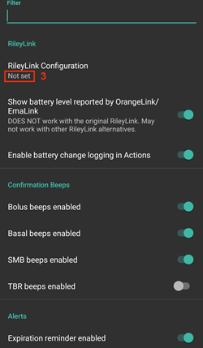
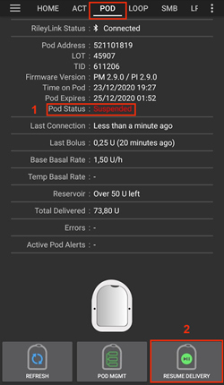
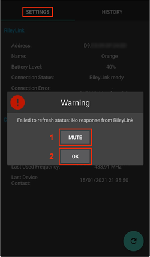
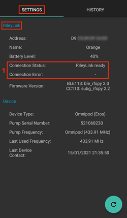
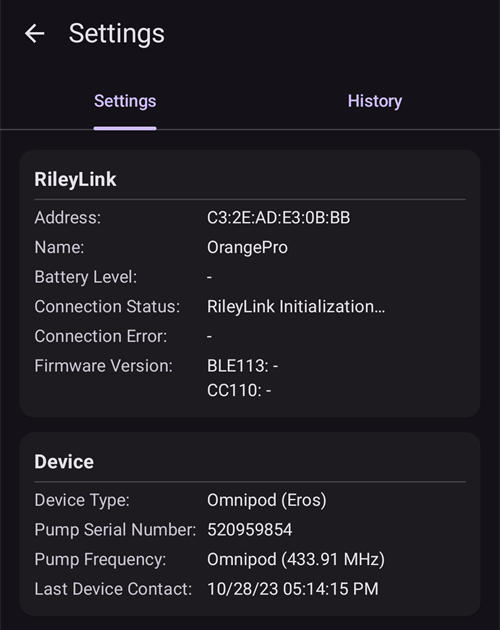
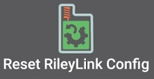
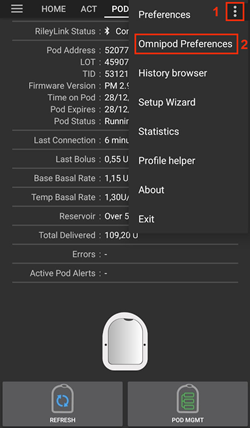

# Omnipod Eros

Estas instruções são para configurar a bomba da geração Omnipod Eros (**NÃO o Omnipod Dash**).

```{admonition} Omnipod Eros is being phased out
:class: note

O [Omnipod System](https://www.omnipod.com/current-podders/resources/omnipod-system) (o Omnipod original, formado pelo Personal Diabetes Manager (PDM) e pelo Pod) está sendo descontinuado, e a data final muda de país para país. Por exemplo, ele não vai mais estar disponível no Canadá depois de 30 de junho de 2026. Se você depende da bomba Eros, planeje com antecedência a mudança para uma bomba com suporte.
```

**Este software faz parte de uma solução de pâncreas artificial DIY (faça você mesmo). Ele não é um produto: ele exige que VOCÊ leia, aprenda e entenda o sistema, incluindo como usá-lo. Você é o único responsável pelo que faz com ele.**

```{contents} Table of contents
:depth: 1
:local: true
```

## Requisitos de hardware e software

- **Dispositivo de comunicação com o Pod**

> Componente que faz a ponte de comunicação entre o seu telefone com o AAPS e os pods da geração Eros.
> 
> > -   [Site do OrangeLink](https://getrileylink.org/product/orangelink)
> > -  [RileyLink 433MHz](https://getrileylink.org/product/rileylink433)
> > -   [Site do Emalink](https://github.com/sks01/EmaLink) - [Contato](mailto:getemalink@gmail.com)
> > -   DiaLink - [Contato](mailto:Boshetyn@ukr.net)
> > -   [Site do LoopLink](https://www.getlooplink.org/) - [Contato](https://jameswedding.substack.com/) - Não testado

-   **Telefone celular**

> Componente que executa o AAPS e envia comandos de controle ao dispositivo de comunicação com o Pod.
> 
> > - Um [telefone Android](#Phones-list-of-tested-phones) compatível, com o **AAPS** e os componentes relacionados configurados.

-   **Dispositivo de administração de insulina**

> Component that will interpret commands received from the Pod communication device originating from your AAPS enabled phone.
> 
> > - Um novo pod Omnipod (geração Eros - **NÃO DASH**)

Estas instruções consideram que você está iniciando uma nova sessão de pod. Se não for o caso, tenha paciência e comece este processo na sua próxima troca de pod.

Nesta página, **RileyLink** significa qualquer um dos dispositivos de comunicação com o pod listados acima.

## Antes de começar

**SEGURANÇA EM PRIMEIRO LUGAR** - não tente fazer este processo em uma situação em que você não possa se recuperar de um erro (pods extras, insulina, RileyLink carregado e telefones são obrigatórios).

**O seu PDM Omnipod não vai mais funcionar depois que o driver Omnipod do AAPS ativar o seu pod**. Antes, você usava o seu PDM Omnipod para enviar comandos ao seu pod Omnipod Eros. Um pod Omnipod Eros só permite que um único dispositivo se comunique com ele. O dispositivo que ativa o pod com sucesso é, a partir desse momento, o único dispositivo que pode se comunicar com ele. Isso significa que, depois de ativar um pod Omnipod Eros com o seu RileyLink pelo driver Omnipod do AAPS, **você não vai mais poder usar o seu PDM com o seu pod**. Agora o driver Omnipod do AAPS com o RileyLink é o seu PDM. *This does NOT mean you should throw away your PDM, it is recommended to keep it around as a backup, and for emergencies when AAPS is not working correctly.*

**Só um RileyLink por vez pode se comunicar com um pod.** O **AAPS** guarda um único RileyLink pareado. Se você parear outro, ele substitui o anterior.

**O seu pod não desliga quando o RileyLink está fora de alcance.** Quando o seu RileyLink está fora de alcance ou o sinal está bloqueado e não chega ao pod ativo, o seu pod continua administrando insulina basal. Na ativação de um pod, o perfil basal definido no AAPS é programado no novo pod. Se você perder o contato com o pod, ele volta para este perfil basal. Você não vai poder enviar novos comandos até o RileyLink voltar ao alcance e restabelecer a conexão.

**Perfis de taxa basal com intervalos de 30 minutos NÃO são aceitos no AAPS.** Se você é novo no AAPS e está configurando o seu perfil de taxa basal pela primeira vez, saiba que taxas basais que começam na meia hora não são aceitas: você vai precisar ajustar o seu perfil de taxa basal para começar na hora cheia. Por exemplo, se você tem uma taxa basal de 1,1 unidade que começa às 09:30 e dura 2 horas, terminando às 11:30, isso não vai funcionar.  Você vai precisar mudar esta taxa basal de 1,1 unidade para o intervalo 9:00-11:00 ou 10:00-12:00.  Mesmo que o próprio hardware do Omnipod aceite intervalos de 30 minutos no perfil basal, os algoritmos do AAPS ainda não conseguem usá-los.

## Ativar o driver Omnipod no AAPS

Você pode ativar o driver Omnipod no AAPS de **duas formas**:

### Opção 1: O Assistente de Configuração

Depois de instalar uma nova versão do AAPS, o **Assistente de Configuração** inicia automaticamente. Se você já exportou as suas configurações de uma instalação anterior, pode importá-las no assistente. Para novas instalações, continue abaixo.

Siga o [Assistente de configuração do AAPS](../SettingUpAaps/SetupWizard.md) até chegar à etapa **Bomba** e selecione **Omnipod Eros** (a descrição diz "Integração da bomba para o Omnipod Eros").


O Assistente de Configuração não pareia o seu RileyLink. Depois de terminar o assistente, abra a tela da bomba Omnipod e faça o pareamento como descrito na [seção Configuração do RileyLink](#OmnipodEros-rileylink-setup).

**OU**

### Opção 2: A tela Configuração

Abra o **menu** (☰) no canto superior esquerdo > **Configuração** > **Bomba** e selecione o **botão de opção** do **Omnipod Eros**.

Depois de selecionado, o cartão **Omnipod Eros** mostra dois botões, **Configurações** e **Abrir plugin**:


**Configurações** abre as configurações do driver Omnipod (veja [Configurações do Omnipod](#OmnipodEros-omnipod-settings)):


**Abrir plugin** abre a tela da bomba Omnipod. Você também pode abri-la a qualquer momento a partir da tela principal com **Gerenciar** > **Bomba**. Esta página chama essa tela de **tela da bomba Omnipod**. Antes de parear um RileyLink e ativar um pod, ela fica assim:


### Verificar a seleção do driver Omnipod

Para verificar se você ativou o driver Omnipod, abra **Gerenciar** > **Bomba** a partir da tela principal. Você deve ver a tela da bomba **Omnipod Eros** mostrada acima. Se você ainda não pareou um RileyLink, **Status do RileyLink** mostra **Não Iniciado** e **Status do Pod** mostra **Nenhum Pod Ativo**.

## Configuração do Omnipod

Todas as funções do pod e do RileyLink são botões na [tela da bomba Omnipod](#OmnipodEros-omnipod-pod-tab) (**Gerenciar** > **Bomba**). Alguns botões só aparecem em certas situações, por exemplo quando um pod está ativo.

>  Atualizar a conectividade e o status do Pod
> 
>  Gerenciamento do Pod (Ativar, Desativar, Faça os testes sonoros, Estatísticas do RileyLink e Histórico do Pod)

```{admonition} Older screenshot
:class: note
A captura de tela acima é de uma versão anterior do **AAPS**. No **AAPS** 4 não existe o botão **POD MGMT** nem o menu Gerenciamento do Pod: **Atualizar** e todas as ações de gerenciamento do pod são botões na tela da bomba Omnipod.
```

(OmnipodEros-rileylink-setup)=

### Configuração do RileyLink

Se você já pareou o seu RileyLink, continue na [seção Ativar um Pod](#OmnipodEros-activating-a-pod) abaixo.

*Observação: Um bom sinal visual de que o RileyLink não está conectado é que os botões de tratamento (barra de ferramentas QuickLaunch) não aparecem na tela principal. Isso também acontece durante os primeiros 30 segundos depois que o AAPS inicia, porque ele está se conectando ao RileyLink.*

1. Tenha certeza de que o seu RileyLink está totalmente carregado e ligado.

2. Coloque o RileyLink [perto do seu telefone](#OmnipodEros-optimal-omnipod-and-rileylink-positioning) (~30 cm ou menos).

3. Abra a tela da bomba Omnipod (**Gerenciar** > **Bomba**) e pressione **Parear RileyLink**.

4. A tela **Parear RileyLink** começa a procurar dispositivos Bluetooth imediatamente. Toque no seu RileyLink na lista de dispositivos encontrados.

   

5. Quando **RileyLink pareado com sucesso** for mostrado com o nome e o endereço do seu dispositivo, pressione **OK**.

6. De volta à tela da bomba Omnipod, verifique se **Status do RileyLink** muda para **Conectado**. **Status do Pod** deve mostrar **Nenhum Pod Ativo**. Se o RileyLink não se conectar, pressione **Redefinir RileyLink** ou reinicie o **AAPS**.

 

 


```{admonition} Older screenshot
:class: note
As seis capturas de tela acima (depois da etapa 6) são de uma versão anterior do **AAPS**. No **AAPS** 4, você pareia o RileyLink com o botão **Parear RileyLink** na tela da bomba Omnipod, em vez de **RileyLink Configuration** (Configuração do RileyLink) nas configurações do Omnipod, e a busca começa automaticamente.
```

```{note}
Para trocar para outro RileyLink (por exemplo, um dispositivo de reserva), pressione **Parear RileyLink** de novo e selecione o novo dispositivo. Ele substitui o que estava pareado antes. Você não precisa remover o dispositivo antigo antes.
```

(OmnipodEros-activating-a-pod)=

### Ativar um Pod

Antes de ativar um pod, tenha certeza de que o seu RileyLink está pareado e que **Status do RileyLink** mostra **Conectado**. O botão **Ativar Pod** fica desabilitado até o RileyLink estar pronto.

*LEMBRETE: Por medida de segurança, a comunicação com o pod tem alcance limitado durante o pareamento na ativação do pod. Antes do pareamento, o sinal de rádio do Pod é mais fraco; depois do pareamento, ele funciona com a potência total do sinal. Durante estes procedimentos, tenha certeza de que o seu pod está* [bem perto](#OmnipodEros-optimal-omnipod-and-rileylink-positioning) *(~30 cm ou menos), mas não em cima ou logo ao lado do RileyLink.*

01. Abra a tela da bomba Omnipod (**Gerenciar** > **Bomba**) e pressione **Ativar Pod**.

    Se você nunca ativou um perfil, a etapa **Perfil necessário** aparece primeiro. Selecione o perfil a ser aplicado na ativação.

    >   
    > 
    > ```{admonition} Older screenshot
    >     :class: note
    >     A captura de tela acima é de uma versão anterior do **AAPS**. No **AAPS** 4, **Ativar Pod** é um botão na tela da bomba Omnipod, e não no menu **POD MGMT**.
    > ```

02. A tela **Preencha o Pod** é mostrada. Preencha um novo pod com insulina suficiente para 3 dias e escute dois bipes. Eles indicam que a quantidade mínima de 80 unidades foi preenchida. Esvazie completamente a seringa de preenchimento, mesmo depois de ouvir os dois bipes. Ao calcular a quantidade total de insulina de que você precisa para 3 dias, lembre-se de que a purga do pod usa de 12 a 15 unidades. Ainda não remova a tampa da agulha do pod.

    > 
    > 
    > Coloque o novo pod e o RileyLink perto um do outro (~30 cm ou menos) e pressione **Seguinte**.

03. **Selecionar insulina** (mostrado só se você tem mais de uma insulina configurada): selecione a insulina com que você está preenchendo o pod e pressione **Seguinte**. Depois da ativação, é aplicada uma troca de perfil com essa insulina.

04. Na tela **Inicializar o Pod**, o pod começa a purga (você ouve um clique seguido de uma série de tiques enquanto o pod faz a purga). Se o RileyLink estiver fora do alcance do pod que está sendo ativado, você recebe a mensagem de erro **Nenhuma resposta do Pod**. Se isso acontecer, [aproxime o RileyLink](#OmnipodEros-optimal-omnipod-and-rileylink-positioning) (~30 cm ou menos) do Pod, mas não em cima ou logo ao lado dele, e pressione **Tentar novamente**.

    >  

05. Quando a purga é bem-sucedida, uma marca de verificação verde é mostrada e o botão **Seguinte** fica habilitado. Pressione **Seguinte**.

    > 

06. **Local** (mostrado só se **Gerenciar rodízio do local da bomba** estiver ativado em [Rotação do local](#Aapsscreens-site-rotation)): selecione onde você vai colocar o pod no corpo e pressione **Seguinte**.

07. A tela **Anexe o Pod** é mostrada. Prepare o local de infusão do novo pod. Remova a tampa plástica da agulha do pod e o papel branco de proteção do adesivo, e cole o pod no local escolhido do seu corpo. Se a cânula estiver saindo do pod, pressione **Cancelar** e descarte o pod. Quando terminar, pressione **Seguinte**.

    > 

08. Aparece um diálogo de confirmação: "Quando você pressionar OK, a cânula será inserida". **Pressione OK SOMENTE se você estiver pronto para inserir a cânula**.

    > 

09. Na tela **Inserir cânula**, pode levar algum tempo até o Omnipod responder e inserir a cânula (no máximo 1-2 minutos), então tenha paciência.

    > Se o RileyLink estiver fora do alcance do pod que está sendo ativado, você recebe a mensagem de erro **Nenhuma resposta do Pod**. Se isso acontecer, aproxime o RileyLink (~30 cm ou menos) do Pod, mas não em cima ou logo ao lado dele, e pressione **Tentar novamente**.
    > 
    > Se o RileyLink estiver fora do alcance do Bluetooth ou não tiver uma conexão ativa com o telefone, você recebe a mensagem de erro **Nenhuma resposta do RileyLink**. Se isso acontecer, aproxime o RileyLink do telefone e pressione **Tentar novamente**.
    > 
    > *OBSERVAÇÃO: Antes de a cânula ser inserida, é uma boa prática beliscar a pele perto do ponto de inserção da cânula. Isso ajuda a agulha a entrar suavemente e diminui a chance de oclusões.*
    > 
    > 
    > 
    >  

10. Uma marca de verificação verde aparece, e o botão **Seguinte** fica habilitado quando a cânula é inserida com sucesso. Pressione **Seguinte**.

    > 

11. A tela **Pod ativado** é mostrada. Verifique se a cânula foi inserida corretamente, e troque o pod se você achar que não foi. Pressione **Finalizar**. Parabéns! Agora você iniciou uma nova sessão de pod ativo.

    >  
    > 
    > ```{admonition} Older screenshot
    >     :class: note
    >     As capturas de tela das etapas 2 a 11 são de uma versão anterior do **AAPS** e podem ser diferentes no **AAPS** 4. As etapas **Selecionar insulina** e **Local** não aparecem nas imagens.
    > ```

12. Você volta à tela da bomba Omnipod. O botão **Ativar Pod** é substituído por **Desativar Pod**, porque você não pode ativar outro pod sem antes desativar o pod ativo.

    A tela da bomba agora mostra as informações do seu pod ativo, incluindo a taxa basal atual, o nível do reservatório, a insulina administrada, os erros e os alertas do pod. Para mais detalhes, veja a seção [Tela da bomba Omnipod](#OmnipodEros-omnipod-pod-tab).

     

    ```{admonition} Older screenshot
    :class: note
    A captura de tela acima é de uma versão anterior do **AAPS**. No **AAPS** 4 não existe o menu Gerenciamento do Pod: você volta diretamente à tela da bomba Omnipod, onde **Desativar Pod** substitui **Ativar Pod**.
    ```

```{note}
Se a ativação foi interrompida depois da purga (por exemplo, porque o aplicativo foi fechado), pressione **Ativar Pod** de novo. O assistente continua a partir das etapas de inserção da cânula.
```

### Desativar um Pod

Em condições normais, um pod dura três dias (72 horas), mais 8 horas depois do aviso de expiração do pod: 80 horas de uso no total.

Para desativar um pod (porque ele expirou ou porque falhou):

1. Abra a tela da bomba Omnipod (**Gerenciar** > **Bomba**) e pressione **Desativar Pod**.

   >   
   > 
   > ```{admonition} Older screenshot
   >    :class: note
   >    A captura de tela acima é de uma versão anterior do **AAPS**. No **AAPS** 4, **Desativar Pod** é um botão na tela da bomba Omnipod, e não no menu **POD MGMT**.
   > ```

2. Na tela **Desativar Pod**, primeiro tenha certeza de que o RileyLink está perto do pod, mas não em cima ou logo ao lado dele. Depois pressione **Seguinte**. Um diálogo pergunta *Um Pod desativado não pode ser usado novamente. Desativar este Pod agora?* Pressione **OK** para começar a desativar o pod, ou **Cancelar** para mantê-lo. A desativação suspende toda a administração de insulina e não pode ser desfeita.

   > 

3. A tela **Desativando o Pod** aparece, e o pod bipa para confirmar que a desativação foi bem-sucedida.

   > 
   > 
   > **SE a desativação falhar** e você não ouvir o bipe de confirmação, pode aparecer a mensagem **Nenhuma resposta do RileyLink** ou **Nenhuma resposta do Pod**. Pressione **Tentar novamente** para tentar desativar de novo. Se a desativação continuar falhando, pressione **Descartar Pod** e confirme. Então o **AAPS** esquece o pod. A administração de insulina **não** foi suspensa, então remova o pod do seu corpo. Se o seu pod estiver com um alarme apitando sem parar, talvez você precise silenciá-lo manualmente (com um alfinete ou um clipe de papel), porque **Descartar Pod** não o silencia.
   > 
   > >   

4. Uma marca de verificação verde aparece quando a desativação é bem-sucedida. Pressione **Seguinte** para mostrar a tela **Pod desativado**. Agora você pode remover o seu pod, porque a sessão ativa foi desativada.

   > 

5. Pressione **Finalizar** para voltar à tela da bomba Omnipod.

   >  
   > 
   > ```{admonition} Older screenshot
   >    :class: note
   >    As capturas de tela das etapas 2 a 5 são de uma versão anterior do **AAPS** e podem ser diferentes no **AAPS** 4.
   > ```

6. Na tela da bomba Omnipod, verifique se **Status do RileyLink** mostra **Conectado** e **Status do Pod** mostra **Nenhum Pod Ativo**.

   >    
   > 
   > ```{admonition} Older screenshot
   >    :class: note
   >    A captura de tela acima é de uma versão anterior do **AAPS**. No **AAPS** 4, **Finalizar** leva você diretamente de volta à tela da bomba Omnipod; não existe o menu Gerenciamento do Pod nem a aba **Omnipod (POD)**.
   > ```

### Suspender e retomar a administração de insulina

O processo abaixo mostra como suspender e retomar a administração de insulina.

*OBSERVAÇÃO - se você não vê um botão **Suspender***, é porque ele fica escondido por padrão. Enable **Show Suspend Delivery button on the pump screen** in the [Omnipod settings](#OmnipodEros-omnipod-settings) under **Other**.

#### Suspender a administração de insulina

Use este comando para colocar o pod ativo em um estado suspenso. Neste estado suspenso, o pod não administra mais nenhuma insulina. Este comando imita a função de suspender que o PDM Omnipod original envia a um pod ativo.

1. Abra a tela da bomba Omnipod (**Gerenciar** > **Bomba**) e pressione **Suspender**. O comando de suspender é enviado pelo RileyLink ao pod ativo.

2. Quando o pod suspendeu toda a administração de insulina, **Status do Pod** mostra **Suspenso** e o botão **Suspender** é substituído por **Reiniciar a administração**.

   >  
   > 
   > 
   > 
   >  
   > 
   > ```{admonition} Older screenshot
   >    :class: note
   >    A captura de tela acima é de uma versão anterior do **AAPS**. No **AAPS** 4, estas etapas acontecem na tela da bomba Omnipod, e não na aba **Omnipod (POD)**, e o resultado é mostrado em **Status do Pod**.
   > ```

Se o comando falhar, um diálogo de **Aviso** mostra "Falha ao suspender a administração" com o motivo. Verifique a conexão com o RileyLink e tente de novo.

#### Retomar a administração de insulina

Use este comando para mandar o pod ativo, que está suspenso, retomar a administração de insulina. Quando o comando é processado com sucesso, a administração normal de insulina é retomada com a taxa basal da hora atual do perfil basal ativo. O pod volta a aceitar comandos de bólus, TBR e SMB.

1. Abra a tela da bomba Omnipod e verifique se **Status do Pod** mostra **Suspenso**. Pressione **Reiniciar a administração**.

2. Quando o comando tiver sucesso, **Status do Pod** mostra **Funcionando** de novo e o botão **Reiniciar a administração** desaparece (o botão **Suspender** é mostrado de novo, se você o ativou).

   >  
   > 
   > 
   > 
   >  
   > 
   > ```{admonition} Older screenshot
   >    :class: note
   >    A captura de tela acima é de uma versão anterior do **AAPS**. No **AAPS** 4, estas etapas acontecem na tela da bomba Omnipod, e não na aba **Omnipod (POD)**, e o resultado é mostrado em **Status do Pod**.
   > ```

Se o comando falhar, um diálogo de **Aviso** mostra "Falha ao reiniciar a administração" com o motivo. Verifique a conexão com o RileyLink e tente de novo.

### Silenciar alertas do Pod

*OBSERVAÇÃO - O botão **Silenciar alertas** só é mostrado na tela da bomba Omnipod enquanto o pod tem um alerta ativo (por exemplo, o alerta de expiração do pod ou de reservatório baixo), e só se **Silenciar alertas do Pod automaticamente** estiver desativado.*

O processo abaixo mostra como silenciar os bipes do pod que começam quando o pod chega à hora do aviso antes de expirar. Esta hora do aviso é definida com **Alerta [horas] antes do desligamento (80 horas)** nas configurações de **Alertas** do Omnipod. A vida máxima de um pod é de 80 horas (3 dias e 8 horas), mas a Insulet recomenda não passar do limite de 72 horas (3 dias).

*OBSERVAÇÃO - Se você ativou **Silenciar alertas do Pod automaticamente** nas configurações de **Alertas** do Omnipod, o **AAPS** silencia o alerta automaticamente na próxima comunicação com o pod, e você NÃO precisa fazer isso manualmente.*

1. Quando chega a hora do aviso, o pod bipa para avisar que vai expirar em breve e que precisa ser trocado. Na tela da bomba Omnipod, **Pod expira** mostra a hora exata em que o pod expira (72 horas depois da ativação); o texto fica **amarelo** 4 horas antes. **Fim obrigatório do Pod** mostra quando o pod para de administrar insulina. **Alertas ativos do Pod** mostra **Pod vai expirar em breve**, e o botão **Silenciar alertas** aparece. O **AAPS** também mostra uma notificação sobre a expiração próxima do pod.

   >   
   > 
   > ```{admonition} Older screenshot
   >    :class: note
   >    A captura de tela acima é de uma versão anterior do **AAPS**. No **AAPS** 4, o botão **ACK ALERTS** se chama **Silenciar alertas** e fica na tela da bomba Omnipod.
   > ```

2. Pressione **Silenciar alertas**. O RileyLink envia o comando ao pod para parar os bipes de aviso de expiração.

   >  
   > 
   > ```{admonition} Older screenshot
   >    :class: note
   >    A captura de tela acima é de uma versão anterior do **AAPS**. No **AAPS** 4, o botão se chama **Silenciar alertas**.
   > ```

3. Quando os alertas são silenciados, o pod bipa duas vezes. **Alertas ativos do Pod** não mostra mais o aviso, o botão **Silenciar alertas** desaparece e o pod para os bipes de aviso de expiração.

   >  
   > 
   > ```{admonition} Older screenshot
   >    :class: note
   >    A captura de tela acima é de uma versão anterior do **AAPS**. No **AAPS** 4, o resultado é mostrado na tela da bomba Omnipod: o aviso desaparece de **Alertas ativos do Pod**.
   > ```

Se o comando falhar (por exemplo, porque o RileyLink está fora do alcance do pod), um diálogo de **Aviso** mostra "Falha ao silenciar os alertas" com o motivo. Aproxime o RileyLink do pod e tente de novo.


```{admonition} Older screenshot
:class: note
A captura de tela acima é de uma versão anterior do **AAPS**. No **AAPS** 4, o diálogo de **Aviso** mostra "Falha ao silenciar os alertas" com o motivo.
```

(OmnipodEros-view-pod-history)=

### Ver o histórico do Pod

Esta seção mostra como ver o histórico do seu pod ativo e filtrá-lo por diferentes categorias de ação. A ferramenta de histórico do pod permite ver as ações enviadas ao seu pod ativo e os resultados delas durante a sua vida de três dias (72 - 80 horas).

Esta função é útil para verificar bólus, TBRs e mudanças de basal que foram enviados, mas que você não tem certeza se foram concluídos. As outras categorias são úteis em geral para resolver problemas e para descobrir a ordem dos eventos que levaram a uma falha.

*OBSERVAÇÃO:* Comandos **incertos** aparecem no histórico do pod, mas, por causa da sua natureza, você não pode ter certeza de que estão corretos.

1. Abra a tela da bomba Omnipod (**Gerenciar** > **Bomba**) e pressione **Histórico do Pod**.

   >   
   > 
   > ```{admonition} Older screenshot
   >    :class: note
   >    A captura de tela acima é de uma versão anterior do **AAPS**. No **AAPS** 4, **Histórico do Pod** é um botão na tela da bomba Omnipod, e não no menu **POD MGMT**.
   > ```

2. A tela **Histórico do Pod** lista todas as ações do pod e os resultados delas, as mais novas primeiro, agrupadas por dia. Por padrão, **Todos** está selecionado. Toque em um dos botões de filtro no alto para mostrar só uma categoria. Use a seta de voltar no canto superior esquerdo para retornar à tela da bomba Omnipod.

   > 

   >  
   > 
   > ```{admonition} Older screenshot
   >    :class: note
   >    A segunda captura de tela é de uma versão anterior do **AAPS** e pode ser diferente no **AAPS** 4.
   > ```

### Ver as configurações e o histórico do RileyLink

A tela **Estatísticas do RileyLink** mostra as configurações do seu RileyLink e do pod ativo, e o histórico de comunicação dos dois. Ela tem duas abas: **Configurações** e **Histórico**.

O botão **Estatísticas do RileyLink** fica escondido por padrão. Para mostrá-lo na tela da bomba Omnipod, ative **Mostrar botão Estatísticas do RileyLink no menu de gerenciamento do Pod** nas [configurações do Omnipod](#OmnipodEros-omnipod-settings), em **Outro**.

#### Restabelecer manualmente a comunicação Bluetooth com o dispositivo de comunicação com o Pod

Se o seu dispositivo de comunicação com o pod ficou fora do alcance do Bluetooth do seu telefone por algum tempo, **Status do RileyLink** pode mostrar **RileyLink inacessível** na tela da bomba Omnipod. Normalmente o **AAPS** se reconecta sozinho quando o dispositivo volta ao alcance. Se isso não acontecer:

1. Tenha certeza de que o RileyLink está ligado, carregado e perto do seu telefone.

2. Na tela da bomba Omnipod, pressione **Redefinir RileyLink**. Uma mensagem confirma: **Configuração do RileyLink redefinida**. Veja as [observações sobre Redefinir RileyLink](#OmnipodEros-reset-rileylink-config-notes) abaixo.

3. Se a **conexão Bluetooth** não for restabelecida, tente **desligar** e depois **ligar** de novo o Bluetooth do seu telefone manualmente.

4. Se ele ainda não se reconectar, pressione **Parear RileyLink** e selecione o seu RileyLink de novo.

5. Depois de uma reconexão bem-sucedida, **Status do RileyLink** mostra **Conectado**. Você também pode verificar **Status da conexão** na aba **Configurações** da tela **Estatísticas do RileyLink**. Parabéns, você reconectou o seu dispositivo de comunicação com o pod configurado ao AAPS!

 






```{admonition} Older screenshot
:class: note
A captura de tela acima é de uma versão anterior do **AAPS**. No **AAPS** 4, você se reconecta com **Redefinir RileyLink** ou **Parear RileyLink** na tela da bomba Omnipod, e não com o botão de atualizar na tela de configurações do RileyLink.
```

#### Configurações do dispositivo de comunicação com o Pod e do Pod ativo

Esta tela mostra informações e o status do dispositivo de comunicação com o pod que está pareado e do pod Omnipod Eros que está ativo. As informações são atualizadas automaticamente.

1. Abra a tela da bomba Omnipod (**Gerenciar** > **Bomba**) e pressione **Estatísticas do RileyLink**. A aba **Configurações** mostra o seu **RileyLink** pareado e o pod ativo (**Dispositivo**).

   >   
   > 
   > ```{admonition} Older screenshot
   >    :class: note
   >    A captura de tela acima é de uma versão anterior do **AAPS**. No **AAPS** 4, **Estatísticas do RileyLink** é um botão na tela da bomba Omnipod, e não no menu **POD MGMT**.
   > ```

   > 

##### Campos do RileyLink

> - **Endereço:** Endereço MAC do dispositivo de comunicação com o pod pareado.
> - **Nome:** Nome Bluetooth do dispositivo de comunicação com o pod pareado.
> - **Nível de Bateria:** O nível atual da bateria do dispositivo de comunicação com o pod conectado. Mostrado só quando **Mostrar o nível da bateria reportada por OrangeLink/EmaLink/DiaLink** está ativado.
> - **Status da conexão**: O status atual da conexão Bluetooth entre o dispositivo de comunicação com o pod e o telefone com o AAPS.
> - **Erro de conexão:** Se houver um erro na conexão Bluetooth do dispositivo de comunicação com o pod, os detalhes são mostrados aqui.
> - **Versão do firmware:** A versão do firmware instalada no dispositivo de comunicação com o pod conectado.

##### Campos do dispositivo - com um Pod ativo

> - **Tipo de dispositivo:** O tipo de dispositivo que se comunica com o dispositivo de comunicação com o pod (Omnipod (Eros)).
> - **Modelo do dispositivo configurado:** O modelo do dispositivo configurado para se comunicar com o dispositivo de comunicação com o pod.
> - **Modelo do dispositivo conectado:** O modelo do dispositivo que está se comunicando com o dispositivo de comunicação com o pod.
> - **Número de série da Bomba:** Número de série do pod ativo.
> - **Frequência da Bomba:** Frequência de rádio usada para se comunicar com o pod.
> - **Última frequência usada:** A última frequência de rádio conhecida que o pod usou para se comunicar com o dispositivo de comunicação com o pod.
> - **Último contato do dispositivo:** Data e hora do último contato do pod com o dispositivo de comunicação com o pod.

(omnipod-eros-rileylink-and-active-pod-history)=
#### Histórico do RileyLink e do Pod ativo

Esta aba lista, os mais novos primeiro, cada estado ou ação do RileyLink ou do pod conectado. O histórico só está disponível para o pod ativo. Depois de uma troca de pod, este histórico é apagado e só os eventos do pod recém-ativado são registrados e mostrados.

1. Abra a tela da bomba Omnipod (**Gerenciar** > **Bomba**), pressione **Estatísticas do RileyLink** e depois toque na aba **Histórico**.

   >   
   > 
   > ```{admonition} Older screenshot
   >    :class: note
   >    A captura de tela acima é de uma versão anterior do **AAPS**. No **AAPS** 4, **Estatísticas do RileyLink** é um botão na tela da bomba Omnipod, e não no menu **POD MGMT**.
   > ```

   > 

##### Campos

Cada entrada mostra:

> - **Dispositivo:** O dispositivo a que a ação ou o estado se refere.
> - **Hora:** A hora do evento.
> - **Estado ou ação:** O estado do dispositivo ou a ação que ele fez.

(OmnipodEros-omnipod-pod-tab)=

## Tela da bomba Omnipod

Abaixo está uma explicação dos campos de status e dos botões da **tela da bomba Omnipod** (**Gerenciar** > **Bomba**, ou **Configuração** > **Bomba** > **Abrir plugin**).

O ícone de engrenagem no canto superior direito abre as [configurações do Omnipod](#OmnipodEros-omnipod-settings).

*OBSERVAÇÃO: Se algum campo de status mostrar (incerto), pressione **Atualizar** para atualizar o status do pod e limpar o campo.*


```{admonition} Older screenshot
:class: note
A captura de tela acima é de uma versão anterior do **AAPS**, em que esta tela era a aba **Omnipod (POD)**. No **AAPS** 4, ela é a tela da bomba Omnipod, e alguns nomes de campos e botões são diferentes.
```

### Campos

- **Status do RileyLink:** Mostra o status atual da conexão com o RileyLink. Os erros são mostrados em vermelho.

- *Não Iniciado* - nenhum RileyLink foi pareado ainda, ou a conexão ainda não começou.
- *RileyLink inacessível* - o dispositivo de comunicação com o pod está fora do alcance do Bluetooth do telefone, desligado ou tem uma falha que impede a comunicação Bluetooth.
- *RileyLink pronto* - o dispositivo de comunicação com o pod está ligado e está iniciando a conexão Bluetooth.
- *Conectado* - o dispositivo de comunicação com o pod está ligado, conectado e pode se comunicar por Bluetooth.

- **ID único:** Mostra o endereço do pod ativo.

- **Número do LOT:** Mostra o número do lote (LOT) do pod ativo.

- **Número sequencial:** Mostra o número de série (TID) do pod.

- **Versão do firmware:** Mostra a versão do firmware do pod ativo.

- **Tempo no Pod:** Mostra a hora atual no pod ativo. Ele fica destacado quando a diferença em relação à hora do telefone é maior que 5 minutos.

- **Pod expira:** Mostra a data e a hora em que o pod ativo vai expirar. O texto fica amarelo nas últimas 4 horas antes desse momento. Ele nunca fica vermelho, porque o pod continua administrando insulina depois disso.

- **Fim obrigatório do Pod:** Mostra o fim do período de tolerância do pod (8 horas depois de **Pod expira**, para uma vida máxima do pod de 80 horas). O texto fica amarelo quando o período de tolerância começa (em **Pod expira**) e vermelho nas últimas 4 horas antes do fim obrigatório. Durante o período de tolerância, ele também mostra o tempo restante, por exemplo *(17m restantes)*. O pod para de administrar insulina no fim obrigatório e precisa ser trocado.

- **Status do Pod:** Mostra o status do pod ativo (por exemplo **Nenhum Pod Ativo**, **Funcionando** ou **Suspenso**).

- **Última conexão:** Mostra a última vez em que a comunicação com o pod ativo foi bem-sucedida. O texto fica vermelho quando o [limite de bomba inacessível](#OmnipodEros-troubleshooting) é ultrapassado.

- *Momentos atrás* - menos de 20 segundos atrás.
- *Há menos de um minuto* - mais de 20 segundos e menos de 60 segundos atrás.
- *1 minuto atrás* - mais de 60 segundos e menos de 120 segundos (2 min)
- *XX minutos atrás* - mais de 2 minutos atrás, conforme o valor de XX

- **Último bólus:** Mostra a dose do último bólus enviado ao pod ativo e, entre parênteses, há quanto tempo ele foi dado.

- **Taxa Basal de base:** Mostra a taxa basal programada para a hora atual no perfil de taxa basal.

- **Taxa Basal Temporária:** Mostrado só enquanto uma taxa basal temporária está em andamento. Ela é mostrada neste formato:

- Unidades / hora @ hora em que a TBR foi enviada (minutos já executados / total de minutos que a TBR vai durar)
- *Exemplo:* 0.00U/h @18:25 ( 90/120 minutos)

- **Reservatório:** Mostra **Mais de 50 U restantes** quando restam mais de 50 unidades no reservatório. Abaixo deste valor, é mostrado o número aproximado de unidades. O texto fica vermelho abaixo do limite de reservatório baixo definido nas [configurações de Alertas](#OmnipodEros-omnipod-settings).

- **Total entregue:** Mostra o número total de unidades de insulina administradas a partir do reservatório. *Observe que este valor é uma estimativa, porque a purga e o preenchimento do pod não são um processo exato.*

- **Alertas ativos do Pod:** Mostra os alertas que estão ativos no pod agora. Normalmente usado quando o pod passou de 72 horas e os bipes de alerta do próprio pod estão tocando.

- **Erros:** Mostra o último erro encontrado (em vermelho). Veja o [Histórico do Pod](#OmnipodEros-view-pod-history), o [histórico do RileyLink](#omnipod-eros-rileylink-and-active-pod-history) e os arquivos de log para erros passados e informações mais detalhadas.

### Botões

Os botões na parte de baixo da tela da bomba mudam conforme a situação. Os botões que não podem ser usados naquele momento ficam cinza, por exemplo enquanto o RileyLink não está conectado.

**Botões de status do pod** (mostrados quando um pod está ativo):

- **Atualizar:** Envia um comando de atualização ao pod ativo para atualizar o seu status. Use para atualizar o status do pod e para limpar campos de status que mostram o texto (incerto). Veja a [seção Resolução de problemas](#OmnipodEros-troubleshooting) abaixo para mais informações.

  

  ```{admonition} Older screenshot
  :class: note
  A captura de tela acima é de uma versão anterior do **AAPS**. No **AAPS** 4, este é um botão com texto chamado **Atualizar** na tela da bomba Omnipod.
  ```

- **Silenciar alertas:** Silencia os bipes e as notificações de expiração do pod e de reservatório baixo. Mostrado só quando o pod tem um alerta ativo e **Silenciar alertas do Pod automaticamente** está desativado. Depois que os alertas são silenciados, o botão desaparece.

  

  ```{admonition} Older screenshot
  :class: note
  A captura de tela acima é de uma versão anterior do **AAPS**. No **AAPS** 4, este botão se chama **Silenciar alertas**.
  ```

- **Configurar a hora:** Atualiza a hora do pod com a hora atual do seu telefone. Mostrado só quando a hora do pod é diferente da hora do telefone em mais de 5 minutos.

  

  ```{admonition} Older screenshot
  :class: note
  A captura de tela acima é de uma versão anterior do **AAPS**. No **AAPS** 4, este é um botão com texto chamado **Configurar a hora** na tela da bomba Omnipod.
  ```

- **Suspender:** Suspende a administração de insulina no pod ativo. Only shown if enabled in the settings (**Show Suspend Delivery button on the pump screen**).

  

  ```{admonition} Older screenshot
  :class: note
  A captura de tela acima é de uma versão anterior do **AAPS**. No **AAPS** 4, este é um botão com texto chamado **Suspender** na tela da bomba Omnipod.
  ```

- **Reiniciar a administração:** Retoma a administração de insulina no pod ativo que está suspenso. Mostrado só enquanto o pod está suspenso.

  

  ```{admonition} Older screenshot
  :class: note
  A captura de tela acima é de uma versão anterior do **AAPS**. No **AAPS** 4, este é um botão com texto chamado **Reiniciar a administração** na tela da bomba Omnipod.
  ```

**Botões de gerenciamento do Pod e do RileyLink:**


```{admonition} Older screenshot
:class: note
A captura de tela acima é de uma versão anterior do **AAPS**. No **AAPS** 4 não existe o menu Gerenciamento do Pod: estas ações são botões diretamente na tela da bomba Omnipod.
```

- **Ativar Pod:** Faz a purga e ativa um novo pod. Mostrado quando nenhum pod está ativo. Ele só fica habilitado quando o RileyLink está conectado.

  

  ```{admonition} Older screenshot
  :class: note
  A captura de tela acima é de uma versão anterior do **AAPS**. No **AAPS** 4, **Ativar Pod** é um botão na tela da bomba Omnipod, e não no menu Gerenciamento do Pod.
  ```

- **Desativar Pod:** Desativa o pod ativo. Mostrado assim que um pod é pareado, também quando uma ativação parou no meio (por exemplo, porque o pod falhou durante a ativação). Ele só fica habilitado quando o RileyLink está conectado. O **AAPS** pede que você confirme antes de desativar o pod.

- Use este comando para desativar um pod que está apitando sem parar ("screamer", erro 49).
- Se a desativação falhar, o assistente de desativação oferece a opção **Descartar Pod**.

  

  ```{admonition} Older screenshot
  :class: note
  A captura de tela acima é de uma versão anterior do **AAPS**. No **AAPS** 4, **Desativar Pod** é um botão na tela da bomba Omnipod, e não no menu Gerenciamento do Pod.
  ```

- **Faça os testes sonoros:** Faz o pod tocar um único bipe de teste quando pressionado. Mostrado quando um pod está pareado.

  

  ```{admonition} Older screenshot
  :class: note
  A captura de tela acima é de uma versão anterior do **AAPS**. No **AAPS** 4, **Faça os testes sonoros** é um botão na tela da bomba Omnipod, e não no menu Gerenciamento do Pod.
  ```

- **Histórico do Pod:** Mostra o histórico de atividades do pod ativo. Veja [Ver o histórico do Pod](#OmnipodEros-view-pod-history).

  

  ```{admonition} Older screenshot
  :class: note
  A captura de tela acima é de uma versão anterior do **AAPS**. No **AAPS** 4, **Histórico do Pod** é um botão na tela da bomba Omnipod, e não no menu Gerenciamento do Pod.
  ```

- **Parear RileyLink:** Procura o seu dispositivo de comunicação com o pod e faz o pareamento. Veja [Configuração do RileyLink](#OmnipodEros-rileylink-setup).

- **Estatísticas do RileyLink:** Abre a tela Estatísticas do RileyLink, que tem duas abas. Mostrado só se estiver ativado nas configurações (**Mostrar botão Estatísticas do RileyLink no menu de gerenciamento do Pod**).

- **Configurações** - mostra as informações de configuração do RileyLink e do pod ativo
- **Histórico** - mostra o histórico de comunicação do RileyLink e do Pod

  

  ```{admonition} Older screenshot
  :class: note
  A captura de tela acima é de uma versão anterior do **AAPS**. No **AAPS** 4, **Estatísticas do RileyLink** é um botão na tela da bomba Omnipod, e não no menu Gerenciamento do Pod.
  ```

- **Redefinir RileyLink:** Redefine a configuração do dispositivo de comunicação com o pod conectado. Quando a comunicação começa, alguns dados específicos são enviados e definidos no RileyLink:

- Os registradores de memória são definidos
- Os protocolos de comunicação são definidos
- A frequência de rádio ajustada é definida
  > 
  > Veja as [observações adicionais](#OmnipodEros-reset-rileylink-config-notes) abaixo.

  

  ```{admonition} Older screenshot
  :class: note
  A captura de tela acima é de uma versão anterior do **AAPS**. No **AAPS** 4, este botão se chama **Redefinir RileyLink** e fica na tela da bomba Omnipod.
  ```

- **Descartar Pod:** Descarta o estado de um pod que não responde, depois de uma confirmação. Mostrado só quando um pod foi iniciado, mas não foi totalmente pareado, porque uma desativação correta não é mais possível:

- Um **pod não está totalmente pareado** e por isso ignora os comandos de desativação.
- Um **pod está travado** entre as etapas do processo de pareamento.
- Um **pod simplesmente não pareia.**
  > 
  > Depois que você descarta um pod, o **AAPS** não consegue mais se comunicar com ele. Remova o pod do seu corpo.

  

  ```{admonition} Older screenshot
  :class: note
  A captura de tela acima é de uma versão anterior do **AAPS**. No **AAPS** 4, **Descartar Pod** é um botão na tela da bomba Omnipod, e não no menu Gerenciamento do Pod.
  ```

(OmnipodEros-reset-rileylink-config-notes)=

#### *Observações sobre Redefinir RileyLink*

- Esta função é usada principalmente quando o dispositivo de comunicação com o pod ativo não responde e a comunicação está travada.
- Se o dispositivo de comunicação com o pod for desligado e ligado de novo, pressione **Redefinir RileyLink** para que estes parâmetros de comunicação sejam definidos de novo no dispositivo de comunicação com o pod.
- Se isso NÃO for feito, o AAPS vai precisar ser reiniciado depois que o dispositivo de comunicação com o pod for desligado e ligado de novo.
- Este botão **NÃO** precisa ser pressionado ao trocar entre diferentes dispositivos de comunicação com o pod.

(OmnipodEros-omnipod-settings)=

## Configurações do Omnipod

Para abrir as configurações do driver Omnipod, você pode:

- pressionar o ícone de engrenagem no canto superior direito da tela da bomba Omnipod (**Gerenciar** > **Bomba**), ou
- abrir o **menu** (☰) no canto superior esquerdo > **Configuração** > **Bomba** e pressionar **Configurações** no cartão **Omnipod Eros**.



```{admonition} Older screenshot
:class: note
A captura de tela acima é de uma versão anterior do **AAPS**. No **AAPS** 4, você abre as configurações com **Configurações** no cartão **Omnipod Eros** ou com o ícone de engrenagem na tela da bomba Omnipod, e não com a engrenagem de configurações em **Configuração** ou com o menu de 3 pontos.
```

As configurações estão agrupadas como listado abaixo. Toque em um grupo para abri-lo. A maioria dos itens são interruptores que você pode ligar ou desligar:


*OBSERVAÇÃO: Um asterisco (\*) indica que a configuração vem ativada por padrão.*

### RileyLink

Configurações do dispositivo de comunicação com o pod. Você pareia o próprio dispositivo com o botão **Parear RileyLink** na tela da bomba (veja [Configuração do RileyLink](#OmnipodEros-rileylink-setup)).

- **Usar escaneamento:** Faz uma busca antes de se conectar ao OrangeLink. Isso pode melhorar as conexões. Também pode ser usado com outros clones do RileyLink, se necessário.

- **Mostrar o nível da bateria reportada por OrangeLink/EmaLink/DiaLink:** Mostra o nível real da bateria do OrangeLink/EmaLink/DiaLink. É **fortemente recomendado** que todos os usuários de OrangeLink/EmaLink/DiaLink ativem esta configuração.

- NÃO funciona com o RileyLink original.
- Pode não funcionar com alternativas ao RileyLink.
- Ativado - Mostra o nível atual da bateria dos dispositivos de comunicação com o pod que têm suporte.
- Desativado - Mostra o valor n/a.

- **Habilitar o log de mudança de bateria em Ações:** Só disponível quando a configuração de nível da bateria acima está ativada. Alguns dispositivos de comunicação com o pod podem usar pilhas comuns que você pode trocar. Com esta configuração ativada, você pode registrar uma [entrada do CarePortal](#aaps-screens-careportal) **Troca de Bateria da Bomba** para anotar a troca e zerar a idade da bateria.

### Beeps de confirmação

Bipes de confirmação do pod para administração e mudanças de bólus, basal, SMB e TBR.

- **\*Beeps de bólus ativados:** Ativa ou desativa os bipes de confirmação quando um bólus é administrado.
- **Beeps de basais ativados:** Ativa ou desativa os bipes de confirmação quando uma nova taxa basal é definida, quando a taxa basal ativa é cancelada ou quando a taxa basal atual é alterada.
- **\*Beeps de SMB ativados:** Ativa ou desativa os bipes de confirmação quando um SMB é administrado.
- **Beeps de taxa basal temporária ativados:** Ativa ou desativa os bipes de confirmação quando uma TBR é definida ou cancelada.

### Alertas

Alertas do AAPS e avisos no Nightscout para expiração do pod, desligamento e reservatório baixo, com base no limite de unidades definido.

*Observe que uma notificação do AAPS é SEMPRE mostrada para qualquer alerta, depois da primeira comunicação com o pod desde que o alerta foi disparado. Dispensar a notificação NÃO silencia o alerta, A MENOS QUE **Silenciar alertas do Pod automaticamente** esteja ativado. Para silenciar o alerta MANUALMENTE, abra a tela da bomba Omnipod e pressione **Silenciar alertas**.*

- **\*Lembrete de expiração ativado:** Quando ativado, o pod bipa quando chega a hora definida abaixo.
- **Alerta [horas] antes do desligamento (80 horas):** O número de horas antes do desligamento do pod (80 horas depois da ativação) em que o lembrete de expiração é disparado (1 a 8 horas, padrão 8).
- **\*Alerta de reservatório baixo habilitado:** Ativa ou desativa um alerta quando as unidades restantes no pod chegam ao limite de reservatório baixo definido no campo Número de unidades.
- **Número de unidades:** O número de unidades em que o alerta de reservatório baixo do pod é disparado (5 a 50, padrão 20).
- **Silenciar alertas do Pod automaticamente:** Quando ativado, uma notificação ainda é mostrada, mas o alerta é silenciado automaticamente na próxima comunicação com o pod depois que o alerta começou.

### Notificações

Notificações do AAPS e alertas sonoros do telefone quando não há certeza se uma TBR, um SMB ou um bólus foi bem-sucedido.

*OBSERVAÇÃO: Estas são só notificações; o pod não faz nenhum bipe de alerta.*

- **\*Sons para notificações incertas de taxa basal temporária ativados:** Ative ou desative esta configuração para disparar um alerta sonoro e uma notificação visual quando o AAPS não tem certeza se uma TBR foi definida com sucesso.
- **\*Som das notificações de SMB incerto ativado:** Ative ou desative esta configuração para disparar um alerta sonoro e uma notificação visual quando o AAPS não tem certeza se um SMB foi administrado com sucesso.
- **\*Sons para notificações incertas de bólus ativados:** Ative ou desative esta configuração para disparar um alerta sonoro e uma notificação visual quando o AAPS não tem certeza se um bólus foi administrado com sucesso.

### Outro

Configurações avançadas para ajudar na depuração.

- **Show Suspend Delivery button on the pump screen:** Hide or display the **Suspend** button on the Omnipod pump screen.
- **Mostrar botão Registro de pulsos no menu de gerenciamento do Pod:** Esta configuração ainda aparece na lista, mas a versão atual da tela da bomba não tem o botão **Registro de pulsos**.

- **Mostrar botão Estatísticas do RileyLink no menu de gerenciamento do Pod:** Esconde ou mostra o botão **Estatísticas do RileyLink** na tela da bomba Omnipod.
- **\*Detecção de fuso horário/zona de horário de verão ativada:** Permite que mudanças de fuso horário sejam detectadas automaticamente se o telefone for usado em uma região com horário de verão.

### Trocar ou remover um dispositivo de comunicação com o Pod ativo (RileyLink)

Como existem muitos modelos alternativos ao RileyLink original (como o OrangeLink ou o EmaLink), ou como você pode precisar de vários dispositivos de comunicação com o pod do mesmo tipo ou de reserva, talvez você precise trocar para outro dispositivo.

Para trocar, abra a tela da bomba Omnipod (**Gerenciar** > **Bomba**), pressione **Parear RileyLink** e selecione o novo dispositivo, como descrito em [Configuração do RileyLink](#OmnipodEros-rileylink-setup). O novo dispositivo substitui o que estava pareado antes.

 


 

```{admonition} Older screenshot
:class: note
A captura de tela acima é de uma versão anterior do **AAPS**. No **AAPS** 4, você adiciona um dispositivo com **Parear RileyLink** na tela da bomba Omnipod, em vez de **RileyLink Configuration** (Configuração do RileyLink) nas configurações do Omnipod, e a busca começa automaticamente.
```

Não existe um botão separado para remover um dispositivo pareado. Se você parar de usar um RileyLink, simplesmente pareie o novo quando precisar dele.


```{admonition} Older screenshot
:class: note
A captura de tela acima é de uma versão anterior do **AAPS**. No **AAPS** 4 não existe o botão **Remove** (Remover): parear um novo RileyLink substitui o anterior.
```

## Linha de status e CarePortal

Existem alguns pontos específicos que mostram como o pod Omnipod é diferente das bombas com tubo, principalmente depois de colocar um novo pod.

As idades da **insulina** e da **cânula** na [linha de status](#screens-sensor-level-battery) da tela principal **voltam** para 0 dias e 0 horas **depois de cada troca de pod**. Isso acontece por causa da forma como a bomba Omnipod é construída e funciona. A **bateria da bomba** e o **reservatório de insulina** são integrados em cada pod. Como o pod insere a cânula diretamente na pele onde ele está colado, as bombas Omnipod não usam um tubo tradicional. *Por isso, depois de uma troca de pod, a idade de cada um desses valores volta automaticamente a zero.* A **Idade da bateria da bomba** não é informada, porque a bateria do pod sempre dura mais do que o próprio pod (no máximo 80 horas).


### Níveis

**Nível de insulina**

A quantidade de insulina informada no Pod Omnipod Eros não é exata. Isso porque não se sabe exatamente quanta insulina foi colocada no pod; só se sabe que, quando os 2 bipes tocam durante o preenchimento do pod, pelo menos 80 unidades foram preenchidas. Um Pod pode ter no máximo 200 unidades. A purga também pode causar variação, porque não é um processo exato. Por causa desses dois fatores, o driver Omnipod foi escrito para dar a melhor estimativa da insulina restante no reservatório.

> - **Acima de 50 unidades** - Informa o valor 50+U quando há mais de 50 unidades no reservatório.
> - **Abaixo de 50 unidades** - Informa um valor calculado aproximado da insulina restante no reservatório.
> - **SMS** - Retorna o valor, ou 50+U, nas respostas por SMS
> - **Nightscout** - Envia o valor 50 ao Nightscout quando há mais de 50 unidades (versão 14.07 e anteriores).  As versões mais novas informam o valor 50+ quando há mais de 50 unidades.

**Nível da bateria**

O nível da bateria é uma configuração que pode ser ativada para mostrar o nível atual da bateria dos dispositivos de comunicação com o pod, como o OrangeLink, o EmaLink ou o DiaLink.  O hardware do RileyLink não consegue informar o nível da sua bateria.  O nível da bateria é informado depois de cada comunicação com o pod; por isso, durante o carregamento, o aumento pode não parecer linear.  Uma atualização manual mostra o nível atual da bateria.  Quando um dispositivo de comunicação com o Pod que tem suporte é desconectado, o valor 0% é informado.

> - **O hardware do RileyLink NÃO consegue informar o nível da bateria**
> - **A configuração "Mostrar o nível da bateria reportada por OrangeLink/EmaLink/DiaLink" PRECISA estar ativada nas configurações do Omnipod para informar o nível da bateria**
> - **O nível da bateria funciona SOMENTE com os dispositivos OrangeLink, EmaLink e DiaLink**
> - **O nível da bateria PODE funcionar com outros dispositivos (exceto o RileyLink)**
> - **SMS** - Retorna o nível atual da bateria quando existe um nível real; o valor n/a não é retornado
> - **Nightscout** - O nível da bateria é informado quando existe um nível real; o valor n/a não é informado

(OmnipodEros-troubleshooting)=

## Resolução de problemas

### Falhas do Pod

Às vezes os pods falham por vários motivos, incluindo problemas de hardware do próprio Pod. O melhor é não abrir chamados sobre estas falhas com a Insulet, porque o AAPS não é um uso aprovado. Uma lista de códigos de falha pode ser [encontrada aqui](https://github.com/openaps/openomni/wiki/Fault-event-codes) para ajudar a descobrir a causa.

### Evitar falhas do pod com erro 49

Esta falha está ligada a um estado errado do pod para um comando ou a um erro durante um comando de administração de insulina. Recomendamos configurar a sincronização com o Nightscout como *somente envio*: deixe todas as opções "Receber ... do NS" desativadas nas configurações de sincronização do cliente Nightscout (veja [Nightscout](../SettingUpAaps/Nightscout.md)) para evitar possíveis falhas.

### Alertas de bomba inacessível

Recomendamos configurar os alertas de bomba inacessível para **120 minutos**. Pressione o ícone **Configurações** (engrenagem) no canto superior direito da tela principal, selecione **Alertas locais** > **Limite de bomba inacessível** e defina para **120**.

(OmnipodEros-import-settings-from-previous-aaps)=
### Importar configurações de uma versão anterior do AAPS

```{admonition} Importing settings can end your active Pod
:class: warning
No telefone que já está controlando o Pod, deixe **Substituir também as configurações da bomba** desmarcado: a sessão do Pod é mantida e só as outras configurações são importadas. Marque essa opção só com um arquivo exportado durante o Pod que você está usando agora. Veja [Bombas sem tubo](#ExportImportSettings-tubeless-pumps).
```

A forma mais segura de reinstalar o **AAPS** é entre dois Pods:

1. Desative a sua sessão de pod. Verifique se você não tem uma sessão de pod ativa.
2. Exporte as suas configurações e guarde uma cópia em um lugar seguro.
3. Desinstale a versão anterior do AAPS e reinicie o seu telefone.
4. Instale a nova versão do AAPS e verifique se você não tem uma sessão de pod ativa.
5. Importe as suas configurações e ative o seu novo pod.

### Alertas do driver Omnipod

Observe que o driver Omnipod mostra vários alertas próprios na **tela principal**; a maioria deles é informativa e pode ser dispensada, enquanto alguns pedem uma ação do usuário para resolver a causa do alerta. Um resumo dos principais alertas que você pode encontrar está listado abaixo:

#### Sem Pod ativo

Nenhuma sessão de Pod ativa detectada. Este alerta pode ser dispensado por um tempo pressionando **SILENCIAR**, mas ele continua sendo disparado enquanto um novo pod não for ativado. Depois da ativação, este alerta é silenciado automaticamente.

#### Pod suspenso

Alerta informativo de que o Pod foi suspenso.

#### Falha ao configurar perfil basal. A administração pode estar suspensa! Please manually refresh the Pod status on the pump screen and resume delivery if needed.

Alerta informativo de que a configuração do perfil basal do Pod falhou. Abra a tela da bomba Omnipod e pressione **Atualizar** e depois, se necessário, **Reiniciar a administração**.

#### Não foi possível verificar se o bólus SMB foi bem-sucedido. Se você tem certeza de que o bólus não foi bem-sucedido, exclua manualmente a entrada do SMB em Tratamentos.

Alerta de que não foi possível verificar se o bólus SMB foi bem-sucedido. Verifique o campo **Último bólus** na tela da bomba Omnipod para ver se o SMB foi bem-sucedido. Se não foi, remova a entrada dos tratamentos.

#### Não há certeza se "tarefa bólus/TBR/SMB" foi concluída; verifique manualmente se ela foi bem-sucedida.

Por causa da forma como o RileyLink e o Omnipod se comunicam, podem acontecer situações em que é *incerto* se um comando foi processado com sucesso. Era necessário informar o usuário sobre essa incerteza.

Abaixo estão alguns exemplos de quando uma notificação de incerteza pode aparecer.

- **Bólus** - Bólus incertos não podem ser verificados automaticamente. A notificação fica até o próximo bólus, mas uma atualização manual do pod limpa a mensagem. *Por padrão, os bipes de alerta estão ativados para este tipo de notificação, porque o usuário precisa verificá-los manualmente.*
- **TBRs, status do Pod, trocas de perfil, mudanças de hora** - uma atualização manual do pod limpa a mensagem.
- **Diferença de hora do Pod -** Quando a hora do pod e a hora do seu telefone são muito diferentes, o loop do AAPS tem dificuldade para funcionar e para fazer previsões e recomendações de dose corretas. Se a diferença de hora entre o pod e o telefone for maior que 5 minutos, um botão **Configurar a hora** aparece na tela da bomba Omnipod. Pressione **Configurar a hora** para sincronizar a hora do pod com a hora do telefone. Se depois disso **Status do Pod** mostrar **Suspenso**, pressione **Reiniciar a administração** para continuar o funcionamento normal do pod.

## Boas práticas

(OmnipodEros-optimal-omnipod-and-rileylink-positioning)=

### Posição ideal do Omnipod e do RileyLink

A antena que o RileyLink usa para se comunicar com um pod Omnipod é uma antena helicoidal de 433 MHz. Por causa da sua construção, ela emite um sinal omnidirecional com forma de uma rosquinha (donut) tridimensional, em que o eixo z representa a antena em pé na vertical. Isso significa que existem posições ideais para colocar o RileyLink, principalmente durante a ativação e a desativação do pod.


> *(Fig. 1. Gráfico de uma antena helicoidal com padrão omnidirecional*)

Por motivos de segurança, a *ativação* do pod precisa ser feita a uma distância *menor (~30 cm ou menos)* do que outras operações, como dar um bólus, definir uma TBR ou simplesmente atualizar o status do pod. Por causa da forma como o sinal sai da antena do RileyLink, NÃO é recomendado colocar o pod diretamente em cima ou logo ao lado do RileyLink.

A imagem abaixo mostra a melhor forma de posicionar o RileyLink durante a ativação e a desativação do pod. O pod pode ser ativado em outras posições, mas você vai ter mais sucesso usando a posição da imagem abaixo.

*Observação: Se a comunicação falhar mesmo com o pod e o RileyLink na posição ideal, a causa pode ser uma bateria fraca, que diminui o alcance da antena do RileyLink. Para evitar este problema, tenha certeza de que o RileyLink está bem carregado ou ligado diretamente a um cabo de carregamento durante este processo.*


## Onde obter ajuda

Todo o trabalho de desenvolvimento do driver Omnipod é feito pela comunidade de forma voluntária; pedimos que você tenha consideração e siga as orientações abaixo ao pedir ajuda:

- **Nível 0:** Leia a seção relevante desta documentação para ter certeza de que você entende como deveria funcionar a função com a qual você está tendo dificuldade.
- **Nível 1:** Se você ainda tem problemas que não consegue resolver com este documento, vá para o canal *#androidaps* no **Discord** usando [este link de convite](https://discord.gg/4fQUWHZ4Mw).
- **Nível 2:** Pesquise as issues existentes para ver se o seu problema já foi relatado; se não foi, crie uma nova [issue](https://github.com/nightscout/AndroidAPS/issues) e anexe os seus [arquivos de log](../GettingHelp/AccessingLogFiles.md).
- **Tenha paciência - a maioria dos membros da nossa comunidade são voluntários de boa vontade, e resolver problemas muitas vezes exige tempo e paciência tanto dos usuários quanto dos desenvolvedores.**
