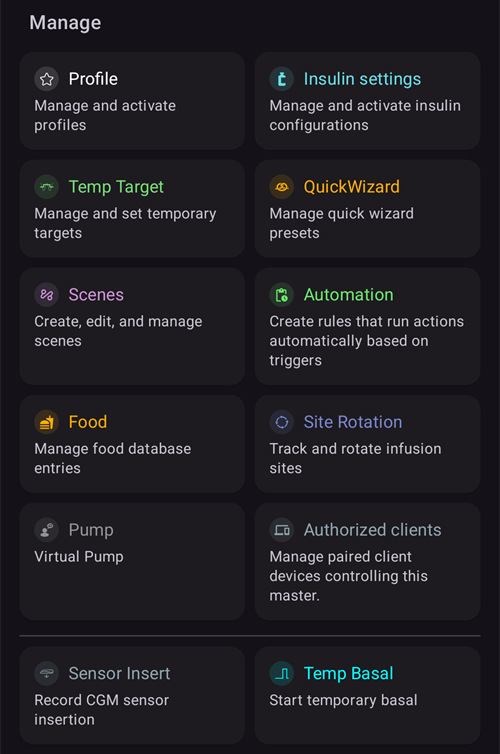
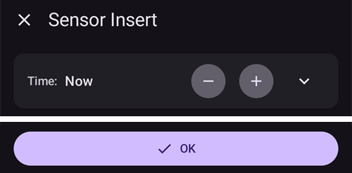
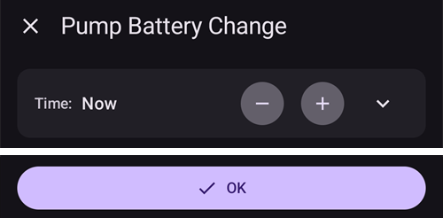
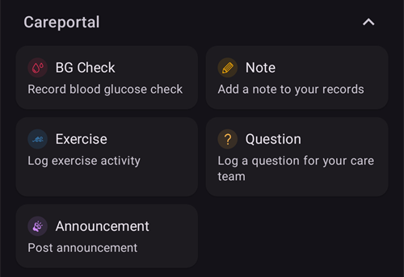
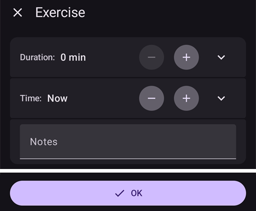

# Telas do AAPS

```{contents}
:backlinks: entry
:depth: 2
```

(the-homescreen)= (AapsScreens-the-homescreen)=

## A tela principal


Esta é a primeira tela que você vê quando abre o **AAPS**, e ela contém a maior parte das informações de que você vai precisar no dia a dia.

### Seção A - Barra superior

* O **menu** (☰) à esquerda abre o menu de navegação com **Histórico de tratamentos**, **Navegador do histórico**, **Estatísticas**, **Assistente de perfil**, **Manutenção**, **Assistente de Configuração**, **Configuração** e outros.
* A **barra de pesquisa** encontra configurações, diálogos e documentação. Basta começar a digitar (veja [Pesquisa global](../DailyLifeWithAaps/GlobalSearch.md)).
* O ícone **Configurações** (engrenagem) à direita abre todas as [configurações](../SettingUpAaps/Preferences.md).

(aaps-screens-profile--target)=

### Seção B - Bloco de status

#### Glicose atual

A última leitura de glicose do seu CGM aparece no círculo grande à esquerda, junto com a diferença em relação à leitura anterior (delta) e a idade da leitura.

A cor do valor de glicose mostra o estado em relação à [faixa](#Preferences-range-for-visualization) definida.

* verde = na faixa-alvo
* vermelho = abaixo da faixa
* amarelo = acima da faixa

  

(loop-status)= (AapsScreens-loop-status)=

#### Status do loop


Ao lado do círculo de glicose, um ícone mostra o modo de operação do loop (de cima para baixo na imagem):

1. Círculo verde = [loop fechado](#KeyAapsFeatures-ClosedLoop), loop em funcionamento
2. Círculo roxo com linha pontilhada = [suspensão por glicose baixa (LGS)](#KeyAapsFeatures-LGS)
3. Círculo azul com linha pontilhada = [loop aberto](#KeyAapsFeatures-OpenLoop)
4. Círculo vermelho com X = loop desativado (não funciona, de forma permanente)
5. Ícone vermelho de pausa = loop suspenso (pausado temporariamente, mas a insulina basal será administrada) - o tempo restante aparece ao lado do ícone
6. Círculo cinza com plugue = bomba desconectada (temporariamente nenhuma insulina é administrada) - o tempo restante aparece ao lado do ícone

Toque no ícone para abrir o diálogo do loop. O conteúdo do diálogo depende do estado atual:

* Enquanto o loop está **em funcionamento** (fechado, aberto ou LGS), você pode trocar o modo de operação (Loop Fechado, Suspensão por glicose baixa, Loop Aberto ou Desativar loop), **suspender** o loop ou **desconectar** a bomba por um tempo escolhido.
* Enquanto o loop está **desativado**, você pode ativá-lo de novo escolhendo um modo de operação, ou desconectar a bomba.
* Enquanto o loop está **suspenso**, você pode **continuar** o loop, desconectar a bomba ou escolher uma nova duração em **Suspender loop** para prolongar a suspensão.
* Enquanto a bomba está **desconectada**, você pode **reconectar** a bomba ou escolher uma nova duração em **Desconectar bomba** para prolongar a desconexão.

Quando você prolonga uma suspensão ou uma desconexão, a nova duração **começa a contar a partir de agora**: ela substitui o tempo restante, não é somada a ele. Você não precisa continuar ou reconectar antes.

O diálogo enquanto o loop está em loop fechado:


O diálogo enquanto o loop está suspenso, com **Continuar** e as durações para prolongar a suspensão:


O diálogo enquanto a bomba está desconectada, com **Reconectar Bomba** e as durações para prolongar a desconexão:


O diálogo em Suspensão por glicose baixa, em loop aberto e com o loop desativado só muda nos modos de operação que oferece:


Assim fica a tela principal em cada modo. A faixa colorida no topo do gráfico muda no momento da troca.

Suspensão por glicose baixa:


Loop aberto:


Loop desativado:


Loop suspenso — o tempo restante aparece ao lado do ícone:


Bomba desconectada — o tempo restante aparece ao lado do ícone. Os botões de tratamento continuam na barra de acesso rápido, então você ainda pode registrar insulina aplicada com caneta ou carboidratos:


É preciso confirmar depois de cada escolha.

```{admonition} Alarme: a bomba não aceitou a basal temporária zero :class: warning Enquanto a bomba está desconectada, o **AAPS** mantém uma basal temporária zero na bomba e a define de novo se ela estiver faltando. Se isso ainda falhar depois de 10 minutos, o **AAPS** dispara um alarme urgente: *"A bomba não aceitou a basal temporária zero. Ela ainda pode estar dando insulina basal. Verifique a bomba."* O alarme se repete a cada 15 minutos até que a basal temporária zero seja definida ou a desconexão termine. Se você vir esse alarme, verifique sua bomba: ela pode estar administrando insulina basal, embora o **AAPS** a mostre como desconectada.

    <br />Observação: os modos oferecidos dependem do seu progresso nos [Objetivos](../SettingUpAaps/CompletingTheObjectives.md) — Loop Fechado e LGS só ficam disponíveis à medida que você os conclui.
    
    (aaps-screens-bg-warning-sign)=
    #### Sinal de aviso de glicose
    
    Se o **AAPS** detectar um problema nas leituras de glicose que recebe, aparece na barra inferior da tela principal um atalho para sua fonte de BG (com o nome dela, por exemplo **xDrip+**), com um selo vermelho de aviso. Toque nele para abrir a [tela da fonte de BG](#aaps-screens-bg-source).
    
    ##### Dados de glicose duplicados
    
    O sinal vermelho de aviso diz que você precisa agir imediatamente: você está recebendo **dados de glicose duplicados**, e isso impede que o loop faça seu trabalho corretamente. O **AAPS** não consegue calcular de forma confiável a tendência da sua glicose a partir de leituras duplicadas, por isso ele para de corrigir.
    
    Se o seu loop estava fechado, o **AAPS** muda para o modo [Suspensão por glicose baixa (LGS)](#KeyAapsFeatures-LGS): o ícone do loop fica roxo.
    
      
    
    Toque no ícone do loop: o cartão **Restrições** no topo explica o motivo: "BgQualityCheck: Modo LGS devido a valores duplicados na fonte de glicemia".
    
      
    
    ```{admonition} Seu loop está funcionando em Suspensão por glicose baixa
    :class: note
    Seu loop continua funcionando, mas só para proteger você contra hipoglicemias: o **AAPS** ainda pode reduzir ou suspender sua basal, e não vai dar nenhuma insulina de correção até você resolver este problema!
    

Você precisa descobrir por que recebe glicemias duplicadas:

* A ponte Dexcom (bridge) está ativada no seu site do Nightscout? Desative a ponte no painel de administração da sua instância do Nightscout: edite a variável "enable" e remova dela a parte "bridge". (Para o heroku, [os detalhes estão aqui](https://nightscout.github.io/troubleshoot/troubleshoot/#heroku).)
* Várias fontes enviam sua glicose ao Nightscout? Se você usa o app BYODA, ative o envio no **AAPS**, mas não ative no xDrip, se você o usar.
* Você tem seguidores que recebem sua glicose, mas também a enviam de novo ao seu site do Nightscout?
* Último recurso: nas [configurações do NSClient](#Preferences-nsclient), abra as configurações de Sincronização e desative a opção "Receber dados de CGM do NS".

Para remover o aviso imediatamente e fazer seu loop voltar a corrigir, apague as entradas duplicadas na tela da fonte de BG: toque no atalho na barra inferior. A leitura duplicada aparece destacada em vermelho. Toque e segure uma leitura para começar a selecionar, marque as duplicadas e toque no ícone de lixeira no canto superior direito.


No entanto, quando há muitas duplicatas, pode ser mais fácil

* [faça backup das suas configurações](../Maintenance/ExportImportSettings.md),
* redefinir seu banco de dados no menu de manutenção e
* [importe suas configurações](../Maintenance/ExportImportSettings.md) de novo

    {admonition} Volte você mesmo para o Loop Fechado
    :class: important
    O **AAPS** não volta sozinho para **Loop Fechado** depois que as duplicatas são removidas. Toque no ícone do loop na tela principal e escolha **Loop Fechado** de novo.

##### Dados de glicose estáveis demais

Com algumas fontes de BG (Libre 1, AiDEX, Glutec, Medtronic e fontes que não informam o tipo de sensor), o **AAPS** também verifica se há leituras que não mudam: se sua glicose mudou menos de 2 mg/dl (0,1 mmol/l) em 45 minutos, os dados são considerados errados. O atalho da fonte de BG mostra então um selo vermelho de tendência plana, e o loop para qualquer basal temporária alta e não dá insulina de correção até as leituras mudarem de novo. Verifique seu sensor e o app que envia as leituras.

##### Dados de glicose irregulares

Quando as leituras chegam em intervalos irregulares ou algumas estão faltando, o **AAPS** recalcula valores de 5 minutos a partir das leituras que tem. Isso acontece, por exemplo, depois de uma troca de sensor, ou com sensores Libre, cujo horário se desloca um ou dois minutos a cada poucas horas. O loop continua funcionando e você não precisa fazer nada. O **AAPS** 4 não mostra mais um sinal de aviso amarelo para isso.

#### Perfil atual

O perfil atual aparece ao lado do ícone de estrela.

Toque no nome do perfil para abrir a [tela Perfil](#aaps-screens-profile), onde você pode ver os detalhes do perfil e [trocar entre perfis diferentes](../DailyLifeWithAaps/ProfileSwitch-ProfilePercentage.md).

Para **mudar a porcentagem do perfil** (e a duração), toque no nome do perfil e depois no botão redondo **▶** (Ativar) no canto inferior direito da tela Perfil. No **AAPS** 3.x esta tela abria com um toque longo no nome do perfil; no **AAPS** 4 um toque longo não faz nada. Passo a passo: [Alterar a porcentagem do perfil](#ProfileSwitch-change-percentage).


1. Exibição normal com a ativação de um perfil padrão.
2. Troca de perfil com uma porcentagem específica de 90% e uma duração restante de 9 minutos — o nome do perfil fica amarelo enquanto uma troca de perfil temporária está em andamento.
3. Troca de perfil com um deslocamento de tempo de 1 hora e uma duração restante de 9 minutos.

#### Alvo


O alvo de glicose atual aparece abaixo do nome do perfil.

Toque no alvo para abrir a tela **[Alvo temporário](../DailyLifeWithAaps/TempTargets.md)**.

1. Exibição normal: a faixa-alvo definida no seu perfil.
2. Se um alvo temporário estiver definido, o alvo fica amarelo/laranja com o ícone da predefinição usada, e o tempo restante em minutos aparece entre parênteses.

(AapsScreens-visualization-of-dynamic-target-adjustment)=

#### Visualização do ajuste dinâmico do alvo

Quando você usa o [algoritmo SMB](#Config-Builder-aps) e a função [Autosens](#Open-APS-features-autosens), o **AAPS** pode ajustar seu alvo de forma dinâmica, com base na sensibilidade.

Ative uma ou as duas opções a seguir nas [configurações do OpenAPS SMB](#Preferences-openaps-smb-settings):

* "Sensibilidade aumenta o alvo" e/ou
* "Resistência reduz o alvo"

Se o **AAPS** detectar resistência ou sensibilidade, o alvo muda em relação ao que está definido no perfil, e o alvo mostrado muda de cor para indicar o ajuste.

(aaps-screens-iob-cob-basal-sens)=

#### IOB, COB, basal e sensibilidade


1. **Seringa**: insulina ativa (IOB) - quantidade de insulina ativa no seu corpo  
    O valor da insulina ativa seria zero se só a sua basal padrão estivesse em andamento e não houvesse insulina restante de bólus anteriores. 
    * A IOB pode ser negativa se houve períodos recentes de basal reduzida.
    * Toque no chip para ver a divisão entre insulina de bólus e de basal (primeiro diálogo na imagem — aqui com IOB negativa depois de um período de basal reduzida)
2. **Grão**: [carboidratos ativos (COB)](../DailyLifeWithAaps/CobCalculation.md) - carboidratos que você comeu antes e que ainda não foram absorvidos
3. O botão azul-petróleo à direita mostra a **basal administrada atualmente**: uma linha reta quando a basal do perfil está em andamento, um ícone diferente enquanto uma taxa basal temporária está ativa
4. A **linha de porcentagem** mostra a sensibilidade atual ([Autosens](#Open-APS-features-autosens) / [ISF dinâmico](../DailyLifeWithAaps/DynamicISF.md)). Quando o loop muda seu ISF, a linha também mostra o ISF do perfil, uma seta e o ISF que o loop usa agora, por exemplo "80% 2,0 ↗ 2,5". Toque nela para ver o valor do Autosens e o ISF efetivo (segundo diálogo na imagem). Se o loop trabalha com um valor diferente do último resultado do Autosens (por exemplo, porque um alvo temporário muda sua sensibilidade), o diálogo também mostra esse valor como **Autosens no algoritmo**. Quando o Autosens está desligado, o loop mantém o ISF do seu perfil e nenhum ISF efetivo é mostrado.

O diálogo de IOB, aberto ao tocar no chip de IOB:


Toque no botão azul-petróleo para ver a taxa basal temporária em andamento, quando ela começou e há quanto tempo está em andamento:


(aaps-screens-carbs-required)=

#### Carboidratos necessários


Sugestões de carboidratos são dadas quando o algoritmo de referência detecta que você precisa de carboidratos.

Isso acontece quando o algoritmo oref acha que não consegue evitar a hipoglicemia com uma basal temporária zero, e você vai precisar de carboidratos para corrigir.

As notificações de carboidratos são muito mais sofisticadas que as da calculadora de bólus. Você pode ver uma sugestão de carboidratos enquanto a calculadora de bólus não mostra carboidratos faltando.

As notificações de carboidratos necessários podem ser enviadas ao Nightscout, se você quiser. Nesse caso, um anúncio será mostrado e transmitido.

### Seção C - Linha de status


A linha de status dá um aviso visual para

* Idade da cânula
* Idade da insulina (dias de uso do reservatório) e nível do reservatório (unidades)
* Idade do sensor
* Idade e nível da bateria da bomba (%)

Se o limite de aviso for ultrapassado, os valores serão mostrados em amarelo.

Se o limite crítico for ultrapassado, os valores serão mostrados em vermelho.

The age is always shown in its short form, whatever the screen size: *4h* on the first day, *3d4h* later.

Os limites podem ser alterados pelo pequeno ícone **Configurações** que aparece quando a linha de status está **expandida** (seta à direita) — veja [Luzes de status](#Preferences-status-lights).

O painel de status expandido também tem um botão no fim de algumas linhas para registrar uma troca, o que zera a idade correspondente: **Adicionar** na linha **Sensor** registra uma inserção de sensor. Se a sua bomba permitir, **Purgar/Preencher** aparece nas linhas **Cânula** (ou **Bomba patch**) e **Insulina**, e **Adicionar** na linha **Bateria da bomba**.


Dependendo da bomba que você usa, talvez você não tenha todos estes ícones.

(screens-sensor-level-battery)=

#### Nível do sensor (bateria)

Funciona com CGM com um transmissor adicional, como o MiaoMiao 2. (Tecnicamente, o sensor precisa enviar a informação do nível da bateria para o xDrip.)

Os limites podem ser definidos em [Luzes de status](#Preferences-status-lights).

(aaps-screens-main-graph)=

### Seção D - Gráfico principal


O gráfico mostra sua glicose (BG) como lida pelo seu monitor de glicose (CGM).

Use os gestos de rolar e de pinça (zoom) no gráfico para mudar o período visível.

A área verde mostra sua faixa-alvo.

Estas informações também aparecem neste gráfico:

* Bólus manuais: triângulo azul logo acima da curva de glicose, apontando para baixo, para a leitura daquele momento, com a quantidade de insulina
* Registros de carboidratos: triângulo laranja logo abaixo da curva de glicose, apontando para cima, para a leitura, com a quantidade de carboidratos. Uma refeição registrada com o seu bólus parece um só marcador, dividido pela leitura.
* Os triângulos têm três tamanhos (pequeno, médio, grande), conforme a quantidade comparada com a maior do dia. Se não houver leitura de glicose naquele momento (falha do sensor), o triângulo é desenhado na parte de baixo do gráfico.
* Verificações de glicose e calibrações: desenhadas no próprio valor medido, para você poder compará-las com a curva do sensor
* Alvo definido no perfil ou alterado por um alvo temporário: linha verde
* Trocas de perfil: ícones de estrela no topo do gráfico
* Status do loop: faixa colorida no topo do gráfico quando o [modo de operação](#AapsScreens-loop-status) é diferente de loop fechado: azul = loop aberto, roxo = LGS, vermelho = loop desativado, amarelo = loop suspenso, cinza = bomba desconectada, laranja = superbolus (na captura de tela: roxo, depois amarelo). O histórico dessas mudanças aparece em [Modo de operação](#AapsScreens-running-mode)
* Os [SMBs](#Open-APS-features-super-micro-bolus-smb) não são desenhados no gráfico de glicose (haveria um a cada poucos minutos): eles aparecem no [gráfico de IOB](#aaps-screens-iob).

Toque em uma **Verificação BG** no gráfico para ver o valor dela e a sua anotação, se você escreveu uma.

(aaps-screens-graph-press-and-hold)=

#### Ver os valores em um momento

**Toque e segure** o gráfico de glicose por um momento para ver os valores de uma leitura. Um ponto marca a leitura mais próxima, uma linha tracejada é desenhada nesse momento em todos os gráficos, e uma janela no topo do gráfico mostra:

* a hora e o valor da glicose
* IOB, COB (só quando for maior que 0 g) e a taxa basal naquele momento — o ícone da basal mostra se uma taxa basal temporária estava em andamento, como na tela principal
* qualquer bólus, SMB ou carboidrato naquele momento, com os mesmos triângulos dos gráficos

Mantenha o dedo na tela e mova-o para a esquerda ou para a direita para ir de uma leitura para a próxima. Você sente uma leve vibração em cada leitura, e o gráfico não rola enquanto você faz isso. A janela fica na tela por 2 segundos depois que você levanta o dedo.

Isso funciona da mesma forma nos [gráficos adicionais](#aaps-screens-additional-graphs) abaixo do gráfico de glicose (IOB, COB...): toque e segure qualquer um deles.


(aaps-screens-graph-clock-change)=

#### Clock changes

When the clock of the phone jumped, at a daylight saving change or in a new time zone, a dashed vertical line marks that moment in the BG graph, with a small clock icon at its foot. The same dashed line runs through the [additional graphs](#aaps-screens-additional-graphs) below.


(AapsScreens-activate-optional-information)=

#### Ativar informações opcionais

Toque no ícone de **lápis** no canto superior direito do gráfico para abrir as configurações do gráfico:


* **Altura do gráfico** ajusta a altura em que o gráfico é desenhado.
* **ACT** sobrepõe a curva de atividade da insulina: uma linha contínua amarelo-esverdeada <span style="background:#141218;color:#D3F166;padding:0 0.3em;border:1px solid #141218;border-radius:4px">━━━━</span> (não confunda com a previsão UAM amarela pontilhada)
* **PRED** sobrepõe as [linhas de previsão](#aaps-screens-prediction-lines) (veja abaixo)

(aaps-screens-prediction-lines)=

#### Linhas de previsão

Quando **PRED** está ligado, o AAPS desenha as previsões como **linhas pontilhadas** à direita da linha "agora". Cada previsão tem sua própria cor. O tema escuro usa tons mais claros das mesmas cores, e uma linha dentro da faixa-alvo verde pode parecer um pouco mais verde.

| Linha                    | Tema claro                                                                                                                        | Tema escuro                                                                                                                        | O que ela prevê                         |
| ------------------------ | --------------------------------------------------------------------------------------------------------------------------------- | ---------------------------------------------------------------------------------------------------------------------------------- | --------------------------------------- |
| **IOB** (azul)           | <span style="background:#FFFFFF;color:#1E88E5;padding:0 0.3em;border:1px solid #CCCCCC;border-radius:4px">●●●●</span>             | <span style="background:#141218;color:#64B5F6;padding:0 0.3em;border:1px solid #141218;border-radius:4px">●●●●</span>              | só insulina                             |
| **COB** (laranja)        | <span style="background:#FFFFFF;color:#FB8C00;padding:0 0.3em;border:1px solid #CCCCCC;border-radius:4px">●●●●</span>             | <span style="background:#141218;color:#FFB74D;padding:0 0.3em;border:1px solid #141218;border-radius:4px">●●●●</span>              | carboidratos ativos                     |
| **UAM** (amarelo)        | <span style="background:#FFFFFF;color:#C9BD60;padding:0 0.3em;border:1px solid #CCCCCC;border-radius:4px">●●●●</span>             | <span style="background:#141218;color:#E6D39A;padding:0 0.3em;border:1px solid #141218;border-radius:4px">●●●●</span>              | refeição não anunciada                  |
| **ZT** (ciano)           | <span style="background:#FFFFFF;color:#00D2D2;padding:0 0.3em;border:1px solid #CCCCCC;border-radius:4px">●●●●</span>             | <span style="background:#141218;color:#4DD4D4;padding:0 0.3em;border:1px solid #141218;border-radius:4px">●●●●</span>              | basal temporária zero (insulina parada) |
| **aCOB** (laranja-claro) | <span style="background:#FFFFFF;color:rgba(251,140,0,0.5);padding:0 0.3em;border:1px solid #CCCCCC;border-radius:4px">●●●●</span> | <span style="background:#141218;color:rgba(255,183,77,0.5);padding:0 0.3em;border:1px solid #141218;border-radius:4px">●●●●</span> | só o algoritmo mais antigo AMA          |

Quando duas previsões dão os mesmos valores, os pontos se sobrepõem e você só vê uma das cores (por exemplo, UAM sobre IOB quando a glicose está estável).

* Linha **COB** (laranja): [carboidratos ativos](CobCalculation) (o laranja é usado em todo o AAPS para COB e carboidratos)
    
    Esta linha de previsão mostra para onde sua glicose (não o próprio COB!) vai, com base nas configurações atuais do **Perfil**, supondo que os desvios causados pela absorção de carboidratos fiquem constantes. Esta linha só aparece se houver COB conhecido.

* Linha **IOB** (azul): insulina ativa (o azul é usado em todo o AAPS para IOB e insulina)
    
    Esta linha de previsão mostra o que aconteceria só sob a influência da insulina. Por exemplo, se você aplicou insulina e depois não comeu nenhum carboidrato.

* Linha **ZT** (ciano): basal temporária zero (glicose prevista se fosse definida uma taxa basal temporária de 0%)
    
    Esta linha de previsão mostra como a trajetória da glicose mudaria se a bomba parasse toda a administração de insulina (TBR de 0%). A linha para quando sobe acima do seu alvo.
    
    *Esta linha só aparece quando o algoritmo [SMB](#Config-Builder-aps) é usado.*

* Linha **UAM** (amarelo): [refeições não anunciadas](#SensitivityDetectionAndCob-sensitivity-oref1)
    
    Refeições não anunciadas significa que foi detectado um aumento significativo da glicose causado por refeições, adrenalina ou outras influências. Esta linha de previsão é parecida com a **linha laranja de COB**, mas supõe que os desvios vão diminuir a uma taxa constante (prolongando a taxa atual de redução).
    
    *Esta linha só aparece quando o algoritmo [SMB](#Config-Builder-aps) é usado, **Ativar UAM** está ligado nas configurações do OpenAPS SMB e a glicose está subindo mais do que a insulina sozinha explica.*

* Linha **aCOB** (laranja-claro, transparente): absorção acelerada de carboidratos
    
    Parecida com a COB, mas supõe uma taxa fixa de absorção de carboidratos de 10 mg/dl/5m (-0,555 mmol/l/5m). Obsoleto e de utilidade limitada.
    
    *Esta linha só aparece quando o algoritmo mais antigo [AMA](#Config-Builder-aps) é usado.*

Normalmente, sua curva real de glicose fica no meio dessas linhas, ou perto daquela cujas suposições mais se parecem com a sua situação.

(aaps-screens-how-predictions-become-a-dosing-decision)=

#### Como o AAPS transforma previsões em uma decisão de dose

O AAPS não dosa insulina só com base na sua glicose atual — a cada ciclo do loop (mais ou menos a cada 5 minutos), ele olha para todas as linhas de previsão acima juntas e calcula o caminho mais seguro.

A regra principal é **segurança em primeiro lugar**: se *qualquer* linha de previsão, em qualquer período, cair abaixo do seu limite de segurança baixo, o AAPS define uma basal temporária zero (taxa basal temporária de 0%) e não dá mais insulina, mesmo que sua glicose atual esteja alta. Só quando todas as linhas de previsão ficam acima desse limite o AAPS considera dar mais insulina.

Quando é seguro dar mais insulina, o AAPS olha onde a glicose deve terminar no final (a **glicose final**, eventual BG) nas previsões combinadas, e calcula quanta correção é necessária para trazer essa glicose final de volta ao alvo — administrada como uma taxa basal temporária aumentada ou (se o algoritmo oref1/[SMB](#Open-APS-features-super-micro-bolus-smb) estiver ativado) como um pequeno bólus imediato. Se a glicose está alta agora, mas já está caindo o suficiente sozinha, o AAPS vai esperar, ou pode até reduzir a taxa basal, em vez de adicionar insulina que só deixaria uma hipoglicemia futura ainda mais baixa.

Para exemplos práticos desta lógica de decisão, com capturas de tela reais, veja os [cenários de dose no Guia para médicos](#clinicianguide-dosing-scenarios) — eles foram escritos para médicos, mas valem para qualquer usuário do AAPS.

*Para a explicação técnica completa de como essas previsões e a decisão de dose resultante são calculadas, veja a [documentação do determine-basal do OpenAPS](https://openaps.readthedocs.io/en/latest/docs/While%20You%20Wait%20For%20Gear/Understand-determine-basal.html).*

#### Basais

Uma linha **azul contínua** mostra a basal administrada pela sua bomba e reflete a administração real ao longo do tempo.

A linha **azul pontilhada** mostra qual seria a taxa basal se não houvesse ajustes temporários da basal (TBRs).

Quando a taxa basal padrão é administrada, a área sob a curva aparece em azul-escuro. Quando a taxa basal é ajustada temporariamente (aumentada ou reduzida), a área sob a curva aparece em azul-claro.

#### Atividade

A linha **amarela fina** mostra a atividade da insulina.

Ela se baseia na queda esperada da glicose causada pela insulina no seu corpo, se nenhum outro fator (como carboidratos) estiver presente.

(AapsScreens-section-g-additional-graphs)= (aaps-screens-additional-graphs)=

### Seção E - Gráficos adicionais

Você pode ativar gráficos adicionais abaixo do gráfico principal. No [Modo simples](#preferences-simple-mode), os gráficos adicionais são predefinidos e não podem ser alterados. Desligue o **Modo simples** se quiser definir sua própria configuração de gráficos adicionais.

Os gráficos adicionais acompanham o gráfico principal: quando você rola ou dá zoom no gráfico de glicose, eles se movem junto. Arrastar para o lado em um gráfico adicional também rola todos os gráficos. Eles não têm marcações de hora próprias — leia a hora no gráfico de glicose.

Para configurar um gráfico adicional, toque no ícone de **lápis** no canto superior direito dele:


Selecione os chips dos dados que você quer ver neste gráfico; o botão **Remover** apaga o gráfico.

Para criar mais um gráfico, toque em **Adicionar gráfico** abaixo do último gráfico e selecione os chips da mesma forma:


O novo gráfico é adicionado abaixo dos outros — aqui um segundo gráfico adicional com **SENS%** e **DEV**:


A maioria dos usuários acha adequada a seguinte configuração de gráficos adicionais:

* Gráfico 1 com IOB, COB, Mudança de sensibilidade
* Gráfico 2 com Desvios e BGI.

#### Insulina absoluta (ABS)

Insulina ativa, incluindo bólus **e basal**.

(aaps-screens-iob)=

#### Insulina ativa (IOB)

Mostra a insulina ativa (IOB) (= insulina ainda ativa no seu corpo). Inclui a insulina de bólus e de basal temporária (**mas exclui as taxas basais definidas no seu perfil**).

Se não houvesse [SMBs](#Open-APS-features-super-micro-bolus-smb), nenhum bólus e nenhuma TBR durante o tempo de DIA, este valor seria zero.

Os SMBs aparecem neste gráfico como triângulos azuis, em três tamanhos, conforme a quantidade comparada com o maior SMB do dia.

A IOB pode ser negativa se você não tiver bólus restante e tiver uma basal temporária zero/baixa por um tempo mais longo.

A redução depende das suas [configurações de DIA e tipo de insulina](#Config-Builder-insulin-dia).

#### Carboidratos ativos (COB)

Mostra os carboidratos ativos (COB) (= carboidratos ainda não absorvidos no seu corpo).

A redução depende dos [desvios que o algoritmo detecta](../DailyLifeWithAaps/CobCalculation.md).

Se for detectada uma absorção de carboidratos maior que a esperada, insulina será administrada e isso aumentará a IOB (mais ou menos, dependendo das suas configurações de segurança).

#### Mudança de sensibilidade (SENS%)

Mostra a sensibilidade que o [Autosens](#Open-APS-features-autosens) detectou.

A sensibilidade é um cálculo da sensibilidade à insulina como resultado de exercício, hormônios etc.

Observe que você precisa estar no [Objetivo 8](#objectives-objective8) para que a detecção de sensibilidade/o [Autosens](#Open-APS-features-autosens) ajuste automaticamente a quantidade de insulina administrada. Antes de chegar a esse objetivo, a linha no seu gráfico é mostrada só como informação.

### Sensibilidade variável (VSENS)

Mostra a sensibilidade calculada pelo [ISF dinâmico](../DailyLifeWithAaps/DynamicISF.md). Só tem dados se você usar este recurso.

(screen-heart-rate-steps)=

#### Frequência cardíaca (FC) & Passos

Estes dados podem estar disponíveis quando você usa um [smartwatch Wear](../WearOS/WearOsSmartwatch.md). Ative-os no app Wear do **AAPS** e dê permissão para os dados de saúde.

Steps are drawn as columns, and the heart rate as a curved line that breaks where the watch sent no data.

#### Desvios (DEV)

* Barras **cinza** mostram um desvio causado por carboidratos.
* Barras **verdes** mostram que a glicose está mais alta do que o algoritmo esperava. As barras verdes são usadas para aumentar a resistência no [Autosens](#Open-APS-features-autosens).
* Barras **vermelhas** mostram que a glicose está mais baixa do que o algoritmo esperava. As barras vermelhas são usadas para aumentar a sensibilidade no [Autosens](#Open-APS-features-autosens).
* Barras **amarelas** mostram um desvio causado por UAM.
* Barras **pretas** mostram pequenos desvios que não são considerados para a sensibilidade

#### Impacto na glicose (-BGI)

Esta linha mostra quanto a glicose "deveria" subir ou cair só com base na atividade da insulina.


É uma boa combinação mostrar esta linha junto com as barras de Desvios. Elas usam a mesma escala, mas uma escala diferente dos outros dados opcionais, por isso é uma boa ideia mostrá-las em um gráfico separado, como mostrado acima. Comparar a linha de BGI com as barras de Desvios é outra forma de entender como a **glicose** varia. Aqui, no momento marcado com **1**, as barras de Desvios estão bem acima da linha de BGI: a glicose sobe mais do que a atividade da insulina sozinha explica (por exemplo, depois de carboidratos). No momento marcado com **2**, as barras de Desvios estão abaixo de zero (vermelhas): a glicose está mais baixa do que o algoritmo esperava.

### Seção F - Barra de acesso rápido


A barra flutuante na parte de baixo da tela contém suas ações de **[acesso rápido](../DailyLifeWithAaps/QuickLaunch.md)**. A pequena **engrenagem** abre a configuração do acesso rápido, onde você escolhe quais botões aparecem (tratamentos, registros do CarePortal, ações do CGM, as telas do painel **Gerenciar**, botões do [Assistente rápido](../DailyLifeWithAaps/QuickWizards.md), [Cenários](../DailyLifeWithAaps/Scenes.md) e mais).

Uma configuração típica aparece acima: **Insulina**, **Carboidratos** e o **Assistente de Bólus**.

Enquanto a bomba está **desconectada**, os botões de tratamento continuam na barra, por exemplo para registrar insulina aplicada com caneta (veja [Insulina](#aaps-screens-buttons-insulin) abaixo). As mesmas ações também estão disponíveis no [painel Tratamentos](#aaps-screens-treatments-sheet) da navegação inferior.

(aaps-screens-buttons-insulin)=

#### Insulina


Para dar uma certa quantidade de insulina sem usar a [calculadora de bólus](#aaps-screens-bolus-wizard).

Ao ativar **Iniciar Comer em breve TT**, você pode iniciar automaticamente seu [alvo temporário Comer em breve](#TempTargets-eating-soon-temp-target).

Se você não quer dar o bólus pela bomba, mas registrar uma quantidade de insulina (por exemplo, insulina aplicada com caneta), ative "**Bólus será apenas registrado (não administrado pela bomba)**". Uma linha adicional **Hora**, definida como **Agora**, permite registrar uma injeção de insulina feita no passado: use **-** / **+** para mudá-la, ou toque na seta para digitar os minutos ou escolher uma data e hora.

 

Você pode usar os botões **+0,5 / +1,0 / +2,0** para aumentar rapidamente a quantidade de insulina. Os valores dos incrementos podem ser alterados nas [configurações do Assistente de Bólus](#Preferences-deliver-this-part-of-bolus-wizard-result).

O diálogo de insulina também pode ser usado quando a bomba está suspensa ou desconectada, por exemplo para registrar insulina injetada com caneta. Nesse caso, "**Bólus será apenas registrado (não administrado pela bomba)**" fica ligado à força (mostrado em vermelho) e aparecem campos adicionais para escolher o tipo de insulina e um ajuste de **Hora** para uma injeção feita no passado:


#### Carboidratos


Para registrar carboidratos sem dar bólus.

Alguns [alvos temporários predefinidos](#TempTargets-hypo-temp-target) (Hipo, Comer em breve, Atividades) podem ser iniciados diretamente com os interruptores no topo.

**Tempo dos carboidratos**: quando você vai comer ou comeu os carboidratos.

**Duração**: usada para ["carboidratos estendidos"](ExtendedCarbs). Esta linha fica recolhida para que você não digite os gramas nela por engano: use **-** / **+** para mudá-la, ou toque na seta para abri-la e digitar um valor.

Você pode usar os botões **+5 / +10 / +20** para aumentar rapidamente a quantidade de carboidratos.

#### Assistente rápido

Registre facilmente a quantidade de carboidratos e defina a base do cálculo com um único botão pré-configurado.

Os detalhes são configurados em [Assistente rápido](../DailyLifeWithAaps/QuickWizards.md).

(aaps-screens-treatments-sheet)=

### Seção G - Navegação inferior

A barra de navegação inferior dá acesso a:

* **Tratamentos** — um painel de ações rápidas com suas ações de tratamento:
    
    

* **Cenários** — só aparece quando você tem pelo menos um [cenário](../DailyLifeWithAaps/Scenes.md) ou uma regra de **Automação** marcada como **Ação do usuário**. Abre um painel em que você pode iniciá-los; um selo mostra quantos você pode iniciar agora. O **lápis** no topo do painel abre **Gerenciar → Cenários**.

* **Gerenciar** — o centro de tudo o que você gerencia no **AAPS**: Perfil, Configurações de insulina, Alvo temporário, Assistente rápido, Cenários, Automação, Alimentos, Rotação do local, Bomba e Clientes autorizados. Abaixo deles ficam ações de dispositivos e de basal, como Inserção do sensor e Basal temporária. Alguns itens só aparecem quando se aplicam ao seu sistema — por exemplo, Purgar/Preencher e a troca de bateria dependem da sua bomba, e Basal temporária, Bólus estendido e os registros do CarePortal ficam ocultos no [Modo simples](#preferences-simple-mode):
    
    

* **Objetivos** — seu progresso nos [Objetivos](../SettingUpAaps/CompletingTheObjectives.md); um selo mostra quantos foram concluídos. Este item desaparece quando todos os objetivos estão concluídos, e não existe no **AAPSClient**.

(aaps-screens-notifications)=

#### Notificações

Uma **bolha de notificações** pode aparecer acima da barra inferior, à direita. Ela reúne as notificações ativas do **AAPS**; o pequeno número mostra quantas são. A cor dela segue a mais importante: vermelho para uma mensagem urgente, verde para uma simples informação.


Toque na bolha para abrir o painel **Notificação**. Cada mensagem mostra a hora em que foi gerada. Toque em **Dispensar** abaixo de uma mensagem para removê-la; algumas mensagens têm outro botão no lugar, que leva você para a configuração que precisa da sua atenção.


(bolus-wizard)= (aaps-screens-bolus-wizard)=

## Assistente de Bólus


Quando você quer dar um bólus de refeição, normalmente é daqui que você o faz.

### Seção I

O cabeçalho **Cálculo** mostra o bólus calculado. Se a insulina ativa já for maior que o bólus calculado, será mostrada apenas a quantidade de carboidratos ainda necessária.

A calculadora de bólus pode ser usada qualquer que seja sua **glicose** atual, também quando ela está muito alta ou muito baixa. Se a **glicose** estiver acima do alvo, uma correção é adicionada ao bólus de refeição. Se a **glicose** estiver abaixo do alvo, o bólus é reduzido e, se a insulina ativa já for maior que a necessária, a calculadora informa quantos carboidratos ainda são necessários, em vez de propor insulina.

A linha de ícones abaixo do cabeçalho mostra quais dados entram no cálculo (glicose, tendência, IOB, alvo temporário, COB). Tocar em um ícone inclui / exclui esse dado do cálculo; o ícone **(i)** mostra os números detalhados por trás do cálculo.

#### Combinações de COB e IOB e o que elas significam

* Por segurança, o dado IOB não pode ser desativado quando o COB está ativado, porque você poderia correr o risco de receber insulina demais, já que o **AAPS** não estaria considerando o que já foi administrado.
* Se você ativar COB e IOB, serão considerados os carboidratos não absorvidos que ainda não foram cobertos com insulina + toda a insulina administrada como TBR ou SMB.
* Se você ativar IOB sem COB, o **AAPS** considera a insulina já administrada, mas não a desconta dos carboidratos que ainda serão absorvidos. Isso leva a um aviso de "carboidratos faltando".
* Se você der bólus para **alimentos adicionais** logo depois de um bólus de refeição (por exemplo, uma sobremesa a mais), pode ser útil **desativar todos os dados de entrada**. Assim, só os novos carboidratos são adicionados, pois a refeição principal não será necessariamente absorvida, e a IOB não corresponderá exatamente ao COB logo após um bólus de refeição.
* Por segurança, um **alvo temporário** só é incluído no cálculo se você ativar esse dado manualmente.

(AapsScreens-section-j)=

### Seção J - Campos de entrada

No campo **Carboidratos**, você informa sua estimativa da quantidade de carboidratos, **em gramas**, para a qual quer dar bólus; os botões **+** abaixo dele adicionam carboidratos rapidamente. O **AAPS** só trabalha com gramas: se você conta em unidades de pão ou porções de troca (*por exemplo*, as trocas "CHO" do DAFNE), converta-as para gramas antes de registrá-las. Veja a [observação sobre unidades de pão](#your-aaps-profile-insulin-to-carbs-ratio) na página do perfil.

#### Tipo de carboidratos: pão, bolo ou pizza

Abaixo do campo **Carboidratos**, os botões **Pão**, **Bolo** e **Pizza** informam ao **AAPS** com que rapidez a refeição é absorvida. Com **Bolo** e **Pizza**, o bólus cobre só uma parte dos carboidratos agora, e o resto é adicionado mais tarde como eCarbs. Veja [Tipo de carboidratos: pão, bolo ou pizza](#AapsScreens-carbs-type) na página Carboidratos estendidos para as porcentagens e os horários.

A linha **Correção** serve para quando você quer modificar a dose final por algum motivo.

Só o campo **Carboidratos** fica sempre aberto. As outras linhas (**Correção**, **Tempo dos carboidratos**, **Glicose** e **Usar porcentagem**) ficam recolhidas: elas mostram o valor com os botões **-** / **+**, para você poder mudá-lo em pequenos passos. Toque na seta para abrir uma linha e digitar um valor, e toque de novo para fechar a linha. Isso evita digitar gramas no campo **Correção** por engano.


Toque em qualquer lugar da linha **Perfil** para abrir a lista dos seus perfis e depois toque em um nome para usar esse perfil neste cálculo.


O campo **Tempo dos carboidratos** serve para o pré-bólus: assim você informa ao sistema que vai haver um atraso antes de os carboidratos chegarem. Você pode colocar um número negativo neste campo se estiver dando bólus para carboidratos passados.

**Definir alarme** (lembrete de refeição): quando um tempo dos carboidratos no futuro é informado, aparece um interruptor "**Definir alarme**" para lembrar você, na hora indicada, de comer os carboidratos que você registrou no **AAPS**:


The reminder starts when the bolus has been delivered. While it runs, a **Time to eat** bar on the main screen counts down, with **Stop** and **+5 min**. **+5 min** moves the end of the wait five minutes later, and the bar shows the total wait. When the time has come, the reminder rings with its own sound, a soft kitchen timer. Besides **Silence alarm** (the screen stays open) and **Silence and close**, the alarm screen offers **+5 min**, which starts a new five-minute wait. Once it has rung, the bar reads *The time is up* with **+5 min** and **Dismiss**; **Silence and close** removes the bar too. The bar and the alarm are also shown on **AAPSClient**, and on the [watch](#WearOsSmartwatch-wizard-carb-time). The reminder does not create a timer in your phone's clock app. If Android does not let **AAPS** set alarms, the wizard asks you to allow *Alarms and reminders* for **AAPS** in the Android settings. The bell is not offered for a carb time in the past.


O campo **Glicose** normalmente já vem preenchido com a última leitura do seu CGM. Se você não tiver um CGM funcionando, ele ficará em branco. Quando a leitura é recente, a linha **Glicose** fica recolhida. The field follows new readings while the wizard is open, until you change it yourself.

O botão de resultado na parte de baixo mostra o bólus proposto; ao tocar nele, é pedida uma confirmação antes de qualquer insulina ser administrada. While the confirmation is waiting, the loop gives no SMB, so the bolus you confirm is still right. If an SMB is being delivered at that moment, **OK** waits until it has finished.

Bom saber:

* Se o bólus calculado for maior que o seu **[Bólus máximo](#Preferences-maximum-bolus)**, ele é reduzido ao bólus máximo, e a confirmação mostra o aviso "Restrição de bólus aplicada". Já um [Assistente rápido](../DailyLifeWithAaps/QuickWizards.md) é recusado.
* Quando o bólus é apenas registrado (por exemplo, enquanto a bomba está desconectada), o aviso "**Bólus será apenas registrado (não administrado pela bomba)**" fica no topo do diálogo, também quando você rola a tela.
* Um bólus que você dá manualmente tem prioridade sobre um [SMB](#Open-APS-features-super-micro-bolus-smb) que está esperando para ser administrado: o SMB é descartado e o loop calcula de novo. Se um SMB estiver sendo administrado neste momento, seu bólus é recusado com a mensagem "Um SMB está sendo administrado agora. Tente novamente quando ele terminar." Nenhuma insulina é administrada, e os carboidratos registrados com esse bólus não são salvos: espere um momento e registre-os de novo.

(AapsScreens-wrong-cob-detection)=

#### Detecção errada de COB


Se você vir o aviso acima depois de usar o Assistente de Bólus, o **AAPS** detectou que o valor de COB calculado pode estar errado. Por isso, se você quiser dar bólus de novo depois de uma refeição anterior com COB, tenha cuidado com uma superdosagem!

Para mais detalhes, veja as dicas na [página Cálculo do COB](#CobCalculation-detection-of-wrong-cob-values).

Procurando a aba **Ações** do **AAPS** 3.x? As funções dela foram para a tela principal, o painel **Gerenciar** e a barra de acesso rápido: veja [Para onde foi a aba Ações?](#screens-action-tab).

(aaps-screens-careportal)=

## Registros do CarePortal

As idades e os níveis mostrados na [linha de status](#screens-sensor-level-battery) (sensor, insulina, cânula, bateria da bomba) se baseiam em registros do CarePortal: **Purgar/Preencher** (registra trocas do local da bomba e do cartucho de insulina), **Inserção do sensor** e **Troca de Bateria da Bomba**.

Você pode registrá-los no painel de status expandido da tela principal, no painel **Gerenciar** ou com botões de [acesso rápido](../DailyLifeWithAaps/QuickLaunch.md).

**Purgar/Preencher** registra uma troca do local da bomba e/ou do cartucho de insulina, e pode administrar uma quantidade de purga:


**Inserção do sensor** e **Troca de Bateria da Bomba** só pedem a hora do evento:



 Os registros de exercício, anúncio, pergunta e anotação seguem o CarePortal do Nightscout e são formas especiais de anotações.

No painel **Gerenciar**, role para baixo e toque em **CarePortal** para mostrar estes registros: **Verificação BG**, **Anotação**, **Exercício**, **Pergunta** e **Anúncio**.



**Verificação BG**, **Pergunta** e **Anúncio** permitem informar um valor de glicose (de um medidor, do sensor ou de outra fonte), uma anotação e a hora do evento. Em **Pergunta** e **Anúncio**, a linha de glicose fica recolhida e mostra o tipo de medição ao lado do valor: se você mudar o valor, o tipo muda de **Sensor** para **Medidor**.


**Anotação** e **Exercício** permitem informar uma duração (uma linha recolhida: use **-** / **+**, ou toque na seta para digitá-la), uma anotação e a hora do evento:



Em todos esses diálogos (**Purgar/Preencher**, **Inserção do sensor**, **Troca de Bateria da Bomba** e os registros do CarePortal), a hora do evento usa a mesma linha **Hora** do [diálogo de insulina](#aaps-screens-buttons-insulin) e do Assistente de Bólus: use **-** / **+** para mudar a hora em passos de 5 minutos (até uma semana para trás e 12 horas para frente), ou toque na seta para escolher qualquer data e hora.

## Rotação do local

**Gerenciar → Rotação do local** registra em um mapa do corpo onde cada cânula e cada sensor foram colocados, para você poder fazer o rodízio dos locais: veja [Rotação do local](#Aapsscreens-site-rotation) na página Bombas e cânulas.

A **TDD** (dose diária total) e a regra prática da relação basal/bólus são explicadas na [aba Insulina das Estatísticas](#reviewing-tdd).

(AapsScreens-insulin-profile)=

## Insulina


**Gerenciar → Configurações de insulina** mostra e gerencia suas configurações de insulina. Cada configuração aparece em um cartão com o **tempo de pico** e a **[DIA](#Config-Builder-insulin-dia)**; a que está em uso é marcada como **ATIVO**. Abaixo do cartão você vê a curva de atividade. Você pode editar o apelido, o pico e a DIA de qualquer configuração, exceto a ativa: para mudar a insulina que você usa, [adicione uma nova configuração e ative-a](#Config-Builder-insulin-change-active).

Veja [Duração da ação da insulina](#Config-Builder-insulin-dia) para saber mais sobre o que ela é e como defini-la.

## Status da bomba


**Gerenciar → Bomba** (ou **Configuração → Bomba → Abrir plugin**) mostra o status da sua bomba: última conexão, taxa basal base, bateria, reservatório...

* As informações mostradas dependem do modelo da sua bomba.
* Veja a [página de bombas](../Getting-Started/CompatiblePumps.md) para mais detalhes.

## Loop, AMA / SMB

**Configuração → Loop → Abrir plugin** (e **Configuração → APS → Abrir plugin**) mostram detalhes sobre os cálculos do algoritmo e por que o **AAPS** age como age: última execução, o pedido resultante e as restrições. A tela **Loop** lista só as restrições que de fato limitaram a taxa basal temporária ou o SMB administrado (e por que o loop fechado não é permitido, se for o caso); a tela **APS** lista todas as restrições que entraram no cálculo.

Os cálculos são feitos cada vez que o sistema recebe uma nova leitura do CGM.

Para mais detalhes, veja a [seção APS da página Configuração](#Config-Builder-aps).

(aaps-screens-profile)=

## Perfil


**Gerenciar → Perfil** (ou um toque no nome do perfil na tela principal) abre a tela Perfil: seus perfis como um carrossel de cartões que você desliza, com botões para adicionar, editar, clonar, apagar e **ativar** um perfil.

O perfil contém as informações das suas configurações individuais de diabetes. Veja a página detalhada **[Perfil](../SettingUpAaps/YourAapsProfile.md)** para mais informações.

## Automação


**Gerenciar → Automação** lista suas regras de automação. Veja a página dedicada [aqui](../DailyLifeWithAaps/Automations.md).

## NSClient


**Configuração → Comunicação → NSClientV3 → Abrir plugin** mostra o status da conexão com seu site do Nightscout: URL, status do websocket, fila e um registro da atividade de sincronização.

As configurações podem ser alteradas nas [configurações do NSClient](#Preferences-nsclient).

Para resolver problemas, veja esta [página](../GettingHelp/TroubleshootingNsClient.md).

(aaps-screens-bg-source)=

## Fonte de BG - xDrip, BYODA...


**Configuração → Fonte de BG → Abrir plugin** mostra o histórico das leituras do CGM e oferece a opção de remover leituras em caso de falha (por exemplo, falsas leituras baixas por compressão) ou de leituras duplicadas.

## Histórico de tratamentos

Abra o **menu** (☰) e escolha **Histórico de tratamentos** para ver, verificar e corrigir tudo o que o **AAPS** registrou: carboidratos e bólus, basais temporárias, alvos temporários, trocas de perfil, registros do CarePortal, mudanças do modo do loop e ações do usuário. Veja [Histórico de tratamentos](#aaps-screens-treatments) na página Revisando seus dados.

## Navegador do histórico


Abra o **menu** (☰) e escolha **Navegador do histórico**.

Permite voltar no histórico do **AAPS**. Veja a página dedicada [Revisando seus dados > Navegador do histórico](../Maintenance/Reviewing.md).

(aaps-screens-statistics)=

## Estatísticas


Abra o **menu** (☰) e escolha **Estatísticas**.

Mostra estatísticas sobre sua dose diária total, o tempo no intervalo, seu perfil de glicose ao longo do dia (AGP) e o padrão do seu ciclo de insulina, em quatro abas. Veja a página dedicada [Revisando seus dados > Estatísticas](#reviewing-statistics).

(aaps-screens-profile-helper)=

## Profile Helper

Abra o **menu** (☰) e escolha **Assistente de perfil**.


O Assistente de perfil permite comparar perfis e gerar perfis iniciais para crianças. Veja [Seu perfil do AAPS](../SettingUpAaps/YourAapsProfile.md) — seções [Criar um perfil do zero para uma criança](#your-aaps-profile-profile-from-scratch-for-a-kid) e [Comparar dois perfis](#your-aaps-profile-compare-profiles).

(aaps-screens-widgets)=

## Widgets da tela inicial

O **AAPS** oferece cinco widgets que você pode adicionar à tela inicial do seu telefone, para ver seus dados sem abrir o app. Veja a página dedicada [Widgets da tela inicial](../DailyLifeWithAaps/Widgets.md).

