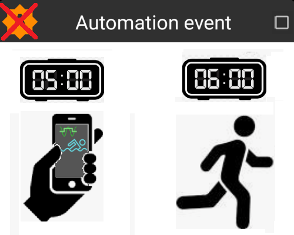
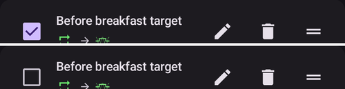
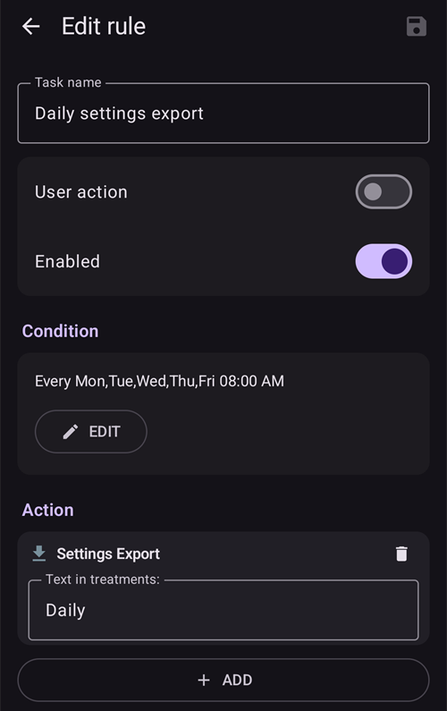
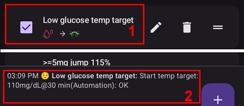

# Automação

```{contents} In this page
:backlinks: entry
:depth: 2
```

## O que é uma Automação?

A "**Automação**" é um recurso que pode automatizar tarefas no AAPS.

A Automação executa ações específicas com base em uma ou mais condições ou gatilhos. Os gatilhos podem incluir eventos irregulares, como níveis de glicose (BG) baixos ou altos, ou uma quantidade definida de insulina ativa (IOB) negativa. As Automações também podem lidar com eventos recorrentes, como refeições ou exercícios em certos horários do dia, ou quando o usuário está a uma certa distância de um local GPS ou na área de um SSID de Wi-Fi. A Automação pode fazer backups das configurações do AAPS conforme uma programação ou a cada troca de Pod.

As regras de Automação são criadas e alteradas na tela **Automação** (**Gerenciar → Automação**). Cada regra é definida por duas propriedades:

- Uma ou mais condições ou 'gatilhos' que iniciam uma ação.

    Pense em um horário definido, em um evento ou no valor de uma propriedade no AAPS

- Uma ou mais ações a executar.

    Como um alarme, a definição de uma porcentagem do perfil ou a exportação das configurações do AAPS na troca do Pod.


Há muitas opções de Automação, e recomendamos que os usuários as estudem no app AAPS, na seção Automação. Você também pode procurar exemplos de Automação de outros usuários nos grupos de usuários do AAPS no [**Facebook**](https://www.facebook.com/groups/AndroidAPSUsers) e no [**Discord**](https://discord.gg/4fQUWHZ4Mw).

## Como a Automação pode ajudar

1. **Automatizar tarefas recorrentes:** executar ações programadas automaticamente, sem interação do usuário.

1. **Menos fadiga de decisão:** o principal benefício das **Automações** é tirar do usuário o peso de ter que fazer intervenções manuais no **AAPS**. Uma [pesquisa](https://www.ncbi.nlm.nih.gov/pmc/articles/PMC6286423/#ref4) estima que pessoas com diabetes tipo 1 precisam tomar em média 180 decisões a mais por dia. As **Automações** podem diminuir a carga mental e liberar a energia mental do usuário para outras partes da vida.

1. **Possível melhora do controle glicêmico:** por exemplo, as **Automações** podem ajudar a garantir que os **Alvos temporários** sejam sempre definidos quando necessário, mesmo em dias corridos ou em períodos de esquecimento. Por exemplo, se uma criança com diabetes tem esporte na escola às terças às 10h e às quintas às 14h e precisa de um Alvo temporário alto ('TT') ativado 30 minutos antes da atividade esportiva, o **Alvo temporário** pode ser ativado por meio de uma **Automação**.

1. **Permitir que o AAPS seja muito personalizado** para ser mais ou menos agressivo em situações específicas, conforme a preferência do usuário. Por exemplo, acionar uma redução temporária da % do **Perfil** por um período definido se surgir **IOB** negativo no meio da noite, o que indica que o **Perfil** atual pode estar forte demais.

O exemplo abaixo mostra como uma **Automação** pode eliminar etapas.

O usuário faz exercício todas as manhãs às 6h: ele precisa lembrar de definir manualmente um "Alvo temporário - Atividade" no AAPS às 5h, antes do exercício.



O usuário configurou uma **Automação** para acionar às 5h um ‘Alvo temporário - Atividade’, para garantir que a sua **glicose (BG)** e o seu **IOB** estejam ideais na preparação para o exercício das 6h:


## Pontos importantes antes de começar com as Automações

1. Antes de configurar certas Automações, você deve ter um controle razoável da **glicose (BG)** com o **AAPS**. As Automações não devem ser usadas para compensar configurações não ideais de basal, **ISF** ou **CR** (veja mais abaixo). Evite configurar uma **Troca de Perfil** automática para compensar subidas da **glicose (BG)** causadas, _por exemplo_, por comida; é melhor tratar isso com outras estratégias (SMBs etc.).

1. Como qualquer tecnologia, **CGMs**, **Bombas** e telefones podem falhar: problemas técnicos ou erros do sensor podem atrapalhar as ações da **Automação**, e pode ser necessária uma intervenção manual.

1. **As necessidades de Automações provavelmente vão mudar quando a rotina mudar**. Ao mudar entre períodos de trabalho/escola/férias, coloque um lembrete no seu calendário para revisar quais **Automações** estão ativas (elas são fáceis de ativar e desativar). Por exemplo, se você sair de férias e não precisar mais de uma Automação configurada para o esporte na escola ou para o exercício diário, ou se precisar ajustar os horários.

1. As **Automações** podem entrar em conflito umas com as outras. É bom revisar com cuidado a configuração de qualquer **Automação(ões)** nova em um ambiente seguro e entender por que uma **Automação** foi ou não foi acionada da forma que você esperava.

1. Se você usa o Autosens, tente usar **Alvos temporários** em vez de **Trocas de Perfil**. **Alvos temporários** não zeram o Autosens. **Trocas de Perfil** zeram o Autosens.

1. A maioria das **Automações** deve ser definida apenas por uma **duração limitada**; depois disso, o **AAPS** pode avaliar de novo e repetir a **Automação**, se necessário e se a condição ainda for atendida. Por exemplo, "iniciar alvo temporário de 7,0 mmol/l por 30 min" ou "iniciar **Perfil** 110% por 10 min" _e_ "iniciar alvo temporário de 5,0 mmol/l por 10 min". Usar **Automações** para criar mudanças permanentes (por exemplo, para uma % de perfil mais forte) traz risco de hipoglicemia.

## Quando posso começar a usar a Automação?

As **Automações** podem ser usadas a partir do **objetivo 10**.

## Onde ficam as Automações no AAPS?

Abra **Gerenciar** na navegação inferior da tela principal e selecione **Automação**.

## Como configurar uma Automação?

Para configurar uma **Automação**, toque no botão **+** na tela Automação para criar uma ‘regra’:


* dê um título à sua ‘regra’ (Nome da Tarefa);
* toque em "**EDITAR**" abaixo de **Condição**. Na tela **Condição**, escolha como os gatilhos são combinados (**E**, **Ou**, **Exclusivo ou**) e toque em "**Adicionar gatilho**":


* adicione pelo menos um gatilho:


* toque em "**ADICIONAR**" abaixo de **Ação** e selecione uma ação:


* salve a regra com o botão **Salvar** e verifique se a caixa à esquerda do nome da regra está ‘marcada’ para ativar a **Automação**:


Para desativar uma regra de **Automação**, desmarque a caixa à esquerda do nome da **Automação**. O exemplo abaixo mostra uma **Automação** ativada (‘marcada’) ou desativada (‘desmarcada’):




Ao configurar uma **Automação**, você pode primeiro testá-la ativando a opção ‘notificação’ em "Ações". Isso faz o **AAPS** primeiro mostrar uma notificação, em vez de executar de fato uma ação. Quando você tiver certeza de que a notificação foi acionada na hora/nas condições corretas, a regra de **Automação** pode ser atualizada para trocar a ‘Notificação’ por uma ‘Ação’.


```{admonition} Important note
:class: note

As **Automações** continuam ativas quando o Loop está desativado!
```


## Quando as regras são verificadas

O **AAPS** verifica todas as regras de **Automação** sempre que uma nova leitura de glicose é processada; assim, as regras são avaliadas no ritmo do seu CGM, também com a tela do telefone desligada. As regras também são verificadas quando o telefone começa a carregar, quando a rede ou a localização muda e quando um dispositivo Bluetooth se conecta. Só uma verificação roda por vez; assim, uma regra cujas ações demoram (por exemplo, um comando para a bomba) não pode ser executada duas vezes.

## Limites de segurança

Há limites de segurança definidos para as **Automações**:

* Um **Alvo temporário** definido por uma **Automação** precisa estar entre 72 e 180 mg/dl (ou 4 e 10 mmol/l).
* A **Porcentagem do perfil** precisa estar entre 50% e 130%.
* Há um limite de tempo de 5 minutos entre as execuções da  **Automação** (e na primeira execução).

## Uso correto de valores negativos

```{admonition} Warning
:class: warning

Tenha cuidado ao selecionar um valor negativo na **Automação**
```

É preciso ter cuidado ao escolher um ‘valor negativo’ na ‘Condição’, como "menor que", nas **Automações**. Por exemplo:


**Exemplo 1:** Criar uma Condição **"é menor que"** "-0,1 mmol/l" (ou "-2 mg/dl") vai:

Aciona uma **Automação** para qualquer número que seja **estritamente menor que** -0,1 (-2). Isso inclui números como -0,2, -0,3, -0,4 (-4, -6, -8) e assim por diante. Lembre-se de que o próprio -0,1 (-2) **não está** incluído nesta condição. (A condição "é igual ou menor que -0,1 mmol/l (-2 mg/dl)" _incluiria_ -0,1 mmol/l ou -2 mg/dl).

**Exemplo 2:** Criar uma Condição "é maior que" -0,1 mmol/l (-2 mg/dl) vai:

Acionar uma **Automação** para qualquer número que seja **maior que** -0,1 mmol/l (-2 mg/dl). Isso inclui números como 0, 0,2, 0,4 mmol/l (0, 4, 8 mg/dl) e qualquer outro número positivo.

É importante pensar com cuidado na intenção exata da sua **Automação** ao escolher essas condições e valores.

(automations-automation-triggers)=
## Gatilhos da Automação


Role para baixo para ver o resto da lista:


Há vários ‘Gatilhos’ que o usuário pode selecionar. Gatilhos são as condições que precisam ser atendidas para que a automação seja executada. A lista abaixo não é completa:

**Gatilho:** ligar condições

**Opções:**

Várias condições podem ser ligadas com
* “E”
* “Ou”
* “Exclusivo ou” (isso significa que, se uma - e somente uma - das condições se aplicar, a(s) ação(ões) acontecerá(ão))

**Gatilho:** hora x tempo recorrente

**Opções:**

* hora = evento de uma única vez
* tempo recorrente = algo que acontece com regularidade (por exemplo, uma vez por semana, todo dia útil etc.)

**Gatilho:** localização

**Opções:**

* em [Configurações > Automação](#preferences-maintenance-settings), o usuário pode selecionar o serviço de localização desejado.

**Gatilho:** serviço de localização

**Opções:**

* Usar localização passiva: o **AAPS** só obtém a localização quando outros apps a solicitam.
* Usar localização pela rede: localização da sua rede Wi-Fi.
* Usar localização por GPS (Atenção! Isso pode gastar muita bateria!)

**Gatilhos** : dados da bomba e do sensor

* Gatilho Idade da cânula: disponível para todas as bombas
* Gatilho Idade da insulina: disponível para as bombas compatíveis
* Gatilho Idade da bateria: disponível para as bombas compatíveis
* Gatilho Idade do sensor: sempre disponível
* Gatilho Ativação do Pod: disponível para bombas de patch

Observe que, em todos os gatilhos de idade, a comparação "igual" dificilmente vai acionar; nesse caso, são necessários dois gatilhos para criar um intervalo

* Gatilho Nível do reservatório: disponível para todas as bombas. A comparação "NOT\_AVAILABLE" não funciona para este gatilho, porque o valor está sempre preenchido no **AAPS**
* Gatilho Nível da bateria da bomba: disponível para as bombas compatíveis. A comparação "NOT\_AVAILABLE" não funciona para este gatilho, porque o valor está sempre preenchido no **AAPS**

(automations-automation-action)=
## Ação


Role para baixo para ver o resto da lista:


**Ações:** iniciar **Alvo temporário**

**Opções:**

* A **glicose (BG)** precisa estar entre 72 mg/dl e 180 mg/dl (4 mmol/l e 10 mmol/l)
* O **TT** só funciona se não houver um Alvo temporário anterior — o **AAPS** adiciona isso automaticamente à regra como uma linha "**Precondições: Alvo Temporário não existe**"

**Ações:** parar **Alvo temporário**

**Opções:**

nenhum

**Ações:** **Porcentagem do perfil**

**Opções:**

* O **Perfil** precisa estar entre 50% e 130%
* só funciona se a Porcentagem anterior for 100%

**Actions:** **Change smoothing** (in the **Loop & insulin** group)

**Opções:**

* select the [smoothing method](../CompatibleCgms/SmoothingBloodGlucoseData.md) to switch to. The list is the same as under **Configuration** > **Smoothing**, and the action does exactly what a change there does: the new method is saved, synced to paired clients, and the BG data is smoothed again right away.
* só é executada se esse método de suavização ainda não estiver ativo — o **AAPS** adiciona isso automaticamente à regra como uma linha "**Precondições: A suavização … não está ativa**". Quando a suavização selecionada já está ativa, a regra é ignorada sem aviso.
* Example: a new sensor is often noisy during its first day. Two rules with the **Sensor age** trigger give stronger filtering while the sensor settles, and lag-free smoothing after that:
  * **Sensor age** less than 24 h: **Change smoothing** to **Unscented Kalman Filter**
  * **Sensor age** more than 24 h: **Change smoothing** to **Average smoothing**

**Ações:** **Anotação** (no grupo **Alertas** da lista)

**Opções:**

* selecione o evento a registrar: **Anotação**, **Exercício**, **Pergunta**, **Anúncio** ou **Alteração do local do cateter**, e uma nota opcional. O nome da ação muda para o evento que você selecionar.
* **Duração**: usada para **Anotação**, **Exercício** e **Alteração do local do cateter**. **Pergunta** e **Anúncio** não têm duração: em vez disso, registram a sua glicose atual.
* **Alteração do local do cateter** zera a idade da cânula, como se você tivesse registrado a troca do local manualmente. Exemplo: algumas bombas (como a Combo) registram sozinhas a troca do reservatório, mas não a troca do local. Se você sempre troca os dois juntos, uma regra com **Idade da insulina** menor que 1 hora e **Idade da cânula** maior que 24 horas pode registrar a troca do local para você.

 

**Ações:** **Enviar SMS** (no grupo **Alertas**)

**Opções:**

* digite o texto da mensagem. Ela é enviada para todos os números de telefone permitidos nas configurações do [Comunicador SMS](../RemoteFeatures/SMSCommands.md). O plugin Comunicador SMS precisa estar ativado.

**Ações:** **Alterar perfil para** (no grupo **Perfil**)

**Opções:**

* selecione o **Perfil** a ativar. Ele é ativado com 100%, sem deslocamento de tempo. Se este perfil já estiver ativo, a ação não faz nada.

**Ações:** **Ativar/desativar SMB** (no grupo **Loop & insulina**)

**Opções:**

* escolha **Ligado** ou **Desligado**. Isso muda a configuração **Ativar SMB** do SMB OpenAPS, exatamente como se você a tivesse mudado em **Configurações**, e fica assim até que você ou outra regra a mude de volta.

**Ações:** **Perfil do Autotune** (no grupo **Loop & insulina**)

**Opções:**

* selecione o perfil a ajustar e o número de dias: veja [Executar o Autotune com uma regra de automação](#autotune-run-autotune-with-an-automation-rule).

**Ações:** **Parar processamento** (no grupo **Loop & insulina**)

**Opções:**

* nenhum. While the conditions of a rule with this action are true, **AAPS** does not check the rules below it in the list. As soon as its conditions are false again, the rules below are checked as usual. Adicione-a a uma regra que deve ter prioridade sobre as regras abaixo dela (veja [a ordem das Automações](#Automations-the-order-of-the-automations-in-the-list-matters)).

**Ações:** **Executar cenário**, **Ativar cenário**, **Desativar cenário** (no grupo **Cenários**)

**Opções:**

* selecione o [cenário](Scenes.md) a executar, ativar ou desativar.

Depois que a ‘Ação’ for adicionada, os valores padrão devem ser mudados para o número desejado, tocando neles e ajustando-os.


(Automations-the-order-of-the-automations-in-the-list-matters)=
## A ordem das **Automações** na lista importa
 O **AAPS** executa as regras criadas por ordem de preferência, começando pelo topo da lista de **Automações**. Por exemplo, se a **Automação** ‘Baixa’ é a **Automação** mais importante, acima de todas as outras regras, então esta  **Automação** deve aparecer no topo da lista de **Automações** do usuário, como mostrado abaixo:


Para mudar a prioridade das regras de **Automação**, toque e segure a alça **=** no lado direito da regra. Reordene as  **Automações** movendo as regras para cima ou para baixo.


## Como excluir regras de Automação

Para excluir uma regra de **Automação**, toque no ícone da lixeira.


## Exemplos de Automações

Abaixo estão exemplos de **Automações**. Mais discussões sobre **Automações** e sobre como os usuários personalizaram a sua  **Automação** podem ser encontradas em grupos de discussão do Facebook ou no Discord. Os exemplos abaixo não devem ser copiados sem que o usuário entenda bem como a **Automação** vai funcionar.

(automations-low-glucose-temp-target)=
### Alvo temporário para glicose baixa

Esta **Automação** aciona um **Alvo temporário** automático quando a **glicose (BG)** cai abaixo de um certo limite — aqui, quando a glicose é menor que 70 mg/dl, um alvo de 110 mg/dl é iniciado por 30 minutos:


### Alvo temporário na hora do almoço (com ‘Localização’)


Esta **Automação** foi criada para um usuário que almoça no trabalho mais ou menos na mesma hora em todos os dias úteis, mas ela só é acionada se o usuário estiver em uma ‘localização’ definida.  Assim, se o usuário não estiver no trabalho em algum dia, esta **Automação** não será ativada.

Esta **Automação** define um **Alvo temporário** baixo (Comer em breve) às 13:00 para levar a glicose a 90 mg/dl (ou 5 mmol/l) na preparação para o almoço.

O ‘Gatilho’ de localização tem um nome, uma posição (toque em **Escolher no mapa** ou use sua localização atual) e um raio em metros, e é acionado quando você está dentro (ou fora) da área:


Por causa da ligação ‘E’, a **Automação** só acontece durante o ‘horário escolhido’ e se o usuário estiver no local selecionado.

A **Automação** não será acionada em nenhum outro horário neste local, nem neste horário fora do raio de 50 metros ao redor da posição escolhida.

### Automação por localização com SSID de Wi-Fi

Usar um SSID de Wi-Fi é uma boa opção para acionar uma **Automação** quando você está ao alcance de uma rede Wi-Fi específica (em comparação com o GPS): é bastante preciso, gasta menos bateria e funciona em locais fechados, onde o GPS e outros serviços de localização podem não estar disponíveis.

Aqui está outro exemplo de configuração de um **Alvo temporário** só para dias úteis, antes do café da manhã(1).


A **Automação** será acionada às 05:30 somente de segunda a sexta(2)  
e enquanto o telefone estiver conectado a uma rede Wi-Fi de casa (3).


Então ela define um **Alvo temporário** de 75 mg/dl por 30 minutos (4). Uma das vantagens de incluir a localização é que ela não será acionada se o usuário estiver viajando de férias, por exemplo.


Role para baixo para ver a ação: um **Alvo temporário** de 75 mg/dl por 30 minutos (4).


Aqui está a captura de tela com os detalhes dos gatilhos da **Automação**:

1) Abaixo do “E” principal (as duas condições precisam ser atendidas para acionar) 1) Tempo recorrente = S,T,Q,Q,S às 5:30  
1) WiFi SSID = My_Home_WiFi_Name


(automating-preference-settings-export)=

## Automatizar a exportação das configurações

### Exportações automáticas: programadas (diárias)

Capturas de tela com os detalhes dos gatilhos da Automação:

1) Condição: Tempo recorrente = S,T,Q,Q,S às 8:00 1) Ação: Exportação de configurações (em "Texto nos tratamentos", digite "Diária")



Nota: a execução da exportação será registrada no CarePortal

### Exportações automáticas: Ativação do Pod (somente bomba de patch)

Capturas de tela com os detalhes dos gatilhos da Automação:

1) Condição: Ativação do Pod 1) Ação: Exportação de configurações (em "Texto nos tratamentos", digite "Ativação do Pod: exportação de configurações")


Nota: a execução da exportação será registrada no CarePortal. Nota: a Automação **não** será acionada se você ainda não tiver feito uma exportação manual das configurações antes. Veja [Configurações → Manutenção](#preferences-maintenance-settings) para ativar corretamente a exportação automática de configurações.


## Registros da Automação

O **AAPS** mostra um registro dos eventos mais recentes da **Automação** na parte de baixo da tela **Automação**, abaixo das regras. Use-o para verificar se as suas regras foram acionadas quando você esperava.

No exemplo abaixo, a regra **Low glucose temp target** (1) (veja [Alvo temporário para glicose baixa](#automations-low-glucose-temp-target) acima) está ativada. O registro (2) mostra que às 03:09 PM a glicose caiu abaixo de 70 mg/dl e a regra foi acionada:
* a ação foi "Start temp target: 110mg/dL@30 min": um **Alvo temporário** de 110 mg/dl por 30 minutos;
* **OK** no final significa que a ação foi executada com sucesso.



(automations-troubleshooting)=

## Resolução de problemas

* Problema: __Minhas automações não são acionadas pelo AAPS?__

Verifique se a caixa à esquerda do nome da **Automação** está ‘marcada’, para garantir que a regra está ativada:


* Problema: __Minhas automações são acionadas na ordem errada.__

Verifique a ordem de prioridade das suas regras, como explicado acima.

* Problema: __Uma condição mostra "Gatilho desconhecido … - nunca verdadeiro".__

A regra contém um gatilho que esta versão do **AAPS** não consegue ler, por exemplo depois de você voltar para uma versão mais antiga ou importar configurações de uma versão mais nova. Esse gatilho nunca é verdadeiro, então a regra não é executada. Ele é mantido sem mudanças, para que uma versão mais nova ainda possa usá-lo. Edite a regra e troque o gatilho, ou atualize o **AAPS**.

## Alternativas às Automações

Para usuários avançados, há outras formas de automatizar tarefas usando o IFTTT ou um app Android de terceiros chamado Automate. 
