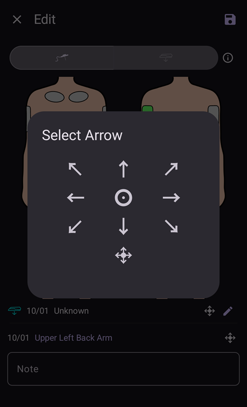

# Bombas e cânulas

## Changing infusion sets: insulin reservoirs and cannulas

The procedure described below is for tubed pumps only and does not apply to patch pumps like Omnipod, Medtrum Nano, Accu-Chek Solo etc. Este procedimento às vezes é chamado de "troca de conjunto": uma troca "completa" inclui o reservatório de insulina e a cânula, e uma troca "parcial" é só a troca da cânula.

Bombas de patch preenchem e purgam a si mesmas no seu próprio assistente de ativação, e a cânula delas já está no corpo. O **AAPS** não oferece purga para elas: **Purgar/Preencher** não aparece no painel **Gerenciar** nem no acesso rápido. Veja a página da sua bomba em [Bombas compatíveis](../Getting-Started/CompatiblePumps.md).

A troca física do cartucho/reservatório não pode ser feita pelo **AAPS**, ela deve ser feita diretamente na bomba. Depois de feita, a troca deve ser registrada manualmente no **AAPS**.

(pumps-cannulas-changing-reservoir-and-cannula)=
### Guide for changing both the pump reservoir and cannula

1. No **AAPS**, desconecte a bomba: toque no [ícone do loop](#AapsScreens-loop-status) na tela principal e selecione **Desconectar bomba** por 1 hora. O ícone muda para um plugue cinza, que mostra que a bomba está desconectada.

2. Physically change the insulin reservoir: physically disconnect your pump from the body, and change the reservoir/cartridge and cannula as per manufacturer's instructions.

3. Prime/fill the tubing and cannula: this can be done directly on the pump. Be sure to eliminate any bubbles in the tubing.

4. Attach the new cannula to the body. Once the cannula is inserted and the needle is removed, the attached cannula now has a small air gap which also needs to be primed. Para registrar isso no **AAPS** e purgar o local: abra **Purgar/Preencher** (no painel de status expandido da tela principal, no painel **Gerenciar** ou como botão do [acesso rápido](QuickLaunch.md)) e marque **Registrar troca de local da bomba** e/ou **Registrar troca de cartucho de insulina**, conforme o caso, para registrar a troca. Agora toque na quantidade padrão de preenchimento da cânula (normalmente cerca de 0,3 U, mas confira se este valor está correto para a sua cânula) e selecione **OK**. Leia a mensagem de resumo e confirme a purga tocando em **OK**.

   


5. Reconecte a bomba no **AAPS**: toque no ícone de plugue cinza e selecione **Reconectar bomba** para continuar o loop.

### Useful information concerning insulin/cannula changes

* Registrar uma troca do local da bomba redefine o Autosens para 100%. Também zera as luzes de status e as idades da cânula/insulina na tela principal do **AAPS**.

* Você pode definir/ajustar as quantidades padrão de preenchimento nas configurações de **Purgar/Preencher**: digite "prime" na barra de pesquisa da tela principal para abri-las (veja [Preferências](../SettingUpAaps/Preferences.md)). See your instruction booklet in your cannula box for how many units (depending on needle length and tubing length) should be primed for your cannula.

* A insulina administrada com a função de purga não é considerada pelo **AAPS** no cálculo da insulina ativa (IOB) e é marcada no [Histórico de tratamentos](#aaps-screens-treatments) como "Purgar".

* A insulina dada em bólus pela bomba enquanto ela está desconectada também não é considerada pelo **AAPS**. Se você der um bólus direto na bomba enquanto o **AAPS** está desconectado, depois de reconectar a bomba você pode informar essa insulina (sem administrá-la) no diálogo **Insulina** (veja [Informar insulina já administrada sem dar o bólus](#pumps-cannulas-announce-insulin) abaixo).

### Cannula, infusion site, tubing and/or pump issues

Se você tem certeza de que não recebeu insulina por um tempo, embora o **AAPS** tenha registrado que sim, e sabe exatamente quando o problema começou (_por exemplo,_ você remove a cânula e vê que ela dobrou durante a inserção), você pode corrigir isso no **AAPS**. Mas lembre-se de que a insulina pode ter sido administrada e estar agindo devagar por algum motivo.

```{admonition} Caution - Risk of Hypoglycemia
:class: danger
Only delete insulin delivery from **AAPS** with EXTREME caution, in case insulin _has_ actually been delivered, and monitor BG closely for the next 24 h.
```

Para remover bólus e SMBs que você sabe que não foram administrados, abra o **menu** (☰), selecione [Histórico de tratamentos](#aaps-screens-treatments) e, na aba **Carboidratos e bólus**, exclua com cuidado os bólus registrados a partir do momento em que o problema aconteceu. Isso corrige o valor de "insulina ativa" (IOB), que é essencial para os cálculos do **AAPS**; se você voltar agora à tela principal, verá que o IOB diminuiu. Atenção: você não pode excluir a insulina basal que o **AAPS** calcula como administrada, então ela continua sendo considerada pelo **AAPS**.

Em casos menos claros de problemas na administração de insulina, _por exemplo_ vazamentos, oclusões ou "tunelamento", quando você não sabe quando o problema começou ou acha que parte da insulina foi administrada, é preciso ter cuidado. Você pode notar esses problemas pelo "cheiro" da insulina, pelo adesivo molhado, por valores de glicose altos ou por um alarme. Como você nunca vai saber quanta insulina entrou na pele (e que pode começar a agir depois de um tempo), é difícil saber a quantidade correta de insulina que deve ser descontada do valor atual de "insulina ativa" (IOB). One strategy is to pause looping for 5 hours (or your specific duration of insulin action) after you resolved the insulin delivery problem, and resume looping afterwards. This will ensure that IOB is correct once you restart looping.

(pumps-cannulas-disconnecting)=
## Disconnecting the pump for showering or activity

Se você tirar a bomba para tomar banho, nadar, praticar esportes de contato ou fazer outras atividades, você deve informar ao **AAPS** que nenhuma insulina está sendo administrada, para manter o IOB correto. A bomba pode ser desconectada pelo [ícone do loop](#AapsScreens-loop-status) na tela principal: toque nele e selecione **Desconectar bomba** com a duração que você precisa. Se a atividade durar mais do que o planejado, abra o mesmo diálogo de novo e escolha uma nova duração em **Desconectar bomba**: a desconexão é prolongada e a nova duração começa agora. Você não precisa reconectar antes.

As you are not getting any insulin while the pump is disconnected, you should reconnect every two hours to catch up for the missing basal. Você pode fazer isso conectando a bomba e dando em bólus as quantidades de basal que faltaram (_por exemplo,_ das últimas duas horas) antes de desconectar de novo. This should help to avoid a severe lack of insulin which could result in diabetic ketoacidosis (DKA). Se for difícil reconectar a bomba durante a atividade (o local da cânula está coberto por uma roupa de mergulho _etc._), considere uma injeção com caneta. Esta injeção manual pode ser registrada no **AAPS** e não precisa ser registrada na hora da injeção (basta anotar a hora da injeção), porque você pode informar a insulina com a hora real em que foi dada quando reconectar a bomba.

(pumps-cannulas-announce-insulin)=
## To announce delivered insulin without actually bolusing

To announce insulin delivered from the pump either while **AAPS** was disconnected, or from pen injections: open the [Insulin dialog](#aaps-screens-buttons-insulin) (**Treatments** in the bottom navigation, or a QuickLaunch button), enter the amount in units and enable **Bolus will be recorded only (not delivered by pump)**. Uma linha **Hora** (definida como **Agora**) permite então registrar a hora real da injeção: você pode ignorá-la se a injeção foi dada há pouco tempo. Se o bólus foi dado há algum tempo, use **-** para voltar a hora (_por exemplo,_ -30 min), ou abra a linha com a seta para escolher a data e a hora exatas. O **AAPS** então considera a duração da ação da insulina e calcula a insulina que ainda resta no corpo.

Se você usa o **AAPS** como cuidador, pode desconectar (e reconectar) a bomba à distância muito facilmente por [comando SMS](../RemoteFeatures/SMSCommands.md), com comandos como "pump disconnect 120" e "pump connect 120". The range of duration for remote disconnect is from 1 - 120 min, (in this example it is 120 minutes). Isso é muito útil quando é difícil acessar o telefone com o **AAPS**: guardado na cintura de uma criança que está correndo para a piscina, ou bem guardado (ou em uso) por um adolescente.

## Reconnecting the pump after activity

Depois de uma desconexão longa (1–2 horas), é bastante comum o **AAPS** calcular que agora você tem IOB negativo. When you reconnect the pump, depending on preference/current glucose level/planned food or subsequent activity, you can either:

a) Simplesmente reconecte a bomba no **AAPS** (de cinza para verde, no loop fechado) e deixe o **AAPS** voltar a administrar insulina

_ou_

b) Se você quer ser mais agressivo (por exemplo, a glicose está indo para hiperglicemia), pode abrir o [Assistente de Bólus](#aaps-screens-bolus-wizard) e dar um bólus para zero carboidratos, para administrar imediatamente a insulina que falta calculada como bólus.

Which strategy you prefer is highly personal, and is best determined by trial and error.


(Aapsscreens-site-rotation)=
## Rotação do local

**Gerenciar → Rotação do local** abre o diálogo Rotação do local no modo de visualização:

- Com os dois botões no topo (ícone da cânula e ícone do sensor), você pode mostrar só os locais da cânula, só os locais do sensor, ou ambos
- Todos os eventos de troca de cânula e troca de sensor dos últimos 45 dias estão disponíveis.
- Toque em uma área do corpo, ou em uma entrada da lista abaixo, para filtrar a lista e mostrar só as entradas da área selecionada. A área selecionada fica destacada em verde claro.
- Toque no ícone de **lápis** ao lado de uma entrada para abrir a tela de edição e mudar o local, a seta ou a nota


- O ícone de **engrenagem** (canto superior direito) abre as configurações: **Perfil do usuário para rotação do local** abre um diálogo onde você escolhe **Homem**, **Mulher** ou **Criança**, e os interruptores **Gerenciar rodízio do local da bomba** e **Gerenciar rodízio do local do CGM** escolhem quais locais você gerencia.


*Note: this setting decides whether the Site Rotation dialog (Edit mode) opens automatically when a new entry is made with the "Prime/Fill" button or the "Sensor Insert" button.*

- Para uma troca de local feita diretamente na bomba, você precisa abrir o modo de visualização e editar a nova entrada para escolher o local e a seta

O modo de edição permite escolher o local, a seta e a nota da entrada selecionada:

- A entrada em edição aparece abaixo das imagens do corpo, com o ícone do tipo (cânula ou sensor)
- As vistas da frente e de trás aparecem lado a lado: toque na área onde você colocou a cânula ou o sensor
- Once a site is selected (highlighted in green), the list below shows all entries made in this site in the past 45 days.


- Você pode adicionar uma seta opcional tocando no ícone de seta à direita da entrada: o diálogo **Selecionar seta** permite indicar um sublocal ou a orientação do pod



- Você também pode adicionar uma **Nota** sobre o local selecionado
- Toque no ícone de **salvar** (canto superior direito) para registrar o local

O filtro pode ser feito na imagem ou tocando em um evento de tratamento na lista Para remover o filtro, basta tocar na imagem fora de qualquer local


