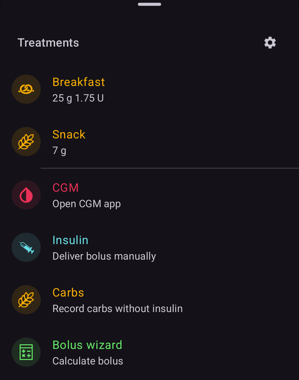

(quickwizards)=
# Assistente rápido (bólus com um toque)

Um **Assistente rápido** é um botão salvo, de um toque, para uma refeição ou situação que se repete. Ele guarda uma quantidade fixa de **carboidratos** (e como dosar para eles). Assim você pode administrar um bólus — ou apenas registrar carboidratos — com um único toque e uma confirmação, sem abrir a calculadora de bólus completa toda vez.

```{contents} Table of contents
:depth: 2
:local: true
```

---

## Abrir o Assistente rápido

Abra a tela **Gerenciar** (navegação inferior) e escolha **Assistente rápido** (*“Gerenciar predefinições do Assistente rápido”*).

---

## Gerenciar os Assistentes rápidos

Seus Assistentes rápidos aparecem como um **carrossel de cartões que você desliza** (cada cartão mostra o texto do botão, os carboidratos e o intervalo de validade). O editor abaixo configura o assistente **selecionado**. A barra de ações inferior tem os botões **➕ adicionar**, **⧉ clonar**, **🗑️ excluir** e um botão **▶** para executar o Assistente rápido selecionado.


Os principais campos do editor são:

- **Texto do botão** — o nome que aparece no botão.
- **Carboidratos** e **Horário dos carboidratos** — a quantidade de carboidratos e o deslocamento de tempo deles.
- **Intervalo de validade** — veja [Validade](#quickwizard_validity).
- **Opções da calculadora** e **Seleção do dispositivo** — veja abaixo.

---

## Os três modos

O seletor no topo do editor — **Calculadora / Insulina / Carboidratos** — define **o que o botão faz** quando você toca nele:

- **Calculadora** — executa a **calculadora de bólus** completa para os carboidratos configurados, usando sua **glicose, IOB, COB e tendência** atuais (conforme as *Opções da calculadora* abaixo). Ele administra o bólus *calculado* e registra os carboidratos. Este é o assistente rápido clássico.
- **Insulina** — administra uma **quantidade fixa de insulina** que você define — sem cálculo.
- **Carboidratos** — registra **apenas os carboidratos** configurados, **sem bólus**.

---

## Opções da calculadora (modo Calculadora)

Para um botão no modo **Calculadora**, você escolhe quais dados o cálculo usa:

- **Usar glicemia**, **Usar COB**, **Usar IOB** (com *Somente IOB positivo*), **Usar tendência** (*Todas / Somente positivas / Somente negativas*), **Usar alvo temporário**, **Usar alarme**.
- **Porcentagem do bólus** — ajusta o bólus calculado por uma porcentagem.
- **Adicionar eCarbs** — também agenda carboidratos estendidos.


---

## Validade — quando o botão aparece

(quickwizard_validity)= O **Intervalo de validade** (*De / Até*) controla **quando** um Assistente rápido aparece e pode ser usado. Um botão configurado, por exemplo, para **06:00–10:00** só aparece de manhã. Assim um Assistente rápido *Café da manhã* não ocupa espaço na sua tela (nem é tocado por engano) no jantar. Fora do seu horário, o botão fica escondido no painel **Tratamentos** e na [barra de acesso rápido](QuickLaunch.md). Um botão da barra não é excluído: ele volta quando o horário começa de novo.

Quando o intervalo de validade é menor que 4 horas, o botão também fica escondido por 30 minutos depois que você o usa, para que a mesma refeição não seja registrada duas vezes por engano.

---

## Onde você usa o Assistente rápido

As opções de **Seleção do dispositivo** definem onde cada Assistente rápido aparece:

- **Mostrar no telefone** — ele aparece no **painel [Tratamentos](../Maintenance/V4Changes.md)** (com a dose calculada mostrada no próprio botão). Um Assistente rápido mostrado no telefone também pode ser **fixado como botão de ação rápida na tela principal**: abra *Configurar acesso rápido* (o ⚙ na barra de [acesso rápido](QuickLaunch.md)) e adicione-o a partir da categoria **Assistente rápido**.
- **Mostrar no relógio** — ele aparece no **bloco do Assistente rápido do Wear OS** (deslize até ele no carrossel de blocos do relógio e toque em um botão para executá-lo — igual ao [bloco Cenário](#scenes-from-watch)).

```{admonition} Don't see Device Selection?
:class: note
A seção **Seleção do dispositivo** só aparece no editor quando o plugin **Wear** está ativado e a preferência **Controle do Wear** dele está ligada. Sem isso, todo Assistente rápido aparece apenas no telefone.
```

No telefone, os Assistentes rápidos aparecem no topo do painel inferior **Tratamentos**:



…e como botão de ação rápida na tela principal:


Um **cliente** pareado (**AAPSClient**) também pode acionar um Assistente rápido — o **dispositivo principal** calcula e administra a dose (veja [Controle dispositivo principal ↔ cliente](../RemoteFeatures/ClientMasterControl.md)).

De onde quer que seja acionado, tocar em um Assistente rápido sempre mostra uma **confirmação** (a confirmação criada pelo dispositivo principal, quando acionado a partir de um cliente ou relógio) antes de qualquer administração.

Um Assistente rápido é recusado quando a dose dele é maior que o seu bólus máximo, ou quando os carboidratos ou eCarbs dele são maiores que o seu máximo de carboidratos (por exemplo, depois que você baixou o limite). Quando os carboidratos estão acima do limite, o botão no painel **Tratamentos** fica desativado. Edite o Assistente rápido ou o limite.

---

## Adicionar e remover

- **➕ Adicionar** — cria um novo Assistente rápido.
- **⧉ Clonar** — duplica um, como ponto de partida.
- **🗑️ Excluir** — remove um.

Com dois ou mais Assistentes rápidos, você também pode mudar a ordem deles no carrossel: toque no ícone **Reordenar** (⇅) na barra superior, mova o cartão do centro com os **botões de mover ◀ / ▶** e confirme com **✓**. (Os controles são iguais aos de [reordenar perfis](ProfileSwitch-ProfilePercentage.md).)

Os Assistentes rápidos fazem parte da configuração sincronizada, então são compartilhados entre o seu dispositivo principal e os clientes pareados.

---


<!-- =====================================================================
     Screenshots captured from a real master device:
       - quickwizard_editor.png   (Manage → QuickWizard: carousel, mode, carbs, carb time, valid time range)
       - quickwizard_options.png  (Calculator Options, Bolus percentage, Device Selection)
       - quickwizard_overview.png (the QuickWizard quick-action button on the overview)
       - quickwizard_watch_tile.png (the Wear OS QuickWizard tile)
     No QuickWizard was actually run (no bolus delivered).
     Maintainers: relocate page + images and fix cross-links as needed.
     ===================================================================== -->
