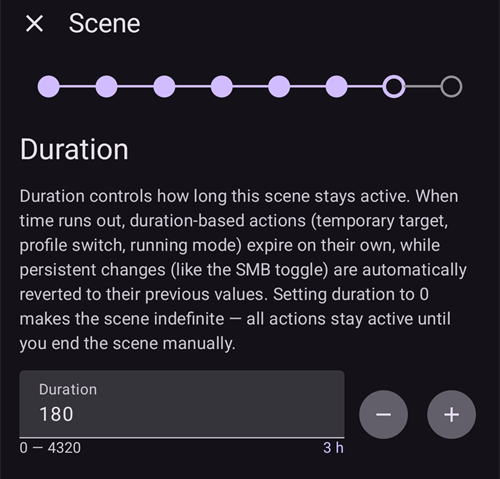
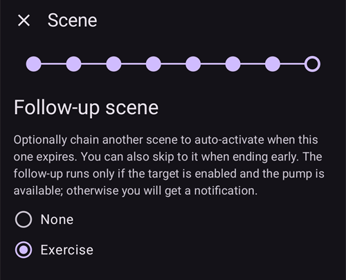
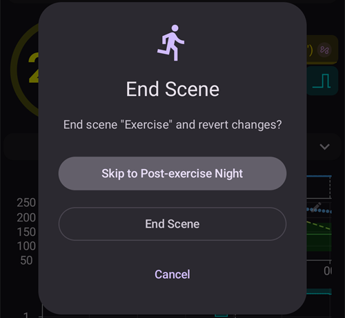

(scenes)=
# Cenários (predefinições de situação)

Um **cenário** é uma predefinição com nome que aplica um **conjunto de ações de uma vez** — por exemplo, uma predefinição *Sono*, *Exercício* ou *Dia de doença* que troca o seu perfil, define um alvo temporário, liga ou desliga o SMB e adiciona uma nota do CarePortal com um único toque, se quiser por um tempo definido.

```{contents} Table of contents
:depth: 2
:local: true
```

---

## O que é um cenário

Em vez de mudar várias coisas à mão toda vez que uma situação se repete, você as configura uma vez como cenário e o ativa com um toque. Um cenário pode juntar qualquer uma destas ações:

- **Troca de Perfil** — troca o perfil e/ou muda a porcentagem dele (por exemplo, 70 %).
- **Alvo Temporário** — define um alvo temporário (por exemplo, *Atividade*, *Comer em breve* ou um valor personalizado).
- **SMB ligado/desligado** — ativa ou desativa os super micro bólus enquanto o cenário está ativo.
- **Modo do loop** — muda o modo de operação (por exemplo, para um modo mais cauteloso).
- **Nota do CarePortal** — registra um evento (por exemplo, *Exercício*, *Doença*) para que ele apareça no gráfico e no Nightscout.

Um cenário também tem uma **duração** — um tempo fixo (minutos/horas/dias) ou *Indefinido (encerramento manual)* — e uma **ação final**, que é executada quando ele termina: uma **notificação**, ou ele pode **encadear** outro cenário (por exemplo, *Dia de doença → Exercício*).

---

## Gerenciar cenários

Abra **Gerenciar → Cenários** para ver, criar, editar, ativar/desativar e reordenar seus cenários.


Cada cartão de cenário mostra:

- uma **caixa de seleção** para ativar/desativar o cenário,
- um **ícone** e um **nome**,
- um resumo — *“N ações, duração”* — e o **→ cenário encadeado**, se ele encadear outro cenário,
- e três botões: **▶ ativar**, **✏️ editar**, **🗑️ excluir**.

Toque no botão **+** para criar um novo cenário.

---

## Criar ou editar um cenário

### Começar a partir de um modelo

Para **criar** um cenário, toque no botão **+** na tela Cenários. O primeiro passo é **Começar a partir de um modelo**: escolha um cenário pronto para uma situação comum — *Exercício*, *Dia de doença*, *Dia de doença — vômitos*, *Sono*, *Noite pós-exercício*, *Antes da refeição*, *Álcool*, *Direção*, *Banho*, *Fase lútea*, *Clima quente*, *Procedimento médico* — ou comece com um cenário *Em branco*. Cada modelo **já preenche as ações recomendadas**, e você pode ajustar tudo nos passos seguintes.


Depois que você escolhe um modelo, o objetivo dele é explicado — *quando* e *por que* usá-lo — antes de você continuar:


### Passar pelas ações

O resto do editor é um assistente curto, **passo a passo**. Cada passo é um tipo de ação com uma chave *“Incluir … no cenário”* — ligue-a apenas para as ações que você quer que este cenário execute e deixe as outras desligadas.


Passe pelos passos com **Seguinte**/**Voltar**: *Troca de Perfil*, *Alvo Temporário*, *SMB*, *Modo de operação*, *CarePortal*, depois a **duração**, a **ação final** (notificar ou encadear outro cenário) e, por fim, o **nome e o ícone** do cenário. Salve quando terminar. (Para **editar** um cenário que já existe, toque no botão **✏️** dele — você vai direto para estes passos.)

Cada passo começa com uma explicação curta do que a ação faz. Os passos são assim, aqui com o modelo *Exercício*:

**Alvo Temporário** — escolha uma das suas predefinições de alvo temporário:


**SMB** — ativa ou desativa o SMB enquanto o cenário está ativo:


**Modo de operação** — se quiser, muda o modo do loop:


**CarePortal** — o tipo de evento e a observação a registrar:


**Duração** — por quanto tempo o cenário fica ativo; 0 significa até você mesmo encerrá-lo:



**Cenário seguinte** — se quiser, o cenário que começa quando este termina:



**Cenário** — o nome e o ícone. Toque em **Concluir** para salvar:


---

## Ativar um cenário

Ative um cenário na lista **Cenários** (o botão **▶**) ou no item **Cenários** da navegação inferior. No painel **Cenários** da navegação inferior, cada cenário mostra o mesmo resumo da lista de Cenários, e o **lápis** no topo do painel abre **Gerenciar → Cenários** para criar ou editar seus cenários.


Antes de qualquer coisa ser aplicada, você recebe uma **confirmação** que lista exatamente o que o cenário vai fazer, para que você possa conferir:


Se o cenário encadeia outro, a confirmação termina com **→** e o nome desse cenário seguinte, do mesmo jeito que aparece na lista de Cenários.

Quando você inicia o cenário pelo item **Cenários** da navegação inferior, a confirmação é um diálogo mais simples com a mesma lista de ações. Toque em **OK** para ativar:


Depois que você confirma, as ações são aplicadas e o **cenário ativo** aparece no topo da tela principal com um botão **Encerrar cenário**. Se o cenário encadeia outro, o aviso também mostra o nome desse cenário seguinte:


As ações do cenário continuam valendo até que:

- a **duração** dele termine (a **ação final** é executada — uma notificação, ou ele encadeia o próximo cenário), ou
- você toque em **Encerrar cenário** para encerrá-lo manualmente. Se o cenário encadeia outro, você tem duas opções: **Pular para** o cenário seguinte (o cenário ativo termina e o seguinte começa agora) ou **Encerrar cenário** (o cenário ativo termina e o seguinte não começa).

Um cenário sem cenário seguinte só pede que você confirme:



Encerrar um cenário **desfaz** as mudanças que ele fez (por exemplo, a troca de perfil e o alvo temporário que ele iniciou).

Enquanto um cenário está ativo, o perfil e o alvo na tela principal mostram um pequeno ícone de cenário quando foi o cenário que os definiu. O painel **Cenários** da navegação inferior continua disponível para iniciar outro cenário:


Quando a duração termina sozinha, as mudanças são desfeitas na hora e o aviso muda para **Cenário encerrado**, com um botão **Dispensar**. Dispensar apenas tira o aviso da tela — o cenário em si já terminou, então as regras de automação e um cenário encadeado continuam sem esperar por isso.

---

## Acionar cenários pela Automação

Um cenário não precisa ser iniciado à mão — a **Automação** pode executá-lo para você. Quando você adiciona uma ação a uma regra de automação (**Gerenciar → Automação**), a lista de ações tem uma categoria **Cenários**:

- **Executar cenário** — ativa um cenário quando os gatilhos da regra disparam (por exemplo, em um horário definido, quando você chega a um lugar ou quando a glicose passa de um limite).
- **Ativar cenário** / **Desativar cenário** — torna um cenário disponível (ou indisponível) sem ativá-lo.


A Automação também pode **reagir a** um cenário: a lista de gatilhos inclui um gatilho **Cenário**, então uma regra pode ser executada só enquanto um determinado cenário está ativo. Junto com a **ação final** de um cenário (desfazer, notificar ou encadear outro cenário), isso permite que os cenários comecem, continuem e terminem automaticamente.

---

## Cenários com dispositivo principal/cliente e um relógio

O **cenário ativo no momento é sincronizado** entre todos os seus dispositivos pareados — ative-o em um telefone e os outros também o mostram.

Um **cliente** pareado (**AAPSClient**) também pode ativar ou encerrar um cenário: o pedido é enviado ao **dispositivo principal**, que cria a confirmação e aplica o cenário no seu próprio estado. Veja [Controle dispositivo principal ↔ cliente](../RemoteFeatures/ClientMasterControl.md) para saber como isso funciona.

(scenes-from-watch)=
### A partir de um relógio Wear OS

Os cenários estão disponíveis em um **relógio Wear OS** como um **bloco Cenário**. Deslize até o bloco **Cenário** no carrossel de blocos do relógio (antes, adicione-o pela lista de blocos do carrossel, se ele ainda não estiver lá) e toque no cenário que você quer iniciar:


O bloco tem quatro espaços. Por padrão, cada espaço se preenche **automaticamente** com o próximo dos seus cenários ativados, na mesma ordem que eles têm no telefone. Para escolher você mesmo, **toque e segure o bloco** e abra as configurações dele: para cada um dos quatro espaços, você pode manter **Automático**, fixar um **cenário específico** ou selecionar **Nenhum** para deixar o espaço vazio. Um espaço fixado em um cenário que depois foi excluído ou desativado mostra **Indisponível** — escolha outro cenário para ele.

O relógio então mostra uma confirmação — toque em **✓** para ativar, ou deslize para voltar e cancelar:


Assim como em um cliente, o **dispositivo principal cria a confirmação e executa o cenário**; o relógio apenas repassa o pedido (pelo telefone cliente, se o relógio estiver pareado com um cliente).

Enquanto um cenário está em execução — ou o aviso **Cenário encerrado** dele ainda aparece no telefone — o bloco mostra um botão **Fim** com o nome do cenário embaixo. Toque nele para encerrar o cenário ativo, ou para tirar o aviso que ficou, direto do seu pulso.

Se o cenário em execução encadeia outro, o bloco também mostra um botão **Pular** com o nome do cenário seguinte embaixo. São as mesmas duas opções do telefone:

- **Fim** — o cenário ativo termina. A confirmação avisa que o cenário seguinte não vai começar.
- **Pular** — o cenário ativo termina e o cenário seguinte começa agora. A confirmação mostra o nome dos dois cenários.

A [tela Status do loop](#WearOsSmartwatch-loop-status) do relógio também mostra o cenário ativo, o tempo que falta e o cenário seguinte.

---


<!-- =====================================================================
     Screenshots captured from a real master device:
       - scenes_list.png        (Manage → Scenes management list)
       - templates_picker.png   (create: "Start from template" picker)
       - template_explanation.png (create: chosen template's explanation)
       - scene_editor.png       (scene editor, Profile switch step)
       - scene_confirmation.png (scene activation confirmation — also used on the Client/Master page)
       - scene_active_banner.png (overview active-scene banner with the End Scene button)
       - automation_scene_action.png (Automation action picker — Scenes category)
       - scene_watch_tile.png    (Wear OS Scene tile)
       - scene_watch_confirm.png (Wear OS scene confirmation)
     Maintainers: relocate page + images and fix cross-links as needed.
     ===================================================================== -->
