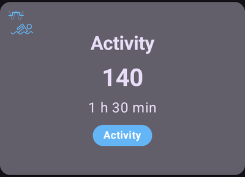

# Alvos temporários

## O que são alvos temporários e onde posso defini-los e configurá-los?

Um **Alvo temporário** (ou, de forma curta, **TT**) é um recurso do **AAPS** que permite ao usuário mudar a sua [faixa-alvo de **glicose**](#profile-glucose-targets) para atividades planejadas. Isso é feito pelo **AAPS**, que ajusta o uso de insulina do usuário.

Um alvo de glicose, principalmente se for só de curto prazo (menos de 4 horas de duração), não precisa ser o *valor real* que você espera ou quer que a sua glicose alcance. Ele é, na verdade, uma boa forma de dizer ao **AAPS** para ser mais ou menos agressivo, mantendo a sua glicose na faixa-alvo.

Os alvos temporários podem ser definidos dentro destes limites:

|        | Alvo Temporário        |
| ------ | ---------------------- |
| Mínimo | 4 mmol/l ou 72 mg/dl   |
| Máximo | 10 mmol/l ou 180 mg/dl |

O **AAPS** oferece três predefinições de **Alvo temporário** já incluídas: para exercício (**Atividade**), para refeições (**Comer em breve**) e para hipoglicemia prevista (**Hipo**). Elas ficam na tela **Alvo temporário** (**Gerenciar** → **Alvo temporário**), que você também pode abrir simplesmente tocando no **chip do alvo** na tela principal.

Os usuários devem ter expectativas realistas sobre os resultados que podem ser alcançados ao selecionar um **Alvo temporário** no **AAPS**. O sucesso em alcançar o alvo de **glicose** desejado vai variar conforme vários fatores, como: a confiabilidade das configurações do **AAPS** do usuário, o controle geral da **glicose**, a **IOB**, a sensibilidade à insulina, a resistência à insulina, a intensidade do esforço durante o exercício e assim por diante.

Um **Alvo temporário** pode levar cerca de 30 minutos ou mais para alcançar o alvo de **glicose** desejado. É impossível para o **AAPS** alcançar um alvo de **glicose** com efeito imediato, e os usuários devem se lembrar disso ao selecionar um **Alvo temporário**.

As seções abaixo resumem os recursos do **Alvo temporário - Atividade**, do **Alvo temporário - Comer em breve** e do **Alvo temporário - Hipo**. Os valores mostrados são os padrões de fábrica — você pode [ajustar cada predefinição](#TempTargets-change-preset-defaults) conforme as suas necessidades.

### TT - Atividade



**Alvo de glicose (predefinição padrão, ajustável)**

O AAPS vai tentar alcançar 140 mg/dl ou 7,8 mmol/l por 1 h 30 min

**Outros pontos que os usuários podem querer levar em conta ao selecionar**:

Dependendo do nível de **glicose**, o **AAPS** vai "diminuir" o uso de insulina para alcançar o alvo de **glicose**. Se o alvo de **glicose** não estiver na faixa (ou seja, acima do alvo de **glicose** selecionado no **Perfil** do usuário), o **AAPS** pode manter a basal ligada.

No modo loop fechado, o **SMB**:

- *pode ser* desativado (explicado mais abaixo); e/ou
- a basal pode ser ativada se o **AAPS** estiver com **IOB** negativa ou <0.

Os usuários também podem considerar:

- *selecionar* este **TT** 1–2 horas antes do exercício planejado, para garantir uma IOB menor (o momento certo para este TT varia de pessoa para pessoa); e
- *selecionar* um Perfil temporário (reduzido) durante a atividade planejada, para garantir uma **IOB** menor;
- *garantir* que o **TT** seja *desativado* pouco antes do exercício, porque a **IOB** já está reduzida e alguns usuários têm uma subida rápida da **glicose** depois do exercício.

### TT - Comer em breve


**Alvo de glicose (predefinição padrão, ajustável)**

O AAPS vai tentar alcançar 90 mg/dl ou 5,0 mmol/l por 45 minutos

**Outros pontos que os usuários podem querer levar em conta ao selecionar**:

No modo loop fechado, o **SMB**:

- vai continuar ativado; e/ou
- a basal também pode ser ativada, dependendo das configurações do **Perfil** do usuário.

Dependendo do nível de **glicose**, o **AAPS** vai "aumentar" o uso de insulina, dentro dos parâmetros das configurações do **AAPS** do usuário, para alcançar o alvo de **glicose** desejado.

### TT - Hipo


**Alvo de glicose (predefinição padrão, ajustável)**

O AAPS vai tentar alcançar 160 mg/dl ou 8,9 mmol/l por 1 hora

**Outros pontos que os usuários podem querer levar em conta ao selecionar**:

No modo loop fechado, o **SMB**:

- *pode ser* desativado (explicado mais abaixo); e/ou
- a basal pode ser ativada se o **AAPS** estiver com **IOB** negativa ou <0.

(TempTargets-manage-v4)=

## Definir e gerenciar alvos temporários (Gerenciar → Alvo temporário)

No **AAPS** v4, você gerencia as suas **predefinições** de TT e inicia um alvo temporário pela tela **Gerenciar** (navegação inferior) → **Alvo temporário** (*“Gerenciar e definir alvos temporários”*).


A tela tem três partes:

1. **Carrossel de predefinições** (em cima) — deslize entre as suas predefinições de TT. Cada cartão mostra o **nome**, o **alvo** e a **duração** da predefinição; o TT em execução no momento fica destacado.
2. **Editor** (no meio) — o **Alvo Temporário** e a **Duração** que serão realmente aplicados, além da data/hora de **Ativação**.
3. **Barra de ações** (embaixo) — os botões **➕ adicionar**, **‘️ excluir** e **▶ ativar**.

Selecionar um cartão de predefinição carrega o **alvo** e a **duração** dele no editor.

```{admonition} Predefinições incluídas e personalizadas :class: note As predefinições incluídas — **Comer em breve**, **Atividade** e **Hipo** — sempre existem e **não podem ser excluídas** (mas você pode mudar os valores delas e salvar). As predefinições que você mesmo cria são **personalizadas** e podem ser editadas ou excluídas livremente.

    <br />### Ativar um alvo temporário
    
    Deslize até a predefinição que você quer (os valores dela são carregados no editor), se quiser ajuste o **alvo**/a **duração** no editor e toque em **▶ Ativar**. Uma confirmação mostra o alvo, a duração e o motivo exatos antes de qualquer coisa começar:
    
    
    
    Depois que você confirma, o alvo temporário começa na hora (ou no horário de **Ativação** escolhido) e dura pelo tempo definido em **duração**.
    
    ```{admonition} Editar os números vale só uma vez — não muda a predefinição
    :class: important
    O **alvo** e a **duração** no editor são os valores que **Ativar** vai usar *agora*. Se você mudar esses valores, a mudança é **temporária**: vale só para esta ativação e **não altera a predefinição salva**. Assim você pode "ajustar e ativar" um TT uma única vez (por exemplo, ativar *Atividade* hoje com um alvo um pouco diferente) sem mudar a predefinição para sempre.
    

### Salvar mudanças em uma predefinição

Se você *quer* manter um valor editado, use **Salvar**: quando o editor está diferente da predefinição selecionada, um ícone **Salvar** aparece na barra de ferramentas superior. Tocar nele grava o **alvo** e a **duração** atuais (e o nome, nas predefinições personalizadas) na predefinição selecionada. Nas predefinições incluídas, um botão **Reverter para os padrões** (↺) também aparece na barra de ações: ele traz de volta os valores padrão da predefinição.


Então a regra prática é:

- **Ativar** → usa os números **uma vez** (a predefinição não muda).
- **Salvar** → torna os números os **novos padrões** da predefinição.

Para deixar uma predefinição incluída como ela veio de fábrica, selecione-a e toque no botão **↺ Reverter**. Ele só aparece na barra de ações para uma predefinição **incluída** cujos valores estão diferentes dos padrões de fábrica, e restaura o **alvo** e a **duração** originais dessa predefinição.

### Adicionar e remover predefinições

- **➕ Adicionar** — cria uma **nova predefinição personalizada** a partir dos valores atuais do editor. O novo cartão aparece no carrossel.
- **‘️ Excluir** — remove a predefinição **personalizada** selecionada. As predefinições incluídas (*Comer em breve*, *Atividade*, *Hipo*) não podem ser excluídas.

Quando você tem pelo menos duas predefinições **personalizadas**, também pode mudar a ordem delas no carrossel: toque no ícone **Reordenar** (⇅) na barra superior, mova o cartão do centro com os **botões de mover ◀ / ▶** e confirme com **✓**. As predefinições incluídas ficam no mesmo lugar — só as predefinições personalizadas podem ser movidas. (Os controles são iguais aos de [reordenar perfis](ProfileSwitch-ProfilePercentage.md).)

As suas predefinições fazem parte da configuração sincronizada, então são compartilhadas entre o seu dispositivo principal e os clientes pareados.

### Outras formas de definir um alvo temporário

Um alvo temporário também pode ser definido sem abrir esta tela:

- com as **chaves de TT no diálogo Carboidratos** — veja [abaixo](#TempTargets-carbs-dialog),
- com um **botão de predefinição na [barra de acesso rápido](QuickLaunch.md)** — a categoria *Predefinições de alvo temporário* em *Configurar acesso rápido* oferece um botão de um toque para cada uma das suas predefinições,
- a partir de um **relógio Wear OS** (o item de menu / bloco **Alvo temporário**),
- a partir de um **cliente** pareado — veja [Controle dispositivo principal ↔ cliente](../RemoteFeatures/ClientMasterControl.md),
- como parte de um **[cenário](Scenes.md)** (a ação *Alvo Temporário*), ou
- a partir de uma regra de **Automação** (*Iniciar alvo temporário* / *Parar alvo temporário*).

* * *

(TempTargets-where-can-i-select-a-temp-target)=

## Onde posso selecionar um alvo temporário?

A forma mais rápida é tocar no **chip do alvo** na tela principal (ele mostra a sua faixa-alvo atual):


Isso abre a tela **Alvo temporário** descrita acima — deslize até uma predefinição e toque em **▶ Ativar**. A mesma tela também pode ser aberta por **Gerenciar** → **Alvo temporário**.

(TempTargets-carbs-dialog)= Ao registrar carboidratos, você nem precisa abrir a tela **Alvo temporário**: o **diálogo Carboidratos** (**Tratamentos** → **Carboidratos**) tem as chaves **Iniciar TT Hipo**, **Iniciar Comer em breve TT** e **Iniciar atividade TT** no topo. Ligue uma delas e a predefinição correspondente é ativada junto com o registro de carboidratos:


    {admonition} TT Hipo automático
    :class: note
    Se você abrir o **diálogo Carboidratos** quando a sua glicose estiver abaixo de 72 mg/dl (4 mmol/l), o **AAPS** já marca a chave **Iniciar TT Hipo** para você (a menos que já esteja em execução um alvo temporário mais alto com mais tempo restante).

(TempTargets-change-preset-defaults)=

## Onde posso mudar o alvo temporário padrão e substituí-lo pelas minhas próprias preferências?

O **alvo** e a **duração** de cada predefinição são editados diretamente na tela **Alvo temporário** — não existe mais um item separado nas preferências para isso:

1. Abra a tela **Alvo temporário** (toque no chip do alvo, ou **Gerenciar** → **Alvo temporário**).
2. Deslize até a predefinição que você quer mudar.
3. Ajuste o **Alvo Temporário** e/ou a **Duração** no editor.
4. Toque no ícone **Salvar** que aparece na barra de ferramentas superior.


Enquanto o editor estiver diferente dos valores de fábrica de uma predefinição incluída, um botão **↺ Reverter** também aparece na barra de ações — toque nele para restaurar o alvo e a duração originais da predefinição.

## Como cancelo um alvo temporário?

Enquanto um alvo temporário está em execução, o chip do alvo na tela principal mostra o alvo e o tempo restante. Toque nele — na tela **Alvo temporário**, a predefinição em execução aparece destacada como **ATIVO**, e um botão vermelho **✗ Cancelar** aparece no fim da barra de ferramentas inferior, logo à esquerda do botão **▶ Ativar**. Toque nele e confirme:


Um alvo temporário em execução também pode ser parado a partir de um **relógio Wear OS**, de um **cliente** pareado ou por uma regra de **Automação** (*Parar alvo temporário*).

(TempTargets-hypo-temp-target)=

## Alvo Temporário para hipoglicemia

O **Alvo temporário Hipo** permite que o **AAPS** ajude o usuário a evitar uma hipoglicemia, reduzindo a insulina administrada. Se o usuário prevê que a **glicose** vai baixar: normalmente o **AAPS** deve lidar com isso, mas muito vai depender da estabilidade das configurações do **AAPS** do usuário. Um **Alvo temporário Hipo** permite que o usuário se antecipe à hipoglicemia prevista e faça o **AAPS** reduzir a insulina.

Às vezes, quando carboidratos são comidos para tratar uma hipoglicemia, a **glicose** do usuário pode subir rápido, e o **AAPS** vai corrigir essa subida rápida da **glicose** ativando **SMBs**.

Alguns usuários querem evitar que **SMBs** sejam administrados durante um **Alvo temporário Hipo**. Isso é feito desativando *'Ativar SMB com alvo temporário alto'* em **Configurações** → **SMB OpenAPS** (veja mais abaixo):

- Em (Avançado, objetivo 9): o usuário pode ativar *“Alvo temporário alto aumenta a sensibilidade”* para **Alvos temporários** de 100 mg/dl (5,6 mmol/l) ou mais no SMB OpenAPS; assim o **AAPS** fica mais sensível.

- Em (Avançado, objetivo 9): o usuário pode desativar *“Ativar SMB com alvo temporário alto”*, para que, mesmo se o **AAPS** tiver COB > 0, “Ativar SMB com alvo temporário baixo” ou “Ativar SMB sempre” ativados e o SMB OpenAPS ativo, o **AAPS** não administre SMBs enquanto alvos temporários altos estiverem ativos.

Observação: se você abrir o **diálogo Carboidratos** quando a sua glicose estiver abaixo de 72 mg/dl ou 4 mmol/l, o **AAPS** marca automaticamente a chave **Iniciar TT Hipo**.

(TempTargets-activity-temp-target)=

## Alvo temporário de atividade

Antes e durante o exercício, o usuário pode precisar de um alvo mais alto para evitar hipoglicemia durante a atividade.

Para simplificar o **Alvo temporário de atividade**, o usuário pode configurar um **Alvo temporário - Atividade** padrão que eleva a **glicose** reduzindo o uso de insulina, para diminuir a queda da **glicose** e evitar hipoglicemia.

Usuários novos do **AAPS** podem precisar testar e personalizar as configurações padrão do **Alvo temporário de atividade**, para que este recurso funcione melhor para eles. Cada pessoa é diferente quando se trata de manter um controle estável da glicose durante o exercício. Veja também a [seção sobre esportes no FAQ](#FAQ-sports).

Alguns usuários também preferem ativar uma **Troca de Perfil** (um perfil reduzido, abaixo de 100%, para diminuir a insulina administrada pelo **AAPS**) antes e durante o **Alvo temporário de atividade**. Você pode iniciar os dois em um passo: toque no nome do perfil na tela principal, toque no botão redondo **▶**, defina uma **Porcentagem** abaixo de 100 % e uma **Duração** e depois ligue **Alvo Temporário / Atividade**. Veja [Alterar a porcentagem do perfil](#ProfileSwitch-change-percentage).

Avançado, objetivo 9: os usuários podem ativar *'Alvo temporário alto aumenta a sensibilidade'* para **Alvos temporários** de 100 mg/dl (5,6 mmol/l) ou mais no **SMB** OpenAPS. Um alvo de 99 mg/dl (5,5 mmol/l) é um alvo normal, nem alto nem baixo. Assim o **AAPS** fica mais sensível.

Além disso, se *'Ativar SMB com alvo temporário alto'* estiver desativado, o **AAPS** não vai administrar **SMBs**, mesmo com COB > 0, *'Ativar SMB com alvo temporário baixo'* ou *'Ativar SMB sempre'* ativados e o **SMB** OpenAPS ativo.

(TempTargets-eating-soon-temp-target)=

## Alvo temporário Comer em breve

O **Alvo temporário - Comer em breve** pode ajudar a baixar a **glicose** suavemente e garantir que haja **IOB** suficiente antes de comer.

Esta pode ser uma ferramenta importante para os usuários que não fazem pré-bólus. Porém, a eficácia do **Alvo temporário - Comer em breve** vai depender de vários fatores, entre eles: as configurações do usuário, se a alimentação tem poucos carboidratos e se a pessoa usa uma insulina de ação rápida (como Fiasp ou Lyumjev) para não precisar de pré-bólus. Normalmente, até ganharem experiência com o **AAPS**, os usuários devem contar com um pré-bólus ao usar o **Alvo temporário - Comer em breve**, principalmente se a alimentação tiver muitos carboidratos.

Você pode ler mais sobre o “modo Comer em breve” (“eating soon mode”) no artigo ['How to do “eating soon” mode'](https://diyps.org/2015/03/26/how-to-do-eating-soon-mode-diyps-lessons-learned/) (em inglês) ou [aqui](https://diyps.org/tag/eating-soon-mode/).

Avançado, [objetivo 9](#objectives-objective9): se você usa o SMB OpenAPS e tem *'Alvo temporário baixo reduz a sensibilidade'* ativado, o **AAPS** age de forma um pouco mais agressiva. Para esta opção, o **Alvo temporário** precisa ser de 98 mg/dl (5,4 mmol/l) ou menos.

## Como desligo o SMB durante alvos temporários?

Para fazer isso, abra **Configurações** → **SMB OpenAPS** e desative *'Ativar SMB com alvo temporário alto'*.


Isso garante que o **AAPS** não vai administrar **SMBs**, mesmo com COB > 0, *'Ativar SMB com alvo temporário baixo'* ou *'Ativar SMB sempre'* ativados e o SMB OpenAPS ativo.