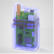
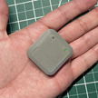

# Bombas compatíveis

AAPS works with a number of insulin pumps. A lista a seguir mostra os dispositivos suportados no momento. Entre parênteses, ela indica se o AAPS se comunica com a bomba pela função Bluetooth do seu telefone ou se precisa de um dispositivo compatível com RileyLink.

<!-- List of hidden pages to avoid overcrowding the menu -->

```{toctree}
:hidden:

../CompatiblePumps/Accu-Chek-Combo-Pump-v2.md
../CompatiblePumps/Accu-Chek-Insight-Pump.md
../CompatiblePumps/CareLevo.md
../CompatiblePumps/DanaR-Insulin-Pump.md
../CompatiblePumps/DanaRS-Insulin-Pump.md
../CompatiblePumps/DiaconnG8.md
../CompatiblePumps/EOPatch2.md
../CompatiblePumps/Equil5.3.md
../CompatiblePumps/MedtronicPump.md
../CompatiblePumps/MedtrumNano.md
../CompatiblePumps/OmnipodDASH.md
../CompatiblePumps/OmnipodEros.md
../CompatiblePumps/Future-possible-Pump-Drivers.md
```

- [Accu-Chek Combo](../CompatiblePumps/Accu-Chek-Combo-Pump-v2.md) (Bluetooth; veja também [Dicas para o uso básico](#combov2-tips-for-basic-usage))
- [Accu-Chek Insight](../CompatiblePumps/Accu-Chek-Insight-Pump.md) (Bluetooth)
- [CareLevo](../CompatiblePumps/CareLevo.md) (Bluetooth)
- [DanaR](../CompatiblePumps/DanaR-Insulin-Pump.md) (Bluetooth)
- [DanaRS](../CompatiblePumps/DanaRS-Insulin-Pump.md) (Bluetooth)
- [Dana-i](../CompatiblePumps/DanaRS-Insulin-Pump.md) (Bluetooth)
- [Dana-i2](../CompatiblePumps/DanaRS-Insulin-Pump.md) (Bluetooth)
- [Diaconn G8](../CompatiblePumps/DiaconnG8.md) (Bluetooth)
- [EOPatch2](../CompatiblePumps/EOPatch2.md) (Bluetooth)
- [Equil 5.3](../CompatiblePumps/Equil5.3.md) (Bluetooth)
- Alguns modelos mais antigos da [Medtronic](../CompatiblePumps/MedtronicPump.md) (precisa de um [dispositivo de comunicação adicional](#CompatiblePumps-additional-communication-device))
- [Medtrum Nano 200U](../CompatiblePumps/MedtrumNano.md) (Bluetooth)
- [Medtrum 300U](../CompatiblePumps/MedtrumNano.md) (Bluetooth)
- [Omnipod DASH](../CompatiblePumps/OmnipodDASH.md) (Bluetooth)
- [Omnipod Eros](../CompatiblePumps/OmnipodEros.md) (precisa de um [dispositivo de comunicação adicional](#CompatiblePumps-additional-communication-device))

## My pump is not listed

Detalhes sobre o status de outras bombas que talvez possam funcionar com o AAPS estão na página [Drivers de bombas futuros (possíveis)](../CompatiblePumps/Future-possible-Pump-Drivers.md).

(CompatiblePumps-additional-communication-device)=
## Additional communication device

Se nenhum dispositivo de comunicação adicional for mencionado, a comunicação entre a bomba de insulina e o **AAPS** usa a pilha Bluetooth integrada do Android. Não é preciso um dispositivo de comunicação adicional para "traduzir" o protocolo de comunicação.

Para as bombas Medtronic antigas e o Omnipod Eros, é preciso um dispositivo de comunicação adicional (além do seu telefone) para "traduzir" o sinal de rádio da bomba para Bluetooth. O dispositivo deve usar a mesma frequência de rádio que a sua bomba:

- **Omnipod Eros**: 433 MHz.
- **Medtronic**: 916 MHz para bombas vendidas nos EUA e no Canadá, 868 MHz para bombas vendidas em outros países. Veja [Como descobrir qual frequência a minha bomba usa](#MedtronicPump-faq).

Dispositivos de comunicação disponíveis:

-   [Site do OrangeLink](https://getrileylink.org/product/orangelink)
-  [RileyLink 433MHz](https://getrileylink.org/product/rileylink433)
-   [Site do Emalink](https://github.com/sks01/EmaLink) - [Contato](mailto:getemalink@gmail.com)
-   DiaLink - [Contato](mailto:Boshetyn@ukr.net)
-   [Site do LoopLink](https://www.getlooplink.org/) - [Contato](https://jameswedding.substack.com/) - Não testado