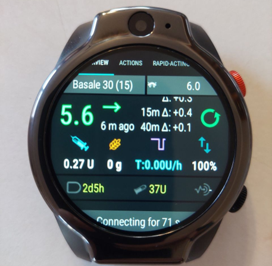
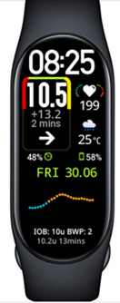

# Smartwatches e o AAPS

Vários smartwatches podem mostrar parte das informações do **AAPS** ou fazer ações remotas.

Para que um smartwatch controle o **AAPS** diretamente (bomba e sensor), é preciso um relógio Android completo (que funciona como um pequeno [smartphone](./Phones.md)).

Alguns smartwatches permitem inserir tratamentos, ou mais, mas o próprio telefone continua gerenciando o **AAPS**.

Smartwatches são cada vez mais usados com o **AAPS**, _tanto_ por adultos com diabetes quanto por cuidadores/pais de crianças com diabetes.

## Vantagens gerais de usar smartwatches com o **AAPS**


Dependendo do modelo, os smartwatches podem ser usados de muitas formas diferentes com o **AAPS**. Eles podem ser usados para controlar o **AAPS** total ou parcialmente, ou apenas para verificar à distância os níveis de glicose, a insulina ativa (IOB) e outros parâmetros.

Integrar um smartwatch ao **AAPS** pode ser útil em muitas situações, por exemplo ao dirigir um carro ou uma moto (ou bicicleta) e durante exercícios. Algumas pessoas acham que olhar para um relógio (em uma reunião, festa, à mesa do jantar etc.) é mais discreto do que olhar para um telefone. Em termos de segurança, um smartwatch também pode ser útil em deslocamentos, pois o usuário pode guardar o telefone **AAPS** fora de vista (por exemplo, dentro de uma bolsa) e continuar usando o smartwatch para controle remoto.

## Vantagens específicas para pais/cuidadores que usam o **AAPS**

No caso de uma criança, se o telefone **AAPS** dela estiver por perto, um cuidador pode usar um smartwatch para monitorar ou fazer alterações sem precisar usar o telefone **AAPS**. Isso pode ser útil, por exemplo, se o telefone **AAPS** estiver guardado em um cinto de bomba.

Um smartwatch pode ser usado _além_ das opções baseadas no TELEFONE para controle remoto ou [apenas acompanhamento](../RemoteFeatures/FollowingOnly.md), ou como _alternativa_ a elas.

Além disso, ao contrário dos telefones seguidores dos pais/cuidadores (que dependem da rede móvel ou de uma conexão Wi-Fi), os smartwatches conectados por Bluetooth podem ser úteis em locais remotos, como uma caverna, um barco ou o meio de uma montanha. Se os dois dispositivos (telefone **AAPS** e smartwatch) estiverem na mesma rede Wi-Fi, eles também podem usar o Wi-Fi.

## Diferentes tipos de interação entre smartwatch e AAPS

Atualmente, há cinco formas principais de usar smartwatches junto com o **AAPS**. Elas são mostradas na tabela abaixo: 

| Configuração do relógio  | Recursos                                                | Requisitos                                                                                                                                                                                                                                                                                                                                 |
| ------------------------ | ------------------------------------------------------- | ------------------------------------------------------------------------------------------------------------------------------------------------------------------------------------------------------------------------------------------------------------------------------------------------------------------------------------------ |
| Independente             | AAPS sem telefone                                       | Smartwatch Android completo (verifique a versão mínima do Android)</br> Executando **app-fullRelease**                                                                                                                                                                                                                                     |
| Controle remoto completo | A maioria das funções do AAPS                           | Relógio Android **Wear OS** (verifique Android/API)</br>Executando **wear-fullRelease**                                                                                                                                                                                                                                                    |
| Controle remoto          | Funções do AAPSClient                                   | Relógio Android **Wear OS** (verifique Android/API)</br>Executando **[wear-aapsclientRelease](https://github.com/nightscout/AndroidAPS/releases)**                                                                                                                                                                                         |
| Controle remoto          | Algumas funções do AAPSClient                           | Relógios Garmin</br>(apenas configurações antigas com Samsung Tizen e Fitbit, não recomendado)</br>Veja abaixo.                                                                                                                                                                                                                            |
| Exibição                 | Glicose, tendência, IOB, COB, status do loop e da bomba | Muitos smartwatches, por meio de um app companheiro no telefone **AAPS** alimentado pela transmissão de [Apps companheiros externos](#watches-external-companion-apps): [WatchDrip+](https://bigdigital.home.blog/) (Xiaomi, Amazfit), [GlucoDataHandler](https://github.com/pachi81/GlucoDataHandler) (Wear OS), G-Watch</br>Veja abaixo. |

## Antes de comprar um smartwatch…

O modelo exato de smartwatch que você compra depende da(s) função(ões) desejada(s). Você pode encontrar informações úteis na [página Telefones](#Phones-list-of-tested-phones), incluindo uma lista de telefones testados que também contém alguns smartwatches.

Marcas de relógio populares incluem Samsung Galaxy, Garmin, Fossil e Mi Band. As diferentes opções resumidas na tabela acima são explicadas com mais detalhes abaixo, para ajudar você a decidir qual smartwatch é o certo para a sua situação.

Se você vai integrar um smartwatch ao **AAPS** em um telefone com a intenção de interagir à distância com o **AAPS**, também precisa verificar se os dois dispositivos são compatíveis entre si, principalmente se você tiver um telefone antigo ou incomum.

Em geral, se você só quer acompanhar os valores de glicose e não interagir com o **AAPS**, há uma variedade maior de relógios mais simples e acessíveis que você pode usar.

A melhor forma de escolher um smartwatch é procurar posts sobre "watch" (relógio) nos grupos do **AAPS** no Discord ou no Facebook. Leia as experiências de outras pessoas e publique suas perguntas específicas se os posts mais antigos não responderem à sua dúvida.

## Android completo

Parece uma opção atraente, não é? No entanto, no momento, apenas alguns entusiastas estão testando o **AAPS** em um relógio independente. Há poucos smartwatches com uma interface razoável que também funcionam bem com o uso independente do **AAPS** e do seu app de CGM. Modelos populares incluem o LEMFO LEM 15 Pro e o 16. Você precisará instalar no relógio o apk "full" do **AAPS** (o apk que normalmente é instalado em um smartphone) em vez do apk "wear" do **AAPS**.

Não existe uma especificação clara que diga se um relógio vai funcionar bem para uso independente do **AAPS**, mas os seguintes parâmetros ajudam:

1)  Android 12 ou mais recente. 2)  Poder tirar o mostrador do modo “quadrado” para deixar o texto maior e mais fácil de ler. 3)  Bateria com duração muito boa. 4)  Bom alcance de Bluetooth.

A maioria das frustrações com relógios independentes com **AAPS** vem de interagir com uma tela minúscula e do fato de que a interface atual do app AAPS full não foi feita para um relógio. Por causa do tamanho reduzido da tela, você pode preferir usar uma caneta stylus para editar as configurações do **AAPS** no relógio, e alguns botões do AAPS podem não aparecer na tela do relógio.

Outros desafios são que é difícil conseguir uma duração de bateria suficiente, e os relógios com bateria suficiente costumam ser grandes e grossos. Os usuários relatam dificuldades com o sistema operacional e as configurações de economia de energia, dificuldade para iniciar sensores no relógio, alcance de Bluetooth fraco (para manter a conexão com o sensor e com a bomba) e resistência à água duvidosa. Há exemplos nas fotos abaixo.



Se você tem interesse em configurar um relógio independente, leia os posts e comentários no grupo do **AAPS** no Facebook (bons termos de busca são “standalone” e “Lemfo”) e no Discord para mais informações.

## Wear OS

O código do **AAPS** contém uma extensão de app que pode ser instalada em [smartwatches **Wear OS**](https://wearos.google.com/#oem-carousel).


Verifique se o seu smartwatch atende aos [pré-requisitos](#maintenance-android-version-aaps-version) do **AAPS**.

### O que _é_ o Wear OS?

As três primeiras opções de smartwatch exigem que o smartwatch tenha o **Wear OS** instalado.

O **Wear OS** é o sistema operacional que roda em alguns smartwatches Android modernos. Se a descrição do smartwatch indicar apenas _compatibilidade_ com Android e iOS, isso não significa que ele roda o Wear OS. Ele pode ter outro tipo de sistema operacional próprio do fabricante, que não é compatível com o **AAPS**. Para instalar e usar qualquer versão do **AAPS** ou do **AAPSClient**, o smartwatch precisa rodar o **Wear OS 3.0, 3.2 ou 3.5** (Android 11, nível de API 30) **ou mais recente**. Cada versão do Wear OS segue a versão do Android em que se baseia: o **Wear OS 3** é o Android 11 (nível de API 30), o **Wear OS 4** é o Android 13 (nível de API 33), o **Wear OS 5** é o Android 14 (nível de API 34) e o **Wear OS 6** é o Android 16 (nível de API 36). Relógios com Wear OS 2 não conseguem rodar o **AAPS**.

Se você instalar o wear.apk do **AAPS** em um relógio **Wear OS**, poderá escolher entre vários mostradores personalizados do **AAPS**. Outra opção é usar um mostrador padrão do smartwatch, com as informações do **AAPS** incluídas em pequenos blocos chamados “complicações” no mostrador. Uma complicação é qualquer elemento mostrado em um mostrador além da hora.

```{note}
As mudanças recentes no **Wear OS** estragam aos poucos os mostradores personalizados do **AAPS** (quanto maior a versão do Wear OS, pior), mas as **complicações** continuam funcionando. Antes de comprar ou atualizar um relógio, leia [Mudanças nos mostradores do Wear OS](#wearos-watchface-changes).
```


### Como pode ficar o meu smartwatch?

Depois de [instalar o **AAPS** no seu relógio](../WearOS/WearOsSmartwatch.md), você poderá escolher automaticamente o seu mostrador preferido entre estes mostradores dedicados ao **AAPS**. Na maioria dos relógios, basta manter pressionada a tela inicial até ela diminuir e deslizar para a direita para escolher outra tela:


Estas são as telas básicas incluídas no **AAPS**; há [mais mostradores](#WearOS_changing-to-AAPS-watchface) e você também pode usar [complicações](#Watchfaces-complications).

### Como eu uso um relógio Wear OS no dia a dia?

Mais detalhes sobre os mostradores e o uso no dia a dia, incluindo como criar (e compartilhar) o seu próprio mostrador personalizado, estão na página [Configurar o AAPS no seu relógio Wear OS](../WearOS/WearOsSmartwatch.md).

(Watchfaces-tizen)= (watches-external-companion-apps)=

## Apps companheiros externos

O **AAPS** pode transmitir o seu status para outros apps instalados no mesmo telefone: glicose e tendência, IOB, COB, basal e basal temporária, nome do perfil, status do loop, bateria do telefone e da bomba, nível do reservatório e progresso do bólus. Vários apps companheiros de relógio leem essa transmissão e mostram os dados em relógios que o **AAPS** não suporta diretamente. Para enviar os dados, ative **Apps companheiros externos** em **Configuração** > **Comunicação** (veja [Apps companheiros externos](#external-companion-apps) na página Configuração). A transmissão é enviada a cada nova leitura e não pode ser solicitada: um botão de atualizar no app companheiro não tem efeito no **AAPS**.


Apps companheiros conhecidos que usam essa transmissão:

- [WatchDrip+](https://bigdigital.home.blog/) para relógios Xiaomi e Amazfit, veja [Relógios Xiaomi e Amazfit](#watches-xiaomi-amazfit) abaixo.
- [GlucoDataHandler](https://github.com/pachi81/GlucoDataHandler) para relógios Wear OS, como complicação ou widget. É uma alternativa útil nas versões do Wear OS em que os mostradores do **AAPS** não são confiáveis, veja [Configurar o AAPS no seu relógio Wear OS](../WearOS/WearOsSmartwatch.md). O app companheiro dele, GlucoDataAuto, mostra os mesmos dados no carro com o Android Auto.
- [App G-Watch](https://play.google.com/store/apps/details?id=sk.trupici.g_watch) para relógios Samsung Tizen, e a versão posterior dele para Wear OS. Em versões anteriores do **AAPS**, o plugin se chamava **Samsung Tizen**, por causa deste app.

```{warning}
O **app G-Watch** e a sua versão para **Wear OS** não recebem mais manutenção, e a Samsung mudou os seus smartwatches do Tizen para o Wear OS. O G-Watch só é relevante para configurações antigas já existentes e não é recomendado para uma nova instalação. Veja o [grupo do Facebook](https://www.facebook.com/groups/gwatchapp) dedicado para as últimas notícias.
```

(Watchfaces-garmin)=

## Garmin

Há alguns mostradores para Garmin que se integram ao [AAPS](https://apps.garmin.com/search?keywords=androidaps), na loja Garmin ConnectIQ.


O [AAPS Glucose Watch](https://apps.garmin.com/apps/3d163641-8b13-456e-84c3-470ecd781fb1) se integra diretamente ao **AAPS**. Ele mostra dados do status do loop (insulina ativa (IOB), basal temporária) além das leituras de glicose, e envia as leituras de frequência cardíaca ao **AAPS**. Ele está disponível na loja ConnectIQ; ative o plugin **Garmin** em **Configuração → Comunicação**. 

1. Maior e menor valor de glicose no gráfico
2. Variação da glicose por minuto
3. Insulina ativa (IOB)
4. Tempo desde a última leitura de glicose (minutos:segundos)
5. Basal temporária, como porcentagem da basal do perfil
6. Gráfico de glicose das últimas 2 horas
7. Valor atual da glicose


## Fitbit

```{warning}
O Google está levando a Fitbit para o Google Health e está removendo apps e mostradores de terceiros dos relógios Fitbit na UE. Por isso, os mostradores da Fitbit **não são mais uma opção recomendada**, e não é recomendado comprar um Fitbit para usar com o **AAPS**.
```

Para relógios Fitbit que você já tem, as [páginas do Nightscout](https://nightscout.github.io/nightscout/wearable/#fitbit) listam algumas opções só de monitoramento, como o [Glance](https://glancewatchface.com/). Eles também são mostradores de terceiros, então a mesma restrição da UE vale para eles.

## Apenas acompanhamento

Estes smartwatches mostram algumas informações do **AAPS**; alguns precisam de outros apps.

Há uma grande variedade de smartwatches acessíveis que servem apenas para exibição. Se você usa o Nightscout, há uma boa visão geral de todas as opções [aqui](https://nightscout.github.io/nightscout/wearable/#)

Abaixo estão algumas opções de relógios só para acompanhamento, populares entre os usuários do **AAPS**:

(watches-xiaomi-amazfit)=
### Relógios Xiaomi e Amazfit

O **WatchDrip+** é um app companheiro feito pela comunidade que mostra dados de glicose e do loop em vários modelos de smartwatch, principalmente das marcas Xiaomi (_por exemplo_, Mi Band) e Amazfit:



Desde a versão 0.5, o **WatchDrip+** lê os dados diretamente do **AAPS**, sem o xDrip+ como intermediário. No telefone **AAPS**:

1. Ative **Apps companheiros externos** em **Configuração** > **Comunicação**, veja [acima](#watches-external-companion-apps). Ele fornece a glicose atual, o delta, a seta de tendência, o IOB e o status da bomba.
2. Ative o plugin **xDrip** em **Configuração** > **Comunicação** e ative **Enviar status para o xDrip+** nas configurações dele. Ele fornece a linha de status de IOB/COB, e o gráfico de glicose no relógio se completa após algumas leituras.
3. Se o xDrip+ estiver instalado no telefone, desative a **Broadcast Service API** dele (xDrip+ > Settings > Inter-app settings) para que o relógio não receba os dados duas vezes. Se o xDrip+ só repassava os dados para o relógio, você pode desinstalá-lo.

O botão de atualizar do WatchDrip+ não tem efeito com o **AAPS**: os dados chegam a cada nova leitura.


Você pode ler mais sobre eles, incluindo como configurá-los, no [site do WatchDrip+](https://bigdigital.home.blog/). A vantagem destes relógios é que são pequenos e relativamente acessíveis. Eles são uma opção popular, principalmente para crianças e pessoas com pulsos menores.

### Relógio Pebble


Os relógios Pebble ([já descontinuados](https://en.wikipedia.org/wiki/Pebble_(watch))) foram vendidos de 2013 a 2016 e ainda podem ser encontrados usados. A Fitbit assumiu os ativos da Pebble. Os usuários do Pebble podem usar o mostrador Urchin para ver os dados do Nightscout. Os dados que podem ser mostrados incluem IOB, a basal temporária ativa e as previsões. Se você usa o loop aberto, pode usar o IFTTT para criar um applet que, quando uma notificação do **AAPS** for recebida, envie um SMS ou uma notificação do Pushover.

### [Relógios Bluejay](https://bluejay.website/)


São aparelhos únicos, que podem receber dados de glicose **diretamente** do transmissor Dexcom. Pouca gente sabe que os transmissores Dexcom G6/G7 na verdade transmitem os dados atuais de glicose em _dois_ canais separados: um canal para o telefone e um canal médico. Os relógios Bluejay podem ser configurados para receber dados de glicose em qualquer um dos canais; assim, se o **AAPS** estiver usando o canal do telefone, os relógios Bluejay podem usar o canal médico.

A principal vantagem é que o relógio é independente tanto do telefone quanto do sistema de loop. Assim, por exemplo, se você desconectar a bomba e o telefone **AAPS** na praia ou num parque de diversões e estiver fora do alcance do telefone **AAPS**, ainda poderá receber as leituras do seu Dexcom diretamente no relógio Bluejay.

O **Bluejay GTS** original foi descontinuado e não consegue ler o Dexcom G7. Os modelos posteriores (U1 e depois o atual **U3**, vendido em acesso antecipado no momento em que este texto foi escrito) são relógios Android completos com xDrip, que recebem os dados diretamente do Dexcom G6 e G7. O fabricante descreve o relógio como uma ferramenta de pesquisa, não para uso médico. As desvantagens relatadas são que ele nem sempre recebe uma leitura a cada 5 minutos e que a bateria precisa ser carregada com frequência. Veja o [site da Bluejay](https://bluejay.website/) para o modelo atual e a disponibilidade.

### Apple Watch

Veja [Nightscout no seu relógio](https://nightscout.github.io/nightscout/wearable/#).

O Apple Watch agora suporta a conexão direta com o G7 e pode ser usado ao mesmo tempo que o **AAPS**.

