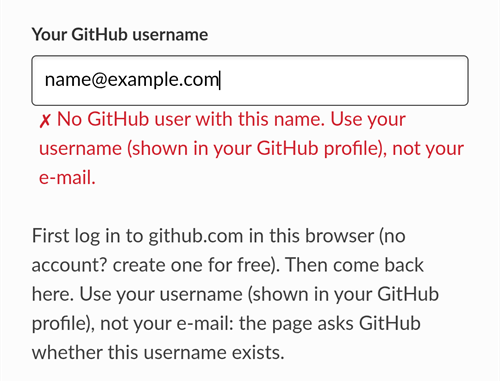
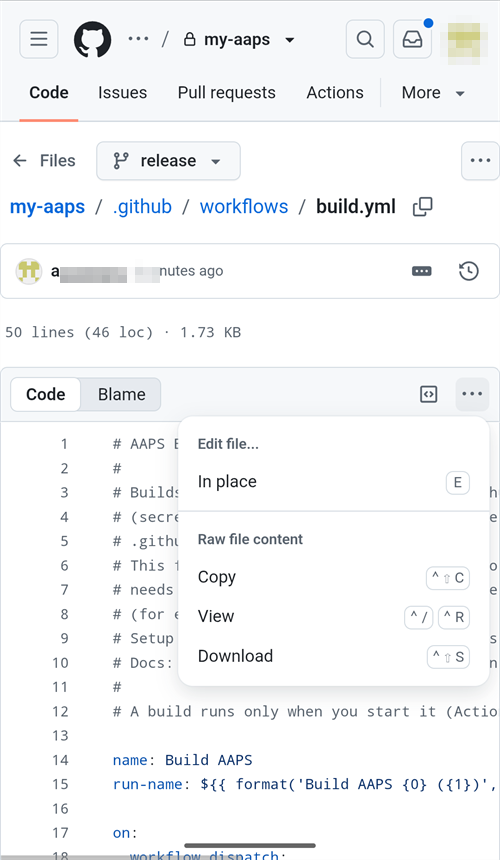
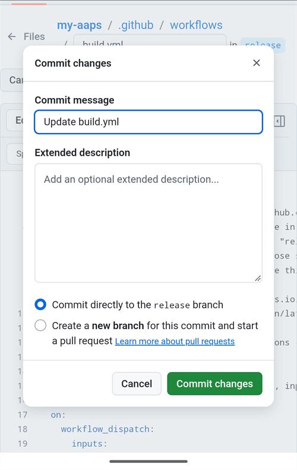
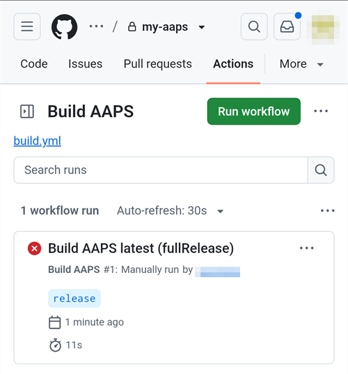
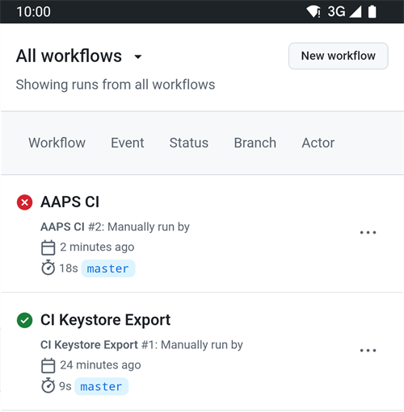
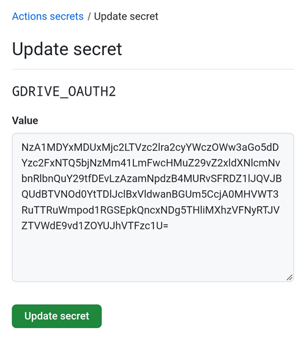
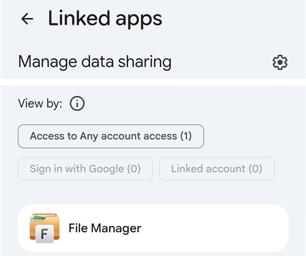
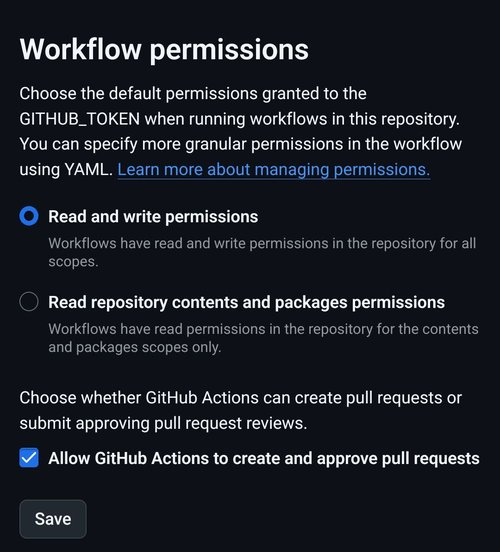

(aaps-ci-troubleshooting)=

# Compilação no navegador: resolução de problemas

```{note}
This page collects troubleshooting tips for the [Browser build](../SettingUpAaps/BrowserBuild.md).
```

(aaps-builder-troubleshooting)=

## AAPS Builder

### Passo 1: o repositório

(aaps-builder-ts-repo-exists)=

#### "my-aaps already exists in this account"


Você já tem este repositório, por exemplo de uma tentativa anterior. Feche a aba do GitHub, mantenha esse nome no passo 1 da página de configuração e continue. Se você já fez os passos 2 e 3 para ele, a sua chave ainda está nele: continue com o [passo 4](#aaps-builder-step4). Se ele foi feito com uma versão anterior da página de configuração, atualize o workflow dele uma vez, como explicado em [Atualizando o AAPS](#aaps-builder-updates). Prefere começar do zero? Digite outro nome, por exemplo `my-aaps-2`, e use a mesma keystore no passo 2.

(aaps-builder-ts-user-not-found)=

#### "No GitHub user with this name"



- **"No GitHub user with this name"** no passo 1: digite o seu nome de usuário do GitHub, como aparece no seu perfil do GitHub, não o seu e-mail.
- **Não há o botão "Build AAPS" ou "Run workflow", ou o repositório está vazio**: o repositório não foi criado a partir do modelo. Exclua-o (**Settings** → fim da página → **Delete this repository**) e faça de novo o [passo 1](#aaps-builder-step1) com o botão **Create my private repository**.

### Passo 3: o secret

(aaps-builder-ts-404)=

#### "Page not found" (404)


- **"Page not found" (404) quando a página de configuração abre o GitHub**: entre no github.com no mesmo navegador (o GitHub mostra 404 para repositórios privados quando você não está conectado). Se você estiver conectado, o nome de usuário ou o nome do repositório no passo 1 da página de configuração não corresponde ao seu repositório. Digite os nomes exatos.

### Passo 4: a compilação

(aaps-builder-ts-workflow-not-found)=

#### "This workflow does not exist"


Logo depois que o repositório é criado, o GitHub pode ainda não ter lido o arquivo de workflow dele: **Build AAPS** não aparece na aba **Actions**, e não há o botão **Run workflow**. Qualquer pequena mudança no arquivo faz o GitHub lê-lo:

1. No seu repositório, abra **Code**, depois a pasta `.github`, depois `workflows` e depois o arquivo `build.yml`.
2. Toque no menu **⋯** no canto superior direito do arquivo e depois em **Edit file… In place** (em um computador, clique no lápis).

   

3. Toque bem no fim do texto e adicione uma linha vazia (Enter). Toque em **Commit changes…** no alto da tela.

   

4. Toque de novo em **Commit changes**.

   

5. Abra de novo a aba **Actions**: **Build AAPS** agora está na lista de workflows (em um telefone, a lista abre com o ícone à esquerda de **All workflows**). Toque nele e depois em **Run workflow**.

   

(aaps-builder-ts-build-failed)=

#### A compilação falhou (X vermelho)

1. Na página de configuração, toque em **Open my builds** e toque na compilação com o X vermelho.

   

2. A página da compilação mostra **Failure** (falha) e qual parte falhou: **AAPS / Check** (o repositório, o secret, a versão ou a variante: nada foi compilado) ou **AAPS / Build AAPS**.

   

3. Role para baixo até **Annotations**, com o dedo sobre o texto, não sobre o diagrama. As linhas vermelhas explicam o problema: toque em **Show more** para ler a mensagem inteira e depois procure-a abaixo.

   

- **"Secret KEYSTORE_SET is missing"**: faça o passo 3 da página de configuração.
- **A compilação para com "This repository is PUBLIC"**: no seu repositório, abra **Settings** → **General** → **Danger Zone** → **Change visibility** → **Private** e depois compile de novo.
- **"Version … does not exist"**: só é possível compilar as versões publicadas do **AAPS**, as que estão na [página de tags](https://github.com/nightscout/AndroidAPS/tags) do nightscout/AndroidAPS, como `3.3.2.0`. Um nome de branch como `dev` não funciona. Use `latest` ou digite uma tag exatamente como ela aparece na lista.
- **"Variant … is not supported"**: o seu arquivo de workflow é uma versão antiga. Substitua-o como explicado em [Atualizando o AAPS](#aaps-builder-updates).
- **"The secret is too short"**, **"The secret is not a valid code"** ou **"The secret does not contain a keystore"**: o texto errado foi colado no secret, muitas vezes a própria palavra `KEYSTORE_SET`, ou só uma parte do código. No seu repositório, abra **Settings** → **Secrets and variables** → **Actions**, edite o `KEYSTORE_SET` e cole de novo o código longo de **Copy secret** (antes, refaça o passo 2 da página de configuração se você a fechou).
- **"Keystore, password or alias is wrong"**: verifique a senha e o alias da sua keystore e depois refaça os passos 2 e 3 da página de configuração.
- **"Google Drive access has expired or was revoked"**: refaça o [passo 6](#aaps-builder-google-drive) e atualize o secret `GDRIVE_OAUTH2`.
- **"Process completed with exit code 1" e uma linha vermelha só com um link para `services.gradle.org`**, depois de menos de um minuto: a compilação não conseguiu baixar o Gradle, uma ferramenta de que ela precisa para compilar o app. O site do Gradle não estava respondendo. O seu repositório e as suas configurações estão corretos. Espere meia hora e depois [execute a compilação de novo](#aaps-ci-rerun).
- **Outro erro**: [leia o log da compilação](#aaps-ci-read-the-logs) e depois [execute a compilação de novo](#aaps-ci-rerun). Se falhar de novo da mesma forma, peça ajuda informando o nome do passo que falhou e as linhas de erro. Nunca compartilhe o conteúdo dos seus secrets.

### Passo 5: o app

- **Não há link Download, ou o app do GitHub abriu**: o app do GitHub não consegue baixar compilações. Abra a compilação no Chrome, como explicado no [passo 5](#aaps-builder-step5). Para que os links do GitHub não abram mais no app: no Android, **Settings** (Configurações) → **Apps** (Apps) → **GitHub** → **Open by default** (Abrir por padrão) → desative **Open supported links** (Abrir links compatíveis).

## Resolução de problemas do AAPS-CI

(aaps-ci-read-the-logs)=
### Primeiro: descubra o que deu errado

Quando uma compilação falha, o GitHub guarda um log de cada passo. O log mostra qual passo falhou e por quê. Leia o log antes de tentar qualquer outra coisa: a mensagem de erro é o que você deve procurar nesta página, e é o que quem for ajudar vai pedir.

1. Na sua cópia do AndroidAPS no GitHub, abra **Actions**. Uma compilação que falhou tem um X vermelho. Toque no nome dela.

   

2. O resumo da execução mostra **Failure** (falha) e, abaixo, o job que falhou (**Build AAPS**, com um X vermelho).

   

3. Role para baixo até **Annotations** e toque na linha vermelha **Build AAPS**.

   

4. O job é aberto. Os passos com um visto cinza funcionaram. O passo com o X vermelho é o que falhou: o GitHub o abre para você. Os passos depois dele foram pulados (círculo cinza).

   

5. Leia as linhas logo acima de `Error: Process completed with exit code 1.`: elas explicam o problema. Neste exemplo, o passo **Retrieving Google Drive access token** falhou com `invalid_grant` e `Token has been expired or revoked.`, veja [Refresh token do Google expirado](#aaps-ci-google-token-expired).

   

```{tip}
Vai pedir ajuda? Informe o nome do passo que falhou e as linhas de erro (uma captura de tela como a acima serve). Nunca compartilhe o conteúdo dos seus secrets.
```

(aaps-ci-update-secret)=
#### Atualizar um secret

Muitas correções consistem em substituir o valor de um secret. Na sua cópia do AndroidAPS no GitHub, vá em **Settings** → **Secrets and variables** → **Actions** e toque no lápis ao lado do secret.


Digite ou cole o novo valor e toque em **Update secret**. O GitHub nunca mostra o valor antigo: o campo está sempre vazio.



(aaps-ci-rerun)=
#### Executar a compilação de novo depois de uma correção

Depois de corrigir a causa, você não precisa começar do zero: abra a execução que falhou, toque em **...** (canto superior direito) e depois em **Re-run failed jobs**.


Toque em **Re-run jobs**. Você também pode iniciar uma nova compilação em **Run workflow**, como de costume.


(aaps-ci-preparation-web)=
### Página web aaps-ci-preparation
  - A página de preparação é mostrada por um servidor local temporário (por exemplo, o Simple Web Server em um computador), que também recebe o refresh token do Google.
  - Se você vir a tela abaixo, o servidor local parou ou não pode ser acessado.
  - Feche a página de preparação, verifique se o servidor local está em execução, depois abra de novo o aaps-ci-preparation.html da mesma forma que na Etapa 2 e conclua os passos restantes. Isso é necessário principalmente ao criar a primeira conexão com o Google durante a configuração.

  

(aaps-ci-google-token-expired)=
### Refresh token do Google expirado
  - Os refresh tokens do Google OAuth2 expiram se não forem usados por 6 meses, e também podem ficar inválidos em outras situações (por exemplo, se você mudou a senha da sua conta Google ou removeu o acesso manualmente). Para mais detalhes, veja a [documentação do Google OAuth2](https://developers.google.com/identity/protocols/oauth2).
  - No [log da compilação](#aaps-ci-read-the-logs), o passo **Retrieving Google Drive access token** falha com `invalid_grant` e `Token has been expired or revoked.`:

  

  - Se a sua compilação falhar por causa de um refresh token do Google expirado ou removido, você precisará refazer os passos de [Google Drive Auth](#aaps-ci-google-drive-auth) para obter um novo token `GDRIVE_OAUTH2`, [atualizar o secret](#aaps-ci-update-secret) no seu repositório GitHub e depois [executar a compilação de novo](#aaps-ci-rerun).
  - Se a autorização falhar de novo, ou se o Google não pedir mais o seu consentimento, primeiro remova o acesso existente do AAPS da sua conta Google, veja [abaixo](#aaps-ci-google-remove-access).

(aaps-ci-google-remove-access)=
### Remover o acesso do AAPS da sua conta Google e reiniciar a autorização
  - Se a autorização do Google Drive continuar falhando, ou se você quiser começar de novo do zero, primeiro remova o acesso que você deu ao AAPS e depois refaça a autorização.
  - No seu telefone, abra [https://myaccount.google.com](https://myaccount.google.com), toque em **Security** (Segurança), role para baixo até **Your connections to third-party apps & services** (Suas conexões com apps e serviços de terceiros) e abra a lista de apps vinculados. Você também pode ir diretamente para [https://myaccount.google.com/connections](https://myaccount.google.com/connections).
  - Toque em **AAPS** na lista.

  

  - A página mostra o acesso que você deu ao AAPS (os arquivos do Google Drive usados com o app). Toque em **Delete all** (Excluir tudo) para remover a conexão, ou toque em **See details** (Ver detalhes) para revisá-la antes.

  

  - Na página de detalhes, toque em **Remove all access** (Remover todo o acesso).

  

  - Toque em **Confirm** (Confirmar).

  

  - O Google confirma que o AAPS não tem mais acesso. O AAPS não aparece mais na lista de apps vinculados.

  

  - Agora reinicie a autorização do zero: feche **tanto** a página de preparação quanto o app gerenciador de arquivos, abra de novo o aaps-ci-preparation.html pelo gerenciador de arquivos e refaça os passos de [Google Drive Auth](#aaps-ci-google-drive-auth). O Google vai pedir que você conceda o acesso de novo e a página vai fornecer um novo token `GDRIVE_OAUTH2`.
  - [Atualize o secret `GDRIVE_OAUTH2`](#aaps-ci-update-secret) no seu repositório GitHub com o novo token e depois [execute a compilação de novo](#aaps-ci-rerun).

(aaps-ci-disable-software)=
### Desative programas que podem atrapalhar a verificação OAuth
  - Desative qualquer VPN ou app de segurança (firewall, antimalware...) no telefone antes de tentar obter a chave OAuth.

(aaps-ci-actions-permission)=
### Verificar as configurações de permissão do GitHub Actions
  - Verifique se as políticas do GitHub Actions estão definidas como “Allow all actions and reusable workflows” (Settings → Actions → General). Se você mudar essa opção, clique em **Save** abaixo das opções.

  

`actions/checkout@v4` and `actions/setup-java@v4` are not allowed to be used in `xxxxx/AndroidAPS`. Actions in this workflow must be: within a repository owned by `xxxxx`

(aaps-ci-workflow-permissions)=
### Verificar as configurações de permissões de workflow do GitHub
  - Se a compilação falhar imediatamente com um erro "Invalid workflow file" parecido com o abaixo, as permissões padrão de workflow do seu repositório são restritivas demais:

```
Invalid workflow file
The workflow is not valid. .github/workflows/aaps-ci.yml (Line: 361, Col: 3):
Error calling workflow 'xxxxx/AndroidAPS/.github/workflows/cleanup-workflow-runs.yml@...'.
The nested job 'cleanup' is requesting 'actions: write', but is only allowed 'actions: none'.
```

  - Verifique se as permissões de workflow estão definidas como “Read and write permissions” (Settings → Actions → General → Workflow permissions), depois salve e execute de novo o workflow de compilação.

  

(aaps-ci-password-special-characters)=
### A compilação falha ao verificar a senha da keystore
  - No [log da compilação](#aaps-ci-read-the-logs), o passo **Validating keystore, alias and password** falha com `Either KEYSTORE_BASE64, KEYSTORE_PASSWORD, KEY_PASSWORD, or KEY_ALIAS is incorrect`, seguido de `Keystore was tampered with, or password was incorrect`. A compilação para ali: a keystore e as senhas são verificadas antes de o AAPS ser compilado.

  

  - O workflow de compilação mantém todos os caracteres das suas senhas sem alteração. Informe `KEYSTORE_PASSWORD` e `KEY_PASSWORD` exatamente como são, sem adicionar uma barra invertida ou qualquer outro caractere de escape. Se você adicionou barras invertidas, [atualize os secrets](#aaps-ci-update-secret) com a senha exatamente como ela é. O exemplo abaixo está errado: a senha é `Example2026`, e a barra invertida foi adicionada.

  

  - Se a compilação ainda falhar ao assinar o APK, embora a sua senha esteja correta, e a senha contiver `$`, uma crase, `"` ou `\`, o arquivo de workflow no seu fork é anterior a setembro de 2026 e ainda interpreta esses caracteres. [Sincronize o seu fork](#Update-to-new-version-update-your-repo) com o dev mais recente e depois execute de novo o workflow de compilação.
  - A barra vertical `|` é um caso especial. A página de preparação da [Opção 1](#aaps-ci-option1) junta a keystore, as senhas e o alias em um único secret `KEYSTORE_SET`, separados por `|`, e o workflow divide o valor nesse caractere. A senha gerada pela página de preparação contém apenas letras e números, então isso não pode acontecer com a Opção 1. Isso só pode acontecer se você mesmo montou um secret `KEYSTORE_SET` a partir de uma senha que contém `|`. Nesse caso, exclua o `KEYSTORE_SET` e informe os secrets separados da [Opção 2](#aaps-ci-option2).
