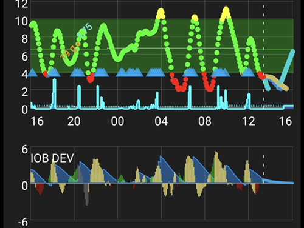

# Ajustar o perfil do AAPS

```{admonition} This is NOT a medical advice
:class: warning
Trabalhe com a sua equipe de saúde para obter apoio e orientação sobre o controle do seu diabetes.</br>
Use este guia somente depois de ter [configurado o seu **Perfil** corretamente](https://androidaps.readthedocs.io/en/latest/SettingUpAaps/YourAapsProfile.md), seguindo todos os objetivos do **AAPS**.
```

Este guia explica a lógica dos resultados do algoritmo OpenAPS com um determinado __Perfil__ e informa quais valores no **AAPS** podem ser ajustados quando certas situações ou padrões são observados. As sugestões sobre o teste da basal abaixo podem ser diferentes do que a sua equipe de saúde aconselha.

Usar o **loop fechado** pode deixar o teste da basal mais fácil e pode reduzir muito o risco de hipoglicemia se a basal do seu __Perfil__ estiver forte demais.

## Como proceder ao mudar as configurações do perfil

1. Leia e entenda as configurações e os conselhos recomendados pelo __AAPS__ abaixo. Se você não seguir estes conselhos, o ajuste pode ficar difícil e é menos provável que você consiga um __Perfil__ bem ajustado
2. Observe e compare com cuidado, **durante vários dias**, o que acontece com a sua __BG__ e o seu __IOB__.
3. Fique atento a padrões no **AAPS** que acontecem (quase) todos os dias por volta do mesmo horário.
4. É importante fazer isso durante vários dias. Usar dados observados em um único dia para decidir ajustes no __Perfil__ costuma dar resultados ruins.
5. Somente depois de observar um padrão que se repete, por exemplo, às 13h você vê um pico de __BG__ ou um valor de __IOB__ negativo, comece a fazer pequenas mudanças no seu __Perfil__.
6. É importante mudar apenas uma coisa de cada vez. Ex.: aumente a sua basal em 10% por volta das 13h.
7. Depois de cada mudança, é importante acompanhar o efeito na sua __BG__ e no seu __IOB__ nos próximos dias.
8. Repita este ciclo: observe, decida, ajuste de novo se for preciso

Não tenha pressa, vá devagar!

## Configurações e conselhos recomendados enquanto você ajusta a basal

- Faça todos os testes com o [loop fechado ativado](#AapsScreens-loop-status).
- **<u>DESATIVE</u> todas as [automações](../DailyLifeWithAaps/Automations.md)**
- **<u>DESATIVE</u> [DynISF](#Open-APS-features-DynamicISF), [AutoISF](#Open-APS-features-auto-isf), [AutoSens](#Open-APS-features-autosens)** para que eles não tentem adaptar o seu perfil.
- Não faça ações manuais (bólus manual, alvos temporários etc.) durante os testes: deixe o sistema usar apenas as configurações do **Perfil**.
- Para os [gráficos adicionais](#AapsScreens-section-g-additional-graphs): no gráfico 1, use Insulina ativa (IOB), Carboidratos ativos (COB) (e Mudança de sensibilidade). No gráfico 2, use Desvios e Impacto na glicose (BGI). Quando pedir conselhos, sempre inclua esses gráficos nas suas capturas de tela.
- COB=0[*](#profiletuning-cob-zero)

Outras situações que, de preferência, devem ser evitadas, porque influenciam os dados e podem levar a conclusões erradas:
- Nenhuma atividade física.
- Nenhum estresse.
- Nenhuma doença.
- Nenhum clima extremo, como temperaturas muito altas ou muito baixas.
- Nenhuma falha de sessão da bomba ou do CGM.
- Nenhum carboidrato não anunciado.

Observe também:
- Se o seu [perfil de taxa basal](#your-aaps-profile-basal-rates) estiver correto, quando você estiver no alvo com COB=0[*](#profiletuning-cob-zero) e IOB=0, você vai continuar sempre no alvo, qualquer que seja o seu **ISF** (o **ISF** só é usado quando você está acima do seu alvo de **BG**).
- Você precisa verificar o **IOB** atual, mas também o gráfico de **IOB**, para ver como o **IOB** mudou nas últimas horas.

(profiletuning-cob-zero)=

***COB = 0**

Significa que a refeição foi digerida e que não há mais carboidratos no seu corpo.

O **AAPS** pode indicar [COB=0 enquanto você ainda tem carboidratos ativos](../DailyLifeWithAaps/CobCalculation.md).

## Definições do [Perfil](../SettingUpAaps/YourAapsProfile.md)

Um **Perfil forte demais** indica alguma combinação do seguinte:

- O número do [ISF](#your-aaps-profile-insulin-sensitivity-factor) está pequeno demais.
- O número da [basal](#your-aaps-profile-basal-rates) está grande demais.
- O número da [I:C](#your-aaps-profile-insulin-to-carbs-ratio) está pequeno demais.

## Observações do IOB

*Nota: você também pode usar o gráfico de IOB do Loopalyzer nos relatórios do Nightscout para ver o IOB de vários dias.*

Se você observar os seguintes padrões depois de alguns dias, considere as seguintes mudanças:

### IOB positivo

- A basal do **Perfil** pode não estar forte o suficiente (isso também pode ser causado por coisas como comida não anunciada, doença, má absorção no local etc.)


### IOB negativo

- Basal padrão forte demais.
- Pode ser o efeito de exercício/atividade física anterior.


- Refeição anterior: bólus demais (o que causou uma basal temporária zero muito longa)


## Observações do alvo de BG

### Preso no alto

- O número do __ISF__ está alto e não é forte o suficiente (a insulina calculada é fraca demais)


- A basal do __Perfil__ pode não estar forte o suficiente (os **SMBs** não têm "reserva de basal" suficiente para usar)
- Uma segurança ([MaxIOB](#Open-APS-features-maximum-total-iob-openaps-cant-go-over)?) pode ter sido ativada e está limitando a administração de insulina. Verifique na tela do plugin **APS** (**Configuração → APS → Abrir plugin**); veja [SMB](#Open-APS-features-super-micro-bolus-smb).
- Problema técnico: absorção no local, conjunto de infusão, ...

### Preso no baixo

- __ISF__ forte demais e o número precisa ser aumentado
- Basal do __Perfil__ forte demais (se o IOB também for negativo)

### Montanha-russa (subidas e descidas)

- **ISF** forte demais? Veja o seu [Perfil do AAPS](#your-aaps-profile-insulin-sensitivity-factor)



## Observações da BG depois das refeições

### Subida rápida e BG fica alta

- A comida tem carboidratos rápidos (como suco de fruta).
- Considere fazer um pré-bólus ou um pré-bólus um pouco mais cedo.
- Bólus (IC ou % injetada) não é forte o suficiente.


### Subida rápida e depois BG fica baixa

- Considere fazer um pré-bólus; o seu **Perfil** pode estar agressivo demais (correção exagerada da subida)
- Bólus forte demais.


## [Como calcular a sua I:C](#your-aaps-profile-insulin-to-carbs-ratio)

1. Primeiro, você precisa das configurações de basal padrão corretas no seu **Perfil**.
2. Comece no alvo, de preferência sem IOB negativo.
3. Anote a insulina total administrada em **Gerenciar → Bomba** (ou no histórico da bomba) e chame-a de insulina inicial. Meça com muita precisão uma porção conhecida de carboidratos e anote a hora de início e o IOB inicial. Depois, informe os carboidratos e o bólus no **AAPS** usando a calculadora de bólus (com a I:C configurada atualmente). Não se esqueça de comer os carboidratos ;)
4. Depois de algumas horas, quando COB=0[*](#profiletuning-cob-zero) e você estiver de volta ao alvo, anote a hora de fim e o IOB final, verifique a insulina total administrada como antes e chame-a de insulina final. *NOTA: O intervalo de tempo NÃO é importante, desde que seja mais longo do que a sua digestão*
5. Da diferença entre a insulina inicial e a final, subtraia/some a diferença IOB final - IOB inicial. Depois, subtraia a insulina basal calculada a partir das configurações do seu **Perfil**.
6. Se a __BG__ estiver no alvo, você terá a insulina total usada para “digerir” os seus carboidratos. Calcule a sua **I:C**.

### Explicações sobre o cálculo da I:C

- Com um **Perfil** que tem a taxa basal padrão correta, em qualquer intervalo de tempo, você deve ficar no alvo e ter um IOB perto de 0. Você recebe apenas a basal do seu **Perfil**.
- Você acrescenta carboidratos e bólus a essa mistura. Espere até o seu corpo digerir todos os carboidratos e voltar ao alvo de **BG**. A insulina usada será a soma da sua basal + a insulina necessária para os carboidratos. Você calcula a insulina usada para a sua basal (usando o seu **Perfil**), e o restante será a insulina usada para digerir os carboidratos.
- Se o intervalo de tempo for curto demais, ainda haverá carboidratos não digeridos, e a sua "insulina necessária para os carboidratos" estará errada.
- Se o intervalo de tempo for longo demais, nada de ruim vai acontecer. Você vai usar todos os seus carboidratos e vai receber mais basal. No fim, você vai subtrair a basal da insulina total usada, então o intervalo de tempo mais longo (com mais basal) não afeta o resultado.

Escrito originalmente por @Robby (Discord) com dicas e truques para ajudar a ajustar o seu **Perfil do AAPS**; revisado e editado pela comunidade (obrigado!).
