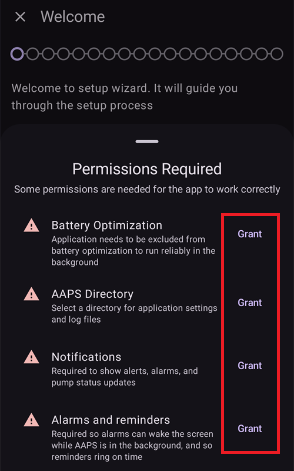
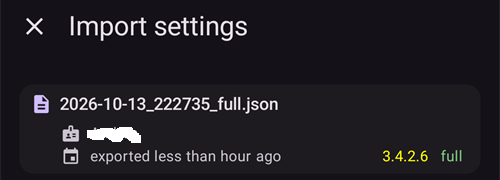
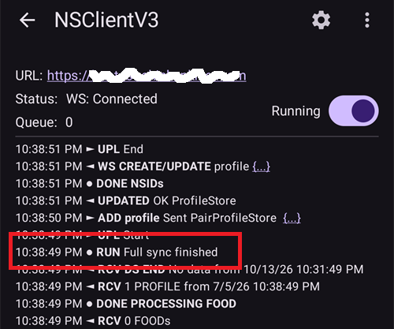

(reinstall-aaps)=
# Reinstalar o AAPS com uma nova keystore

Todo apk do **AAPS** é assinado com uma **keystore**. Uma atualização só é instalada sobre o seu **AAPS** atual se for assinada com a **mesma keystore**: assim, todas as suas configurações e dados são mantidos. Por isso, é recomendado guardar a keystore e a senha dela em um lugar seguro.

Se você tentar instalar um apk assinado com uma keystore diferente da anterior, vai receber uma mensagem de erro dizendo que a instalação falhou!

(reinstall-aaps-when)=
## Quando você precisa reinstalar?

Você precisa desinstalar e reinstalar o **AAPS** quando o seu novo apk é assinado com uma keystore diferente, por exemplo:

- Você não encontra a sua keystore antiga ou a senha dela.
- Você criou uma nova keystore, por exemplo com a [Opção 1 da compilação no navegador](../SettingUpAaps/BrowserBuildKeystore.md) ou com **Create a new key** (Criar uma nova chave) no [AAPS Builder](../SettingUpAaps/BrowserBuildAapsBuilder.md).
- Você compila em um computador novo e não copiou a sua keystore para ele.

Se você ainda tem a sua keystore, não precisa desta página: use-a de novo e [atualize o **AAPS**](../Maintenance/UpdateToNewVersion.md) sem desinstalar.

(reinstall-aaps-before)=
## Antes de começar

- Desinstalar o **AAPS** apaga todas as configurações dele, os seus [objetivos](../SettingUpAaps/CompletingTheObjectives.md) e a conexão atual com a bomba. Você recupera tudo isso importando o seu **arquivo de configurações**, então verifique se você tem um arquivo recente.
- O arquivo de configurações não contém o seu histórico de tratamentos e de glicose. Se você envia dados para o [Nightscout](../SettingUpAaps/SettingUpTheReportingServer.md), pode carregá-los de volta depois da reinstalação (passo 8).
- Você precisa da sua [**Senha mestra**](#Preferences-master-password): o arquivo de configurações é criptografado com ela.
- **Usuários de Omnipod e Medtrum:** leiam primeiro [Bombas sem tubo](#ExportImportSettings-tubeless-pumps). O seu arquivo de configurações precisa ter sido exportado durante o pod ou patch que você está usando agora.
- Se for preciso, [configure o receptor do seu CGM/da sua fonte de BG](../Getting-Started/CompatiblesCgms.md) antes de começar.

(reinstall-aaps-steps)=
## Passos

As imagens mostram uma mudança do **AAPS** 3.4 (passos 1 a 3) para o **AAPS** 4 (passos 6 a 8). Outras versões são um pouco diferentes.

(reinstall-aaps-export)=
### 1. Exporte suas configurações

Exporte as suas configurações com o **AAPS** que está instalado agora no seu telefone. Veja [Exportação de configurações](#ExportImportSettings-Settings-Export) para mais detalhes.

No **AAPS** 3.4: abra **Manutenção** e toque em **Opções de exportação**. Em **Configurações do usuário**, marque **Armazenamento local** e toque em **OK**.

*Nota: você também pode usar o [Armazenamento na nuvem](#preferences-maintenance-cloud) para ter uma cópia de segurança: é uma boa ideia, mas mantenha o Armazenamento local para recuperar as configurações rapidamente.*

Agora o botão mostra **Exportar configurações (local)**. Toque nele.

O **AAPS** mostra o nome do arquivo que vai criar. Toque em **OK**, digite a sua senha mestra e toque em **OK**.

No **AAPS** 4: abra **Manutenção**, selecione o chip **Local** ao lado de **Exportar configurações** e toque em **Exportar configurações**.

(reinstall-aaps-copy)=
### 2. Copie o arquivo de configurações para fora do telefone

O arquivo fica na pasta **preferences** do seu [diretório do **AAPS**](#SetupWizard-StoragePermission), com um nome como `2026-10-13_222735_full.json`. Copie ou envie o arquivo para um local externo (por exemplo, o seu computador, um serviço de armazenamento na nuvem...). Normalmente o arquivo continua no seu telefone depois da desinstalação, mas, por segurança, guarde uma cópia em outro lugar.

(reinstall-aaps-nightscout-before)=
### 3. Sincronize com o Nightscout

Este passo não é obrigatório, mas é recomendado se você usa [DynISF](#Open-APS-features-DynamicISF): ele permite continuar direto com as configurações atuais, em vez de esperar 5 dias para juntar os dados de que o plugin precisa. O NSClient V3 precisa estar [ativado e configurado](../SettingUpAaps/SettingUpTheReportingServer.md).

Verifique se o Nightscout tem todos os seus dados antes de desinstalar.

Abra o **NSClient**, toque no botão **Sincronização completa** na parte de baixo da tela e depois em **OK**.

*Nota: o tempo necessário depende do seu serviço de hospedagem do Nightscout.*

Em seguida, o **AAPS** oferece limpar o banco de dados dele. **OK** remove do telefone os dados com mais de 3 meses, o que deixa a sincronização muito mais rápida. **Cancelar** sincroniza sem limpar. De qualquer forma, o banco de dados do telefone é apagado quando você desinstala, então as duas opções servem.

Deixe o **AAPS** em execução até a sincronização terminar.

(reinstall-aaps-build)=
### 4. Compile o novo apk

[Compile](../SettingUpAaps/BuildingAaps.md) um novo apk assinado com a sua nova keystore e transfira-o para o seu telefone.

(reinstall-aaps-uninstall)=
### 5. Desinstale o AAPS

Em **Settings** (Configurações) > **Apps** (Aplicativos) > **AAPS** do seu telefone, toque em **Uninstall** (Desinstalar) e confirme com **OK**.

(reinstall-aaps-install)=
### 6. Instale e inicie o novo AAPS

[Instale](../SettingUpAaps/TransferringAndInstallingAaps.md) o novo apk e inicie o **AAPS**. O [assistente de configuração](../SettingUpAaps/SetupWizard.md) pede as permissões de que o **AAPS** precisa: toque em **Conceder** para cada uma delas. Isso também desativa de novo a [otimização de bateria](#setup-wizard-bluetooth-battery-optimisation).

Em **Diretório do AAPS**, selecione a mesma pasta do **AAPS** de antes (a que tem a pasta **preferences** dentro), toque em **Use this folder** (Usar esta pasta) e em **Allow** (Permitir).

Quando o **AAPS** encontra as suas configurações exportadas, o assistente de configuração mostra a tela [Configurações encontradas](#setup-wizard-import-settings), onde você pode importá-las. Você também pode fechar o assistente e importar em **Manutenção**, como descrito abaixo.

(reinstall-aaps-import)=
### 7. Importe as suas configurações

Se o arquivo de configurações não estiver mais no seu telefone, copie-o de volta para a pasta **preferences** do seu diretório do **AAPS**.

Abra o menu (☰) > **Manutenção**, selecione o chip **Local** ao lado de **Importar configurações** e toque em **Importar configurações**.

A lista mostra cada arquivo com a versão do **AAPS** e a idade dele. Escolha o arquivo que você exportou no passo 1.

Você não precisa definir uma senha mestra no novo **AAPS** antes. Digite a senha mestra que você usou na exportação em **Senha de descriptografia** e toque em **Descriptografar**. A mensagem **O arquivo foi criptografado com uma senha diferente** é esperada: o novo **AAPS** ainda não conhece a sua senha. A importação restaura a senha junto com as suas outras configurações.

Marque **Substituir também as configurações da bomba**: sem isso, a sua bomba e as configurações dela não são restauradas. Usuários de Omnipod e Medtrum: marquem esta opção somente se o arquivo foi exportado durante o pod ou patch atual (veja [Bombas sem tubo](#ExportImportSettings-tubeless-pumps)).

Toque em **Importar**, depois em **OK** para aplicar as configurações e de novo em **OK** em **Configurações aplicadas**.

(reinstall-aaps-nightscout-after)=
### 8. Recupere o seu histórico do Nightscout

Abra o menu (☰) > [**Configuração**](../SettingUpAaps/ChangeAapsConfiguration.md) > **Comunicação** e toque em **Abrir plugin** abaixo de **NSClientV3**. Verifique se o status mostra **Conectado**. Se não mostrar, veja [Resolução de problemas do NSClient](TroubleshootingNsClient.md).

Toque no botão **Sincronização completa** na parte de baixo da tela e em **OK**. O banco de dados é novo, então você pode responder à pergunta de limpeza como quiser.

O **AAPS** carrega os seus dados do Nightscout. O log mostra **Full sync finished** (sincronização completa terminada) quando acabar.

(reinstall-aaps-check)=
### 9. Verifique e continue usando o loop

Verifique se a sua bomba está conectada e se os valores do seu CGM estão chegando; depois, continue usando o loop.

(reinstall-aaps-afterwards)=
## Depois

A partir de agora, use sempre a sua nova keystore e guarde-a com a senha dela em um lugar seguro, fora do seu telefone. Veja [Criação de backups](../Maintenance/ExportImportSettings.md).
