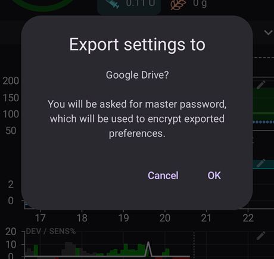
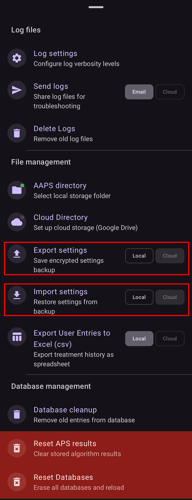

# Criação e restauração de backups

Quando você instala o AAPS no seu telefone, ele se torna um "dispositivo médico" do qual você depende todos os dias. É altamente recomendado ter um plano de backup de emergência para quando o seu telefone apresentar defeito, for roubado ou perdido. Por isso, é essencial se preparar perguntando a si mesmo: "E se?"

Para restaurar a sua configuração do AAPS em um telefone existente ou novo, é importante guardar os itens a seguir em um local seguro (ou seja: não no seu telefone). A melhor prática é manter pelo menos dois backups separados: em um disco rígido local, em um pendrive e (de preferência) em armazenamento na nuvem, como Google Drive ou Microsoft 365 OneDrive. Guardando os seus backups na nuvem, você sempre terá tudo o que precisa acessível a partir do seu telefone para restaurar a sua configuração em qualquer lugar e a qualquer hora.

Considere ter um segundo telefone de reserva e praticar a restauração do AAPS para garantir que o telefone de reserva funcione como esperado. Este passo dará a você a confiança de que o seu plano de emergência funciona e de que você pode continuar usando o AAPS sem interrupção se o seu telefone principal ficar indisponível.

Para poder restaurar, é importante ter à mão os seguintes itens:

- O seu **arquivo keystore do Android Studio** e a **senha** correspondente: necessários para (re)compilar o arquivo instalador .APK do AAPS.
- Uma cópia recente do **instalador .APK do AAPS**
- Um arquivo recente de **exportação das configurações**: para restaurar configurações importantes (o que inclui os seus objetivos!).
- A sua **senha mestra do AAPS**
- Backups de utilitários adicionais: como BYODA e/ou xDrip.
- Anotações pessoais sobre a sua configuração.

Abaixo estão os itens dos quais é recomendado manter backups.

## Criação de backups

### Arquivo keystore do computador que você usou para compilar o APK
Ao compilar o seu arquivo instalador .APK no Android Studio, ele usa o **arquivo keystore e a senha para assinar o arquivo instalador .APK**. Para atualizar a sua instalação atual do AAPS, é necessário assinar o arquivo instalador .APK da atualização com a mesma keystore usada na instalação inicial. Ao atualizar, todas as configurações e o banco de dados do AAPS são mantidos. Observe que, sem isso, você precisará primeiro desinstalar o aplicativo atual e depois [reinstalar](#reinstall-aaps) e configurar o AAPS novamente.

Guardar a keystore e a senha correspondente vai reduzir muito a complexidade de atualizar o APK no futuro, especialmente se você precisar compilar o aplicativo em um novo computador. Veja a seção [Atualizando o AAPS](../Maintenance/UpdateToNewVersion.md) para detalhes sobre como usar a keystore ao compilar um novo APK.

**Quando fazer o backup:** faça backup da keystore depois de compilar pela primeira vez o arquivo instalador .APK do **AAPS**.

**Como fazer o backup:** localize o caminho da sua keystore. Se você não se lembrar, pode encontrá-lo no Android Studio selecionando **Build > APK > Next**. O caminho será mostrado em “Key store path” (caminho da keystore). Com o seu gerenciador de arquivos, navegue até este caminho e faça uma cópia do seu arquivo keystore (com a extensão `.jks`). Salve-o em um local seguro na nuvem, caso o seu computador deixe de estar disponível. Anote também a senha da keystore, o alias da chave (key alias) e a senha da chave (key password).

### Cópias do APK mais recente
Caso o seu telefone principal com o **AAPS** seja perdido ou danificado, ter uma cópia do APK disponível permitirá que você volte a usar o **AAPS** rapidamente em um novo telefone. Observação: você também precisará do backup das suas preferências, como descrito abaixo.

**Quando fazer o backup:** você deve manter um backup do APK mais recente que instalou no seu telefone principal com o **AAPS**. Você também pode guardar uma versão anterior, caso precise voltar para ela por qualquer motivo.

**Como fazer o backup:** guarde uma cópia no computador usado para compilar o APK com o Android Studio. Além disso, é recomendado usar uma plataforma de nuvem para guardar uma cópia do APK instalador. Saiba como encontrar os dois backups quando precisar. Considere criar pastas próprias para guardar esses backups.

### Arquivo de configurações do AAPS (também chamado de 'Preferências')

```{admonition} Where are preferences stored on my phone?
:class: tip
Você encontrará as suas configurações no **Diretório do AAPS** que selecionou durante a [configuração do AAPS](#SetupWizard-StoragePermission).</br>
Você também pode alterar o **Diretório do AAPS** na tela **Manutenção** (**menu** (☰) > **Manutenção**), veja [Definir o diretório local do AAPS](#preferences-maintenance-logdirectory).
```

Com uma cópia do arquivo instalador APK (veja acima) e o seu arquivo de **Configurações**, você pode voltar a usar o AAPS rapidamente em um telefone existente ou novo.

O arquivo de **Configurações** é usado para ajustar o aplicativo AAPS à sua configuração específica. Eles incluem detalhes como as suas configurações de **Configuração**, o estado dos objetivos, as configurações de comunicação com serviços externos (por exemplo, Nightscout, Tidepool), automações e perfis.

Exportar as configurações do AAPS para um arquivo permite restaurar a configuração a partir de um momento específico. Como dito, além de todas as configurações, o arquivo exportado também contém o estado dos seus objetivos, que você precisa restaurar ao **(re)instalar** o AAPS. Sem isso, você terá que refazer todos os objetivos desde o início para ativar o loop fechado. Os arquivos de configurações também permitem restaurar as últimas configurações que funcionavam bem, para desfazer alterações na configuração.

**Quando fazer backup das configurações do AAPS:**
* Sempre que você concluir um objetivo, para não perder o seu progresso. _Sem uma cópia das suas **Configurações**, você terá que concluir todos os objetivos novamente caso precise reinstalar o AAPS ou substituir o seu telefone._

* Sempre que planejar fazer mudanças importantes na sua configuração (alterar as configurações de SMB, alterar tipos de insulina, trocar de bomba, alterar automações), você deve fazer backup das suas **Configurações** antes e depois das mudanças. Assim você tem as suas configurações mais recentes e também uma cópia de como elas eram antes das alterações, caso precise voltar a elas.

* Somente para usuários de bombas sem tubo (como Omnipod e Medtrum): o arquivo de **Configurações** contém os dados de conexão do seu Pod atual e pode ser usado para restaurar a conexão com esse Pod em um novo telefone. Se você não tiver uma cópia das suas preferências exportada depois de iniciar o seu Pod atual, precisará iniciar um novo Pod caso tenha que substituir o seu telefone atual.

**Como fazer o backup manualmente:**

1. Se esta for a primeira vez que você importa ou exporta **Configurações**, precisará definir uma senha mestra em [Configurações > Proteção](#Preferences-master-password). Defina uma senha e guarde-a em um lugar seguro. _Sem esta senha você não conseguirá acessar os seus backups de **Configurações**._

2. Na tela principal do **AAPS**, abra o **menu** (☰) > **Manutenção**. Escolha onde salvar o arquivo com os chips **Local** e **Nuvem** ao lado de **Exportar configurações** (veja **Exportar ou importar configurações** abaixo) e toque em **Exportar configurações**. O **AAPS** mostra para onde o arquivo vai: o nome do arquivo para **Local**, **Google Drive** para **Nuvem**. Toque em **OK**.

   

   

   Digite a senha mestra definida acima e toque em **OK**.

   

   **Configurações exportadas** (local) ou **Exportação para a nuvem concluída** (nuvem) confirma a exportação.

   

   

3. Com o gerenciador de arquivos do seu telefone (normalmente chamado “Files” ou “My Files” [Arquivos / Meus arquivos]), navegue até Internal Storage [Armazenamento interno] > AAPS > preferences. Aqui você verá uma cópia de todos os arquivos de preferências exportados. O nome do arquivo deve ser `YYYY-MM-DD_Time_appname.json`. Envie este arquivo para a plataforma de nuvem de sua escolha. Depois, a partir da plataforma de nuvem, baixe também uma cópia para o seu computador.

(ExportImportSettings-Settings-Export)=

## Exportação de configurações

```{admonition} Where are preferences stored on my phone?
:class: tip
Você encontrará as suas configurações no **Diretório do AAPS** que selecionou durante a [configuração do AAPS](#SetupWizard-StoragePermission).</br>
Você também pode alterar o **Diretório do AAPS** na tela **Manutenção** (**menu** (☰) > **Manutenção**), veja [Definir o diretório local do AAPS](#preferences-maintenance-logdirectory).
```

É recomendado exportar as configurações regularmente, especialmente antes e depois de alterações na configuração. Você pode fazer as exportações **manualmente ou (de preferência) por automação**. Anote a sua senha mestra do AAPS e faça backup dos seus arquivos de configurações, copiando-os para fora do telefone, por exemplo para um armazenamento na nuvem.

**Observação**: _As configurações exportadas serão criptografadas com a sua senha mestra do AAPS: sem a senha mestra usada na exportação você não conseguirá importar o arquivo de configurações!_

### Exportar ou importar configurações
Para exportar ou importar configurações, abra o **menu** (☰) e selecione **Manutenção**. Em **Gerenciamento de arquivos**, os chips **Local** e **Nuvem** ao lado de **Exportar configurações** e **Importar configurações** escolhem onde o arquivo de configurações é salvo ou de onde é lido: **Local** é o diretório do AAPS no seu telefone, **Nuvem** fica disponível quando um [Diretório da nuvem](#preferences-maintenance-cloud) estiver configurado. Tocar em um chip liga ou desliga esse chip; pelo menos um fica sempre selecionado, e as duas linhas usam a mesma escolha. Depois toque no próprio **Exportar configurações** ou **Importar configurações** para começar.



(ExportImportSettings-Automating-Settings-Export)=
### Automatizar a exportação de configurações

Para fazer exportações automáticas de configurações [(**veja Automação**)](../DailyLifeWithAaps/Automations.md#automating-preference-settings-export), abra [**Configurações** > **Manutenção**](#preferences-maintenance-settings), expanda **Exportação automática de configurações** e ative **Ativar exportação automática das configurações**.

Agora você pode configurar uma [Automação](../DailyLifeWithAaps/Automations.md#automating-preference-settings-export) para exportar as configurações, seja regularmente (_por exemplo_, toda semana), seja após a troca do Pod.

_**Observação:** ao importar configurações, o usuário sempre precisa digitar a senha mestra do AAPS!_


(ExportImportSettings-restoring-from-your-backups-on-a-new-phone-or-fresh-installation-of-aaps)=
## Restauração dos seus backups em um novo telefone ou em uma nova instalação do AAPS

```{admonition} Where are preferences stored on my phone?
:class: tip
Você encontrará as suas configurações no **Diretório do AAPS** que selecionou durante a [configuração do AAPS](#SetupWizard-StoragePermission).</br>
Você também pode alterar o **Diretório do AAPS** na tela **Manutenção** (**menu** (☰) > **Manutenção**), veja [Definir o diretório local do AAPS](#preferences-maintenance-logdirectory).</br>
Se o **AAPS** perder o acesso a esse diretório (isso pode acontecer após uma reinstalação ou após limpar o armazenamento do aplicativo), ele mostra uma notificação **O acesso ao diretório do AAPS foi perdido** e para de salvar as configurações no telefone até você [selecionar o diretório novamente](#preferences-maintenance-logdirectory).
```

Use estas instruções se você tiver um backup do seu APK e das suas **Configurações** que deseja carregar em um novo telefone, ou se precisou excluir e reinstalar o APK no seu telefone atual por qualquer motivo.

_Se você estiver atualizando o **AAPS** com um APK compilado com a mesma keystore, não deve precisar seguir este processo. Mesmo assim, é recomendado criar um backup antes de aplicar a atualização._

Se você estiver atualizando o **AAPS** depois de perder ou substituir a sua keystore original (ou seja, usando um novo computador de compilação sem transferir a keystore), faça backup de todas as configurações como descrito acima e depois desinstale a versão existente do **AAPS** do seu telefone. Veja [Reinstalar o AAPS com uma nova keystore](#reinstall-aaps) para o procedimento completo.

Se necessário, [configure o receptor da sua fonte de CGM/BG](../Getting-Started/CompatiblesCgms.md) antes dos passos listados abaixo

(ExportImportSettings-tubeless-pumps)=
```{admonition} Tubeless pumps (Omnipod and Medtrum) users
:class: warning
O arquivo de **Preferências** contém a sessão do Pod ou patch que estava ativo quando você o exportou.
- **Exporte logo após cada ativação de Pod ou patch** e copie o arquivo para fora do telefone.
- **Mesmo telefone, Pod ainda funcionando:** deixe **Substituir também as configurações da bomba** desmarcado. O seu Pod atual é mantido e apenas as outras configurações são importadas.
- **Novo telefone assumindo o Pod:** marque **Substituir também as configurações da bomba** e use somente um arquivo exportado durante o Pod que você está usando agora. Um arquivo de um Pod anterior substitui a sessão do seu Pod atual, e você precisará iniciar um novo Pod.
- **Uma sessão de Pod antiga foi importada por engano:** o **AAPS** continua tentando se comunicar com esse Pod e você não consegue ativar um novo. Desative-o; se isso falhar, descarte-o (veja, por exemplo, [Descartar um Pod](#omnipod-dash-discard-pod) para o Omnipod DASH).
```

```{admonition} Pump settings are kept unless you say otherwise
:class: note
Por padrão, uma importação não altera as configurações da bomba: a bomba selecionada em **Configuração**, o pareamento e todas as outras configurações dela ficam como estão neste telefone. Marque **Substituir também as configurações da bomba** na tela de importação somente quando restaurar em um novo telefone que deve assumir a mesma bomba. Configurações que não estão no arquivo nunca são excluídas por uma importação.
```

1. Usando a cópia de backup do seu APK mencionada acima, siga as instruções para uma [nova instalação](../SettingUpAaps/TransferringAndInstallingAaps.md)

2. Abra o **AAPS** e conceda todas as permissões solicitadas

3. Saia do Assistente de Configuração. Vamos importar todas as configurações necessárias da cópia de backup das **Configurações**

4. Na tela principal do **AAPS**, toque em **Conceder** e permita todas as permissões listadas no painel **Permissões necessárias** no topo

5. Na tela principal do **AAPS**, defina a senha mestra em [Configurações > Proteção](#Preferences-master-password) com a mesma senha que você usou nos seus backups.

6. Se ainda não fez isso, [defina o **Diretório do AAPS**](#preferences-maintenance-logdirectory): na tela principal do **AAPS**, abra o **menu** (☰) > **Manutenção** > **Diretório do AAPS**.

7. Na tela principal do **AAPS**, abra o **menu** (☰) > **Manutenção** > **Exportar configurações** > digite a senha mestra definida acima > **OK**. Isso criará a pasta de preferências, se ela ainda não existir no seu telefone.

8. Baixe o backup do seu arquivo de **Preferências** da sua plataforma de nuvem.

9. Use o seu gerenciador de arquivos (normalmente chamado “Files” ou “My Files” [Arquivos / Meus arquivos]) para mover o arquivo da pasta de downloads para `/internal storage/AAPS/preferences`, se o seu **Diretório do AAPS** estiver definido como `/internal storage/AAPS`

10. Na tela principal do **AAPS**, abra o **menu** (☰) > **Manutenção** e toque em **Importar configurações**. Selecione o arquivo de preferências que você quer restaurar (o mais recente fica no topo). Selecione o arquivo de preferências correto: todos os arquivos .json da pasta preferences (ou do diretório da nuvem, com **Nuvem**) serão mostrados.

    

    O **AAPS** mostra os detalhes do arquivo. Digite a senha mestra definida acima e toque em **Descriptografar & revisar**.

11. Depois que o arquivo for descriptografado, decida o que fazer com as configurações da bomba. Em um novo telefone que assume a mesma bomba, marque **Substituir também as configurações da bomba** para que o pareamento e as configurações da bomba venham do arquivo. Deixe a caixa desmarcada para manter a bomba com a qual este telefone já está pareado. Depois toque em **Importar**.

    

12. O **AAPS** pergunta **Aplicar as configurações importadas?** e informa quantas configurações vão mudar e, se você deixou a caixa desmarcada, quantas configurações da bomba são mantidas. Nada foi gravado ainda, então **Cancelar** deixa o seu telefone exatamente como estava. Toque em **OK** para aplicar.

    

13. O **AAPS** aplica as configurações importadas imediatamente, sem reiniciar. Apenas os plugins cujas configurações mudaram são reiniciados. Enquanto isso acontece, o **AAPS** mostra **Aplicando configurações…**; se a bomba estiver ocupada, mostra **Aguardando a bomba…** e aplica as configurações quando a bomba ficar livre. Se a bomba ainda estiver ocupada após um minuto, o **AAPS** oferece tentar novamente. Uma mensagem **Configurações aplicadas** confirma que as configurações importadas estão em uso. Qualquer tratamento que estava na fila durante a importação é descartado, e o **AAPS** informa que ele foi cancelado, para que nada seja enviado à bomba duas vezes.

    

Se o arquivo selecionou uma bomba que esta versão do **AAPS** não tem, o **AAPS** volta para a **Bomba virtual** e avisa você. Selecione a sua bomba novamente em **Configuração** e verifique as configurações dela.

14. Somente para usuários de bombas sem tubo (Omnipod e Medtrum) - se você marcou **Substituir também as configurações da bomba** e as suas **Preferências** não foram salvas com o mesmo Pod que você está usando agora, precisará iniciar um novo Pod para começar a administração de insulina.

**Resolução de problemas:** se você não conseguir ativar um perfil a partir da tela principal do **AAPS**, abra o **menu** (☰) no canto superior esquerdo > **Configuração** > **Bomba** > mude para **Bomba virtual** > depois volte para o seu tipo de bomba

### Observação para usuários da Dana RS

- Se você marcou **Substituir também as configurações da bomba**, as configurações de conexão da bomba também são importadas: o **AAPS** no seu novo telefone já vai "conhecer" a bomba e, por isso, não vai iniciar uma busca Bluetooth.
- Pareie o novo telefone com a bomba manualmente.