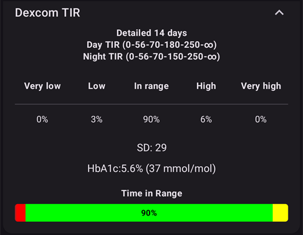
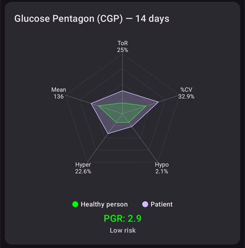

# Revisando seus dados

## Navegador do histórico do AAPS

O **AAPS** guarda todo o seu histórico (**glicose (BG)**, tratamentos, basal, alvos, **Troca de perfil**, …) em um banco de dados local no telefone. Este banco de dados não faz parte da [exportação das configurações](../Maintenance/ExportImportSettings.md). Você pode revisá-lo no próprio **AAPS** com o **Navegador do histórico** e a tela **Estatísticas**, descritos abaixo. Para revisões e relatórios de longo prazo, envie os seus dados para o [Nightscout](../SettingUpAaps/Nightscout.md) ou o [Tidepool](../SettingUpAaps/Tidepool.md).

O histórico do **AAPS** pode ser revisado no **Navegador do histórico**: abra o **menu** (☰) e selecione **Navegador do histórico**.

- Toque no **cartão da data** para escolher o dia que você quer revisar.
- Os gráficos abrem com o zoom reduzido para mostrar o **dia selecionado inteiro**. Faça o movimento de pinça para ampliar uma parte dele.
- Use as setas **<** e **>** para voltar ou avançar um dia, e **Agora** para voltar ao dia atual.
- Os gráficos mostram os mesmos dados que os gráficos da tela principal (glicose, tratamentos, basal, IOB, COB, atividade, desvios...).

(reviewing-statistics)=
## Estatísticas do AAPS

O **AAPS** oferece estatísticas básicas de acompanhamento.

A maioria dos valores segue as [recomendações](https://diabetesjournals.org/care/article/46/Supplement_1/S97/148053/6-Glycemic-Targets-Standards-of-Care-in-Diabetes) da ADA 2023.

Para abri-las, abra o **menu** (☰) e selecione **Estatísticas**.

A tela **Estatísticas** tem quatro abas: **Insulina**, **Tempo no intervalo**, **Glicose** e **Ciclo**. Toque em uma aba ou deslize para a esquerda ou para a direita para passar de uma para outra.

(reviewing-tdd)=
### Aba Insulina: Dose diária total

O cartão **Dose diária total** mostra uma linha por dia para os dias anteriores (até uma semana) para os quais o **AAPS** tem dados de insulina, depois a **Média** deles e depois **Hoje** até o momento. Logo após instalar o **AAPS**, somente **Hoje** é mostrado. As colunas são:

- **Basal**: somente basal.
- **Bólus**: a soma dos tratamentos de bólus e dos SMBs.
- **TDD total**: a dose diária total de insulina (**TDD**), a soma da insulina de bólus e basal administrada durante o dia.
- **Carboidratos**: tratamentos de carboidratos informados e eCarbs.

A seção **TDD** é calculada quando você abre a página e leva alguns segundos para ser calculada. Toque em **Recalcular** para calculá-la novamente.

A **TDD** é a sua insulina de bólus mais a basal por dia. Alguns médicos usam - especialmente para quem está começando com bomba - uma proporção basal-bólus de 50:50: a basal base total (**TBB**, a soma das suas taxas basais em 24 horas) deve então ser cerca de metade da TDD. Outros preferem uma TBB de 32% a 37% da TDD.

Como a maioria das regras práticas, esta tem validade real limitada. O seu diabetes pode ser diferente!

### Aba Tempo no intervalo

Tempo no intervalo (**TIR**): 70–180 mg/dl ou 3,9–10 mmol/l.

As informações de **TIR** estão disponíveis para 7 e 30 dias, conforme a quantidade de dados disponíveis no banco de dados do **AAPS**.

As estatísticas de tempo no intervalo estreito (TITR), 70–140 mg/dl ou 3,9–7,8 mmol/l, estão disponíveis abaixo (a tela mostra este intervalo como 70–141).

**Converse sobre as metas com o seu endocrinologista**

O seu diabetes pode ser diferente. Qualquer meta sugerida deve ser discutida com o seu endocrinologista ou com a sua equipe médica. Se usadas corretamente, as estatísticas do AAPS podem ser uma ferramenta eficaz para acompanhar as tendências de __glicose (BG)__ e monitorar o progresso.

Abaixo, o cartão **Dexcom TIR** mostra estatísticas detalhadas de **TIR** de 14 dias.

**SD**: desvio padrão, um [indicador](https://www.ncbi.nlm.nih.gov/pmc/articles/PMC3125941/) da variabilidade da glicose (quanto maior, pior).

HbA1c: a estimativa da hemoglobina glicada resultante, com base na média das medições do CGM. Este é um valor indicativo, que pode não corresponder aos exames de sangue de HbA1c.

(reviewing-statistics-agp)=
### Aba Glicose: Perfil Ambulatorial de Glicose (AGP)

O **Perfil Ambulatorial de Glicose** (**AGP**) mostra como a sua glicose costuma variar ao longo do dia. Escolha o período com os botões no topo: **Hoje**, **24h**, **7d**, **30d** ou **90d**.

- **O gráfico**: um dia, de meia-noite a meia-noite. A linha é a **Mediana** (metade das suas leituras naquela hora foi mais baixa, metade foi mais alta). Em volta dela, uma faixa contém a metade central das suas leituras (**25–75%**) e uma faixa mais larga contém a maioria delas (**10–90%**). Uma faixa estreita significa que a sua glicose é parecida de um dia para o outro naquela hora. Linhas tracejadas marcam a sua **Marca BAIXA**, 140 mg/dl (7,8 mmol/l) e a sua **Marca ALTA**.
- **Visão geral glicêmica**: o tempo no seu intervalo, no intervalo estreito (70–140 mg/dl ou 3,9–7,8 mmol/l), acima do seu intervalo e abaixo dele, e depois a sua glicose **Média** e **Mediana**. O seu intervalo é definido pela **Marca BAIXA** e pela **Marca ALTA** em [Intervalo para visualização](#Preferences-range-for-visualization).
- **eA1c** e **GMI**: duas estimativas de HbA1c calculadas a partir das suas leituras do CGM. Assim como a HbA1c acima, elas podem não corresponder aos seus exames de sangue de HbA1c.
- **SD** (desvio padrão) e **CV** (coeficiente de variação): o quanto a sua glicose varia. Um valor menor significa uma glicose mais estável.
- **Dias**: quantos dias de dados do CGM foram usados.

 

Abaixo do AGP, o cartão **Pentágono da glicose (CGP)** desenha cinco medidas dos seus últimos 14 dias de glicose como um pentágono. Um pentágono menor significa um melhor controle da glicose.

### Aba Ciclo: Padrão de ciclos da TDD

O **Padrão de ciclos da TDD** sobrepõe os seus totais diários de insulina em ciclos de 28 dias, para ajudar você a encontrar padrões que se repetem. Cada ciclo é desenhado como uma linha (**Ciclos individuais**), junto com a média deles.

- **TDD bruto** / **TDD limpo**: escolha a dose diária total como foi administrada, ou a TDD menos a insulina dos carboidratos.
- **Deslocamento do ciclo**: move o início do ciclo (de 0 a 27 dias).

São necessários pelo menos 56 dias de dados (2 ciclos). Com menos dados, o cartão mostra **Dados insuficientes (são necessários pelo menos 56 dias para 2 ciclos)**. O padrão só é calculado quando você abre a aba **Ciclo**, porque ele lê 168 dias de dados.

(aaps-screens-treatments)=
## Histórico de tratamentos

Abra o **menu** (☰) no canto superior esquerdo da tela principal e selecione **Histórico de tratamentos**. Nesta tela, você pode ver e alterar o histórico dos seguintes tratamentos, cada um na sua própria aba (deslize a linha de abas para ver todas):

* Carboidratos e bólus
* [Bólus estendido](#Extended-Carbs-extended-bolus-and-switch-to-open-loop-dana-and-insight-pump-only)
* Basal temporária
* [Alvo Temporário](../DailyLifeWithAaps/TempTargets.md)
* [Troca de perfil](../DailyLifeWithAaps/ProfileSwitch-ProfilePercentage.md)
* CarePortal: anotações e registros do CarePortal
* Modo de operação: histórico do status do loop
* Entrada do usuário: outras anotações que não são enviadas ao Nightscout

No final de cada linha, pequenos ícones mostram de onde os dados vêm ou para onde foram enviados:
* Ícone do **Nightscout** (o logotipo do Nightscout): os dados vêm do Nightscout ou foram registrados no Nightscout
* Ícone da **Bomba**: os dados vêm do histórico da bomba (foram processados pela bomba)
* Ícone da **Lixeira**: o registro foi excluído (ele só é mostrado quando você exibe os registros excluídos com o ícone do **olho** no canto superior direito)

(screens-bolus-carbs)=
### Carboidratos e bólus

Nesta aba você pode ver o registro de bólus e carboidratos. Cada bólus (linha **1**) mostra a IOB restante associada ao lado da quantidade de insulina. A origem do bólus pode ser:
* Refeição (inserido manualmente pelos botões Insulina, Assistente rápido ou Assistente de Bólus)
* SMB, ao usar a função SMB

Os registros de carboidratos (linha **2**) são mostrados com a quantidade em gramas.

Se você usou o [Assistente de Bólus](#aaps-screens-bolus-wizard) para calcular a dose de insulina, pode tocar no texto “Calc” na linha do bólus para ver os detalhes de como o bólus foi calculado.

Dependendo da bomba usada, a insulina e os carboidratos podem aparecer em uma única linha ou em várias linhas: uma para os detalhes do cálculo, uma para os carboidratos e uma para o próprio bólus.

O Histórico de tratamentos pode ser usado para corrigir registros de carboidratos errados (_por exemplo_, você superestimou ou subestimou os carboidratos). Observe que não é possível editar um registro existente; você precisa seguir este processo:

1. Verifique e memorize os valores atuais de COB e IOB na tela principal.
2. Dependendo da bomba, os carboidratos podem aparecer junto com a insulina em uma linha ou como um registro separado (por exemplo, com a Dana RS).
3. Remova o registro com a quantidade errada de carboidratos: toque no ícone da lixeira, selecione as linhas a remover e depois toque no ícone da lixeira novamente para concluir.
4. Confirme que os carboidratos foram removidos verificando novamente o COB na tela principal.
5. Faça o mesmo para a IOB se houver apenas uma linha com carboidratos e insulina.

   → Se os carboidratos não forem removidos como esperado e você adicionar mais carboidratos como explicado aqui (6.), o COB ficará alto demais e isso pode levar a uma administração de insulina alta demais.

6. Insira novamente a quantidade correta de carboidratos (**Tratamentos → Carboidratos** na navegação inferior, ou um botão **Carboidratos** do [acesso rápido](#quicklaunch)) e defina o horário correto do evento.
7. Se houver apenas uma linha com carboidratos e insulina, você também precisa adicionar a quantidade de insulina. Defina o horário correto do evento e verifique a IOB na tela principal depois de confirmar o novo registro.

### Basal temporária

As **basais temporárias** aplicadas pelo loop são mostradas aqui. Quando um registro ainda tem impacto na IOB, essa informação é mostrada ao lado da taxa (linha **1**). Ela pode ser:
* IOB positiva, se a basal temporária foi maior que a definida no perfil
* IOB negativa, para uma basal temporária zero (como na linha **1**) ou se a basal temporária foi menor que a definida no perfil

Excluir os registros só afeta os seus relatórios no Nightscout e provavelmente vai distorcer a sua IOB real - não é recomendado.

À esquerda de uma linha, um S vermelho significa “Suspender”: isso acontece quando a basal não está sendo administrada no momento. Esta é uma situação normal durante a troca de um Pod, por exemplo.

### Alvo Temporário

O histórico de alvos temporários pode ser visto aqui.

### Troca de perfil

O histórico de trocas de perfil pode ser visto aqui. Você pode ver vários registros a cada troca de perfil: a linha **1**, salva tanto no NS quanto no histórico da bomba, corresponde à troca real. A linha **2**, salva no Nightscout mas não no histórico da bomba, corresponde ao pedido de troca de perfil feito pelo usuário.

Excluir os registros só afeta os seus relatórios no Nightscout e nunca altera de fato o perfil atual.

Você pode usar o botão **Clonar** mostrado na linha **2** para fazer uma cópia de uma **Troca de perfil**. Veja [Seu perfil do AAPS > Gerenciar seus perfis](#your-aaps-profile-clone-profile-switch) para mais informações.

### CarePortal

Esta aba mostra todas as anotações e registros do CarePortal salvos no Nightscout.

(AapsScreens-running-mode)= (aaps-screens-running-mode)=
### Modo de operação

Esta aba mostra o histórico das mudanças de [status do loop](#AapsScreens-loop-status): aberto, fechado, LGS, suspenso, desconectado.

### Entrada do usuário

Esta aba lista as ações feitas no **AAPS** pelo usuário ou por uma **Automação** (mudanças do modo do loop, trocas de perfil, tratamentos, exportações de configurações...). Estes registros não são enviados ao Nightscout.

------

## Qual é a diferença entre Nightscout e Tidepool?

O Nightscout pode facilitar o armazenamento dos dados do **AAPS** pelo usuário e oferece uma grande variedade de [ferramentas de relatórios](https://nightscout.github.io/nightscout/reports/).

Já o Tidepool permite que o usuário [revise os seus dados](https://www.tidepool.org/viewing-your-data) e oferece [compartilhamento simples com a sua equipe médica](https://www.tidepool.org/providers/how-it-works#tidepool-data-platform).