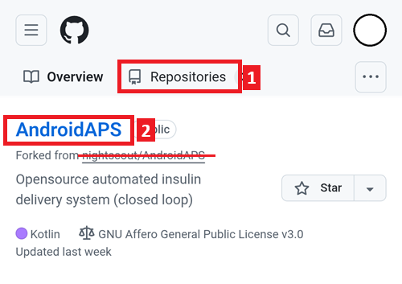

# Atualizar pelo navegador (fork)

```{tip}
Você compilou o AAPS com o **AAPS Builder**? Você não precisa desta página: veja [Atualizar o AAPS com o AAPS Builder](#aaps-builder-updates).
```

## Compile você mesmo em vez de baixar

O **AAPS** não está disponível para download por causa das regras para dispositivos médicos. É legal compilar o app para uso próprio, mas você não deve dar uma cópia para outras pessoas! Veja a página [FAQ para loopers](../UsefulLinks/FAQ.md) para mais detalhes.

```{note}
Se você quiser atualizar o **AAPS** pelo navegador pela primeira vez: copie o arquivo de backup da sua keystore para o seu Google Drive. Depois siga o [procedimento de compilação do **AAPS** no navegador](../SettingUpAaps/BrowserBuild.md) em vez deste guia. Em vez de criar uma nova keystore, você deve selecionar a que você copiou do seu computador.
Essa operação só é obrigatória na primeira vez. Nas próximas atualizações você poderá seguir este guia.
```

```{tip}
**Vai mudar para o AAPS Builder?** O [AAPS Builder](../SettingUpAaps/BrowserBuildAapsBuilder.md) é a compilação no navegador mais simples: não há fork para sincronizar, e você baixa o app diretamente do GitHub. Você não precisa mudar: este guia continua funcionando. Se você mudar, primeiro pegue uma cópia da sua keystore do seu fork, como explicado em [Vindo da compilação no navegador anterior](#aaps-builder-from-fork). Caso contrário, a nova compilação não poderá atualizar o AAPS no seu telefone.
```

## Visão geral da atualização para uma nova versão do AAPS pelo navegador

```{contents} Steps for updating to a new version of AAPS
:depth: 1
:local: true
```

Se tiver problemas, veja a página separada [Compilação no navegador: resolução de problemas](../GettingHelp/BrowserBuildTroubleshooting.md).

### Exporte suas configurações

Exporte as configurações da versão atual do **AAPS** no seu telefone. Talvez você não precise delas, mas é melhor prevenir do que remediar.

Veja a página [Criação e restauração de backups](ExportImportSettings.md) se você não lembrar como fazer isso.

(Update-to-new-version-update-your-repo)=
### Atualize seu repositório no GitHub

[Entre no GitHub](https://github.com/login).

1. Selecione Repositories (repositórios).
2. Role para baixo e selecione o seu próprio repositório AndroidAPS.



3. Verifique se você está usando a sua própria cópia do AndroidAPS (Forked from nightscout/AndroidAPS)
4. Toque em Sync Fork para atualizá-la (o número de commits atrasados pode ser diferente da imagem)


5. Toque em Update Branch


Observação: se você modificou a sua cópia do AndroidAPS por engano, você verá esta tela. Descarte todas as alterações (commits) para voltar à versão lançada.


Agora você sincronizou (atualizou) a sua própria cópia com a versão mais recente do Android APS. Muito bem.


### Execute o workflow para compilar o APK assinado

1. Na sua cópia do AndroidAPS no GitHub, selecione Actions.
2. Expanda All Workflows.
3. Selecione AAPS-CI


4. Role para baixo e toque em Run Workflow.


5. Deixe a branch em master, selecione a AAPS Version que você quer compilar (a versão mais recente ou uma versão específica necessária), escolha a [variante](#browserbuild-variant) (fullRelease) e depois toque em Run workflow.


6. Você verá a mensagem Workflow run was successfully requested. Atualize a página do navegador e você poderá acompanhar o progresso da compilação. Quando a ação terminar, a ação AAPS CI mostrará um sinal verde de confirmação. Você compilou com sucesso a versão atualizada do Android APS. Isso significa que os apks Master e Wear agora são salvos diretamente no seu Google Drive (como abaixo). O apk do AAPSClient pode ser baixado em Github > nightscout > AndroidAPS [aqui](https://github.com/nightscout/AndroidAPS/releases)


### Instale o APK do AAPS

1. Abra o seu Google Drive
2. Abra a pasta AAPS, selecione a pasta da nova versão e você encontrará as versões para o telefone e para o Android Wear.


```{note}
A partir de setembro de 2026, a [Verificação de desenvolvedor do Android](#android-developer-verification) do Google pode bloquear a instalação do APK ao tocar no arquivo, dependendo do seu país. Soluções gratuitas são explicadas nessa página.
```

Continue [aqui](#Update-to-new-version-check-aaps-version-on-phone)

(update-browser-build-troubleshooting)=

## Resolução de problemas

Se algo der errado, não entre em pânico.

Respire fundo!

Depois verifique se o seu problema já está documentado: veja [Resolução de problemas do AAPS Builder](#aaps-builder-troubleshooting) se você compila com o **AAPS Builder**, ou [Compilação no navegador: resolução de problemas](#aaps-ci-troubleshooting) nos outros casos.

Se precisar de mais ajuda, entre em contato com outros usuários do **AAPS** no [Facebook](https://www.facebook.com/groups/AndroidAPSUsers) ou no [Discord](https://discord.gg/4fQUWHZ4Mw).
