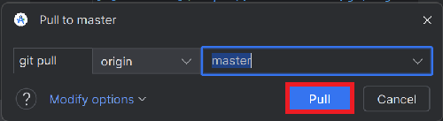

# Atualizar com o Android Studio

## Compile você mesmo em vez de baixar

O **AAPS** não está disponível para download por causa das regras para dispositivos médicos. É legal compilar o app para uso próprio, mas você não deve dar uma cópia para outras pessoas! Veja a página [FAQ para loopers](../UsefulLinks/FAQ.md) para mais detalhes.

```{note}
Se você quiser compilar o **AAPS** em um computador novo: copie o arquivo de backup da sua keystore para o computador novo. Depois siga o [procedimento de primeira compilação do **AAPS**](../SettingUpAaps/BuildingAaps.md) em vez deste guia. A única diferença é que, em vez de criar uma nova keystore, você pode selecionar a que você copiou para o computador novo.
```

## Visão geral da atualização para uma nova versão do AAPS com o Android Studio

```{contents} Steps for updating to a new version of AAPS
:depth: 1
:local: true
```

Se tiver problemas, veja a página separada [Resolução de problemas do Android Studio](../GettingHelp/TroubleshootingAndroidStudio.md).

### Exporte suas configurações

Exporte as configurações da versão atual do **AAPS** no seu telefone. Talvez você não precise delas, mas é melhor prevenir do que remediar.

Veja a página [Criação e restauração de backups](ExportImportSettings.md) se você não lembrar como fazer isso.

### Verifique a sua versão do Android Studio

A versão mínima necessária está descrita nas [instruções de compilação](#Building-APK-recommended-specification-of-computer-for-building-apk-file). Se a sua versão for mais antiga, [atualize primeiro o Android Studio](#Building-APK-install-android-studio)!

(Update-to-new-version-update-your-local-copy)=
### Atualize sua cópia local

* Abra seu projeto AAPS existente no Android Studio. Talvez você precise selecionar o seu projeto. Clique (duas vezes) no projeto AAPS.

  

* Na barra de menus do Android Studio, selecione Git -> Fetch

   

* Você verá uma mensagem no canto inferior direito dizendo que o Fetch foi concluído com sucesso.

   

* Na barra de menus, selecione agora Git -> Pull

   

* Deixe todas as opções como estão (origin/master) e selecione Pull

   

* Aguarde enquanto o download está em andamento. Você verá essa informação na barra inferior. Quando terminar, você verá uma mensagem de sucesso.

  ```{note}
  Os arquivos atualizados podem ser diferentes! Isso não indica um problema.
  ```

   

* O Gradle Sync será executado para baixar algumas dependências. Aguarde até terminar.

  

### Verifique a versão da JVM

Essa verificação é especialmente indicada se você já compilou uma versão anterior do **AAPS** no mesmo computador.

Verifique nas [instruções de compilação](#Building-APK-recommended-specification-of-computer-for-building-apk-file) a versão da JVM necessária para a versão do **AAPS** que você vai compilar agora. Depois siga os passos descritos em [Incompatible Gradle JVM](#incompatible-gradle-jvm) para garantir que você está usando a versão correta.

(Update-to-new-version-build-the-signed-apk)=
### Compile o APK assinado

Seu código-fonte agora é a versão lançada atual, e todos os pré-requisitos foram verificados. É hora de compilar o apk assinado, como descrito na [seção Gerar APK assinado](#Building-APK-generate-signed-apk).

(Update-to-new-version-transfer-and-install)=

### Transfira e instale o apk
Você precisa transferir o apk para o seu telefone para poder instalá-lo.

```{note}
Se você compilou com a mesma keystore de antes no Android Studio, não precisa remover o app existente do seu telefone. Ao instalar o apk, siga as instruções para instalar as atualizações.
Em outros casos, por exemplo, se você criou uma nova keystore no Android Studio para o seu apk assinado, você precisa desinstalar o app antigo antes de instalar o apk. **Não se esqueça de exportar suas configurações!**
```

Veja as instruções para [transferir e instalar o AAPS](../SettingUpAaps/TransferringAndInstallingAaps.md). Onde a [verificação de desenvolvedor do Android](#android-developer-verification) do Google for obrigatória (a partir de setembro de 2026, dependendo do seu país), instale com [ADB](#android-developer-verification-adb) em vez de tocar no arquivo APK.

Continue [aqui](#Update-to-new-version-check-aaps-version-on-phone).

(update-computer-build-troubleshooting)=

## Resolução de problemas

Se algo der errado, não entre em pânico.

Respire fundo!

Depois veja a página separada [Resolução de problemas do Android Studio](../GettingHelp/TroubleshootingAndroidStudio.md) para saber se o seu problema já está documentado!

Se precisar de mais ajuda, entre em contato com outros usuários do **AAPS** no [Facebook](https://www.facebook.com/groups/AndroidAPSUsers) ou no [Discord](https://discord.gg/4fQUWHZ4Mw).