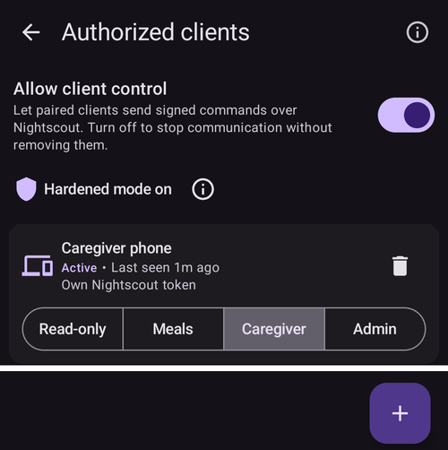

(client-master-control)=
# Controle dispositivo principal ↔ cliente (controle remoto assinado)

A partir da versão 4 do **AAPS**, um telefone de seguidor com o **AAPSClient** pode fazer muito mais do que *anunciar* tratamentos pelo Nightscout: depois de ser **pareado** com o telefone principal, ele pode enviar **comandos assinados** que o telefone principal (o **dispositivo principal**) verifica, confirma e executa — incluindo aplicar um **bólus de insulina** na bomba do dispositivo principal.

Esta página explica como isso funciona e como configurar e usar.

```{contents} Table of contents
:depth: 2
:local: true
```

```{admonition} Wording used on this page
:class: note
- **Dispositivo principal** = o telefone principal com o **AAPS**, que controla a bomba e executa o loop (o app `full`).
- **Cliente** = um telefone com o **AAPSClient**, sem bomba, que acompanha e agora também *controla* o dispositivo principal.
- Os dois telefones precisam estar conectados ao **mesmo site Nightscout**. Toda a comunicação continua passando pelo Nightscout — não é preciso uma conexão direta entre os telefones.
```

---

## Como funciona

```{admonition} Coming from AAPS v3?
:class: note
No **AAPS** v3, o **AAPSClient** só podia gravar tratamentos do careportal não assinados no Nightscout e não podia aplicar um bólus. O controle remoto agora precisa de um [pareamento](#client_master_master_setup) feito uma única vez. Veja também [O que mudou no AAPS v4](#v4changes-remote-control).
```

O **AAPS** v4 usa um canal próprio de **Client-Control**. Ele continua passando pelo seu site Nightscout (na coleção `settings`), mas cada mensagem é **assinada criptograficamente** com um segredo que só os dois telefones conhecem. O segredo é entregue uma única vez, durante o **pareamento**, e substituído por um novo logo depois, por isso nunca trafega em texto aberto.

O princípio básico é: **quem manda é o dispositivo principal**:

1. O cliente envia uma *intenção* (“bólus de 2 U”, “iniciar o cenário Exercício”, “definir este alvo temporário”…).
2. O **dispositivo principal** recalcula e **limita** a ação com base nos seus **próprios** dados atuais (perfil, IOB, COB, alvo temporário atual, bomba) e **escreve a confirmação exata** que o usuário vai ver.
3. O cliente (ou o relógio) mostra o texto de confirmação do **dispositivo principal** — ele nunca cria o seu próprio.
4. Após a confirmação, o dispositivo principal **executa uma única vez** e informa o resultado ao cliente.

O que isso significa para você:

- **Comandos assinados**: só os clientes que você pareou podem enviar comandos (segredo de pareamento e assinatura por cliente). Comandos antigos ou repetidos são rejeitados.
- **Uma função para cada cliente**: você decide o que cada cliente pode fazer, de *Somente leitura* a *Admin* — veja [Funções do cliente](#client-master-control-roles).
- **Bólus de insulina a partir de um cliente**: o dispositivo principal o aplica na sua bomba, e o cliente mostra o progresso da aplicação.
- **O dispositivo principal decide**: ele limita cada ação de acordo com as suas próprias restrições e escreve a confirmação mostrada no cliente.
- **Só clientes pareados mudam a terapia**: enquanto o controle do cliente está ativado, o dispositivo principal não aceita mais tratamentos ou alterações digitados diretamente no Nightscout — veja [Modo reforçado](#client-master-control-hardened-mode).
- **Cada cliente recebe o seu próprio token do Nightscout**, só com os direitos de que um cliente precisa — veja [O token próprio do Nightscout do cliente](#client-master-control-own-token).
- **Dispositivo principal offline**: as ações são bloqueadas com uma mensagem clara.
- **Revogar um cliente** leva um toque (por cliente), ou use a chave do dispositivo principal para parar todos os clientes.

Ações que podem ser feitas a partir de um cliente: **bólus**, **carboidratos / eCarbs**, **alvo temporário** (definir e cancelar), **troca de perfil**, mudança do **loop / modo de operação**, **basal temporária** (definir e cancelar), **bólus estendido** (definir e cancelar), **seleção da insulina** e **[cenários](../DailyLifeWithAaps/Scenes.md)**. Uma parte das **preferências** bidirecionais também é mantida sincronizada entre o dispositivo principal e os clientes.

---

## Funções e pré-requisitos

```{admonition} Before you start
:class: important
- O **dispositivo principal** usa a compilação `full` normal do **AAPS** e está conectado à sua bomba.
- O **dispositivo principal** usa o **NSClientV3** com o seu Nightscout e mostra *Conectado*. Dê a ele um **token de administrador** do seu Nightscout: com ele, o dispositivo principal pode criar um token próprio para cada cliente e mostrá-lo ao cliente como código QR.
- O **cliente** usa o **[AAPSClient](AapsClient.md)** (ou o **AAPSClient2** / **AAPSClient3** para outros pacientes — veja [Sobre o AAPSClient, o AAPSClient2 e o AAPSClient3](#remotecontrol-aapsclient-versions)). Ele precisa usar o **mesmo** Nightscout. Se você o configurar com o código QR do dispositivo principal, o cliente recebe o endereço e o token do Nightscout do dispositivo principal; caso contrário, primeiro configure você mesmo o **NSClientV3** nele.
- Os **websockets** são necessários nos dois telefones: os comandos só chegam ao dispositivo principal pela conexão websocket. Enquanto o controle do cliente está ativado, o **AAPS** mantém os websockets ativados no dispositivo principal e nos clientes pareados.
```

Pareamento e sincronização são duas coisas diferentes:

- A **sincronização** (dados: glicose, tratamentos, perfil) é configurada como antes — veja [Sincronização](#RemoteControl_aapsclient). O código QR do dispositivo principal pode fazer isso por você no cliente.
- O **pareamento** (controle: o canal de comandos assinados descrito aqui) é o novo passo abaixo.

---

## Configuração

(client_master_master_setup)=
### 1. No dispositivo principal — ativar o controle e adicionar um cliente

No dispositivo principal, abra a tela **Gerenciar** e escolha **Clientes autorizados**.

Ative **Permitir controle pelo cliente** (fica **desativado** por padrão). Esta é a chave geral: com ela desativada, nenhum cliente pode enviar comandos, mas os seus clientes pareados são mantidos, para que você possa ativá-la de novo depois. Ativá-la também ativa o [Modo reforçado](#client-master-control-hardened-mode), mostrado como "*Modo reforçado ativado*" com um **(i)** que o explica. No [Modo simples](#preferences-simple-mode), o controle do cliente está sempre ativado, por isso a chave não é mostrada.



Toque no botão **+** (canto inferior direito) para adicionar um cliente. Na janela **Novo cliente**:

1. Digite um **nome do dispositivo**, para reconhecê-lo na lista.
2. Escolha **como o telefone é configurado** (veja a tabela abaixo).
3. Escolha a sua **[função](#client-master-control-roles)**. Nada vem selecionado: a função certa depende de quem usa o telefone.


| Forma                                  | O que o novo telefone recebe                                                                      | Use quando                                                                                                                 |
| -------------------------------------- | ------------------------------------------------------------------------------------------------- | -------------------------------------------------------------------------------------------------------------------------- |
| **Código QR: Nightscout e pareamento** | o endereço do Nightscout, o seu próprio token do Nightscout e o pareamento, com uma única leitura | o novo telefone tem câmera: a forma mais rápida, sem nada para digitar                                                     |
| **Código QR: somente Nightscout**      | o endereço do Nightscout e o seu próprio token do Nightscout, sem pareamento                      | o telefone deve apenas **mostrar** dados e nunca enviar comandos                                                           |
| **PIN**                                | só o pareamento; ele mantém as configurações do Nightscout que já tem                             | o telefone não tem câmera (ou o dispositivo principal não pode criar tokens); ele já precisa estar conectado ao Nightscout |

As duas formas com código QR precisam de um **token de administrador** nas configurações do **NSClientV3** do dispositivo principal, porque o dispositivo principal cria o token do cliente no Nightscout. Sem ele, as opções de código QR são mostradas, mas não podem ser escolhidas, e a janela explica o motivo; o **PIN** sempre funciona.

#### Com um código QR

Toque em **OK**: o dispositivo principal cria o token do Nightscout do cliente e mostra um **código QR**. Um código que também pareia vale por cerca de **dois minutos**; a tela faz uma contagem regressiva e fecha sozinha quando o cliente é pareado. Escaneie-o no novo telefone como descrito em [No cliente](#client_master_client_setup).

```{admonition} The QR code is a secret
:class: warning
Qualquer pessoa que vir o código QR pode ler o seu Nightscout, e um código que pareia também contém o pareamento. Mostre-o apenas ao novo telefone. O **AAPS** bloqueia capturas de tela enquanto o código está na tela.
```


#### Com um PIN

Toque em **OK**: o dispositivo principal mostra um **PIN de pareamento** de 8 dígitos, em dois grupos de quatro (por exemplo, `1234 5678`). Este PIN é de **uso único** e **expira depois de cerca de dois minutos**.


```{admonition} The pairing PIN is a secret
:class: warning
O PIN protege o segredo de pareamento que é trocado pelo Nightscout. Compartilhe-o apenas com o dispositivo que você está pareando, não o publique e deixe-o expirar se não for usá-lo. Você sempre pode gerar um novo PIN tocando em **+** de novo.
```

(client_master_client_setup)=
### 2. No cliente — parear com o dispositivo principal

#### Escanear o código QR

Você pode escanear o código QR do dispositivo principal em dois lugares:

- no **Assistente de Configuração** do cliente, no passo "**Configurar a partir do dispositivo principal**", que vem antes do passo do Nightscout. Uma única leitura configura o Nightscout e, com um código que pareia, também o pareamento, e a configuração termina: o assistente fecha e a tela inicial abre;
- a qualquer momento depois, em **Gerenciar → Parear com o dispositivo principal → Escanear código QR**.

Na primeira vez, o **AAPSClient** pede a permissão da **câmera**. Se você recusar, a tela diz que a câmera é necessária, e você pode permitir com **Tentar novamente** ou parear com o PIN.

Aponte a câmera para o código. O cliente mostra o que o código faz — o endereço do Nightscout e, para um código que pareia, o dispositivo principal com o qual ele pareia — e pergunta "**Usar este código?**". Toque em **Usar**: o cliente ativa o **NSClientV3**, substitui o endereço e o token do Nightscout pelos do código e ativa os websockets. Um código que pareia também pareia o telefone; ele se apresenta ao dispositivo principal assim que se conecta ao Nightscout.


```{admonition} Scanning is available on Android
:class: note
O leitor de código ainda não está disponível no iOS, e um computador desktop não tem câmera: use o PIN nesses casos.
```

#### Digitar o PIN

No cliente, abra **Gerenciar → Parear com o dispositivo principal** (ou o passo do assistente **Parear com o dispositivo principal**, depois do passo do Nightscout), **digite o PIN de 8 dígitos** mostrado no dispositivo principal e toque em **Parear**. O cliente usa o PIN para buscar com segurança a oferta de pareamento pelo Nightscout, depois pergunta "**Parear com este dispositivo principal?**" e mostra o identificador do dispositivo principal. Toque em **Parear** para confirmar (veja [Parear com o dispositivo principal](#aapsclient-pairing-with-the-master) para uma captura de tela).


#### Depois do pareamento

Depois de pareado, o cliente envia um **Hello** ao dispositivo principal e aparece na lista **Clientes autorizados** do dispositivo principal como **Ativo**, com o horário de *“visto pela última vez”*. O cliente conhece a sua [função](#client-master-control-roles) a partir do pareamento, por isso mostra os botões certos imediatamente. Um pareamento feito no Assistente de Configuração encerra o assistente. No mesmo passo, os dois telefones substituem o segredo de pareamento por um novo que nunca trafegou (veja [Notas de segurança](#client-master-control-security)), e um cliente configurado com o PIN recebe o seu próprio token do Nightscout (veja [O token próprio do Nightscout do cliente](#client-master-control-own-token)). Um cliente pode ser pareado com **um** dispositivo principal por vez; para parear com outro dispositivo principal, primeiro use **Desfazer pareamento**.


### 3. Gerenciar clientes

Na tela **Clientes autorizados** do dispositivo principal, você pode, a qualquer momento:

- **Mudar a função** de um cliente com a linha de quatro botões abaixo do nome dele. A nova função vale imediatamente, sem parear novamente.
- **Ver com qual token do Nightscout** um cliente grava: "*Token próprio do Nightscout*" é o que você quer. Uma linha vermelha "*Usa o token do Nightscout …, que tem mais permissões do que um cliente precisa*" significa que o cliente ainda usa um token com mais direitos, normalmente o seu token de administrador — veja [O token próprio do Nightscout do cliente](#client-master-control-own-token).
- **Revogar** um único cliente — toque no ícone de **lixeira** ao lado dele. O cliente não pode mais enviar comandos até ser pareado novamente. O seu token próprio do Nightscout também é excluído, então ele também não pode mais ler o seu Nightscout.
- **Parar todo o controle** sem perder os pareamentos — desative **Permitir controle pelo cliente**.

Telefones configurados com **Código QR: somente Nightscout** aparecem abaixo dos clientes, em "**Somente leitura do Nightscout**". Para cada um deles, você pode mostrar o código QR de novo (para configurar o mesmo telefone novamente) ou excluir o seu token, o que encerra o acesso dele ao seu Nightscout.


---

(client-master-control-roles)=
## Funções do cliente

Cada cliente pareado tem uma **função**. O dispositivo principal a verifica em cada comando, e o cliente mostra apenas o que a sua função permite. Uma nova função vale imediatamente, sem parear novamente. As funções se somam: cada uma pode fazer tudo o que a anterior pode.

| Função              | O cliente pode                                                                                                                                                                                                                                                          |
| ------------------- | ----------------------------------------------------------------------------------------------------------------------------------------------------------------------------------------------------------------------------------------------------------------------- |
| **Somente leitura** | apenas mostrar dados. Ele continua pareado, então está pronto quando você der a ele uma função mais alta.                                                                                                                                                               |
| **Refeições**       | dar um bólus, usar a calculadora de bólus e o Assistente rápido, inserir carboidratos e parar um bólus em andamento. Carboidratos inseridos aqui podem fazer o loop dar mais insulina.                                                                                  |
| **Cuidador**        | fazer tudo o que um usuário faz no **AAPS**: alvos temporários, trocas de perfil e de insulina, modo do loop, basal temporária, bólus estendido, cenários, eventos do Careportal, calibrações e remoção de registros. Não pode alterar configurações nem predefinições. |
| **Admin**           | fazer tudo, incluindo configurações e predefinições (Assistente rápido, predefinições de alvo temporário, cenários, perfis, automação, insulina).                                                                                                                       |

O **(i)** no topo da tela **Clientes autorizados** mostra a mesma explicação. No cliente, **Gerenciar → Parear com o dispositivo principal** mostra a função do próprio telefone.

---

(client-master-control-hardened-mode)=
## Modo reforçado

Quando **Permitir controle pelo cliente** está ativado, o dispositivo principal fica no **modo reforçado**: ele aceita alterações apenas de clientes pareados. Ele **não** aceita tratamentos, alvos temporários, mudanças de perfil, mudanças do modo de operação nem exclusões feitas diretamente no Nightscout, por exemplo no site do Nightscout ou em outros apps.

- As configurações para aceitar dados do Nightscout (**NSClientV3 → Sincronização**) ficam ocultas enquanto o modo reforçado está ativado; o **AAPS** as trata como se estivessem desativadas.
- O dispositivo principal continua **enviando** todos os seus dados para o Nightscout, incluindo a glicose, e mantém os **websockets** ativados.
- Se o dispositivo principal recebe a **glicose do Nightscout**, ele continua recebendo a glicose de lá.
- Para carregar o histórico em um **novo** dispositivo principal, use a **Sincronização completa** no **NSClientV3**: ela pega tudo o que está no Nightscout, incluindo os perfis.
- Os [Comandos SMS](SMSCommands.md) não são afetados.

Um cliente pareado segue o modo reforçado do dispositivo principal: ele mantém os websockets ativados, e as mesmas configurações do Nightscout ficam ocultas nele. Um cliente não pareado mantém as suas próprias configurações.

O [Modo simples](#preferences-simple-mode) sempre ativa o modo reforçado. Para desativá-lo, saia do Modo simples e desative **Permitir controle pelo cliente** no dispositivo principal.

```{admonition} Why hardened mode
:class: note
Tudo o que um cliente pareado envia é assinado, verificado e confirmado pelo dispositivo principal. Um tratamento digitado no site do Nightscout não é: qualquer pessoa com acesso de escrita ao seu Nightscout poderia adicioná-lo. No modo reforçado, só comandos assinados podem mudar o que o dispositivo principal faz.
```

---

(client-master-control-own-token)=
## O token próprio do Nightscout do cliente

Um cliente não precisa de um token de administrador. Ele só lê o seu Nightscout e envia os seus comandos ao dispositivo principal por meio dele; ele mesmo não envia nada. Por isso, o dispositivo principal dá a cada cliente um token próprio do Nightscout, só com estes direitos:

- ler tudo,
- gravar na coleção `settings`, o canal para o dispositivo principal,
- adiar (soneca) os alarmes do Nightscout.

O token pertence a uma função (role) do Nightscout chamada **`aaps-client`**, que o dispositivo principal cria na primeira vez que precisa dela. Você pode ver a função e os tokens (chamados `aaps-` mais o nome do cliente) em **Admin tools** do seu site Nightscout. Se a função for alterada ali, o dispositivo principal a restaura na próxima vez que criar um token ou que você abrir **Clientes autorizados**.

Como um cliente recebe o seu token:

- **Configurado com um código QR**: o token está no código.
- **Pareado com o PIN** (ou pareado antes de isto existir): depois do pareamento, o dispositivo principal envia ao cliente o seu próprio token pelo canal pareado, criptografado. Primeiro o cliente verifica se um login com ele funciona e depois o usa no lugar do token que tinha. Isso precisa de um token de administrador no dispositivo principal; sem ele, o cliente mantém o seu token, e o cartão dele no dispositivo principal mostra a linha vermelha.

**Um cliente mantém o seu próprio token.** Depois que o dispositivo principal vê um cliente gravar com o seu próprio token, ele só aceita os comandos desse cliente com esse token. Um comando gravado com outro token (por exemplo, um token de administrador digitado depois no cliente, ou o token de outro cliente) é recusado, mesmo com o cliente pareado, e o cliente diz "*O dispositivo principal recusou: este telefone grava no Nightscout com um token diferente do seu*". O cartão dele no dispositivo principal mostra isso em vermelho. O cliente continua aparecendo como online, para que você possa ver o que está errado. Para corrigir, remova o cliente no dispositivo principal e adicione-o novamente.

O dispositivo principal nunca exclui nem altera um token do Nightscout que ele não criou (um com outras funções além de `aaps-client`): esses são seus. Ele exclui o token próprio de um cliente quando você remove o cliente.

---

## Usar o controle remoto

### Fazer uma ação a partir do cliente

Use o cliente exatamente como usaria o próprio telefone: abra **Carboidratos**, **Insulina**, **Alvo temporário**, **Perfil**, **Cenários**, a tela **Gerenciar** etc. e preencha os valores.

Quando você confirma, o cliente mostra por um instante **“Contatando o dispositivo principal…”**, o **dispositivo principal** calcula e limita a ação, e o cliente então mostra a **confirmação do próprio dispositivo principal** — exatamente as linhas, os valores e as cores que o dispositivo principal mostraria na sua própria tela. Revise e toque em **OK** para continuar.


O mesmo vale para um simples registro de carboidratos — a quantidade mostrada para confirmação é a que o dispositivo principal calculou:


Depois que você confirma, o dispositivo principal executa a ação uma única vez e o resultado aparece de volta no cliente.

### Bólus de insulina a partir de um cliente

Esta é a principal novidade da v4. Um bólus iniciado em um cliente é **aplicado pelo dispositivo principal na sua bomba**; o dispositivo principal o limita de acordo com as suas próprias restrições, e o cliente mostra o **progresso da aplicação ao vivo** enquanto ele roda (e um alarme se a bomba informar uma falha).

```{admonition} Boluses are always confirmed and capped on the master
:class: note
Um cliente nunca decide sozinho a quantidade aplicada. O dispositivo principal a recalcula e limita, você confirma a quantidade escrita pelo dispositivo principal, e só então ela é aplicada.
```

(clientmastercontrol-when-the-master-is-offline)=
### Quando o dispositivo principal está offline

Se o dispositivo principal não estiver acessível (o telefone está desligado/em repouso, não está conectado ao Nightscout ou os websockets não funcionam), as ações de controle no cliente são **bloqueadas antes de qualquer envio**, e você recebe uma mensagem clara. Nada é aplicado pela metade.


O cliente verifica de novo a conexão automaticamente e reativa o controle quando o dispositivo principal volta a ficar online.

(clientmastercontrol-wear-os-on-a-client)=

### Wear OS (relógio) em um cliente

Um relógio pareado com um telefone **cliente** repassa as suas ações pelo cliente ao dispositivo principal (relógio → cliente → dispositivo principal). O relógio mostra as linhas de confirmação do **dispositivo principal** e o resultado real, assim como o telefone. A configuração do relógio não mudou — veja [Wear OS](../WearOS/WearOsSmartwatch.md).


<!-- 📷 SCREENSHOT NEEDED (optional): watch confirmation screen relayed from the master,
     and/or the "Contacting master" state on the watch. Requires a paired Wear OS device. -->

---

(client-master-config-prefs)=
## Alterar a configuração e as preferências

O pareamento faz mais do que repassar ações isoladas — ele também mantém a **configuração** e muitas **preferências** iguais entre o dispositivo principal e os seus clientes.

### Configuração (quais plugins estão ativos)

Os **plugins** ativos (algoritmo APS, sensibilidade, suavização, …) são escolhidos no **dispositivo principal** e **espelhados** em todos os clientes pareados. Em um cliente, essas seleções são marcadas com um pequeno **ícone de celular** na tela [Configuração](#configuration_sync_icon) — mude-as no dispositivo principal e os clientes acompanham automaticamente, e vice-versa.

Em um cliente, o ícone de celular aparece em *Suavização*, *Calibração*, *Detecção de sensibilidade* e *APS* (sincronizados a partir do dispositivo principal), mas não em *Comunicação*:


Os dados de conexão próprios de cada dispositivo — principalmente a **URL do Nightscout / Token de acesso do Nightscout do NSClient** — *não* são sincronizados. Cada telefone tem os seus; em um cliente, eles vêm do código QR do dispositivo principal, ou você mesmo os define.

### Perfis

A sua **lista de perfis** também é mantida sincronizada entre o dispositivo principal e os seus clientes pareados. Em um cliente pareado, **Gerenciar → Perfil** mostra os mesmos perfis do dispositivo principal; você pode **editar** um perfil ou **ativar** um, e — como qualquer outro comando — a mudança é enviada ao **dispositivo principal**, aplicada lá e sincronizada de volta.

Na primeira vez que você ativa um perfil em um cliente recém-instalado, o cliente pode mostrar "*Nenhuma insulina está em uso ainda*" e pedir que você **selecione a insulina**. Escolha a insulina que está ativa no dispositivo principal (**Gerenciar → Configurações de insulina** no dispositivo principal a mostra).

Em um cliente **não pareado**, a tela Perfil continua disponível, mas **somente para visualização**: o cliente mostra os perfis que recebe pelo Nightscout (ele precisa deles para os seus próprios cálculos), mas não há botão de editar nem de ativar — não há dispositivo principal para onde enviar a mudança.

### Preferências

Uma parte das **preferências** é **bidirecional**: você pode alterá-las no **dispositivo principal ou em um cliente pareado**, e a mudança é sincronizada com o outro lado. Quando você altera uma dessas preferências em um cliente, ela é enviada ao dispositivo principal pelo canal assinado, aplicada lá, e o valor oficial é enviado de volta — assim, o que você vê no cliente é sempre o que o dispositivo principal salvou. Se a mesma preferência for alterada em dois dispositivos quase ao mesmo tempo, **vale a alteração mais recente**. Para uma configuração com controle deslizante, o novo valor é enviado quando você tira o dedo.

Dentro das configurações, o mesmo pequeno **ícone de celular** marca cada preferência sincronizada. No exemplo abaixo, *Limite de absorção* é sincronizado (ícone de celular), enquanto as configurações sem o ícone são locais do dispositivo:


```{admonition} The master must be online to change synced settings from a client
:class: note
Como o dispositivo principal é a autoridade sobre o valor salvo, para editar a partir de um cliente um item de configuração controlado pelo dispositivo principal ou uma preferência bidirecional, o dispositivo principal precisa estar **acessível**. Quando o dispositivo principal está offline, esses controles ficam desativados no cliente (veja [Quando o dispositivo principal está offline](#clientmastercontrol-when-the-master-is-offline)).
```

---

(client-master-control-security)=
## Notas de segurança

```{admonition} How the channel is protected
:class: tip
- **Segredo de pareamento**: o dispositivo principal o entrega ao cliente uma única vez — protegido pelo PIN em um documento do Nightscout, ou dentro do código QR — e os dois o guardam criptografado.
- **Um novo segredo logo após o pareamento**: a primeira mensagem do cliente depois do pareamento inicia uma troca de chaves, e a partir daí os dois telefones usam um segredo que nunca trafegou. Um segredo que alguém possa ter visto (um código QR fotografado, uma oferta de PIN lida no Nightscout) não serve para nada depois disso. Telefones pareados antes de isto existir fazem o mesmo uma vez após a atualização.
- **Cada comando é assinado** (HMAC). O dispositivo principal rejeita qualquer coisa cuja assinatura não corresponda a um cliente pareado.
- **A repetição é impedida** por um contador crescente por cliente, e cada comando **expira** após um curto tempo de validade.
- **Mínimo de direitos no Nightscout**: cada cliente tem o seu [próprio token do Nightscout](#client-master-control-own-token), que só pode ler e gravar no canal client-control. Depois que o cliente o usou, o dispositivo principal só aceita os comandos dele com esse token. Remover o cliente exclui o token.
- **Só alterações assinadas**: no [modo reforçado](#client-master-control-hardened-mode), o dispositivo principal ignora mudanças de terapia digitadas diretamente no Nightscout.
- **O dispositivo principal assina o que compartilha**: as configurações, a lista de clientes e o sinal "o dispositivo principal está ativo" que o dispositivo principal coloca no Nightscout para os seus clientes levam a assinatura do dispositivo principal. Um cliente só os aceita quando a assinatura é do dispositivo principal, então o token de outro cliente não pode alterá-los. O cliente recebe a chave do dispositivo principal ao parear, ou pelo código QR no caso de um telefone que só lê o Nightscout. Um documento recusado aparece no log do NSClient como "*✕ SETTINGS … refused*".
- **Você continua no controle**: dê a cada cliente a [função](#client-master-control-roles) de que ele precisa, revogue um cliente com um toque ou desative tudo com **Permitir controle pelo cliente**.
```

```{admonition} After restoring a backup
:class: warning
Se um cliente for restaurado de um backup que faz o seu contador de comandos voltar para trás, o dispositivo principal vai rejeitar os próximos comandos dele como repetições. Basta **desfazer o pareamento e parear novamente** para resolver.
```

---

(client-master-control-troubleshooting)=

## Resolução de problemas

| Sintoma                                                                                                                      | O que verificar                                                                                                                                                                                                                                                                                                                                                                                                                 |
| ---------------------------------------------------------------------------------------------------------------------------- | ------------------------------------------------------------------------------------------------------------------------------------------------------------------------------------------------------------------------------------------------------------------------------------------------------------------------------------------------------------------------------------------------------------------------------- |
| O cliente diz que o **dispositivo principal está offline**                                                                   | Telefone principal ligado e com o **AAPS** rodando; os dois telefones conectados no **NSClientV3**; **websockets** ativados nos dois; o mesmo site Nightscout.                                                                                                                                                                                                                                                                  |
| O cliente diz que **não está pareado**                                                                                       | Pareie novamente em **Gerenciar → Parear com o dispositivo principal**. Confirme que o cliente está **Ativo** na lista **Clientes autorizados** do dispositivo principal.                                                                                                                                                                                                                                                       |
| Comando **rejeitado** pelo dispositivo principal                                                                             | O dispositivo principal valida de novo com base no seu estado atual — por exemplo, o perfil escolhido não existe mais ou o tipo de bomba não corresponde. Verifique de novo no dispositivo principal.                                                                                                                                                                                                                           |
| Os comandos funcionam, mas estão **lentos**                                                                                  | Ative os **websockets** nos dois telefones (senão os apps usam uma consulta periódica mais lenta).                                                                                                                                                                                                                                                                                                                              |
| O pareamento é cancelado com *"Não foi possível salvar o segredo de pareamento"*                                             | Nada foi alterado. Inicie o pareamento de novo; se continuar falhando, reinicie o **AAPSClient** e tente mais uma vez.                                                                                                                                                                                                                                                                                                          |
| Nada acontece depois do pareamento                                                                                           | Verifique se **Permitir controle pelo cliente** está ATIVADO no dispositivo principal e se o dispositivo principal está conectado ao Nightscout.                                                                                                                                                                                                                                                                                |
| As opções de código QR não podem ser escolhidas na janela **Novo cliente**                                                   | A janela explica o motivo. *Não é um token de administrador*: dê ao dispositivo principal um token de administrador do seu Nightscout ou adicione o cliente com o **PIN**. *Não conectado*: espere até o dispositivo principal mostrar *Conectado* no **NSClientV3**.                                                                                                                                                           |
| *"O Nightscout tem um token com este nome e outras permissões"*                                                              | Um dos seus próprios tokens do Nightscout se chama `aaps-` mais este nome. Escolha outro nome para o cliente.                                                                                                                                                                                                                                                                                                                   |
| *"Já existe um cliente com este nome na lista"*                                                                              | Escolha outro nome ou remova esse cliente primeiro.                                                                                                                                                                                                                                                                                                                                                                             |
| O cliente diz *"Este código é de outra versão do AAPS"*                                                                      | O dispositivo principal e o cliente precisam usar a **mesma** versão do **AAPS**. Atualize o mais antigo.                                                                                                                                                                                                                                                                                                                       |
| O cliente diz *"Este código expirou"*                                                                                        | Um código que pareia vale por cerca de dois minutos. Adicione o cliente novamente no dispositivo principal para receber um novo código.                                                                                                                                                                                                                                                                                         |
| O cliente diz *"Este telefone já está pareado"*                                                                              | Primeiro desfaça o pareamento (**Gerenciar → Parear com o dispositivo principal → Desfazer pareamento**) e depois escaneie novamente. Um código **somente Nightscout** também funciona em um telefone pareado.                                                                                                                                                                                                                  |
| O cliente diz *"O dispositivo principal recusou: este telefone grava no Nightscout com um token diferente do seu"*           | O cliente usava antes o seu próprio token do Nightscout e agora grava com outro, por exemplo depois que um token foi digitado nas configurações do Nightscout dele. Remova o cliente no dispositivo principal e adicione-o novamente (veja [O token próprio do Nightscout do cliente](#client-master-control-own-token)).                                                                                                       |
| O log do NSClient no cliente mostra *"✕ SETTINGS … refused"* e as configurações dele não seguem mais o dispositivo principal | Outra pessoa gravou o documento de configurações do dispositivo principal, ou o dispositivo principal tem uma nova chave (por exemplo, depois que os dados dele foram apagados). Um cliente pareado recebe a nova chave sozinho na próxima vez que se conectar ao Nightscout. Um telefone que só lê o Nightscout precisa do código QR do dispositivo principal de novo (**Somente leitura do Nightscout → Mostrar código QR**). |
| O cartão do cliente mostra *"Usa o token do Nightscout …"* em vermelho                                                       | O cliente ainda grava com um token que tem mais direitos do que precisa. O dispositivo principal envia a ele o seu próprio token depois do pareamento, mas só se o dispositivo principal tiver um token de administrador. Verifique o token do dispositivo principal ou configure o cliente de novo com um código QR.                                                                                                           |
| Um cliente não consegue mais ler o Nightscout                                                                                | O token dele foi excluído, por exemplo porque o cliente foi removido no dispositivo principal. Adicione-o novamente.                                                                                                                                                                                                                                                                                                            |
| Tratamentos inseridos no site do Nightscout não são aplicados                                                                | É o esperado no [modo reforçado](#client-master-control-hardened-mode): insira-os em um cliente pareado.                                                                                                                                                                                                                                                                                                                        |

Para problemas com o Nightscout / a sincronização, veja primeiro [Resolução de problemas do NSClient](../GettingHelp/TroubleshootingNsClient.md).

---


<!-- =====================================================================
     SCREENSHOTS STILL TO ADD:
       1. (optional) Wear OS confirmation relayed from the master
     Already included:
       - authorized_clients_master.png       (master: Allow client control, hardened mode, client card, + button)
       - authorized_clients_roles.png        (master: client card with roles, Read Nightscout only section)
       - new_client_master.png               (master: New client dialog, three ways and role row)
       - qr_code_master.png                  (master: pairing QR code with countdown, code blurred; console screenshot)
       - aapsclient_wizard_from_master.png   (client: Set up from the master wizard step)
       - pair_with_master_unpaired.png       (client: pairing screen, unpaired PIN entry)
       - pairing_pin_master.png              (master: one-time pairing PIN — expired demo PIN)
       - pair_with_master_client.png         (client: pairing screen, paired state)
       - confirmation_master_authored.png    (client: master-authored scene confirmation)
       - carbs_confirmation_client.png       (client: master-authored carbs confirmation)
       - master_offline_error.png            (client: master-offline message)
     Maintainers: relocate page + images and fix cross-links as needed.
     ===================================================================== -->
