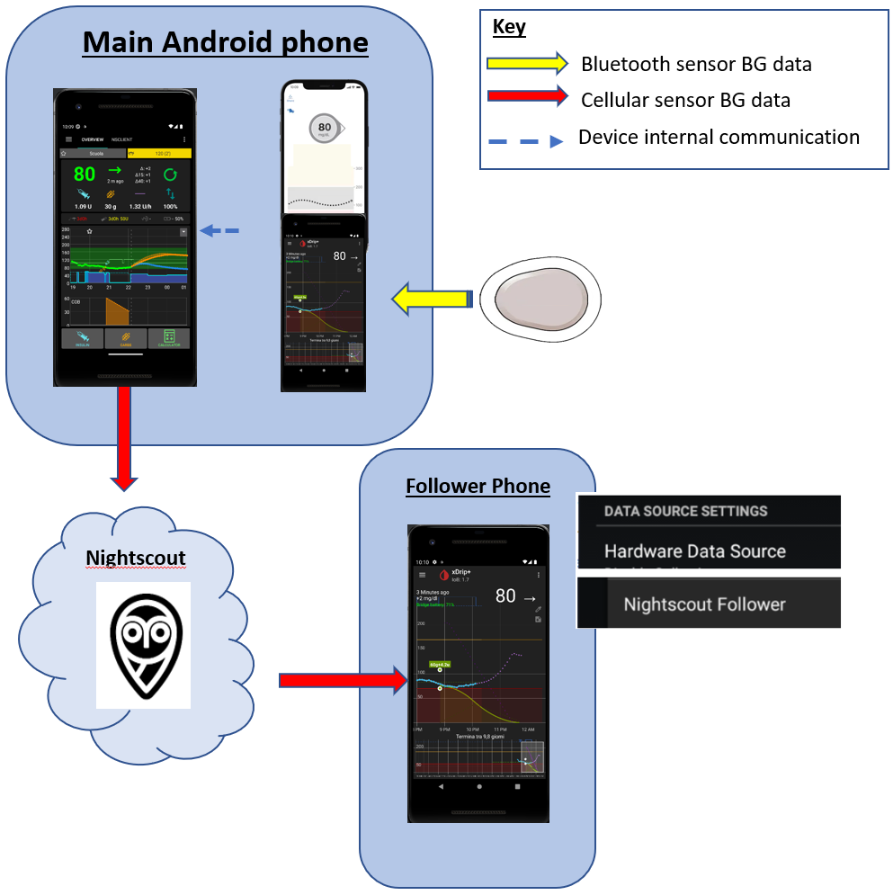

# Acompanhar o AAPS (sem interação com o sistema AAPS)

Além das muitas possibilidades para controlar _e_ acompanhar o **AAPS** a distância, descritas em [Controle remoto do AAPS](../RemoteFeatures/RemoteControl.md), a comunidade desenvolveu vários outros apps e dispositivos para simplesmente acompanhar números (níveis de glicose e outras informações), sem interagir com o **AAPS**.

Uma boa visão geral das muitas opções para acompanhar o **AAPS** está na página [Nightscout follower](https://nightscout.github.io/nightscout/downloaders/#).

```{contents} Table of contents
:depth: 1
:local: true
```

As estratégias mais comuns usadas com o **AAPS** são explicadas com mais detalhes abaixo.

## Apps para smartphone

```{contents} These are some of the main “follower” apps used by **AAPS** users. All of these apps are “free”: 
:depth: 1
:local: true
```

### Dexcom Follow ([Android](https://play.google.com/store/apps/details?id=com.dexcom.follow.region2.mgdl) e [iOS](https://apps.apple.com/fr/app/dexcom-follow-mg-dl-dxcm2/id1032203080))


* O Dexcom Follow é compatível com muitos celulares (Android e iPhone). O Dexcom Follow pode ser usado mesmo se você não usa o app oficial da Dexcom para receber os dados do sensor.

* Muitos cuidadores conhecem o Dexcom Follow e preferem a sua interface clara a algo mais complicado.

* O Dexcom Follow é muito bom para professores, avós e pessoas que sabem muito pouco sobre diabetes e níveis de glicose. Tem alertas personalizáveis (nível de glicose, qual som tocar etc.). Os alarmes podem ser desligados totalmente, se necessário. Isso é muito útil se você tem um sensor que ainda está se estabilizando e cria várias hipoglicemias falsas.

#### Configurar o Dexcom Follow: guia passo a passo

Se você usa o app não oficial da Dexcom BYODA para receber os dados do sensor, talvez consiga enviar convites aos seguidores pelo próprio app BYODA.

Não é mais possível enviar e-mails de convite para seguidores da Dexcom a partir de apps de terceiros. No xDrip, o pedido de convite só resulta na mensagem “invite not sent”.

Você precisa instalar o app oficial da Dexcom, enviar o convite e depois desinstalar o app oficial.

Os passos são os seguintes:

1)  Instale o app oficial “Dexcom” em _qualquer_ smartphone (Android/iPhone). Pode ser o telefone do seguidor, se for mais prático. 2)  Faça login com seu usuário e senha da Dexcom. São os mesmos dados de login que você usaria no Dexcom Clarity, se você já é cliente da Dexcom/Clarity. Se você não tem um login da Dexcom, pode criar um novo login neste momento.   
3)  Passe pelas telas de introdução. 4)  Informe “no code” (sem código) como código do sensor. 5)  Em Transmitter SN, selecione “enter manually” (inserir manualmente) e digite qualquer código de transmissor válido (use o código de um dos seus transmissores vencidos, se você souber um, para não interferir no seu transmissor atual. Os códigos seguem um formato específico de números e letras: “NLNNNL” e só usam certas combinações, então é mais fácil usar um que você já sabe que é válido). 6)  Quando o app estiver tentando encontrar o transmissor e o sensor, você poderá convidar seguidores: selecione os três pontinhos no canto superior esquerdo do app e adicione um novo seguidor. Você também pode usar isso se um dos seus seguidores trocou de celular e precisa de um novo convite: aqui você pode excluí-lo da lista de seguidores e reenviar um novo e-mail de convite para ele usar no novo celular. 7)  No telefone do seguidor, instale o Dexcom Follow baixando-o da App Store (iPhone) ou da Play Store (Android). Configure o app Dexcom Follow. Ele vai pedir para você abrir seu e-mail e encontrar o convite para ser seguidor.    
8)  Agora você pode excluir o app oficial Dexcom G6.

Para o Dexcom Follow, os dados do sensor são então exportados do telefone com o **AAPS**, diretamente do BYODA ou do xDrip, conforme o app que você usa.


### [Nightguard](https://apps.apple.com/fr/app/nightguard/id1116430352) (iOS)


Prós (segundo os usuários):

* Disponível na [App Store](https://apps.apple.com/us/app/nightguard/id1116430352), com interface simples e fácil de usar.

* Deslize o botão ou sacuda o telefone para adiar os alarmes por intervalos de 5 min a 24 horas

* Alarmes personalizáveis (alta, baixa, leituras perdidas quando não há dados por 15–45 minutos).

* Subida/queda rápida em 2–5 leituras seguidas (você escolhe). Também é possível escolher o delta entre duas leituras individuais

* Soneca inteligente: não alerta se os níveis estão indo na direção certa

* Há uma aba Care que parece permitir definir um novo alvo temporário por um certo tempo, excluir o alvo temporário ou inserir carboidratos.

Contras (segundo os usuários)

* Disponível apenas para iOS

* O alvo temporário (TT) aparece como 5 mmol, não importa qual nível de TT está definido

* Nunca mostra a taxa de basal temporária, embora mostre TB

### [Nightwatch](https://play.google.com/store/apps/details?id=se.cornixit.nightwatch) (Android)


* O Nightwatch se apresenta como um cliente do Nightscout e monitora os níveis de glicose do Nightscout do usuário em um telefone ou tablet Android.

* O app pode ser baixado do [Google Play](https://play.google.com/store/apps/details?id=se.cornixit.nightwatch) e mostra os dados de glicose em tempo real.

* O usuário pode ser alertado com alarmes sonoros personalizados de baixa e de alta.

* Os dados de glicose podem ser vistos em mmol/l ou mg/dl.

* Ele precisa do Android 5.0 ou mais recente.

* Tem uma interface escura, com leituras e botões grandes, feita para uso à noite.

### xDrip (Android)

Você pode usar o xDrip como seguidor.

#### Com Nightscout

Configure o xDrip como seguidor do Nightscout. Você vai receber a glicose e os tratamentos, mas não a basal.



#### Sem Nightscout - fonte de BG xDrip

Se a sua fonte de dados do **AAPS** é o xDrip (ou se o xDrip também pode receber glicose de outro app, como BYODA, Juggluco, ...), você pode usá-lo no telefone principal para compartilhar dados com seguidores do xDrip, mostrando glicose, tratamentos e taxas basais.


#### Sem Nightscout - app companheiro de BG do xDrip

Se a sua fonte de dados do **AAPS** não é o xDrip, mas você pode mostrar a glicose da fonte de dados Companion App, você pode usá-lo no telefone principal para compartilhar dados com seguidores do xDrip, mostrando glicose, tratamentos e taxas basais.


### xDrip4iOS (iOS)


xDripSwift was created from porting the original xDrip app to iOS and evolved into "xDrip for iOS", written as **xDrip4iOS**.

```{admonition} Further detail about how to attempt to obtain the original **xDrip4iOS** app
:class: dropdown
O [grupo xDrip4iOS no Facebook](https://www.facebook.com/groups/853994615056838/announcements) é o principal suporte da comunidade para o xDrip4iOS e o Shuggah. O **xDrip4iOS** pode se conectar a muitos sistemas de CGM e transmissores diferentes e mostrar valores de glicose, gráficos e estatísticas, além de dar alarmes. Ele também pode enviar dados para o Nightscout ou funcionar como [app seguidor do Nightscout](https://xdrip4ios.readthedocs.io/en/latest/connect/follower/). 

"Como posso ter o **xDrip4iOS** no meu iPhone?"
Há duas opções:

1. Se você tem um Mac e uma conta Apple Developer (99 EUR/USD por ano), pode compilar seu próprio xDrip4iOS [seguindo as instruções](https://xdrip4ios.readthedocs.io/en/latest/install/build/).

Se quiser, você pode então se tornar um "releaser" e [compartilhar um xDrip4iOS pelo Personal Testflight](https://xdrip4ios.readthedocs.io/en/latest/install/personal_testflight/) com até 100 outras pessoas para ajudá-las.

2. Entre no [grupo xDrip4iOS no Facebook](https://www.facebook.com/groups/853994615056838/announcements) e leia as publicações fixadas para ver as formas atuais de obter o app. **Você não deve pedir um convite para o app** (leia as regras do grupo).
```


"O que é o **Shuggah**?" Um grupo de desenvolvedores ucranianos copiou o código do projeto xDrip4iOS (que é público no GitHub) e o publicou na App Store com uma conta comercial. A versão Shuggah não é gerenciada de forma alguma pelos desenvolvedores do xDrip4iOS.

O [grupo xDrip4iOS no Facebook](https://www.facebook.com/groups/853994615056838/announcements) dá suporte ao xDrip4iOS e aos apps correspondentes para Apple Watch.

### [Sugarmate](https://apps.apple.com/fr/app/sugarmate/id1111093108) (iOS)


O [Sugarmate](https://sugarmate.io/) pode ser baixado para iPhone na App Store. O Sugarmate é compatível com:
* Apple iPhone (precisa da versão de software 13.0 ou mais recente)
* Apple iPad (precisa da versão de software 13.0 ou mais recente)
* Google Android (salve o web app na tela inicial)

Usuários do Sugarmate relatam que ele pode ser usado com o Apple CarPlay nos EUA para mostrar as leituras de glicose ao dirigir. Ainda não se sabe se isso é possível em países fora dos EUA. If you know more about this, please add details in here to the documentation by completing a [pull request](../SupportingAaps/HowToEditTheDocs.md), which is quick and easy to do.


### [Spike](https://spike-app.com/) (iOS)


O Spike pode ser usado como receptor principal ou como app seguidor, com glicose, alarmes, IOB e mais.

O site e o app não são mais desenvolvidos. Há suporte no [Facebook](https://www.facebook.com/groups/1973791946274873) e no [Gitter](https://gitter.im/SpikeiOS/Lobby).

## Smartwatches para **monitoramento do AAPS** (dados completos do perfil ou só glicose) quando o **AAPS** roda em um telefone.

Veja [aqui](../Getting-Started/Watches.md).


## Dispositivos para acompanhar o AAPS

```{contents} Devices include:
:depth: 1
:local: true
```

### M5Stack


O M5Stack é uma pequena caixa que pode ser programada para muitas aplicações. O projeto de Martin, [M5Stack NightscoutMon](https://github.com/mlukasek/M5_NightscoutMon/wiki), mostra os valores e as tendências da glicose do sensor, IOB e COB. Ele fica em uma caixa de plástico, com tela colorida, entrada para cartão micro SD, 3 botões, alto-falante e bateria interna. É um ótimo monitor de glicose e é relativamente fácil de configurar se você tem uma conta do Nightscout. Os usuários normalmente o usam no Wi-Fi de casa, mas alguns relatam usá-lo como tela ao andar de moto, usando o ponto de acesso Wi-Fi do telefone.

### SugarPixel

O SugarPixel é um dispositivo secundário de exibição e alerta de glicose para monitoramento contínuo de glicose, que se conecta ao app da Dexcom ou ao Nightscout no smartphone do usuário. O dispositivo mostra as leituras de glicose em tempo real. Este monitor de CGM tem alertas sonoros com tons aleatórios (que são muito altos), alertas por vibração para pessoas com deficiência auditiva, opções de tela personalizáveis e acompanhamento por vários usuários.


* O SugarPixel tem várias opções de tela em mg/dl e mmol/l para atender às necessidades do usuário, com valores de glicose em cores.
* A tela padrão mostra a glicose, a seta de tendência e o delta. O delta é a variação, para mais ou para menos, desde a última leitura.
* O SugarPixel pode ser ajustado para pouca luz com a tela BG and Time, para ver a glicose e a hora atual na mesa de cabeceira do usuário.
* A tela colorida do SugarPixel usa toda a tela para mostrar uma única cor que representa o valor da glicose. Isso permite que o usuário veja as leituras de glicose a distância, pela janela, enquanto brinca no quintal, no pátio ou na piscina.
* A tela Big BG é útil para quem usa o dispositivo na mesa de cabeceira e usa óculos ou lentes de contato.

### Nightscout Clock no Ulanzi TC001

O **Nightscout Clock** é um software de código aberto que roda no dispositivo **Ulanzi TC001**. Ele se conecta aos servidores da Dexcom ou ao Nightscout e mostra as leituras de glicose em tempo real.


* O relógio suporta as unidades mmol/l e mg/dl e tem alarmes sonoros.
* Há várias telas disponíveis. Veja [Github nightscout-clock](https://github.com/ktomy/nightscout-clock?tab=readme-ov-file#more-information-for-people-who-needs-it) para uma visão geral.
* Configurar o dispositivo leva só alguns passos simples. Depois de configurado, ele só precisa de energia e Wi-Fi para funcionar.
* O dispositivo Ulanzi TC001 é bem mais barato que o SugarPixel.
* O software e as instruções de instalação estão em [Github nightscout-clock](https://github.com/ktomy/nightscout-clock?tab=readme-ov-file).
* Ele é desenvolvido e mantido por Artiom Kenibasov, que oferece suporte no [grupo Facebook AAPS Users](https://www.facebook.com/groups/cgminthecloud/posts/8776932509094594/).

### PC (TeamViewer)
Alguns usuários consideram uma ferramenta de acesso remoto completa, como o [TeamViewer](https://www.teamviewer.com/), útil para solução de problemas remotos avançados.
