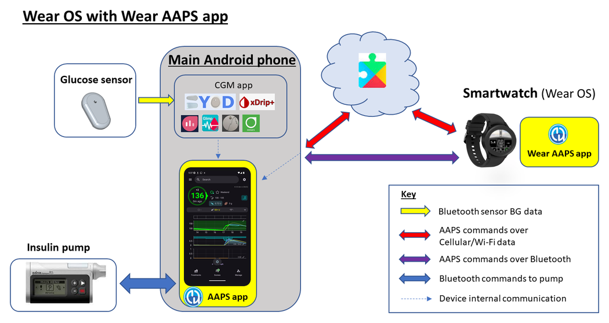

# Controle remoto do AAPS

```{contents} In this page
:backlinks: entry
:depth: 2
```

Há quatro ferramentas muito eficazes para gerenciar o **AAPS** a distância:

1) [Comandos SMS](#RemoteControl_SMS-Commands) (o telefone do seguidor pode ser Android ou iOS), 2) [AAPSClient](#RemoteControl_aapsclient) (o telefone do seguidor é Android; uma versão para iPhone está em desenvolvimento) 3) [Nightscout](#RemoteControl_nightscout) (Android, iOS ou outro computador/dispositivo), principalmente para acompanhar: veja a nota sobre o [controle do cliente](#client-master-control) nessa seção.  
4) [Smartwatches](#RemoteControl_smartwatches) (Android)

As três primeiras são mais adequadas para cuidadores/pais, mas os smartwatches são muito úteis para cuidadores/pais **e** também para adultos com diabetes.


(RemoteControl_SMS-Commands)=

## 1) Comandos SMS

Veja a página própria [Comandos SMS](../RemoteFeatures/SMSCommands.md).

(RemoteControl_aapsclient)=
## 2) AAPSClient

O **AAPSClient** tem uma aparência muito parecida com a do próprio **AAPS** e oferece ao cuidador as mesmas telas e botões para enviar comandos ao **AAPS** a distância:


(remotecontrol-aapsclient-versions)=
### Sobre o AAPSClient, o AAPSClient2 e o AAPSClient3

Existem 3 versões do app cliente: **AAPSClient**, **AAPSClient2** e **AAPSClient3**. Elas funcionam da mesma forma. A única diferença é que podem ser instaladas lado a lado no mesmo telefone de seguidor.

Um cuidador que acompanha uma pessoa precisa apenas do **AAPSClient**. Para acompanhar e controlar a distância uma segunda pessoa (com o seu próprio site **Nightscout** e o seu próprio telefone com o **AAPS**), instale também o **AAPSClient2**, e o **AAPSClient3** para uma terceira pessoa. Cada app é configurado e [pareado](#aapsclient-pairing-with-the-master) separadamente, com o site **Nightscout** e o telefone com o **AAPS** da pessoa que ele acompanha.

Para diferenciar os apps, alguns elementos têm cores diferentes: amarelo para o **AAPSClient**, azul para o **AAPSClient2** e verde para o **AAPSClient3**. Esses elementos são o ícone do app, o fundo do widget e a seção de status do **AAPS** na tela inicial do app. <br/> Observação: a opacidade do fundo do widget pode ser definida na configuração do widget. Com pouca opacidade, a cor é difícil de ver.


### Download e instalação

O **AAPSClient** pode ser instalado em um único telefone ou em vários telefones de seguidores (por exemplo, o telefone do pai 1 e o telefone do pai 2), para que os dois cuidadores tenham acesso e possam controlar a distância o telefone com o **AAPS** do paciente.

Para baixar o **AAPSClient**, vá até o [repositório do Github](https://github.com/nightscout/AndroidAPS/releases/) e clique no arquivo **“app-AAPSClient-release_x.x.x.x”** (pode ser uma versão mais nova que a mostrada na captura de tela abaixo):


Depois vá até _downloads_ no seu computador. No Windows, os _downloads_ aparecem na faixa do lado direito:


Depois de baixar, clique em _show in folder_ (mostrar na pasta) para encontrar o arquivo.

O apk do **AAPSClient** agora pode ser:

Transferido por cabo USB para o telefone do seguidor; ou Arrastado para uma pasta do Google Drive e depois instalado no telefone do seguidor tocando no arquivo "app-AAPSClient-release".

Se você precisa do **AAPS** para você mesmo e do **AAPSClient** para monitorar outra pessoa, você precisa compilar o **AAPSClient** você mesmo, em vez de baixá-lo do repositório do Github como descrito acima. O motivo é que não é possível instalar o **AAPS** e o **AAPSClient** no mesmo telefone se forem assinados com chaves diferentes. <br/> Para compilar o **AAPSClient** você mesmo, siga o mesmo processo da [compilação normal do AAPS](../SettingUpAaps/BuildingAaps.md). Na página **Generate signed App Bundle or APK**, selecione **aapsclientRelease** em vez de **fullRelease**.

A mesma regra vale quando você instala vários apps clientes (**AAPSClient**, **AAPSClient2**, **AAPSClient3**) em um telefone de seguidor: todos precisam ser assinados com a **mesma chave**. Caso contrário, o Android se recusa a instalar o segundo (erro `INSTALL_FAILED_DUPLICATE_PERMISSION`).

### Sincronização: configuração do AAPSClient e do AAPS

Depois que o apk do __AAPSClient__ estiver instalado no telefone do seguidor, verifique se o **NSClientV3** está configurado da mesma forma nos dois telefones para o Nightscout 15 (veja as [notas de atualização](../Maintenance/UpdateToNewVersion.md)). O exemplo abaixo mostra a configuração da sincronização com o NSClientV3 e o Nightscout 15; outras fontes de dados estão disponíveis no __AAPS__ (por exemplo, xDrip).

Em **Configuração** > **Comunicação**, o usuário sincroniza seus dados com o Nightscout pelo __NSClientV3__ (usando a API v3), configurado da mesma forma no __AAPS__ e no telefone do seguidor.


O usuário precisa garantir que __os dois__ telefones, com o AAPS e com o AAPSClient, estejam sincronizados entre si, configurando o NSClientV3 em cada um. No telefone do seguidor, isso pode ser feito escaneando um código QR mostrado pelo **AAPS**; veja [Parear o AAPSClient com o AAPS](#remotecontrol-pairing) abaixo:

- Digite a sua **URL do Nightscout** nas **Configurações** do NSClientV3

- Digite o seu **Token de acesso do Nightscout** nas mesmas configurações. Siga as notas [aqui](https://nightscout.github.io/nightscout/security/#create-a-token). No telefone com o **AAPS**, use um **token de administrador**: com ele, o **AAPS** cria um token próprio para cada telefone de seguidor.

- Ative **Usar websockets** nos **dois** telefones. No telefone com o **AAPS**, os websockets são **obrigatórios** para o controle remoto: sem eles, o **AAPS** não consegue receber comandos do **AAPSClient**. Nos dois telefones, eles também deixam a sincronização mais rápida, com um consumo de bateria um pouco maior.


O usuário deve verificar se o __AAPSClient__ e o __AAPS__ mostram  ‘Conectado’ na tela **NSClientV3** de cada telefone. Neste ponto, o **AAPSClient** acompanha o **AAPS** (glicose, tratamentos, perfil), mas ainda não pode controlá-lo: pareie os dois telefones como descrito abaixo.

(remotecontrol-pairing)=
### Parear o AAPSClient com o AAPS (controle remoto)

A partir do **AAPS** versão 4, o **AAPSClient** controla o **AAPS** por uma conexão segura e **pareada**. Só a sincronização não basta: enquanto os telefones não estiverem pareados, o **AAPSClient** mostra apenas **Gerenciar**, com um **Perfil** somente para visualização e **Parear com o dispositivo principal**.

1. No telefone com o **AAPS**, abra **Gerenciar → Clientes autorizados** e ative **Permitir controle pelo cliente** (fica desativado por padrão e sempre ativado no Modo simples).
2. Toque em **+**, digite um nome para o telefone do seguidor, escolha como ele é configurado e escolha a sua **função**:
   - **Código QR: Nightscout e pareamento** — o **AAPS** mostra um código QR que configura o Nightscout no telefone do seguidor e o pareia, com uma única leitura. Isso precisa de um token de administrador nas configurações do NSClientV3 do telefone com o **AAPS**.
   - **PIN** — para um telefone de seguidor sem câmera, já conectado ao Nightscout: anote o **PIN** de uso único (válido por cerca de dois minutos).
3. No telefone com o **AAPSClient**, escaneie o código (no Assistente de Configuração ou em **Gerenciar → Parear com o dispositivo principal → Escanear código QR**) ou abra **Gerenciar → Parear com o dispositivo principal** e digite o PIN. Confirmar.

O telefone do seguidor então aparece como **Ativo** na lista **Clientes autorizados**, e o **AAPSClient** mostra **Tratamentos**, **Cenários** e **Gerenciar**. O telefone do seguidor recebe um token do Nightscout próprio, só com os direitos de que precisa. O procedimento completo, com capturas de tela e resolução de problemas, está em [Controle dispositivo principal ↔ cliente](#client_master_master_setup).

Verifique se a configuração funciona: insira carboidratos no **AAPSClient**, confirme a quantidade mostrada e verifique se o registro aparece em **Tratamentos** nos dois telefones.

(remotecontrol-nightscout-access-token)=

### Resolver problemas de configuração do 'Token de acesso do Nightscout'

A configuração exata do 'Token de acesso do Nightscout' pode ser diferente se o seu Nightscout é um site hospedado pago ou não.

Se você tem dificuldade para o **AAPS** aceitar o 'Token de acesso do Nightscout' e usa um site Nightscout hospedado pago, talvez seja melhor falar primeiro com o seu provedor do Nightscout sobre como resolver as dificuldades com o 'Token de acesso do Nightscout'. Caso contrário, peça ajuda ao grupo do **AAPS**, mas antes verifique bem se você seguiu corretamente as notas [aqui](https://nightscout.github.io/nightscout/security/#create-a-token).

### O que o AAPSClient oferece

Depois de pareado, o **AAPSClient** oferece ao cuidador quase as mesmas telas do próprio **AAPS**:

- **Tratamentos**: bólus de insulina, carboidratos e a calculadora de bólus.
- **Cenários**: iniciar e parar [cenários](../DailyLifeWithAaps/Scenes.md).
- **Gerenciar**: perfis, configurações de insulina, alvos temporários, Assistente rápido, automação, alimentos, rotação do local e a basal temporária em andamento.
- **Menu principal**: histórico de tratamentos, navegador do histórico, estatísticas, manutenção, configuração.

Não há bomba nem objetivos no **AAPSClient**. Veja [O app AAPSClient](AapsClient.md) para uma descrição detalhada.

O **AAPSClient** permite que o cuidador faça a distância, pela rede móvel ou pela internet, a maioria dos ajustes permitidos diretamente no **AAPS**, **incluindo bólus de insulina**. Cada comando é assinado e enviado pelo Nightscout ao telefone com o **AAPS**, que o verifica com os seus próprios dados, aplica os limites, mostra a sua própria confirmação e só então o executa. O **AAPSClient** _pode_ ser muito mais rápido que os [Comandos SMS](../RemoteFeatures/SMSCommands.md), principalmente para comandos que precisariam de autenticação.

Tratamentos inseridos no Nightscout de outras formas (por exemplo, pelo site do Nightscout) não são aplicados enquanto o controle do cliente está ativado: o **AAPS** fica então no [modo reforçado](#client-master-control-hardened-mode) e aceita alterações apenas de clientes pareados. Com o controle do cliente desativado, eles são aplicados apenas se as opções **Receber** correspondentes estiverem ativadas na [seção Sincronização das preferências do NSClient](#Preferences-nsclient-synchronization).

O controle remoto pelo **AAPSClient** só é recomendado se a sua sincronização funciona bem (_ou seja_, você não vê mudanças indesejadas nos dados, como alterações sozinhas de alvo temporário, TBR etc.).

### AAPSClient com opções de smartwatch

Um smartwatch pode ser uma ferramenta muito útil para ajudar a gerenciar o **AAPS** com crianças. Algumas configurações diferentes são possíveis. Se o **AAPSClient** estiver instalado no telefone do cuidador, o [app **AAPSClient WearOS**](https://github.com/nightscout/AndroidAPS/releases/) pode ser baixado e instalado em um smartwatch compatível conectado ao telefone dos pais. Isso mostra a glicose atual e o status do loop. Depois que o **AAPSClient** é pareado com o **AAPS**, as ações do relógio (incluindo bólus, carboidratos, alvos temporários e mudanças de perfil) são repassadas pelo **AAPSClient** ao **AAPS**, que as confirma e executa: veja [Wear OS em um cliente](#clientmastercontrol-wear-os-on-a-client). Você pode ler mais sobre smartwatches [aqui](#remotecontrol-smartwatches).

(RemoteControl_nightscout)=
## 3) Nightscout

Além de o Nightscout ser um servidor “na nuvem”, também existe um app **Nightscout** próprio, que pode ser baixado diretamente da App Store no seu iPhone. Se o seu telefone de seguidor é Android, não existe um app Nightscout próprio, e é melhor usar o [**AAPSClient**](#2-aapsclient). Ou, se você só quer acompanhar e não enviar tratamentos, pode baixar e instalar o app [Nightwatch](https://play.google.com/store/apps/details?id=se.cornixit.nightwatch) da Play Store.

Depois de instalar o app **Nightscout** no iPhone, abra o app e siga as instruções de configuração, digitando o endereço do seu Nightscout (veja abaixo, à esquerda). O formato pode variar conforme o local onde o seu Nightscout está hospedado. (_por exemplo_ http://youraddresshere.herokuapp.com). Depois digite o API secret do seu Nightscout (veja abaixo, à direita). Se a senha da API não for pedida, você precisa digitá-la tocando no cadeado no topo do app:


Mais informações sobre a configuração estão disponíveis diretamente no [Nightscout](https://nightscout.github.io/nightscout/discover/)

No primeiro login, você verá uma tela bem simples. Personalize as opções de exibição selecionando o “hambúrguer” no canto superior direito e rolando para baixo:


Role para baixo até “Settings” (configurações). Talvez você queira mudar “scale” (escala) para “linear”, pois o padrão da exibição da glicose é logarítmico, e em “render basal” selecionar “default” para que a basal da bomba apareça.


Selecione as opções que você quer. Desmarque os alarmes se você usa outro app para alarmes.


Continue rolando para baixo até chegar em “show plugins” (mostrar plugins).

Verifique se “careportal” está marcado. Você também pode selecionar várias outras métricas (as mais úteis são: IOB, care portal, pump, cannula age, insulin age, basal profile e OpenAPS).

Importante: agora você precisa tocar em “save” (salvar) na parte de baixo para que essas mudanças tenham efeito.


Depois de tocar em “save”, o app volta para a tela principal do Nightscout, que vai ficar mais ou menos assim:

1. Valor atual da glicose
2. Informações sobre o status do sistema AAPS - toque nas abas da tela para ver mais detalhes. Adicione ou remova essas opções de exibição pelo menu hambúrguer.
3. Curva recente da glicose com os tratamentos (carboidratos, bólus)
4. Curva da glicose de prazo mais longo
5. Menu "hambúrguer" para definir opções de exibição, gerar relatórios, editar perfis e ferramentas de administração do Nightscout
6. Menu "**+**" para inserir tratamentos (veja [abaixo](#RemoteControl_nightscout-treatments) quando o **AAPS** os aplica).
7. Selecionar outro período para exibir
8. Perfil de insulina basal
9. Linha verde = glicose passada Linhas azuis = glicose prevista


Olhando com mais detalhes o menu superior esquerdo do app Nightscout:

1. Edição retroativa do Careportal
2. Ligar/desligar alarmes
3. Hambúrguer - para definir preferências
4. Careportal - registrar tratamento (veja [abaixo](#RemoteControl_nightscout-treatments) quando o **AAPS** os aplica)


Há muitas informações sobre o status do sistema **AAPS** nas abas cinzas desta tela (e mais informações aparecem se você tocar na aba):

1. Tendência da glicose em 5 min
2. Prévia do assistente de bólus (Bolus wizard preview)
3. Toque em Basal para ver o seu perfil atual e as informações da basal
4. Tempo desde a última leitura do CGM no AAPS
5. **Bomba**: insulina, bateria (%) e quando o AAPS se conectou a ela pela última vez
6. Última atualização do AAPS - se for mais de 5 min, pode indicar um problema de conexão entre o telefone com o AAPS e a bomba/CGM
7. Toque em IOB para ver a divisão entre insulina basal e de bólus
8. Idade da insulina no reservatório
9. Idade da cânula
10. Status da bateria do telefone com o AAPS
11. Tamanho do seu banco de dados. Se ele ficar cheio demais (só Nightscout DIY - serviços hospedados podem ignorar), você pode começar a ter problemas de conexão. Você pode excluir dados para reduzir esse número no menu Admin tools (pelo hambúrguer).


Toque em "refresh" (atualizar) na parte de baixo da página para fechar a janela.

(RemoteControl_nightscout-treatments)=
### Enviar tratamentos pelo app Nightscout para o AAPS

No **AAPS** 4, a forma suportada de controlar o **AAPS** a distância é um **AAPSClient pareado**, veja [Controle dispositivo principal ↔ cliente](#client-master-control): cada cliente tem uma [função](#client-master-control-roles) que limita o que ele pode fazer, e cada comando é assinado, verificado e confirmado pelo telefone com o **AAPS**. Enquanto o controle do cliente está ativado, o telefone com o **AAPS** fica no [modo reforçado](#client-master-control-hardened-mode): tratamentos, alvos temporários e trocas de perfil inseridos no site do Nightscout ou no app Nightscout **não** são aplicados. O app Nightscout é então uma ferramenta apenas para acompanhar.

```{admonition} Only when client control is off
:class: warning
Se **Permitir controle pelo cliente** estiver desativado em **Gerenciar → Clientes autorizados** (e o Modo simples estiver desativado), o **AAPS** aplica registros do careportal vindos do Nightscout apenas para os tipos de dados que você ativou em **Receber** na [seção Sincronização das configurações do NSClientV3](#Preferences-nsclient-synchronization): carboidratos, alvos temporários, trocas de perfil e os outros registros do careportal. A insulina nunca é aplicada dessa forma: um "Correction bolus" inserido no Nightscout é apenas *anunciado*, e o **AAPS** o conta como insulina ativa sem aplicá-lo. Esta configuração não é recomendada para controle remoto; use um **AAPSClient** pareado.
```

Leia mais sobre as opções do **Nightscout** [aqui](https://nightscout.github.io/)

### Dicas para aproveitar ao máximo o app Nightscout

1). Se você ficar “preso” em uma página e quiser ver a tela principal de novo, toque em “refresh” (atualizar, embaixo no meio). Isso leva você de volta à página inicial do **Nightscout** com o gráfico de glicose.

Para ver o perfil atual em uso no telefone, toque nos vários ícones da tela acima do gráfico. Mais informações (relação de carboidratos atual, sensibilidade, fuso horário etc.) podem ser vistas tocando em “basal”, e “OpenAPS” dá informações sobre o perfil, o alvo atual etc. A bateria do telefone (%) e a bateria da bomba (%) também podem ser monitoradas. BWP dá informações sobre o que o algoritmo acha que vai acontecer no futuro, considerando o IOB e o COB.

#### Outros ícones do menu: o que significa o lápis (editar)?

Você pode (tecnicamente) usar o lápis de edição para mover ou excluir tratamentos de bólus ou de correção das últimas 48 h.

Mais sobre isso [aqui](https://nightscout.github.io/nightscout/discover/#edit-mode-edit)

Embora isso possa ser útil para excluir carboidratos anunciados (mas sem bólus), na prática isso não funciona bem com o **AAPS** atualmente, e recomendamos fazer esse tipo de mudança diretamente no app **AAPS**.

(RemoteControl_smartwatches)= (remotecontrol-smartwatches)=

## 4) Smartwatches

### Opção 1) Controlar o AAPS de um relógio Wear OS



Depois de [configurar o **AAPS** no seu relógio](../WearOS/BuildingAapsWearOS.md), você encontra muitos detalhes sobre os mostradores do smartwatch e suas funções em [Configurar o AAPS no seu relógio Wear OS](../WearOS/WearOsSmartwatch.md).

Em resumo, as seguintes funções podem ser acionadas pelo smartwatch:

* definir um alvo temporário

* usar a calculadora de bólus (as variáveis do cálculo podem ser definidas nas configurações do telefone)

* aplicar eCarbs

* aplicar um bólus (insulina + carboidratos)

* configurações do relógio

* status

* verificar o status da bomba

* verificar o status do loop

* verificar e mudar o perfil, CPP (Circadian Percentage Profile = deslocamento de tempo + porcentagem)

* mostrar a TDD (dose diária total = bólus + basal por dia)

* Bólus remoto quando o cuidador e a criança com DM1 estão em lugares diferentes (isso é possível com o relógio com o **AAPS** e o telefone com o **AAPS**, desde que os dois dispositivos estejam conectados à rede)

#### Comunicação dos cuidadores com o relógio usando outros apps (como o WhatsApp)

É possível adicionar outros apps ao relógio, como o WhatsApp, para trocar mensagens (por exemplo) entre cuidadores e crianças. É importante ter apenas UMA conta Google associada ao telefone, senão o relógio não vai trazer esses dados. Você precisa ter 13 anos ou mais para ter uma conta Samsung, e ela precisa ser criada com o mesmo endereço de e-mail usado no telefone Android.

Um vídeo que explica como configurar o WhatsApp para mensagens no relógio Galaxy 4 (não é possível ter todas as funções do WhatsApp) está [aqui](https://gorilla-fitnesswatches.com/how-to-get-whatsapp-on-galaxy-watch-4/)

Com ajustes no app **Galaxy wearable** no telefone com o **AAPS** e no relógio, as mensagens do WhatsApp podem ser avisadas com uma leve vibração e aparecer sobre o mostrador atual.

### Opção 2) **AAPS** no relógio, para controle remoto do **AAPS** em um telefone

Assim como um telefone de seguidor com o **AAPSClient** ou com comandos SMS (veja as seções acima), um smartwatch pode ser usado para controlar o **AAPS** a distância e mostrar os dados completos do perfil. Uma diferença importante em relação ao telefone de seguidor é que a ligação entre o smartwatch e o telefone com o **AAPS** é por Bluetooth e não precisa nem do Nightscout nem de um código de autenticação. Observação: se o smartwatch e o telefone com o **AAPS** ligados por Bluetooth também estiverem em uma rede Wi-Fi/de dados móveis, o relógio também vai interagir com o telefone com o **AAPS**, com um alcance de comunicação maior. Isso inclui aplicar um bólus a distância quando o cuidador com o relógio com o **AAPS** e a criança com DM1 (com o telefone com o **AAPS**) estão em lugares diferentes, o que pode ser útil quando a criança com DM1 está na escola.

Por isso, um smartwatch de controle remoto costuma ser útil em qualquer situação em que:

a)  Os comandos do **AAPSClient** ou por **SMS** não funcionam; ou

b)  O usuário quer evitar digitar um código de autenticação (como é preciso nos comandos SMS).

Um smartwatch precisa do **Wear OS 3 ou mais recente** para poder controlar o **AAPS**. Verifique as especificações técnicas do relógio e veja a [página Smartwatches e o AAPS](../Getting-Started/Watches.md). Pesquise ou pergunte nos grupos do **AAPS**  no Facebook/Discord se tiver dúvidas.

Abaixo há guias específicos para configurar o **AAPS** no popular Samsung Galaxy Watch 4 (40 mm). O relógio [Garmin](https://apps.garmin.com/en-US/apps/a2eebcac-d18a-4227-a143-cd333cf89b55?fbclid=IwAR0k3w3oes-OHgFdPO-cGCuTSIpqFJejHG-klBTm_rmyEJo6gdArw8Nl4Zc#0) também é uma escolha popular. Se você já configurou outro smartwatch e acha que isso seria útil para outras pessoas, adicione-o a estas páginas ([editar a documentação](../SupportingAaps/HowToEditTheDocs.md)) para compartilhar o que aprendeu com toda a comunidade do **AAPS**.

### Opção 3) AAPSClient em um relógio, para controle remoto do **AAPS** em um telefone


O software para o relógio, o apk Wear do **AAPSClient**, pode ser baixado diretamente do [Github](https://github.com/nightscout/AndroidAPS/releases/).

Para baixar o software, clique no app de relógio que corresponde ao app cliente do telefone: **wear-aapsclient-release_**_versão_ é para o **AAPSClient**, **wear-aapsclient2-release_**_versão_ é para o **AAPSClient2** (veja [Sobre o AAPSClient, o AAPSClient2 e o AAPSClient3](#remotecontrol-aapsclient-versions)):


Depois use "save as" (salvar como) e salve o arquivo em um local prático no seu computador:


O apk wear do **AAPSClient** pode ser transferido para o seu telefone e instalado no relógio da mesma forma que o app Wear do **AAPS**, como descrito em [Transferir o app Wear para o seu telefone com o AAPS](#remote-control-transferring-the-aaps-wear-app-onto-your-aaps-phone)  


