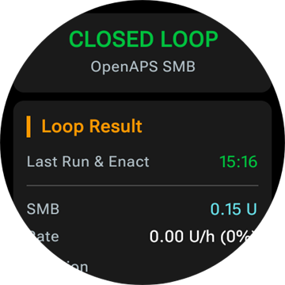
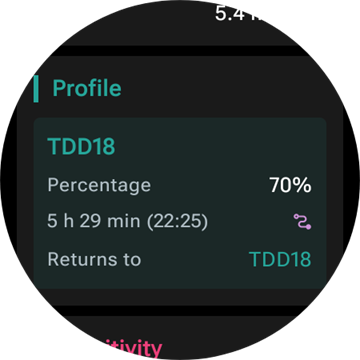
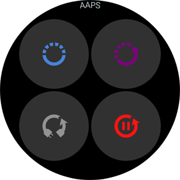

# Uso do AAPS pelo seu smartwatch Wear OS

(Watchfaces-aaps-watchfaces)=

## Mostradores do AAPS

```{warning}
Os mostradores clássicos do **AAPS** funcionam apenas no Wear OS 5 e anteriores, e o Wear OS 5 já os limita. No **Wear OS 6 e mais recentes**, o app do relógio instala em vez disso um mostrador no formato Watch Face Format do Google: o seu mostrador personalizado como imagem, ou o **Mostrador de complicações**. Veja [Mudanças nos mostradores do Wear OS](#wearos-watchface-changes) para saber o que deixa de funcionar em cada versão do Wear OS, e [o mostrador que o AAPS instala](#wearos-aaps-v4-watchface) para o Wear OS 6.
```

No Wear OS 5 e anteriores, vários mostradores clássicos vêm no app **AAPS** do relógio. Eles mostram o valor da glicose com o delta, o IOB, a taxa basal ativa e um gráfico das leituras. Neles funcionam dois toques:

* Toque duas vezes no valor da glicose para abrir o menu principal do **AAPS**
* Toque duas vezes no gráfico para mudar o intervalo de tempo dele

Em todas as versões do Wear OS, as [complicações](#Watchfaces-complications) e os [blocos](#WearOsSmartwatch-wear-os-tiles) descritos nesta página funcionam com qualquer mostrador que tenha espaço para eles.

## Configuração

Ative o **Wear** em [**Configuração** > **Comunicação**](#Config-Builder-wear).

Para aplicar bólus ou fazer outras ações pelo relógio, ative o **Controle do Wear**. As opções do assistente de bólus para o relógio ficam no mesmo lugar: veja [Configurações > Wear](#preferences-wear). Enquanto o **Controle do Wear** estiver desativado, o telefone recusa todos os tratamentos ou mudanças de modo enviados pelo relógio, e o relógio mostra *"O controle pelo Wear está desativado nas configurações do Wear no telefone."*

Com **Abrir plugin** no cartão **Wear**, você abre a tela do Wear:


A linha de cima mostra o nome do relógio conectado, ou **(Nenhum relógio conectado)**. Nesta tela você pode

* Reenviar Todos os Dados. Pode ser útil se o relógio ficou desconectado por algum tempo e você quer enviar as informações para o relógio.
* Abra as configurações do seu relógio diretamente a partir do seu telefone.
* Escolher qual mostrador o **AAPS** instala no relógio (**Mostrador instalado no relógio**: o seu mostrador personalizado, ou o mostrador de complicações). Este cartão só aparece enquanto um relógio com **Wear OS 6** ou mais recente estiver conectado. Veja [o mostrador que o AAPS instala](#wearos-aaps-v4-watchface).
* Gerenciar o **Mostrador personalizado** (o cartão aparece enquanto um relógio estiver conectado): **Carregar Watchface** envia um mostrador personalizado para o relógio, **Infos Watchface** lista os detalhes do mostrador carregado e os campos que ele contém, **Mais mostradores** abre o [site de troca](../ExchangeSiteCustomWatchfaces/index.md) no seu navegador, e **Exportar modelo** salva um modelo que você pode editar. Uma prévia do mostrador carregado aparece abaixo dos botões. Veja [Mudar para um mostrador do AAPS](#WearOS_changing-to-AAPS-watchface).

Verifique se as notificações do AAPS não estão bloqueadas no relógio. A confirmação de uma ação (por exemplo, bólus, alvo temporário) vem por uma notificação, que você precisa deslizar e marcar.

## Acessar o menu principal do AAPS


Para abrir o menu principal do **AAPS**, use uma destas opções:

* abra o **AAPS** na lista de apps do relógio
* toque em uma complicação do **AAPS** que abre o menu, veja [Configurações relacionadas às complicações](#WearOsSmartwatch-complication-settings)
* toque no bloco **Gráfico de glicemia** com a **Ação ao tocar** definida como **Menu principal**, veja [Configurações do bloco](#WearOsSmartwatch-wear-os-tiles)
* em um mostrador clássico do **AAPS**, toque duas vezes no valor da glicose

(WearOsSmartwatch-loop-status)=

## Tela Status do loop

A tela **Status do loop** dá um resumo do que o loop está fazendo, sem você precisar tirar o telefone do bolso. Abra-a pelo menu principal do AAPS (**Status do loop**, ou **Status → Loop**), ou tocando na complicação **Glicemia**. O menu **Status** também tem uma página **Bomba** e uma página **TDD** com as doses diárias totais.




A tela é uma lista de cartões. Role para baixo para ver todos:

* **Modo de operação** — o modo atual (loop fechado, loop aberto, LGS, suspenso, desconectado…) e, para um modo temporário, quanto tempo ele ainda vai durar.
* **Resultado do loop** — quando o loop rodou pela última vez, e a basal temporária ou o SMB que ele pediu.
* **Cenário** — só enquanto um [cenário](#scenes-from-watch) estiver ativo: o nome dele, o tempo restante (ou **Até ser encerrado** para um cenário sem hora de fim) e o **Cenário seguinte**, que começa quando ele termina.
* **Alvos** — o seu alvo, e o alvo temporário, se houver um ativo.
* **Perfil** — o nome do perfil ativo, com a **Porcentagem** e o **Deslocamento de tempo** quando eles não estão nos valores padrão. Uma troca de perfil temporária fica destacada e mostra quanto tempo ainda vai durar e o perfil para o qual ela **Volta para** quando terminar.
* **Sensibilidade** — as mesmas linhas do chip de sensibilidade na tela principal do telefone: o valor do autosens e o ISF do perfil, o variável e o efetivo.

Um pequeno ícone de cenário ao lado de um modo de operação, de um alvo temporário ou de uma troca de perfil significa que ele foi **Definido pelo cenário ativo**. O mesmo ícone aparece no seletor de **Modo de operação**.



(WearOsSmartwatch-bolus-calculator)=

## A calculadora de bólus no relógio

Abra a **Calculadora** pelo menu principal do **AAPS**, pelo [bloco Ações](#WearOsSmartwatch-wear-os-tiles) ou por uma complicação configurada para abrir a calculadora. Ela passa por algumas páginas; deslize da direita para a esquerda para continuar:

| Carboidratos                                                                | Solicitar                                                               | Resultado                                                                 | Cálculo                                                                           | Confirmar                                                               |
| --------------------------------------------------------------------------- | ----------------------------------------------------------------------- | ------------------------------------------------------------------------- | --------------------------------------------------------------------------------- | ----------------------------------------------------------------------- |
|  |  |  |  |  |

1. **Carboidratos**: insira os carboidratos com os botões **+10**, **+5**, **−** e **+**.
2. **Solicitar**: a última página antes de o telefone assumir. Ela mostra o que você inseriu: os carboidratos e, quando você os usa, o tipo de refeição, o tempo dos carboidratos e a porcentagem, veja [Páginas opcionais](#WearOsSmartwatch-calculator-optional-pages). Toque na marca de confirmação para enviar ao telefone, que faz o cálculo.
3. **Resultado**: o bólus que o **AAPS** propõe, com os carboidratos abaixo dele: os carboidratos agora e os eCarbs depois, o tempo dos carboidratos e o sino do lembrete para comer. Ajuste a dose com **−** e **+**, veja abaixo. Role para baixo até o cartão **Cálculo**: toque nele para ver cada linha do cálculo, igual ao telefone.
4. **Confirmar**: deslize até a segunda página e toque na marca de confirmação. O telefone aplica o bólus e registra os carboidratos.

(WearOsSmartwatch-calculator-optional-pages)=

### Páginas opcionais

Três configurações do relógio adicionam, cada uma, uma página depois de **Carboidratos**. Elas vêm desativadas por padrão. Abra o menu principal do **AAPS**, depois **Configurações** > **Interface**, e ative as que você quiser; quando mais de uma estiver ativada, as páginas vêm nesta ordem: **Tipo de refeição**, **Tempo dos carboidratos**, **Porcentagem**. Os pontos na parte de baixo da calculadora mostram quantas páginas ela tem.

| Configurações                                                                                   | Tipo de refeição                                                                 | Tempo dos carboidratos                                                                 | Porcentagem                                                                  |
| ----------------------------------------------------------------------------------------------- | -------------------------------------------------------------------------------- | -------------------------------------------------------------------------------------- | ---------------------------------------------------------------------------- |
|  |  |  |  |

* **Tipo de refeição na calculadora**: **Pão**, **Bolo** ou **Pizza**, que divide os carboidratos de uma refeição lenta em carboidratos agora e eCarbs depois, veja [Escolher o tipo de refeição](#WearOsSmartwatch-wizard-meal-type).
* **Tempo dos carboidratos na calculadora**: os minutos até você comer, com um sino **Definir alarme** para o lembrete para comer, veja [Tempo dos carboidratos e o lembrete para comer](#WearOsSmartwatch-wizard-carb-time).
* **Porcentagem da calculadora**: uma porcentagem do bólus calculado, por exemplo 70 % quando você quer uma dose menor. Ela começa na **Porcentagem do bólus** das [configurações do Assistente de Bólus](#Preferences-deliver-this-part-of-bolus-wizard-result) do telefone, 100 % se você não a mudou. Veja também a observação em [Ajustar o bólus na página de resultado](#WearOsSmartwatch-wizard-result).

(WearOsSmartwatch-wizard-result)=

### Ajustar o bólus na página de resultado

A página de resultado mostra o bólus que o **AAPS** propõe, junto com um botão **−** e um botão **+**. Use-os para ajustar a dose antes de confirmá-la, sem voltar ao telefone.

| Proposto                                                                        | Mais                                                                                 | Menos                                                                                  |
| ------------------------------------------------------------------------------- | ------------------------------------------------------------------------------------ | -------------------------------------------------------------------------------------- |
|  |  |  |

* Cada toque muda o bólus em **um passo da sua bomba**, assim os valores oferecidos sempre correspondem ao que a sua bomba realmente pode aplicar.
* **Toque e segure** um botão para continuar mudando o valor. Quanto mais tempo você segurar, mais rápido ele muda.
* Você não pode ir abaixo de **0 U** nem acima da sua configuração de **Máximo bólus permitido**.

O total atual aparece na página de resultado, assim você sempre vê o valor que está para confirmar. A mudança aparece depois dos carboidratos, por exemplo *(+0,20 U)*, e o botão que você usou fica verde para mais ou vermelho para menos.

Se o **AAPS** precisou limitar a dose, por exemplo porque o bólus calculado está acima da sua configuração de **Máximo bólus permitido**, uma linha de aviso em âmbar abaixo do total informa isso (por exemplo *"Restrição de bólus aplicada"*). O mesmo vale para uma quantidade de carboidratos limitada.

```{admonition} Isto não é o mesmo que a Porcentagem da calculadora :class: note A configuração **Porcentagem da calculadora** permite inserir uma *porcentagem* do bólus calculado **antes** de a página de resultado aparecer. Os botões **−** e **+** ajustam o *valor final* **na** página de resultado. Você pode usar os dois.

    <br />(WearOsSmartwatch-wizard-meal-type)=
    
    ### Escolher o tipo de refeição
    
    A calculadora do relógio pode dividir os carboidratos de uma refeição lenta em carboidratos agora e eCarbs depois, como o [tipo de carboidratos](#AapsScreens-carbs-type) da calculadora do telefone. Ative **Tipo de refeição na calculadora** em **Configurações** > **Interface** no relógio. A configuração vem desativada por padrão, e nesse caso a página **Tipo de refeição** é pulada.
    
    * Depois que você insere os carboidratos, uma página **Tipo de refeição** mostra três ícones: **Pão**, **Bolo** e **Pizza**. Toque em um ícone: o nome dele e os carboidratos que ele dá aparecem abaixo dos ícones, por exemplo *65 g* para pão, ou *52+22 g* para pizza (52 g agora e 22 g de eCarbs depois). **Pão** é o padrão e mantém todos os carboidratos agora.
    * As páginas de pedido e de confirmação mostram os carboidratos da mesma forma (*52+22 g*). A página de resultado também mostra quando os eCarbs começam e quanto tempo duram.
    * O bólus é calculado somente para os carboidratos comidos agora. A divisão usa os mesmos números da calculadora do telefone.
    
    (WearOsSmartwatch-wizard-carb-time)=
    
    ### Tempo dos carboidratos e o lembrete para comer
    
    Com **Tempo dos carboidratos na calculadora** ativado em **Configurações** > **Interface** no relógio, uma página **Tempo dos carboidratos** vem depois dos carboidratos: os minutos até você comer, como o [tempo dos carboidratos](#aaps-screens-bolus-wizard) da calculadora do telefone. **Agora** é o padrão. **−** e **+** mudam o valor em passos de 5 minutos, até uma hora antes ou depois de agora. Um horário no passado é para carboidratos que você já comeu.
    
    Com um horário no futuro, aparece um sino **Definir alarme** abaixo do valor. Ele vem ativado por padrão; toque nele para desativá-lo. As páginas de pedido e de resultado mostram o tempo dos carboidratos, por exemplo *+30 min*, e o sino. O telefone registra os carboidratos nesse horário, move junto os eCarbs do tipo de refeição e inicia o seu lembrete **Hora de comer**.
    
    | Resultado | Gráfico de BG | Em andamento | Hora de comer |
    | --- | --- | --- | --- |
    |  |  |  |  |
    
    O lembrete também fica no relógio, então ele toca mesmo quando o telefone está longe:
    
    * A tela **Gráfico de BG**, o bloco **Gráfico de glicemia** e o gráfico do **Mostrador de complicações** desenham uma linha laranja tracejada onde o lembrete toca, com os minutos restantes ao lado dela.
    * Enquanto ele está em andamento, uma notificação silenciosa **Hora de comer** com **Parar** e **+5 min** fica na lista de notificações. Ela volta quando você a desliza para fora, até o lembrete terminar.
    * Quando chega a hora, o relógio vibra, e de novo a cada meio minuto durante cinco minutos, até você responder. A notificação oferece **Silenciar** e **+5 min**, e deslizá-la para fora também a silencia.
    
    **Parar**, **Silenciar** e **+5 min** fazem a mesma coisa no relógio, no telefone e em um **AAPSClient**, e todos eles mostram o mesmo lembrete.
    
    (Watchfaces-complications)=
    
    ## Complicações
    
    _Complicação_ é um termo da relojoaria tradicional, onde descreve um acréscimo ao mostrador principal - como outra pequena janela ou submostrador (com data, dia da semana, fase da lua etc.). O Wear OS 2.0 traz essa ideia para permitir provedores de dados personalizados, como clima, notificações, contadores de atividade física e outros, que podem ser adicionados a qualquer mostrador que suporte complicações.
    
    O app AAPS para Wear OS suporta complicações desde a versão `2.6` e permite que qualquer mostrador de terceiros que suporte complicações seja configurado para mostrar dados do AAPS (glicose com a tendência, IOB, COB etc.).
    
    As complicações também servem como **atalho** para funções do AAPS. Ao tocar nelas, você pode abrir menus e diálogos do AAPS (dependendo do tipo e da configuração da complicação).
    
    
    
    ### Tipos de complicação
    
    O app AAPS para Wear OS fornece apenas dados brutos, conforme formatos predefinidos. É o mostrador de terceiros que decide onde e como desenhar as complicações, incluindo o layout, a borda, a cor e a fonte. Dos muitos tipos de complicação disponíveis no Wear OS, o AAPS usa:
    
    * `SHORT TEXT` - Contém duas linhas de texto, com 7 caracteres cada, às vezes chamadas de valor e rótulo. Normalmente desenhada dentro de um círculo ou de uma pequena pílula - uma abaixo da outra ou lado a lado. É uma complicação com muito pouco espaço. O AAPS tenta remover os caracteres desnecessários para caber: arredondando valores, removendo zeros no início e no fim dos valores etc.
    * `LONG TEXT` - Contém duas linhas de texto, com cerca de 20 caracteres cada. Normalmente desenhada dentro de um retângulo ou de uma pílula longa - uma abaixo da outra. É usada para mais detalhes e status em texto.
    * `RANGED VALUE` - Usado para valores de uma faixa predefinida, como uma porcentagem. Contém ícone e rótulo e normalmente é desenhada como um mostrador circular de progresso.
    * `LARGE IMAGE` - Imagem de fundo personalizada que pode ser usada (quando o mostrador suporta) como plano de fundo.
    * `SMALL IMAGE` / `MONOCHROMATIC IMAGE` - Um ícone pequeno. Em um espaço `SMALL IMAGE`, o AAPS o desenha com a sua própria cor; em um espaço `MONOCHROMATIC IMAGE`, o mostrador o colore.
    
    ### Configuração das complicações
    
    Para adicionar uma complicação ao mostrador, configure-o com um toque longo e tocando no ícone de engrenagem abaixo. Dependendo de como o mostrador as configura - toque nos espaços reservados ou entre no menu de configuração do mostrador para as complicações. As complicações do AAPS ficam agrupadas no item de menu AAPS.
    
    Ao configurar as complicações no mostrador, o Wear OS mostra e filtra a lista de complicações que cabem no lugar escolhido do mostrador. Se uma complicação específica não aparece na lista, provavelmente é porque o tipo dela não pode ser usado nesse lugar.
    
    ### Complicações fornecidas pelo AAPS
    
    O AAPS fornece as complicações abaixo. "Abre" é o que um toque faz com a **Ação ao tocar na complicação** deixada em **Padrão**, veja [Configurações relacionadas às complicações](#WearOsSmartwatch-complication-settings).
    
    **Glicose**
    
    * **Glicemia** (`SHORT TEXT`, abre _Status do loop_): o valor da glicose com a seta de tendência na primeira linha, a idade da leitura e o delta na segunda.
    * **Glicemia (grande)** (`SHORT TEXT`, abre _Gráfico de BG_): só o valor da glicose na primeira linha, assim o mostrador pode desenhá-lo grande. A idade e a seta de tendência ficam na segunda linha.
    * **Gráfico de BG** (`SMALL IMAGE` / `LARGE IMAGE`, abre _Gráfico de BG_): o gráfico de BG como imagem, para mostradores com um espaço para imagem. Este é o gráfico do **Mostrador de complicações**.
    * **Status completo** (`LONG TEXT`, abre _Menu_): a maior parte dos dados em uma linha: o valor da glicose com a seta de tendência, o delta e a idade da leitura, depois os carboidratos ativos, a insulina ativa e a taxa basal.
    * **Status completo (invertido)** (`LONG TEXT`, abre _Menu_): o mesmo, com as duas linhas trocadas, para mostradores que mostram só uma das duas linhas de um espaço `LONG TEXT`.
    
    **Insulina e carboidratos**
    
    * **Ícone de IOB** (`SHORT TEXT`, abre _Bólus_): a insulina ativa com um ícone de seringa.
    * **IOB detalhado** (`SHORT TEXT`, abre _Bólus_): a insulina ativa total na primeira linha, as partes de bólus e de basal na segunda.
    * **Ícone de COB** (`SHORT TEXT`, abre _Calculadora_): os carboidratos ativos com um ícone de carboidratos.
    * **COB detalhado** (`SHORT TEXT`, abre _Calculadora_): os carboidratos ativos agora na primeira linha, os carboidratos que ainda vão vir (eCarbs) na segunda.
    * **COB & IOB** (`SHORT TEXT`, abre _Calculadora_): a insulina ativa na primeira linha, os carboidratos ativos na segunda.
    
    **Basal e alvo**
    
    * **Taxa basal** (`SHORT TEXT`, abre _Menu_): a taxa basal atual.
    * **BR & IoB** (`SHORT TEXT`, abre _Menu_): a insulina ativa na primeira linha, a taxa basal na segunda.
    * **BR & alvo** (`SHORT TEXT`, abre _Alvo temporário_): o alvo na primeira linha, com o tempo restante quando um alvo temporário está ativo, e a taxa basal na segunda.
    * **Alvo** (`SHORT TEXT`, abre _Alvo temporário_): o alvo na primeira linha e, enquanto um alvo temporário está ativo, o tempo restante dele na segunda.
    * **BR, CoB & IoB** (`SHORT TEXT`, abre _Menu_): a taxa basal na primeira linha, os carboidratos ativos e a insulina ativa na segunda.
    
    **Loop e telefone**
    
    * **Modo de operação** (`SMALL IMAGE` / `ICON`, abre o _seletor de Modo de operação_): o modo atual do loop como ícone: loop fechado, loop aberto, suspensão por glicose baixa, suspenso, desconectado ou desativado. Um toque abre um seletor com as mudanças de modo permitidas no momento, por exemplo **Suspender loop**, **Desconectar bomba**, **Retomar loop** ou **Reconectar bomba**. O mesmo seletor fica no menu principal do **AAPS**, em **Modo de operação**.
    * **Bateria do dispositivo de upload/telefone** (`RANGED VALUE` / `SHORT TEXT` / `ICON`, abre _Status_): a bateria do telefone com **AAPS**, como medidor com um ícone de bateria, como número, ou só como ícone. Ela é atualizada junto com os outros dados do **AAPS**, normalmente a cada 5 minutos, com uma nova leitura.
    
    O seletor de **Modo de operação**, aberto pela complicação, pelo menu principal ou pelo bloco Modo de operação:
    
    
    
    (WearOsSmartwatch-complication-settings)=
    
    ### Configurações relacionadas às complicações
    
    No menu principal do **AAPS** no relógio, abra **Configurações** > **Complicação**:
    
    
    
    * **Ação ao tocar na complicação** (padrão `Padrão`): o que um toque em uma complicação do **AAPS** abre, para todas as complicações de uma vez:
      * _Padrão_: o que a própria complicação abre, veja a lista acima
      * _Menu_: o menu principal do **AAPS**
      * _Calculadora_: a calculadora de bólus
      * _Tratamento_: o diálogo de tratamento, insulina e carboidratos
      * _eCarbs_: o diálogo de eCarbs
      * _Status_: o menu de status
      * _Modo de operação_: o seletor de modo de operação. Precisa do **Controle do Wear** ativado nas configurações do Wear no telefone; caso contrário, abre o menu principal.
      * _Nenhum_: um toque não faz nada
    * **Intervalo do gráfico de BG** (padrão `3 horas`): quantas horas a complicação **Gráfico de BG** mostra, 1, 3 ou 6. O bloco Gráfico de glicemia tem a sua própria configuração.
    * **Unicode em Complicações** (padrão `Ativado`): as complicações usam símbolos Unicode como `Δ` para o delta, `⁞` como separador e `⎍` para a taxa basal. A aparência deles depende da fonte do mostrador. Coloque em `Desativado` quando um mostrador os desenhar como caixas ou espaços vazios.
    
    (WearOsSmartwatch-wear-os-tiles)=
    
    ## Blocos do Wear OS
    
    Os blocos são as páginas que você alcança deslizando a partir do mostrador. O **AAPS** traz sete deles, cada um com um conjunto de até quatro botões. Um toque em um botão abre o diálogo correspondente no relógio, ou pede para você confirmar, e depois o telefone faz o trabalho. Um bloco é um atalho, não uma tela de status: ele não guarda o estado do app do telefone.
    
    Antes de usar os blocos, ative o **Controle do Wear** em [Configurações > Wear](#preferences-wear).
    
    ### Adicionar um bloco
    
    Há duas formas, dependendo do seu relógio e do seu telefone:
    
    1. No relógio: deslize a partir do mostrador, passando pelo último bloco, até **Add tile** (Adicionar bloco) e escolha um bloco do **AAPS**. Na maioria dos relógios, um toque longo em um bloco também abre a tela para adicionar e remover.
    2. No telefone, no app companheiro do seu relógio (**Galaxy Wearable** para Samsung, **Wear OS** para outras marcas): abra **Tiles** (Blocos), toque em **Add** (Adicionar) e escolha os blocos do **AAPS** que você quer. A ordem dos blocos pode ser mudada arrastando.
    
    
    
    ### Configurações do bloco
    
    Os blocos **Ações**, **Alvo temporário**, **Gráfico de glicemia** e **Cenário** têm configurações no relógio. Abra o menu principal do **AAPS**, depois **Configurações** > **Blocos**, e escolha o bloco. Um toque longo no bloco também abre as configurações dele, exceto nos relógios Pixel. Os outros três blocos são preenchidos pelo telefone e não têm nada para configurar no relógio.
    
    | Menu principal | Configurações | Blocos |
    | --- | --- | --- |
    |  |  |  |
    
    As configurações de um bloco são uma lista dos seus quatro lugares. Toque em um lugar para escolher o que ele mostra, ou **Nenhum** para deixá-lo vazio.
    
    | Toque longo no bloco | Configurações do bloco Alvo temporário |
    | --- | --- |
    |  |  |
    
    Todo bloco tem quatro lugares. Um bloco com mais itens do que isso mostra os quatro primeiros.
    
    ### Bloco Ações
    
    
    
    Atalhos para os diálogos do app **AAPS** no relógio. Escolha até quatro destes nas configurações do bloco:
    
    * **Calc**: a calculadora de bólus, com entrada de carboidratos, uma porcentagem opcional [1] e um tipo de refeição opcional [2]
    * **Trat**: insulina e carboidratos de uma vez
    * **Insulina**: um bólus, inserido em unidades
    * **Carboidratos**: carboidratos, também carboidratos estendidos. Um valor **negativo** é aceito, até o seu COB atual, para corrigir carboidratos que você inseriu antes. As remoções de carboidratos aparecem no gráfico de BG do relógio.
    * **eCarbs**: carboidratos estendidos
    * **AlvoT**: um alvo temporário com alvo e duração personalizados
    * **Troca de perfil**: uma troca de perfil com porcentagem, deslocamento de tempo e duração
    
    
    
    Os diálogos que os botões abrem. Deslize da direita para a esquerda para ir à próxima página de um diálogo, e toque na marca de confirmação na última página para enviar o pedido ao telefone:
    
    | Trat | Insulina | Carboidratos | eCarbs | AlvoT | Troca de perfil |
    | --- | --- | --- | --- | --- | --- |
    |  |  |  |  |  |  |
    
    [1] Em **Configurações** > **Interface** no relógio, ative **Porcentagem da calculadora** para mostrar a entrada de porcentagem na calculadora de bólus. The default percentage comes from the phone's ["Bolus percentage"](#Preferences-deliver-this-part-of-bolus-wizard-result). As outras configurações da calculadora são as do telefone em **Configurações** > **Configurações do Assistente de Bólus**.
    
    [2] Em **Configurações** > **Interface** no relógio, ative **Tipo de refeição na calculadora** para mostrar a página **Tipo de refeição**, onde você escolhe **Pão**, **Bolo** ou **Pizza** para dividir os carboidratos de uma refeição lenta em carboidratos agora e eCarbs depois. Veja [Escolher o tipo de refeição](#WearOsSmartwatch-wizard-meal-type).
    
    ### Bloco Alvo temporário
    
    
    
    Alvos temporários das predefinições do telefone. Defina a duração e o alvo de cada predefinição no telefone em **Configurações** > [Alvos temporários padrão](#Preferences-default-temp-targets). Escolha até quatro destes nas configurações do bloco:
    
    * **Atividades**: para esporte
    * **Comendo**: comer em breve, um alvo mais baixo para que haja mais insulina ativa na hora da refeição
    * **Hipo**: um alvo mais alto durante o tratamento de uma hipoglicemia
    * **Manual**: alvo e duração personalizados
    * **Cancelar**: para o alvo temporário em andamento. O botão só aparece enquanto um alvo temporário está em andamento.
    
    ### Bloco Assistente rápido
    
    
    
    Os itens do [Assistente rápido](#quickwizards) do telefone que têm **Mostrar no relógio** ativado, dentro do horário válido deles. Um item de carboidratos mostra os carboidratos em g, um item de insulina mostra a dose fixa em U. Um toque executa o item depois de uma confirmação no relógio. Não há nada para configurar no relógio: edite os itens no telefone e ative **Mostrar no relógio** em **Seleção do dispositivo** para cada item que você quer no bloco. Fora do horário válido de todos os seus itens, o bloco mostra **Nenhuma configuração disponível**.
    
    
    
    ### Bloco Cenário
    
    
    
    Os [Cenários](#scenes-from-watch) do telefone. Cada um dos quatro lugares é definido como **Automático**, **Nenhum** ou um cenário nas configurações do bloco. Um lugar **Automático** pega o próximo cenário da lista do telefone que nenhum outro lugar já pegou. Um lugar definido para um cenário que não existe mais no telefone mostra **Indisponível**.
    
    
    
    ### Bloco Modo de operação
    
    
    
    Os [modos de operação](#aaps-screens-running-mode) para os quais você pode mudar a partir do atual, com os mesmos ícones do telefone: loop fechado, suspensão por glicose baixa, loop aberto, desativar loop, suspender loop e desconectar bomba, ou retomar e reconectar enquanto um desses está ativo. **Suspender loop** e **Desconectar bomba** pedem primeiro uma duração. O telefone decide quais modos são oferecidos; o relógio mostra os quatro primeiros e deixa de fora **Desativar loop** quando **Suspender loop** está na lista.
    
    ### Bloco Ação do usuário
    
    
    
    Um botão para cada [automação](#automations-automation-triggers) do telefone cujo gatilho é **Ação do usuário**. Um toque pede para você confirmar, e depois o telefone executa as ações da automação. Os botões recebem o nome das automações, então dê nomes curtos a elas. Não há nada para configurar no relógio.
    
    ### Bloco Gráfico de glicemia
    
    
    
    O valor da glicose com seta, delta e idade, abaixo dele IOB, COB, taxa basal e alvo, e o gráfico de BG com previsões, bólus, carboidratos e SMBs. Duas configurações no relógio: **Intervalo de tempo** (1, 3 ou 6 horas) e **Ação ao tocar**, que abre o **Gráfico de glicemia** completo, o **Menu principal** ou a tela **Status do loop**.
    
    
    
    
    
    ## Sempre ligado
    
    Esta seção e a próxima valem para os mostradores clássicos do **AAPS** no Wear OS 5 e anteriores. No Wear OS 6, o **Mostrador de complicações** tem a sua própria tela sempre ligada, veja [o mostrador que o AAPS instala](#wearos-aaps-v4-watchface).
    
    Uma bateria de longa duração nos smartwatches Android Wear OS é um desafio. Alguns smartwatches chegam a durar 30 horas antes de precisar recarregar. Para economizar o máximo de energia, a tela deve ficar desligada quando não estiver em uso. A maioria dos relógios suporta a tela “Always on” (sempre ligada).
    
    Desde a versão 3 do AAPS, podemos usar um “Simplificar UI” durante o modo sempre ligado. Essa UI contém apenas a glicose, a direção e a hora. Essa UI economiza energia: atualiza com menos frequência, mostra menos informação e acende menos pixels, para poupar energia nas telas OLED.
    
    O modo de UI simplificada está disponível para os mostradores Digital Style e Personalizado. A UI simplificada é opcional e é configurada nas configurações do mostrador (toque longo no mostrador e toque em “edit” (editar) ou no ícone de engrenagem). Selecione a configuração “Simplificar UI" e defina como “Modo Sempre Ligado” ou “Sempre Ligado e Carregando”.
    
    ### Modo noturno
    
    Durante o carregamento, seria útil se a tela pudesse ficar “sempre ligada” e mostrar a sua glicose durante a noite. Mas os mostradores padrão são claros demais e têm informação demais, e os detalhes são difíceis de ler com olhos sonolentos. Por isso, adicionamos uma opção para o mostrador simplificar a UI apenas durante o carregamento, quando isso estiver definido na configuração.
    
    O modo de UI simplificada está disponível para os mostradores Digital Style e Personalizado. A UI simplificada é opcional e é configurada nas configurações do mostrador (toque longo no mostrador e toque em “edit” (editar) ou no ícone de engrenagem). Selecione a configuração “Simplificar UI" e defina como “Durante o carregamento” ou “Sempre Ligado e Carregando”.
    
    As opções do desenvolvedor do Android permitem que o seu relógio fique ativo durante o carregamento. Para liberar as opções do desenvolvedor, veja a [documentação oficial](https://developer.android.com/training/wearables/get-started/debugging). Set the “Stay awake when charging” to “on” in the developer options.
    
    Observação: nem todas as telas lidam bem com o modo sempre ligado. Isso pode causar marcas permanentes na tela (burn-in), principalmente nas telas OLED mais antigas. Os relógios normalmente escurecem a tela para evitar o burn-in; consulte o manual do usuário, o fabricante ou a internet para obter conselhos.
    
    
    
    
    
    (WearOsSmartwatch-phone-alarms)=
    
    ## Alarmes do telefone no relógio
    
    
    
    O relógio mostra os alarmes do telefone, assim você vê por que o telefone está fazendo barulho e pode responder pelo pulso. O relógio vibra, e de novo a cada meio minuto durante cinco minutos, até você responder. Uma notificação mostra o título e o texto do alarme, com as mesmas respostas do lembrete [Hora de comer](#WearOsSmartwatch-wizard-carb-time):
    
    * **Silenciar**, ou deslizar: o alarme para, e a tela de alarme no telefone fecha.
    * **Silenciar 5 min**: o alarme para e toca de novo depois de cinco minutos, no telefone e no relógio.
    
    Dois tipos de alarme chegam ao relógio:
    
    * A tela de alarme do telefone (erros da bomba, alarmes de automação, alarmes de glicose): **Silenciar** e **Silenciar 5 min**.
    * Notificações urgentes com som, como *Bomba inacessível* ou um alarme do Nightscout: somente **Silenciar**. O telefone tem só **Dispensar** para elas, e elas voltam sozinhas enquanto a causa continuar.
    
    O lembrete *Hora de comer* não é enviado dessa forma: o relógio toca esse lembrete por conta própria.
    
    ## Atalho Alerta de Soneca
    
    O relógio [mostra o alarme](#WearOsSmartwatch-phone-alarms) por conta própria; o atalho é uma segunda forma de silenciá-lo, com um só toque. É possível criar um atalho para silenciar os alertas/alarmes do AAPS. Silenciar o som pelo relógio é prático e mais rápido, sem precisar pegar o telefone. Note: you still have to check your alarm message on your phone and handle it accordingly, but you can check that later. Quando o seu relógio tem dois botões, você pode atribuir uma tecla ao programa `AAPS Snooze Alert` (Alerta de Soneca AAPS).
    
    Para vincular o botão no Samsung Watch 4, vá em `Settings > Advanced Features > Customize Buttons > Double press > AAPS Snooze Alert` (Configurações → Recursos avançados → Personalizar botões → Pressionar duas vezes → Alerta de Soneca AAPS)
    
    Em um mostrador com complicações, uma complicação **App shortcut** (Atalho de app) definida como **Alerta de Soneca AAPS** faz o mesmo com um toque. A [configuração alternativa do Mostrador de complicações](#wearos-complications-watchface-setup) usa o espaço do canto superior direito para isso.
    
    ### Soneca do xDrip
    
    Quando você usa o xDrip e tem o xDrip instalado no relógio, o atalho 'Alerta de Soneca AAPS' também silencia qualquer alarme do xDrip. 
    
    
    ## Dicas de desempenho e de duração da bateria
    
    Os relógios Wear OS são aparelhos com energia muito limitada. O tamanho da caixa do relógio limita a capacidade da bateria dentro dele. Mesmo com os avanços recentes no hardware e no software, os relógios Wear OS ainda precisam ser carregados todos os dias.
    
    Se a duração da bateria for menor que um dia (do amanhecer ao anoitecer), aqui estão algumas dicas para resolver os problemas.
    
    As principais áreas que gastam bateria são:
    
    * Tela ativa com a luz de fundo ligada (para LED) ou no modo de intensidade total (para OLED)
    * Desenho na tela
    * Comunicação por rádio via Bluetooth
    
    Como não podemos abrir mão da comunicação (precisamos de dados atualizados) e queremos mostrar os dados mais recentes, a maior parte das otimizações pode ser feita na área de _tempo de tela_:
    
    * Os mostradores de fábrica normalmente são mais otimizados do que os personalizados, baixados da loja.
    * É melhor usar mostradores que limitam a quantidade de dados desenhados no modo inativo / escurecido.
    * Tenha cuidado ao misturar outras complicações, como widgets de clima de terceiros, ou outras que usam dados de fontes externas.
    * Comece com mostradores mais simples. Adicione uma complicação de cada vez e observe como elas afetam a duração da bateria.
    * Use um tema escuro no mostrador. Nas telas OLED, menos pixels acesos significam menos consumo de energia e menos burn-in.
    * Verifique o que funciona melhor no seu relógio: os mostradores de fábrica do AAPS ou outros mostradores com complicações do AAPS.
    * Observe durante alguns dias, com perfis de atividade diferentes. A maioria dos relógios ativa a tela quando você olha para ele, com movimento e com outros gatilhos de uso.
    * Verifique as configurações gerais do sistema que afetam o desempenho: notificações, tempo limite da luz de fundo/tela ativa, quando o GPS é ativado.
    * Veja a [lista de telefones e relógios testados](#Phones-list-of-tested-phones) e [pergunte à comunidade](../GettingHelp/WhereCanIGetHelp.md) sobre as experiências de outros usuários e a duração de bateria relatada.
    * **Não podemos garantir que os dados mostrados no mostrador ou na complicação estejam atualizados**. No fim, é o Wear OS que decide quando atualizar um mostrador ou uma complicação. Mesmo quando o app AAPS pede uma atualização, o sistema pode decidir adiar ou ignorar as atualizações para economizar bateria. Na dúvida e com pouca bateria no relógio, sempre confira no app AAPS principal no telefone.
    
    (Watchfaces-troubleshooting-the-wear-app)=
    
    ## Resolução de problemas do app Wear
    
    Se o relógio não mostra dados ou mostra dados antigos, verifique primeiro a conexão entre o relógio e o telefone, veja [Resolução de problemas da comunicação entre o relógio AAPS e o telefone AAPS](#wear-os-watch-phone-communication). Para um relógio com Wear OS 5, veja também as [recomendações gerais de resolução de problemas para o Wear OS 5](#wear-os-5-troubleshooting). Uma complicação que não atualiza tem as mesmas causas que um bloco ou mostrador que não atualiza, então verifique esses pontos primeiro.
    
    ## Outros mostradores personalizados do AAPS também estão disponíveis
    
    [Aqui](../ExchangeSiteCustomWatchfaces/index.md) você pode baixar arquivos Zip com mostradores personalizados feitos por outros usuários.
    
    ## Crie o seu próprio mostrador
    
    Se você quer criar o seu próprio mostrador, siga o [guia aqui](../ExchangeSiteCustomWatchfaces/CustomWatchfaceReference.md).
    
    Once you have built a custom watchface, you can share your own **AAPS** custom watchface with others, the zip-file can be uploaded in the folder "ExchangeSiteCustomWatchfaces" via a Pull Request into GitHub. Durante o merge do pull request, a equipe da documentação vai extrair o arquivo CustomWatchface.png e colocar na frente dele o nome do arquivo Zip.
    
    (WearOsSmartwatch-complications-watchface-download)=
    
    ## Faça a sua própria versão do Mostrador de complicações
    
    O **Mostrador de complicações** que o **AAPS** instala no Wear OS 6 (veja [o mostrador que o AAPS instala](#wearos-aaps-v4-watchface)) é feito com o **Watch Face Studio** da Samsung. O arquivo do projeto pode ser baixado de graça, assim você pode mudá-lo do seu jeito, ou usá-lo em um relógio com Wear OS 5 ou anterior, onde o **AAPS** não o instala:
    
    [Mostrador de complicações (AAPS V4), zip](https://github.com/openaps/AndroidAPSdocs/raw/refs/heads/master/docs/_static/wearos/Complications_watchface_AAPS_V4.zip)
    
    O zip contém quatro arquivos:
    
    * `AAPS V4_0_2.wfs`: o projeto. Abra-o no [Watch Face Studio](https://developer.samsung.com/watch-face-studio/download.html), mude o que quiser e instale-o no relógio a partir dali.
    * `com.watchfacestudio.aapsv4.apk`: o mostrador como ele é, pronto para instalar com o [adb](https://developer.android.com/tools/releases/platform-tools): `adb install com.watchfacestudio.aapsv4.apk` com o relógio conectado pela depuração ADB.
    * `README.txt`: as duas configurações de complicações recomendadas, as mesmas da [página do Wear OS](#wearos-complications-watchface-setup).
    * `AAPS V4.png`: uma prévia.
    
    ```{admonition} Isto não é um mostrador personalizado
    :class: note
    O zip não é um mostrador personalizado para **Carregar Watchface** no plugin **Wear**, e o telefone não consegue instalá-lo. Ele precisa ser descompactado e instalado no relógio com o Watch Face Studio ou o adb, como acima.