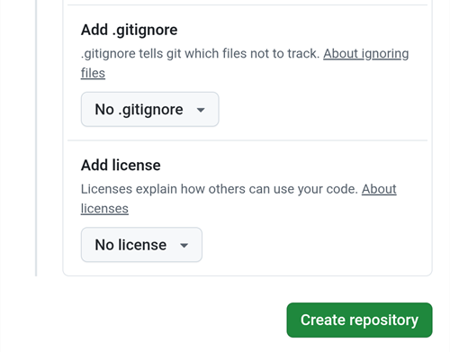

(aaps-builder)=

# Compilação no navegador com o AAPS Builder

```{note}
Esta é a forma recomendada de compilar o AAPS a partir de um **telefone Android**. Também funciona no navegador de qualquer computador. Para as outras formas de compilar a partir de um computador ou de um iPhone, veja a visão geral da [Compilação no navegador](BrowserBuild.md).
```

```{contents} In this page
:backlinks: entry
:depth: 2
```

O **AAPS Builder** compila o app AAPS para você no GitHub, o site gratuito de hospedagem de código. Não há nada para instalar no seu telefone, nem arquivo de preparação para abrir.

A setup page walks you through it. Na primeira vez, leva cerca de 10 minutos:

1. Create your own **private copy** of AAPS Builder in your GitHub account: the setup page opens GitHub with everything filled in, you only confirm. The build workflow, the file that tells GitHub how to build AAPS, is already in it.
2. Create or upload your **signing key** (the keystore).
3. Give the key to your repository as a GitHub **secret**.
4. **Build** the app. One build takes 15 to 30 minutes.
5. **Download and install** the app on your phone.

Você **não** precisa fazer um fork do AndroidAPS: o código-fonte do AAPS é baixado do repositório oficial do AndroidAPS a cada compilação. Você também **não** precisa do Google Drive: você baixa o app diretamente do GitHub.

```{admonition} Where the code comes from
:class: note

The build workflow is maintained by the AAPS developers in the [nightscout/aaps-builder](https://github.com/nightscout/aaps-builder) repository, and your repository is a copy of it. The [workflow](https://github.com/nightscout/aaps-builder/blob/main/.github/workflows/build.yml) in your copy is short: it runs the [build steps](https://github.com/nightscout/aaps-builder/blob/main/.github/workflows/aaps-builder.yml) kept in that repository, so improvements reach you without any change to your repository. You can read both files. Durante a compilação, o workflow baixa apenas o código-fonte oficial do AAPS e as ferramentas de compilação do próprio GitHub. A sua keystore nunca sai do seu navegador e do seu repositório privado.
```

(aaps-builder-before-you-start)=

## Antes de começar

Você vai precisar de:

- Uma **conta GitHub** (grátis). Se você não tem uma, primeiro crie-a em [github.com](https://github.com/signup).
- Um **navegador web**: o Chrome no seu telefone, ou qualquer navegador em um computador. Entre no github.com nesse navegador antes de começar.
- **Tem o app do GitHub no seu telefone?** Você pode mantê-lo. Alguns botões da página de configuração então abrem o app em vez do Chrome. Building works in the app, but the app **cannot download** the finished AAPS: [step 5](#aaps-builder-step5) shows how to switch to Chrome for the download.
- A sua **keystore existente** (arquivo `.jks`), a senha e o alias dela, se você já compilou o AAPS antes e quer atualizá-lo sem reinstalar.

```{warning}
**O seu repositório de compilação deve continuar privado.** Tudo o que uma compilação produz fica visível para qualquer pessoa que possa ver o repositório. A página de configuração cria um repositório privado para você. Never change it to public, and don't **fork** AAPS Builder instead: a fork is always public.

Um repositório privado recebe 2000 minutos grátis de GitHub Actions por mês, o que é suficiente para várias compilações.
```

```{warning}
**Chave nova ou chave existente: isso decide se você pode atualizar o AAPS.**

- **Você já tem o AAPS no seu telefone, compilado com uma keystore que você ainda tem**: escolha **I already have a keystore** (Já tenho uma keystore) na página de configuração e envie-a. A sua próxima compilação vai atualizar o AAPS no lugar. Compilou o AAPS com a compilação no navegador anterior (o seu próprio fork)? A sua keystore está no seu fork: [primeiro pegue uma cópia dela](#aaps-builder-from-fork).
- **Você compila o AAPS pela primeira vez, ou perdeu a sua keystore ou a senha dela**: escolha **Create a new key** (Criar uma nova chave). Um app assinado com uma chave nova **não pode atualizar** um AAPS assinado com outra chave. Você precisa exportar as suas configurações, copiar o arquivo para fora do seu telefone, desinstalar o AAPS antigo, instalar o novo e depois importar as suas configurações: veja [Reinstalar o AAPS com uma nova keystore](#reinstall-aaps).

Depois disso, use sempre a mesma chave. Quando você criar uma chave nova, baixe o backup que a página oferece e guarde-o com a senha e o alias dele (`key0`) em um lugar seguro, fora do seu telefone.
```

(aaps-builder-from-fork)=

## Vindo da compilação no navegador anterior (fork)

Pule esta seção se você nunca compilou o AAPS com o método anterior de compilação no navegador (a sua própria cópia, ou fork, do AndroidAPS no GitHub, com o arquivo de preparação e o Google Drive).

A sua keystore está guardada como secrets no seu fork. O GitHub nunca mostra um secret de novo, então você não pode copiá-lo para o seu novo repositório. Get a copy of your keystore first, then use it in [step 2](#aaps-builder-step2) with **I already have a keystore**.

```{warning}
Não escolha **Create a new key**. Um AAPS compilado com uma chave nova não pode atualizar o AAPS no seu telefone.
```

Qual é o seu caso?

- **Você usou a Opção 2** (você enviou a sua própria keystore do Android Studio) e ainda tem o arquivo `.jks`, as senhas e o alias dele: não há nada a fazer aqui. Use that file in step 2.
- **Você usou a Opção 1** (o arquivo de preparação criou a sua chave), ou não tem mais o arquivo da sua keystore: exporte-a do seu fork como abaixo.

Para exportar a sua keystore do seu fork:

1. No seu fork, abra **Settings** → **Secrets and variables** → **Actions** e adicione um secret chamado `ZIP_PASSWORD`. Escolha uma senha só com letras do alfabeto inglês e números. Ela protege o arquivo que você vai criar.
2. Abra a aba **Actions** do seu fork, toque em **CI Keystore Export** e depois em **Run workflow**. Mais detalhes: [Exportar a sua keystore](#ci-keystore-export).
3. Quando a execução tiver um visto verde, abra o seu Google Drive: o arquivo `keystore.zip` está na pasta **AAPS** → **KeyStore**. Se a execução falhar no passo do Google Drive, o acesso do seu fork ao Google Drive expirou: veja [Refresh token do Google expirado](#aaps-ci-google-token-expired).
4. Baixe o `keystore.zip` e abra-o com a sua `ZIP_PASSWORD`: em um computador, ou no seu telefone com um app gerenciador de arquivos que consiga abrir arquivos ZIP protegidos por senha. Ele contém:
   - `keystore.jks`: a sua keystore,
   - `keyStoreInfo.txt`: a sua `KEYSTORE_PASSWORD`, a `KEY_PASSWORD` e o `ALIAS` (normalmente `key0`).
5. Copie o `keystore.jks` para o seu telefone (ou para o Google Drive, para poder escolhê-lo de lá).

In [step 2](#aaps-builder-step2) of the setup page:

1. Toque em **I already have a keystore**.
2. Em **Keystore file**, escolha `keystore.jks`.
3. Em **Keystore password**, digite a `KEYSTORE_PASSWORD` do `keyStoreInfo.txt`.
4. Em **Key alias**, escolha ou digite o `ALIAS` do `keyStoreInfo.txt`.
5. Se a `KEY_PASSWORD` for diferente da `KEYSTORE_PASSWORD`, desmarque **Key password is the same as the keystore password** e digite a `KEY_PASSWORD`.

Guarde o `keystore.zip` e a `ZIP_PASSWORD` dele em um lugar seguro, fora do seu telefone: ele é o backup da sua chave.

To also save the builds of AAPS Builder in Google Drive, do [step 6](#aaps-builder-google-drive): the setup page gets a new `GDRIVE_OAUTH2` for you. Você pode manter o seu fork até que o AAPS compilado com o AAPS Builder esteja instalado no seu telefone.

## Abra a página de configuração

**→ [Abra a página de configuração do AAPS Builder](#aaps-builder-setup)**

The setup page is part of this documentation, in your language. Keep this page open in another tab as well: the sections below explain each step of the setup page in more detail, with screenshots.

A página de configuração abre cada página do GitHub em uma nova aba do Chrome. Para voltar à página de configuração, toque no botão de abas ao lado da barra de endereço do Chrome (o quadrado com um número) e escolha a página de configuração do AAPS Builder.

A página de configuração funciona inteiramente no seu navegador: a sua chave e as suas senhas nunca são enviadas a lugar nenhum, exceto para o secret do GitHub em que você mesmo as cola. Só o seu nome de usuário do GitHub é enviado ao GitHub, para verificar se ele existe. Ela lembra o seu nome de usuário do GitHub e o nome do repositório, então você pode voltar a ela a qualquer momento para abrir de novo a página de secrets ou as suas compilações.


(aaps-builder-step1)=

## Passo 1 – Crie o seu repositório de compilação privado

This step creates your own private copy of AAPS Builder in your GitHub account, with the build workflow already in it. Só você pode vê-lo, assim como os apps que ele compila.

1. Verifique se você está conectado ao github.com neste navegador.

2. Em **Your GitHub username**, digite o seu nome de usuário do GitHub, não o seu e-mail. A página o verifica no GitHub: **✓ GitHub user found** significa que está certo.

3. Em **Name of your repository**, mantenha a sugestão `my-aaps`. Se você já criou o seu repositório com outro nome, digite exatamente esse nome.

   ```{note}
   **Already have an AAPS Builder repository** (made with an earlier version of the setup page)? Don't create a new one: type its exact name, skip **Create my private repository**, and update its workflow once as explained in [Updating AAPS](#aaps-builder-updates). Your secrets stay as they are. If you want a new repository anyway, choose a name you don't have yet, for example `my-aaps-2`, and use the same keystore in step 2.

   Don't type the name of your fork of AndroidAPS: a fork is public, and it already builds with its own **AAPS CI** workflow.
   ```

   

4. Confira a linha **Your repository:** ela mostra `github.com/<your username>/my-aaps`. The setup page remembers the name from your last visit: check it every time before you use its buttons.

5. Toque em **Create my private repository**.

   

6. GitHub opens **Create a new repository** in a new tab. Everything is already filled in: under **Start with a template**, the template `nightscout/aaps-builder` with **Include all branches** off, and under **General**, your account as **Owner** and the name you chose.

   

   Don't change anything.

7. Scroll down: under **Configuration**, **Choose visibility** is already **Private**. Tap the green **Create repository** button.

   

   GitHub shows your new repository: it contains a folder `.github` (with the build workflow) and a file `README.md`. **Volte para a aba da página de configuração** para o passo 2: toque no botão de abas ao lado da barra de endereço do Chrome e escolha a página de configuração.

```{warning}
**Your new repository is empty**, with no files? It was not created from the template, and it cannot build. Delete it (**Settings** → bottom of the page → **Delete this repository**), then tap **Create my private repository** on the setup page again.
```

(aaps-builder-step2)=

## Step 2 – Your signing key

O app precisa ser assinado com a sua própria chave. Escolha uma das duas abas. Primeiro leia o [aviso sobre chave nova ou chave existente](#aaps-builder-before-you-start).


### I already have a keystore

1. Toque em **I already have a keystore**.
2. Em **Keystore file**, escolha o seu arquivo `.jks` (ou `.keystore`, `.p12`, `.pfx`). Em um telefone, primeiro copie o arquivo para o seu telefone ou para o Google Drive.
3. Em **Keystore password**, digite a senha da keystore.
4. Em **Key alias**, escolha o seu alias na lista, ou digite-o se não houver lista. Para keystores criadas com o Android Studio, normalmente é `key0`.
5. Se a senha da sua chave for diferente da senha da keystore, desmarque **Key password is the same as the keystore password** e digite a senha da chave.
6. Toque em **Check and continue**.

A página verifica a senha e o alias no seu dispositivo. **Keystore OK! Continue with step 3.** means everything is right. Se ela disser que a senha será verificada durante a compilação, continue mesmo assim: a compilação avisa você se algo estiver errado.

### Create a new key

1. Toque em **Create a new key**.

2. Escolha uma senha e digite-a duas vezes. Regras: pelo menos 8 caracteres, apenas as letras a–z e A–Z, os dígitos 0–9 e símbolos como `! ? #`. Sem espaços, sem letras acentuadas e sem o caractere `|`.

3. Toque em **Create key**. Leva alguns segundos até aparecer **Key created**.

   

4. Toque em **Download backup (aaps-keystore.jks)**. Se o Chrome perguntar **Download file again?** (Baixar o arquivo de novo?), um backup mais antigo com o mesmo nome já está no seu telefone: toque em **Download again** (Baixar de novo). O Chrome então salva a nova chave como `aaps-keystore (1).jks`: esse é o arquivo que pertence a esta chave; guarde-o e não o confunda com o mais antigo.

   Guarde estes três itens juntos, em um lugar seguro fora do seu telefone (por exemplo, no seu próprio armazenamento na nuvem):

   - o arquivo `aaps-keystore.jks`,
   - a sua senha,
   - o alias da chave: **`key0`**.

   Você precisa dos três se algum dia compilar o AAPS de outra forma, por exemplo com o Android Studio. Chaves criadas com uma versão anterior da página de configuração têm o alias `aaps`.

   

(aaps-builder-step3)=

## Step 3 – Give the key to your repository

Step 3 unlocks when step 2 is done. A sua chave, as senhas e o alias dela são reunidos em um único valor, o secret `KEYSTORE_SET`.

1. Toque em **Open the secrets page**.


2. O GitHub abre a página **New secret** do seu repositório. Em um telefone, ela fica abaixo do menu de configurações: role para baixo.


3. Mude para a aba da página de configuração e toque em **Copy name**. Volte para a aba do GitHub e cole-o no campo pequeno **Name**. O nome é `KEYSTORE_SET`.

4. Mude para a aba da página de configuração e toque em **Copy secret**. Volte para a aba do GitHub e cole-o na caixa grande **Secret** (em um telefone, toque e segure). O secret é um código muito longo, com milhares de caracteres: a página de configuração mostra os primeiros caracteres dele ao lado do botão. Não cole a palavra `KEYSTORE_SET` ali.

5. Toque em **Add secret**. `KEYSTORE_SET` agora aparece em **Repository secrets**.


Você só precisa fazer isso uma vez.

```{tip}
O GitHub mostra **Page not found** (404)? Primeiro verifique se você entrou no github.com neste navegador: o GitHub mostra 404 para repositórios privados quando você não está conectado. Caso contrário, o nome de usuário ou o nome do repositório no passo 1 não corresponde ao seu repositório. Confira o nome no github.com, corrija-o no passo 1 e toque no botão de novo.
```

(aaps-builder-step4)=

## Step 4 – Build the app

1. Na página de configuração, toque em **Open the build page**. O GitHub abre a página **Build AAPS** do seu repositório.

   

   Se em vez disso abrir o **app do GitHub**: toque em **RUN WORKFLOW**, confira a versão e a variante e toque em **RUN WORKFLOW** de novo. O app ainda pode mostrar **Nothing to see here**: puxe a lista para baixo para atualizá-la e ver a sua compilação. Depois continue com o passo 4 abaixo.

2. If GitHub asks, tap the green button to enable workflows.

   The list of workflows shows two entries: use **Build AAPS**. Ignore **AAPS Builder**: it holds the build steps and has no **Run workflow** button.

3. Toque em **Run workflow**. Um pequeno formulário se abre:
   - **Version**: keep `latest` to build the newest AAPS release, or type a release number such as `4.0.0`.
   - **Variant**: deixe `fullRelease` para o uso normal com uma bomba. As outras variantes são explicadas em [variantes de compilação](#browserbuild-variant). `aapsclient3Release` compila o **AAPSClient3**, disponível a partir da versão 4.0 do **AAPS** (veja [Sobre o AAPSClient, AAPSClient2 e AAPSClient3](#remotecontrol-aapsclient-versions)).
   - Toque no botão verde **Run workflow**.

   

4. A compilação começa e mostra **In progress** (em andamento), com duas partes: **AAPS / Check** e depois **AAPS / Build AAPS**.

   

5. Aguarde de 15 a 30 minutos. Um visto verde significa que a compilação terminou. Um X vermelho significa que ela falhou: abra a compilação para ler a mensagem e depois veja [resolução de problemas](#aaps-builder-troubleshooting).

   

   ```{tip}
   **E-mail quando uma compilação terminar:** o GitHub só envia e-mail quando uma compilação falha. Para receber um e-mail também quando ela der certo: no github.com, abra a sua foto de perfil → **Settings** → **Notifications** → **System** → **Actions** e desmarque **Only notify for failed workflows**.
   ```

Se não houver o botão **Build AAPS** ou **Run workflow**:

- Open your repository and check that it has a folder `.github` with the file `workflows/build.yml`. If the repository is empty, it was not created from the template: delete it (**Settings** → bottom of the page → **Delete this repository**) and do [step 1](#aaps-builder-step1) again with the button.
- Abra a aba **Actions**. Se aparecer que os workflows estão desativados, toque no botão verde para ativá-los e depois toque em **Build AAPS** na lista.

(aaps-builder-step5)=

## Step 5 – Install the app on your phone

```{warning}
**Antes de cada atualização**, [exporte as suas configurações](#ExportImportSettings-Automating-Settings-Export) no AAPS e copie o arquivo **para fora do telefone** (Google Drive, Dropbox…). Guarde lá também várias exportações mais antigas e os arquivos APK, para que você sempre possa voltar atrás.
```

1. No seu telefone, abra a página de configuração no **Chrome**. Entre no github.com se for pedido.
2. Toque em **Open my builds** e depois na compilação mais recente com um visto verde.

   ```{admonition} The GitHub app opened instead of Chrome?
   :class: note

   O app do GitHub não consegue baixar compilações. No app, abra a compilação mais recente e toque em **Artifacts ↗**, ou toque no ícone de compartilhar no topo e escolha **Chrome** (ou **Copy link** e depois cole o link na barra de endereço do Chrome). A compilação abre no Chrome: continue lá com o próximo passo.

   Para que os links do GitHub não abram mais no app: no Android, **Settings** (Configurações) → **Apps** (Apps) → **GitHub** → **Open by default** (Abrir por padrão) → desative **Open supported links** (Abrir links compatíveis).
   ```

   

3. Role para baixo até o resumo da compilação e toque no link **Download AAPS**.

   

   ```{tip}
   Role com o dedo sobre o texto, não sobre o diagrama dos passos da compilação: senão o diagrama se move em vez da página.
   ```

   Você também pode rolar mais para baixo até **Artifacts** e tocar no ícone de download ao lado de `aaps-….apk`.

   

4. Quando o download terminar, abra o menu do Chrome **⋮** → **Downloads**, toque em `aaps-….apk` e escolha **Install** (Instalar). Se for pedido, permita a instalação de apps desta fonte.

   

`aaps-wear-….apk` é o app para o smartwatch. Ignore-o se você não usa um.

O app fica guardado na página da compilação por **14 dias**. Ele não aparece em **Code** no seu repositório. Copie-o para um lugar seguro, fora do seu telefone, junto com as exportações das suas configurações.

Para mais formas de instalar o app, veja [Transferir e instalar o AAPS](TransferringAndInstallingAaps.md).

```{note}
A partir de setembro de 2026, a [Verificação de desenvolvedor do Android](#android-developer-verification) do Google pode bloquear a instalação do APK ao tocar no arquivo, dependendo do seu país. Soluções gratuitas são explicadas nessa página.
```

(aaps-builder-google-drive)=

## Step 6 (optional) – Also save the app in Google Drive

Você também pode fazer com que cada compilação seja salva no seu Google Drive, na pasta `AAPS/<version>`. Isso é opcional: o app está sempre disponível na página da compilação.

Para isso é necessário mais um secret, o `GDRIVE_OAUTH2`. Step 6 of the setup page gets it from Google for you, on a phone or a computer. **AAPS** can then only see and change the files it creates in your Google Drive, nothing else.

1. On the setup page, tap **Connect Google Drive**. Google opens in a new tab.
2. Choose your Google account and allow access. If Google says the app is not verified, tap **Advanced**, then **Go to …**.
3. The new tab then shows an error such as **This site can't be reached** or **127.0.0.1 refused to connect**. **This is expected:** Google's answer is in the address of that tab. Tap the address bar, select the whole address (it starts with `http://127.0.0.1:47913/`) and copy it.
4. Go back to the setup page tab within a few minutes: Google's answer is only valid for a short time, and only once. Paste the address into **Paste the copied address here** and tap **Get GDRIVE_OAUTH2**. The page shows **GDRIVE_OAUTH2 is ready**.
5. Toque em **Open the secrets page**. Toque em **Copy name** e depois cole-o no campo pequeno **Name** (o nome é `GDRIVE_OAUTH2`). Tap **Copy secret**, paste it into the big **Secret** box and tap **Add secret**.

A partir da próxima compilação, os APKs também são salvos no Google Drive.

Already have a `GDRIVE_OAUTH2` value from the preparation file of the other browser build methods? It works too: add it as the `GDRIVE_OAUTH2` secret.

O Google encerra o acesso se você não compilar por 6 meses, ou se você mudar a sua senha do Google. Nesse caso, a compilação avisa você: refaça estes passos. Veja [Refresh token do Google expirado](#aaps-ci-google-token-expired).

(aaps-builder-updates)=

## Atualizando o AAPS

O seu repositório nunca compila nada sozinho: você decide quando compilar, qual versão e qual variante. Quando uma nova versão do AAPS for lançada:

1. [Back up your settings](#aaps-builder-step5) as explained in step 5.
2. Build the new version as in [step 4](#aaps-builder-step4). Deixe `latest`, ou digite o número da versão.
3. Download and install it as in [step 5](#aaps-builder-step5).

**Updates of the build steps** reach you by themselves: at every build, your repository runs the build steps released by the AAPS developers in nightscout/aaps-builder. Nothing changes in your repository, and there is no automatic build.

**Updates of your workflow file** are rare: only when the **Run workflow** form changes, for example for a new build variant, or once if your repository was made with an earlier version of the setup page (an empty repository with a short workflow file) or from the old template. The [Docs updates & changes](../Maintenance/DocumentationUpdate.md) page says so. Your `KEYSTORE_SET` secret stays as it is. On the setup page, open **Updating your copy** at the end of step 1:

1. Tap **Open the newest workflow**. On a computer, click the **copy icon** ("Copy raw file") at the top right of the file. On a phone, open the **plain-text version** instead, press and hold the text, then **Select all** and **Copy**.
2. Tap **Open my workflow file**.
3. Replace the whole text with the copied workflow (long press on a phone: **Select all**, then **Paste**).
4. Tap **Commit changes…**, then **Commit changes**.

The first line of the file shows its version.

(aaps-builder-troubleshooting)=

## Resolução de problemas

To see why a build failed, [read the build log](#aaps-ci-read-the-logs): the step names are different, but you find the error the same way. You can also [update a secret](#aaps-ci-update-secret) and [run the build again](#aaps-ci-rerun) the same way.

- **No "Build AAPS" or "Run workflow" button, or the repository is empty**: the repository was not created from the template. Delete it (**Settings** → bottom of the page → **Delete this repository**) and do [step 1](#aaps-builder-step1) again with the **Create my private repository** button.
- **A compilação para com "This repository is PUBLIC"**: no seu repositório, abra **Settings** → **General** → **Danger Zone** → **Change visibility** → **Private** e depois compile de novo.
- **"Secret KEYSTORE_SET is missing"**: do step 3 of the setup page.
- **"The secret is too short"**, **"The secret is not a valid code"** ou **"The secret does not contain a keystore"**: o texto errado foi colado no secret, muitas vezes a própria palavra `KEYSTORE_SET`, ou só uma parte do código. In your repository, open **Settings** → **Secrets and variables** → **Actions**, edit `KEYSTORE_SET` and paste the long code from **Copy secret** again (redo step 2 of the setup page first if you closed it).
- **"Keystore, password or alias is wrong"**: check your keystore's password and alias, then redo steps 2 and 3 of the setup page.
- **"Version … does not exist"**: a versão que você digitou não é uma versão lançada do AAPS. Use `latest`, ou confira o número da versão.
- **"Variant … is not supported"**: your workflow file is an older version. Replace it as explained in [Updating AAPS](#aaps-builder-updates).
- **"Page not found" (404) quando a página de configuração abre o GitHub**: entre no github.com no mesmo navegador (o GitHub mostra 404 para repositórios privados quando você não está conectado). Se você estiver conectado, o nome de usuário ou o nome do repositório no passo 1 da página de configuração não corresponde ao seu repositório. Digite os nomes exatos.
- **"No GitHub user with this name"** no passo 1: digite o seu nome de usuário do GitHub, como aparece no seu perfil do GitHub, não o seu e-mail.
- **Não há link Download, ou o app do GitHub abriu**: o app do GitHub não consegue baixar compilações. Open the build in Chrome as explained in [step 5](#aaps-builder-step5). Para que os links do GitHub não abram mais no app: no Android, **Settings** (Configurações) → **Apps** (Apps) → **GitHub** → **Open by default** (Abrir por padrão) → desative **Open supported links** (Abrir links compatíveis).
- **"Google Drive access has expired or was revoked"**: redo [step 6](#aaps-builder-google-drive) and update the `GDRIVE_OAUTH2` secret.

For other GitHub and Google Drive issues, see [Browser build troubleshooting](../GettingHelp/BrowserBuildTroubleshooting.md).

```{toctree}
:hidden:

AAPS Builder setup page <BrowserBuildAapsBuilderSetup.md>
```
