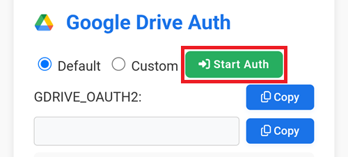
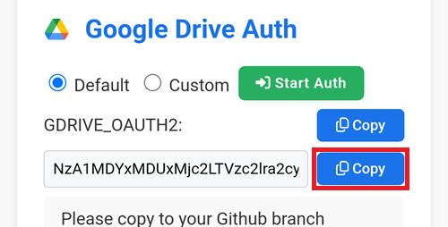

(aaps-ci-google-drive-auth)=

# Compilação no navegador – Etapa 3: Autorize o Google Drive

```{note}
Esta é a **Etapa 3** da [Compilação no navegador](BrowserBuild.md). Primeiro conclua a [Etapa 2 – Crie a sua keystore de assinatura](BrowserBuildKeystore.md).
```

```{warning}
Não importa quais das instruções anteriores você seguiu (Opção 1 ou Opção 2): você PRECISA adicionar a autorização do Google Drive para usar a compilação no navegador com sucesso.
```

Observação: se você já fez esta parte no vídeo, agora pode pular para a [Etapa 4 – Compile o APK](BrowserBuildAPK.md).

```{warning}
Se a autorização do Google não começar ou a página de preparação falhar, feche a página de preparação, abra `aaps-ci-preparation.html` de novo da mesma forma que na Etapa 2 e comece esta etapa de novo. Veja a [resolução de problemas](#aaps-ci-preparation-web).
```

Volte para a aba da página de preparação.

Role para baixo até a seção Google Drive Auth e toque em Start Auth.



Selecione a sua conta Google.


Role para baixo e aceite o acesso. A página web precisa dele para obter a chave de autenticação do Google Drive.

Toque em Continue (Continuar).


O campo `GDRIVE_OAUTH2` será preenchido: toque no botão Copy de cima.


Volte para a aba do GitHub.

Role para baixo até Repository secrets e toque em New repository secret.

Se você seguiu a Opção 1, deve ver isto:


Se você seguiu a Opção 2, haverá mais chaves:


No campo Name, cole o texto que você acabou de copiar. Toque e segure na caixa de texto para mostrar o menu de colar.


Mude para a aba da página de preparação.

Toque no segundo botão Copy.



Volte para a aba do GitHub.

1. No campo Secret, cole o texto que você acabou de copiar. Toque e segure na caixa de texto para mostrar o menu de colar.

2. Toque em Add secret.


Agora você deve ter duas (Opção 1) ou cinco (Opção 2) entradas de secrets.


Depois da compilação, o GitHub poderá salvar o arquivo apk do AAPS no seu Google Drive.

----

**Próxima etapa: [Etapa 4 – Compile o APK](BrowserBuildAPK.md) →**
