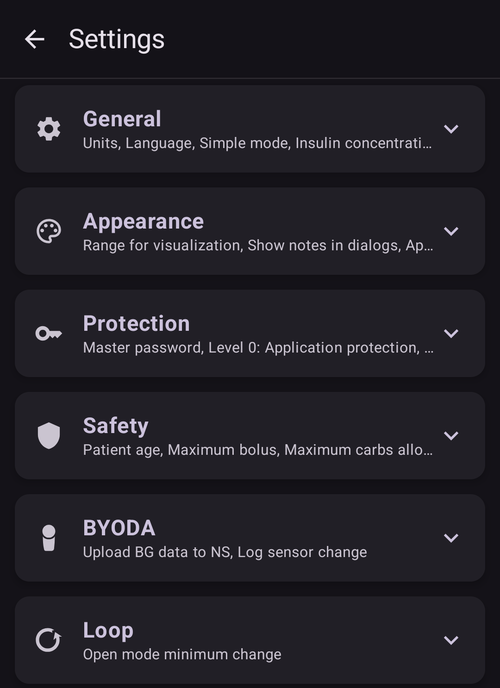

# Alterar a configuração do AAPS

Depois de concluir o **[Assistente de configuração do AAPS](../SettingUpAaps/SetupWizard.md)**, você não precisa executar todo o assistente de novo se quiser alterar apenas partes da configuração do **AAPS**.

Há três caminhos para alterar a configuração do **AAPS**. Qual caminho você usa é apenas uma questão de praticidade ou de preferência pessoal, pois todos levam às mesmas configurações.

These are as follows:

1. A tela **Configuração**,
2. A tela **Configurações** ou
3. As **Configurações** de um plugin, abertas a partir da categoria dele em **Configuração**.

Here we explain which option is most convenient for each situation:

## Configuração

Abra o **menu** (☰) no canto superior esquerdo da tela principal e escolha **Configuração**:

A **Configuração** é usada para **escolher quais plugins estão ativos**: o seu CGM, a bomba, o algoritmo APS, a detecção de sensibilidade, a sincronização e mais, agrupados por categoria. É a mesma tela que o Assistente de Configuração configurou para você.

A documentação da tela Configuração está disponível [aqui](../SettingUpAaps/ConfigBuilder.md).

## Configurações

Toque no ícone **Configurações** (engrenagem) no canto superior direito da tela principal. Isso abre as configurações de **todos os plugins ativados em um só lugar**, agrupadas em seções que podem ser expandidas:

Este é um bom caminho se você não tem certeza de onde procurar uma opção de configuração, mas pode ser um pouco cansativo se você sabe que quer alterar a configuração de apenas um plugin.

A documentação das configurações está disponível [aqui](../SettingUpAaps/Preferences.md).

## As Configurações de um plugin

Em **Configuração**, abra uma categoria e toque em "**Configurações**" abaixo do plugin ativo. Você vai direto para as configurações **apenas desse plugin**:

Por exemplo, este é um bom caminho se você sabe que quer alterar a configuração da sua bomba: abra **Configuração → Bomba** e depois toque em "**Configurações**" abaixo da bomba selecionada.

Este é um "atalho" para as mesmas configurações mostradas na tela geral **Configurações**.
