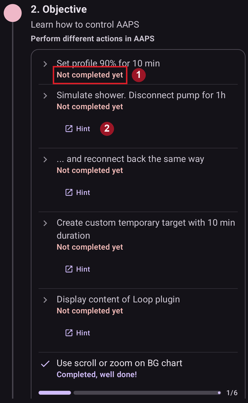
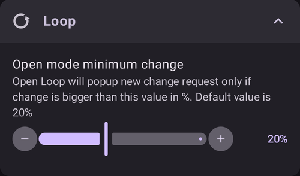
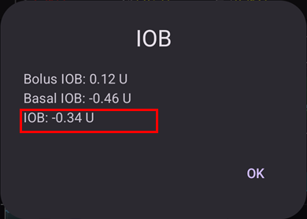
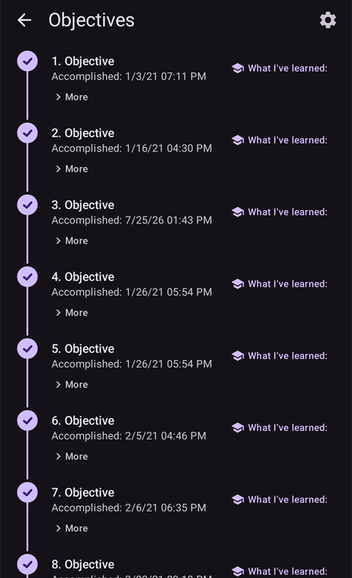
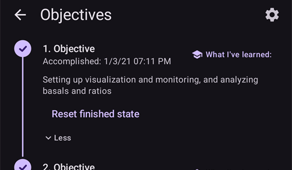
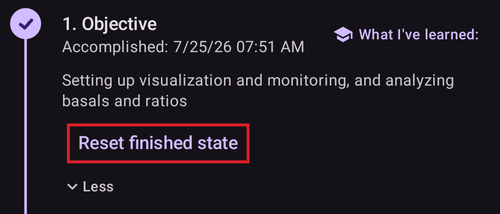

# Completar os objetivos

O **AAPS** tem uma série de **Objetivos** que devem ser concluídos para ajudar o usuário a avançar do loop aberto básico até o loop fechado híbrido e todas as funções do **AAPS**. Concluir os **Objetivos** serve para garantir que você:

* Configurou tudo corretamente no seu **AAPS**;
* Aprendeu os recursos essenciais do **AAPS**; e
* Tem uma compreensão básica do que o seu sistema pode fazer, para ajudar a ter confiança ao usar o **AAPS**.

Quando o **AAPS** é instalado pela primeira vez, cada objetivo deve ser concluído antes de passar para o próximo. Novos recursos são liberados aos poucos, à medida que você avança em cada **Objetivo**.

Os **Objetivos 1 a 8** guiam você desde a configuração do **AAPS** no seu smartphone até o loop fechado híbrido “básico”. Isso leva cerca de 6 semanas. Você pode avançar até o **Objetivo 5** usando uma bomba virtual (e usando outro método de administração de insulina enquanto isso). Os **Objetivos 9 e 10** foram feitos para testar recursos mais avançados do **AAPS**, com o objetivo de controlar melhor o seu diabetes, e levam até 3 meses para concluir, talvez mais. Mais detalhes sobre uma estimativa do tempo de cada parte estão aqui: [Quanto tempo vai levar?](#preparing-how-long-will-it-take)

As well as progressing through the **Objectives**, if required, you can also remove your progress and [go back to an earlier objective](#CompletingTheObjectives-go-back-in-objectives).

## Faça backup das suas configurações

```{admonition} Note
:class: note

É recomendado exportar as configurações do **AAPS** depois de concluir cada **Objetivo**!
```

É muito recomendado [exportar as suas configurações](../Maintenance/ExportImportSettings.md) depois de concluir cada objetivo, para não perder o progresso feito no **AAPS**. Essa exportação cria um **arquivo de configurações** (.json), que deve ser guardado como backup em um ou mais lugares seguros (por exemplo Google Drive, disco rígido, anexo de e-mail _etc._). Isso garante que todo o progresso feito no **AAPS** fique salvo. Se você perder o telefone ou apagar o seu progresso sem querer, o arquivo json pode ser carregado de novo no **AAPS** importando um arquivo de configurações recente. Ter um **arquivo de configurações** de backup também é necessário se você precisar de um novo smartphone para o **AAPS** por qualquer motivo (troca de aparelho, telefone perdido ou quebrado _etc._)

O arquivo de **configurações** salva não só o seu progresso nos **Objetivos**, mas também todas as suas configurações do **AAPS**, como o **bólus máximo** _etc._

Os **Objetivos** terão de ser refeitos desde o início se você não tiver um backup das suas configurações e algo acontecer com o seu smartphone do **AAPS**. Avançar nos **Objetivos** leva tempo, e ter de concluí-los de novo porque, por exemplo, você perdeu o smartphone, é uma situação que é melhor evitar.

(objectives-objective1)=
## Objetivo 1: Configurar a visualização e o monitoramento, analisar basais e relações

O **Objetivo 1** pede que o usuário faça a configuração técnica básica no **AAPS**. Não é possível avançar enquanto esta etapa não for concluída.

- Selecione o CGM/FGM correto em [Configuração → Fonte de BG](#Config-Builder-bg-source). Veja [Fonte de BG](../Getting-Started/CompatiblesCgms.md) para mais informações.
- Selecione a bomba correta em [Configuração → Bomba](#Config-Builder-pump) para garantir que a sua bomba possa se comunicar com o **AAPS**. Selecione **bomba virtual** se você usa um modelo de bomba sem driver do **AAPS** para loop, ou se quer passar pelos primeiros **Objetivos** enquanto usa outro sistema para administrar insulina. Veja [bomba de insulina](../Getting-Started/CompatiblePumps.md) para mais informações.
- Se você usa o Nightscout:
  - Siga as instruções da página [Nightscout](../SettingUpAaps/Nightscout.md) para garantir que o **Nightscout** possa receber e mostrar os dados do **AAPS**.
  - Observe que a URL no **NSClientV3** deve estar **_sem_ "/api/v1/"** no final - veja [Configurações → NSClientV3](#Preferences-nsclient).
- Se você usa o Tidepool:
  - Siga as instruções da página [Tidepool](../SettingUpAaps/Tidepool.md) para garantir que o **Tidepool** possa receber e mostrar os dados do **AAPS**.

Observação: *Talvez você precise esperar a próxima leitura de glicose do sensor chegar antes que o **AAPS** a reconheça.*

(objectives-objective2)=
## Objetivo 2: Aprenda como controlar o AAPS

O **Objetivo 2** pede que várias ‘tarefas’ sejam feitas, como mostra a captura de tela abaixo. Cada tarefa mostra o seu status (**1**): o texto laranja "**Incompleto**" muda para "**Terminado, parabéns!**" assim que o **AAPS** registra a ação. Toque em **Dica** (**2**) abaixo de uma tarefa para abrir a documentação relacionada, caso você ainda não conheça uma ação.



As tarefas para concluir o **Objetivo 2** são:
- Defina o seu **Perfil** como 90% por 10 min.
  - _Dica_: toque no nome do seu perfil na tela principal para abrir a tela **Perfil**, depois use o botão **Ativar** (▶) e defina a porcentagem e a duração. Mais informações em [Troca de perfil e porcentagem do perfil](../DailyLifeWithAaps/ProfileSwitch-ProfilePercentage.md).
  - _Observação_: o **AAPS** não aceita taxas basais abaixo de 0,05 U/h. Se o seu **Perfil** tem taxas de 0,05 U/h ou menos, você precisa criar um **Perfil** temporário com taxas basais mais altas antes de concluir esta tarefa. Volte ao seu **Perfil** normal depois de concluir esta tarefa.
- Simule "tomar um banho" [desconectando a sua bomba](#AapsScreens-loop-status) no **AAPS** por 1 h.
  - _Dica_: toque no ícone do loop na tela principal para abrir o diálogo do Loop e escolha uma duração em **Desconectar bomba**.
- Termine o "banho" reconectando a sua bomba.
  - _Dica_: toque no ícone "desconectado" para abrir de novo o diálogo do loop e escolha **Reconectar Bomba**.
- Defina um [**Alvo temporário**](../DailyLifeWithAaps/TempTargets.md) personalizado com duração de 10 min.
  - _Dica_: toque na faixa-alvo na tela principal para abrir a tela de alvo temporário.
- Mostre o conteúdo do plugin **Loop**.
  - _Dica_: abra **Configuração → Loop** e toque em "**Abrir plugin**".
- Use a rolagem ou o zoom no gráfico de glicose para ver períodos de tempo maiores ou menores.


(objectives-objective3)=
## Objetivo 3: Prove seu conhecimento

O **Objetivo 3** pede que o usuário passe em uma prova de múltipla escolha, feita para testar o seu conhecimento do **AAPS**.

Alguns usuários acham o **Objetivo 3** o mais difícil de concluir. Leia a documentação do **AAPS** junto com as perguntas. Se você realmente não souber a resposta depois de pesquisar na documentação do **AAPS**, pesquise "Objective 3" no grupo do [Facebook](https://www.facebook.com/groups/AndroidAPSUsers) ou do [Discord](https://discord.gg/4fQUWHZ4Mw) (porque é provável que a sua pergunta já tenha sido feita antes e respondida pelo grupo). Esses grupos podem dar dicas amigáveis ou indicar a parte certa da documentação do **AAPS**.

Enquanto isso:
- Para reduzir o número de notificações / decisões que você precisa tomar (taxas basais temporárias) no loop aberto, defina uma faixa-alvo ampla no seu **Perfil**, _por exemplo_ 90–150 mg/dl ou 5,0–8,5 mmol/l.
- Talvez você queira definir um limite superior mais largo, ou até desativar o loop aberto, à noite.

Para fazer o **Objetivo 3**, toque na linha de uma pergunta para abri-la. Leia cada pergunta com atenção e selecione a(s) sua(s) resposta(s).

Cada pergunta pode ter mais de uma resposta correta! Se você selecionar uma resposta errada, a pergunta fica bloqueada por 1 hora antes que você possa voltar e responder de novo. Atenção: a ordem das respostas pode mudar na próxima tentativa. Isso garante que você leia cada resposta com atenção e entenda de verdade se ela está certa ou não.

```{admonition} __What happens if new question(s) are added to an Objective when I update to a newer version of AAPS?__
:class: note
De tempos em tempos, novos recursos são adicionados ao **AAPS**, o que pode exigir uma nova pergunta nos **Objetivos**, especialmente no **Objetivo 3**. Por isso, qualquer nova pergunta adicionada ao **Objetivo 3** vai aparecer como “incompleta”, porque o **AAPS** vai pedir que você a responda. Não se preocupe: como cada **Objetivo** é independente, você **não vai perder as funções do AAPS que já tem**, desde que os outros **Objetivos** continuem concluídos.
```

## Objetivo 4: Iniciando em um loop aberto

O propósito do **Objetivo 4** é perceber com que frequência o **AAPS** avalia a taxa basal do usuário em relação à glicose e recomenda ajustes da taxa basal temporária. Neste **Objetivo**, você vai ativar o loop aberto pela primeira vez e aceitar 20 alterações propostas da taxa basal temporária e, se necessário, aplicá-las manualmente na sua bomba. Você também vai observar o efeito dos [**Alvos temporários**](../DailyLifeWithAaps/TempTargets.md). Se você ainda não sabe definir uma taxa basal temporária no **AAPS**, veja as ações da bomba no painel **Gerenciar** ([Para onde foi a aba Ações?](#screens-action-tab)).

Tempo mínimo para concluir este objetivo: **7 dias**. Este é um tempo de espera obrigatório. Não é possível passar para o próximo **Objetivo** antes disso, mesmo que todas as alterações da taxa basal já tenham sido executadas.

- Selecione o loop aberto tocando no [ícone do Loop](#AapsScreens-loop-status) na tela principal e escolhendo **Loop Aberto** como modo de operação.
- Execute manualmente pelo menos 20 das sugestões de taxa basal temporária durante 7 dias: digite-as na sua bomba (física) e confirme no AAPS que você as aceitou. Verifique se esses ajustes da taxa basal aparecem no **AAPS** e no **Nightscout**.
- Use [**Alvos temporários**](../DailyLifeWithAaps/TempTargets.md) quando necessário. Depois de tratar uma hipoglicemia, use o "Alvo Temporário para hipoglicemia" predefinido para evitar que o sistema corrija demais quando a glicose voltar a subir.
- Se você ainda estiver no [Modo simples](#preferences-simple-mode) neste ponto, agora provavelmente é um bom momento para desativá-lo.

To reduce the number of proposed basal rate changes while in Open Loop, you can still use the tips described in [**Objective 3**](#objectives-objective3). Além disso, você pode alterar a porcentagem mínima das alterações recomendadas da taxa basal com a configuração "**Alteração mínima no modo aberto**" em **Configurações → Loop**. Quanto maior o valor, menos notificações de alteração você vai receber.



```{admonition} Note
:class: note

Você não precisa executar todas as recomendações do sistema!
```
(objectives-objective5)=
## Objetivo 5: Entender o seu loop aberto, incluindo as recomendações de basal temporária

No **Objetivo 5**, você vai começar a entender como as recomendações de basal temporária são calculadas. Isso inclui a [lógica de decisão da basal](#aaps-screens-how-predictions-become-a-dosing-decision), analisar o efeito observando as [linhas de previsão na **Visão geral do AAPS**](#aaps-screens-prediction-lines) (ou no Nightscout) e ver os cálculos detalhados mostrados na tela do plugin **SMB OpenAPS** (**Configuração → APS → Abrir plugin**).

Tempo estimado para concluir este objetivo: **7 dias**.

Este **Objetivo** pede que você determine e defina o valor da “Taxa basal máxima” (max-basal), como descrito em [Recursos do OpenAPS](#Open-APS-features-max-u-h-a-temp-basal-can-be-set-to). Esse valor pode ser definido em [Configurações → SMB OpenAPS](#Preferences-openaps-smb-settings). No [Modo simples](#preferences-simple-mode), o **AAPS** define esse valor automaticamente e você não precisa alterá-lo. Se você ainda usa uma bomba virtual, verifique se esta configuração de segurança está definida tanto no **AAPS** quanto na sua bomba de insulina.

Talvez você queira definir o [alvo de glicose do seu **Perfil**](#profile-glucose-targets) mais alto do que o normal até se sentir seguro com os cálculos e as configurações do **AAPS**. Talvez você queira experimentar ajustar o **alvo de glicose** do seu **Perfil** para uma faixa mais estreita (por exemplo, 1 mmol/l [20 mg/dl] de largura ou menos) e observar o comportamento resultante.


```{admonition} If you have been using a virtual pump, change to a real insulin pump now!
:class: note

Se você está usando o loop aberto com uma bomba virtual, **pare aqui**. Só toque em **Verificar** no final deste **Objetivo** depois de passar a usar uma bomba "real", que administra insulina.

```


(objectives-objective6)=
## Objetivo 6: Começar a fechar o loop com Suspensão por glicose baixa


```{admonition} Closed loop will not correct high **BG** values in **Objective 6** as it is limited to **Low Glucose Suspend** only!
:class: note
Você ainda vai precisar corrigir as glicoses altas por conta própria (manualmente, com correções pela bomba ou pela caneta)!
```

No **Objetivo 6**, você vai fechar o loop e ativar o modo **Suspensão por glicose baixa** (LGS), com o [max IOB](#Open-APS-features-maximum-total-iob-openaps-cant-go-over) definido como zero. Você precisa ficar no modo LGS por 5 dias para concluir este **objetivo**. Use esse tempo para verificar se as configurações do seu **Perfil** estão corretas e se os eventos de LGS não acontecem com muita frequência.

Tempo mínimo para concluir este objetivo: **5 dias**. Este é um tempo de espera obrigatório. Você não pode passar para o próximo **Objetivo** antes de terminar esse tempo.

É muito importante que o seu **Perfil** atual (basal, ISF, IC) tenha sido bem testado antes de fechar o loop no modo **LGS**. Configurações erradas do **Perfil** podem levar você a hipoglicemias que precisam ser tratadas manualmente. Um **Perfil** correto ajuda a reduzir a necessidade de tratar glicose baixa durante o período de 5 dias.

**Se você ainda tiver episódios frequentes ou graves de glicose baixa, considere ajustar o [DIA do seu tipo de insulina](#Config-Builder-insulin-dia), a basal, o ISF e as relações de carboidratos.** Consulte o grupo do [Facebook](https://www.facebook.com/groups/AndroidAPSUsers) ou do [Discord](https://discord.gg/4fQUWHZ4Mw), onde há muita discussão sobre isso.


Durante o **Objetivo 6**, o **AAPS** vai substituir a configuração de maxIOB por zero. **Essa substituição termina quando você passa para o Objetivo 7.**

Isso significa que, no **Objetivo 6**, se a glicose do sensor estiver caindo, o **AAPS** vai reduzir a sua insulina basal para você. Mas, se a glicose do sensor estiver subindo, o **AAPS** só vai aumentar a taxa basal acima do valor do seu **Perfil** se o **IOB basal** estiver negativo por causa de uma **LGS** anterior. Caso contrário, o **AAPS** não vai aumentar a basal acima do valor atual do seu perfil, mesmo que a glicose esteja subindo. Essa cautela serve para evitar hipoglicemias enquanto você aprende a usar o **AAPS**.

**Por isso, você precisa tratar glicoses altas com bólus de correção manuais.**

- Se o seu IOB estiver negativo (veja a captura de tela abaixo), uma taxa basal temporária (TBR) > 100% pode ser acionada no **Objetivo 6**.



- Defina a sua faixa-alvo um pouco mais alta do que você normalmente usaria, só por segurança e para ter uma margem de segurança.
- Ative o modo 'Suspensão por glicose baixa' tocando no ícone do Loop na tela principal e escolhendo **Suspensão por glicose baixa** como modo de operação.
- Acompanhe as basais temporárias ativas pelo texto turquesa da basal na tela de Visão geral ou pela basal turquesa desenhada no gráfico da Visão geral.
- Depois de tratar uma hipoglicemia, você pode ter picos temporários, porque a basal não pode ser aumentada quando a glicose volta a subir.

(objectives-objective7)=
## Objetivo 7: Ajustar o loop fechado, aumentar o maxIOB acima de 0 e reduzir aos poucos os alvos de glicose

Para concluir o **Objetivo 7**, você precisa fechar o loop e aumentar o seu [maxIOB](#Open-APS-features-maximum-total-iob-openaps-cant-go-over). O **maxIOB** foi zerado automaticamente no **Objetivo 6**, por causa do modo Suspensão por glicose baixa. Isso não acontece mais. O **AAPS** vai começar a usar o valor de maxIOB que você definiu para corrigir glicoses altas. No [Modo simples](#preferences-simple-mode), o **AAPS** define o maxIOB automaticamente e você não precisa alterá-lo.

Tempo mínimo para concluir este objetivo: **1 dia**. Este é um tempo de espera obrigatório. Não é possível passar para o próximo **Objetivo** antes de terminar esse período.

- Selecione **Loop Fechado** tocando no [ícone do Loop](#AapsScreens-loop-status) na tela principal e escolhendo **Loop Fechado** como modo de operação. Fique em **Loop Fechado** por um período de 1 dia.

- Aumente devagar o seu 'Max IOB para SMB' (no OpenAPS chamado 'max-iob') acima de 0, até encontrar as configurações que funcionam melhor para você.

A recomendação padrão para esta configuração é “**bólus médio de refeição + 3x a basal diária máxima**”, em que “basal diária máxima” é o maior valor por hora em qualquer período do dia.


Veja esta recomendação como um ponto de partida. Se você usar esta regra, mas o AAPS administrar insulina demais quando a glicose sobe, talvez você precise:
* reduzir o valor de "Max IOB para SMB";
* revise as configurações do seu **Perfil**, fazendo apenas um ajuste de cada vez.

Ou, se você for muito resistente à insulina, aumente o valor de **maxIOB** com muito cuidado.

Quando tiver confiança de quanto **maxIOB** combina com o seu padrão de loop, reduza os seus **alvos de glicose** até o nível desejado.

(objectives-objective8)=
## Objetivo 8: Ajustar as basais e as relações, se necessário, e depois ativar o Autosens

Neste **objetivo**, você vai rever o desempenho do seu **Perfil** e usar a função [Autosens](#Open-APS-features-autosens) como indicador de configurações erradas.

Tempo mínimo para concluir este objetivo: **7 dias**. Este é um tempo de espera obrigatório. Não é possível passar para o próximo **Objetivo** antes de terminar esse período.

Ative o [Autosens](../DailyLifeWithAaps/KeyAapsFeatures.md) por um período de 7 dias (no [Modo simples](#preferences-simple-mode) ele já vem ativado) e observe a [linha branca do gráfico na **Visão geral**](#AapsScreens-section-g-additional-graphs), que mostra a sua sensibilidade à insulina subindo ou caindo por causa de exercícios, hormônios etc. Acompanhe a tela do plugin **SMB OpenAPS** (**Configuração → APS → Abrir plugin**), que mostra o **AAPS** ajustando a sensibilidade, as basais e os alvos conforme necessário.

Este é um bom momento para rever as suas configurações de [Detecção de sensibilidade](#Config-Builder-sensitivity-detection). Você pode ver a sua sensibilidade na tela principal em um [gráfico adicional](#AapsScreens-section-g-additional-graphs).

Além disso, você pode usar o [Autotune](#autotune-how-autotune-calculates-adjustments) uma única vez para verificar se as suas basais continuam corretas, ou fazer um teste de basal tradicional.

(objectives-objective9)=
## Objetivo 9: Ativar recursos adicionais do oref1 para uso durante o dia, como o super micro bólus (SMB)

No **Objetivo 9**, você vai conhecer e usar o **"Super Micro Bólus (SMB)"** como uma função principal. Depois de fazer as leituras obrigatórias, você vai entender bem o que são os SMBs, como eles funcionam e por que a basal é zerada temporariamente depois que os SMBs são dados (zero-temping).

Tempo mínimo para concluir este objetivo: **28 dias**. Este é um tempo de espera obrigatório. Você não pode passar para o próximo Objetivo antes de terminar esse tempo.

- A [seção sobre SMB nesta documentação](#Open-APS-features-super-micro-bolus-smb) e a [explicação do oref1 na documentação do openAPS](https://openaps.readthedocs.io/en/latest/docs/Customize-Iterate/oref1.html) são leitura obrigatória para entender o **SMB** e o conceito de **basal temporária zero** (zero-temping).
- Depois disso, você pode [aumentar o maxIOB](#Open-APS-features-maximum-total-iob-openaps-cant-go-over) para que os **SMBs** funcionem melhor. O maxIOB agora inclui todo o **IOB**, não só a basal acumulada. Esse limite pausa os **SMBs** até o IOB cair abaixo desse valor (_por exemplo_, o **maxIOB** está definido como 7 U e um bólus de 8 U é dado para cobrir uma refeição: os SMBs ficam pausados e não são dados, a não ser que o **IOB** caia abaixo de 7 U). Um bom começo é definir **maxIOB** = **bólus médio de refeição + 3x a basal diária máxima**, em que "basal diária máxima" é o maior valor por hora em qualquer período do dia. See [objective 7](#objectives-objective7) as reference.
- Avalie a velocidade de absorção dos seus carboidratos e considere alterar o parâmetro “min_5m_carbimpact” em [Configurações → Configurações de absorção → min_5m_carbimpact](#Preferences-min_5m_carbimpact) se achar que ela está lenta ou rápida demais.

(objectives-objective10)=
## Objetivo 10: Automação

As **Automações** ficam disponíveis quando o **Objetivo 10** é iniciado.

Tempo mínimo para concluir este objetivo: **28 dias**. Este é um tempo de espera obrigatório. Você não pode passar para o próximo Objetivo antes de terminar esse tempo.

Leia primeiro a página da documentação [Automação](../DailyLifeWithAaps/Automations.md).

Configure a regra de automação mais simples; por exemplo, mostrar uma notificação do Android daqui a alguns minutos:
- Abra **Gerenciar → Automação** e toque no botão **+** (**Adicionar regra**).
- Digite um **Nome da Tarefa**, por exemplo "Minha primeira notificação de automação".
- Em **Condição**, toque em "**EDITAR**".
  - Toque em "**Adicionar gatilho**" e selecione "**Hora**". O **AAPS** cria uma entrada para hoje no horário atual.
  - Altere o horário para que a regra seja acionada daqui a alguns minutos.
  - Toque no ícone **Salvar** (canto superior direito) para voltar à regra.
- Em **Ação**, toque em "**ADICIONAR**" e selecione "**Notificação**".
  - Digite uma mensagem no cartão da ação, por exemplo "Minha primeira automação".
- Toque no ícone **Salvar** (canto superior direito) e verifique se a regra está marcada como **Ativado**.
- Espere até que o horário acione a notificação (dependendo do seu telefone, ela pode chegar alguns minutos atrasada)

Depois você pode experimentar configurar uma **Automação** mais útil. A página da documentação dá alguns exemplos, e você pode procurar capturas de tela de "Automation" no grupo do [Facebook](https://www.facebook.com/groups/AndroidAPSUsers). Também existe um canal dedicado na comunidade do [Discord](https://discord.gg/4fQUWHZ4Mw).

Por exemplo, se você come a mesma coisa no café da manhã, no mesmo horário, todas as manhãs antes da escola ou do trabalho, você pode criar uma **Automação** como "alvo-antes-do-café" para definir um **Alvo temporário** um pouco mais baixo 30 minutos antes do café da manhã. Nesse caso, a sua condição provavelmente vai incluir "Tempo recorrente", em que você seleciona dias específicos da semana (segunda, terça, quarta, quinta e sexta) e um horário específico (06:30). A ação será "Iniciar alvo temporário", com um valor de alvo mais baixo que o normal e duração de 30 minutos.

## Quando todos os objetivos estiverem concluídos

Quando você concluir todos os **Objetivos**, a lista mostra cada um deles com um sinal de visto e a data em que foi concluído. O item **Objetivos** some da navegação inferior; você ainda pode abrir a lista em **Configuração → Restrições → Objetivos → Abrir plugin**.



Toque em "**Mais**" abaixo de um objetivo para ver as tarefas dele de novo:



(CompletingTheObjectives-go-back-in-objectives)=
## Voltar nos objetivos

Se por algum motivo você quiser voltar nos **Objetivos**, abra o **Objetivo** concluído com "**Mais**" e toque em "**Redefinir estado concluído**":



Da mesma forma, o **Objetivo** em que você está trabalhando agora pode ser reiniciado com "**Redefinir estado iniciado**".
