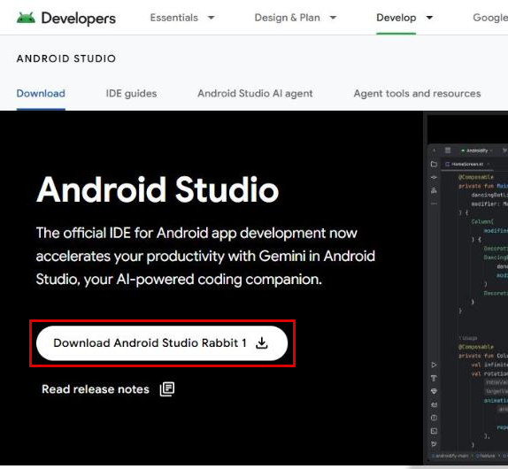
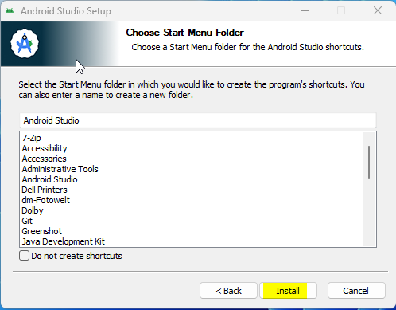
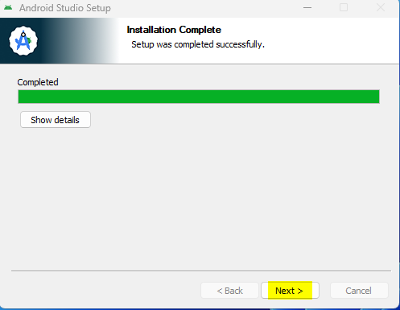
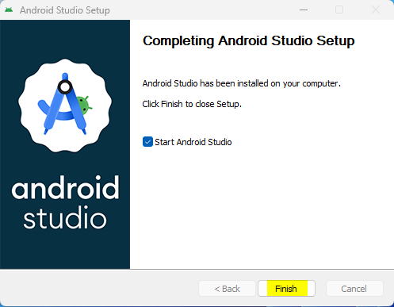
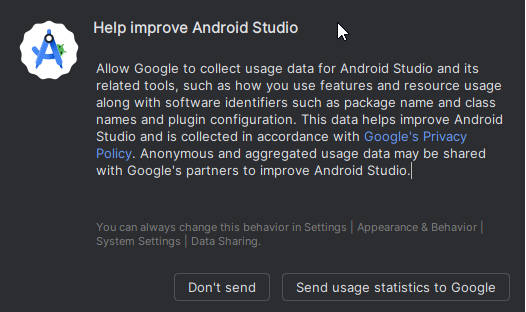
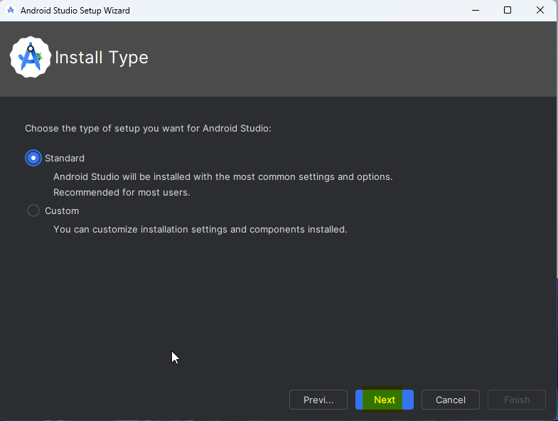

<!-- Android Studio Build, FKA Computer Build. Preserve filenames to avoid breaking URLs. -->

# Compilação no Android Studio

Este é o método tradicional para compilar o seu app AAPS.

Você pode compilar o app sem um computador usando o método [Compilação no navegador](./BrowserBuild.md).

## Compile você mesmo em vez de baixar

**O app AAPS (um arquivo apk) não está disponível para download, por causa das regras sobre dispositivos médicos. É legal compilar o app para uso próprio, mas você não deve dar uma cópia para outras pessoas!**

Veja a página [FAQ para loopers](../UsefulLinks/FAQ.md) para mais detalhes.

---

(Building-APK-recommended-specification-of-computer-for-building-apk-file)=
## Especificações do computador e dos programas para compilar o AAPS

* Pode ser necessária uma versão específica do **[Android Studio](https://developer.android.com/studio/)** para compilar o apk. Veja a tabela abaixo:

| Versão AAPS             | Versão<br/>preferida do<br/>Android Studio | Versão<br/>alternativa do<br/>Android Studio | Gradle | JVM |
| ----------------------- | ------------------------------------------------------ | -------------------------------------------------------- | ------ |:--- |
| 2.6.2                   | 3.6.1                                                  |                                                          | 5.6.4  | 11  |
| 2.8.2.1                 | 4.1.1                                                  |                                                          | 6.1.1  | 13  |
| [3.1.0.3](#version3100) | 2020.3.1                                               | testado até o Quail 4                                    | 7.3.3  | 17  |
| [3.2.0.4](#version3204) | Hedgehog (2023.1.1)                                    | testado até o Quail 4                                    | 8.2    | 17  |
| [3.3.1.3](#version3300) | Ladybug Feature Drop (2024.2.2)                        | testado até o Quail 4                                    | 8.10   | 21  |
| [3.3.2](#version3300)   | Meerkat (2024.3.1)                                     | testado até o Quail 4                                    | 8.11.1 | 21  |
| [3.3.2.1](#version3321) | Narwhal (2025.1.2)                                     | testado até o Quail 4                                    | 8.13   | 21  |
| [3.4.2.6](#version3426) | Panda 2 (2025.3.2)                                     | testado até o Quail 4                                    | 9      | 21  |
| [4.0.0](#version400)    | Rabbit 2 (2026.2.2)                                    | Mais recente                                             | 9.8    | 21  |

A "versão preferida" já vem com a versão correta da JVM. A versão preferida é também a versão mínima que você pode usar para compilar o **AAPS**. Você **NÃO** conseguirá compilar com uma versão mais antiga que a "preferida". Se você usar outra versão, poderá ter problemas com a versão da JVM. Veja a página [Resolução de problemas do Android Studio](#troubleshooting_androidstudio-uncommitted-changes) para ajudar a resolver esses problemas. Se a sua versão atual do Android Studio não estiver na tabela, você precisa atualizá-la primeiro.

A versão do Gradle está ligada ao código-fonte. Você sempre terá a versão correta do Gradle ao baixar / atualizar o código-fonte. Ela é citada aqui apenas como referência, você não precisa fazer nada.

* [Sistemas Windows de 32 bits](#troubleshooting_androidstudio-unable-to-start-daemon-process) não são compatíveis com o Android Studio. Lembre-se de que **CPU de 64 bits e sistema operacional de 64 bits são condições obrigatórias.** Se o seu sistema NÃO atende a essa condição, você precisa trocar o hardware ou software afetado, ou o sistema inteiro.

<table class="tg">
<tbody>
  <tr>
    <th class="tg-baqh">Sistema operacional (somente 64 bits)</th>
    <td class="tg-baqh">Windows 10 ou mais novo</td>
    <td class="tg-baqh">macOS 12 ou mais novo</td>
    <td class="tg-baqh">Qualquer distribuição Linux com suporte a Gnome, KDE ou Unity DE;&nbsp;&nbsp;GNU C Library (glibc) 2.31 ou mais nova</td>
  </tr>
  <tr>
    <th class="tg-baqh"><p align="center">CPU (somente 64 bits)</th>
    <td class="tg-baqh">CPU x86_64 de 2017 ou mais nova (Intel Core i5 de 8ª geração, AMD Ryzen ou mais novo) com <a href="https://developer.android.com/studio/install" target="_blank" rel="noopener noreferrer">suporte a virtualização</a> (Intel VT-x ou AMD-V) ativado na BIOS</td>
    <td class="tg-baqh">Apple Silicon (M1 ou mais novo), ou Intel Core de 6ª geração ou mais novo (o suporte a Macs com Intel está sendo encerrado aos poucos)</td>
    <td class="tg-baqh">CPU x86_64 de 2017 ou mais nova (Intel Core i5 de 8ª geração, AMD Ryzen ou mais novo) com suporte a virtualização (Intel VT-x ou AMD-V) ativado na BIOS</td>
  </tr>
  <tr>
    <th class="tg-baqh"><p align="center">RAM</th>
    <td class="tg-baqh" colspan="3"><p align="center">16 GB ou mais (8 GB é o mínimo absoluto só para o Android Studio; 32 GB é o recomendado)</td>
  </tr>
  <tr>
    <th class="tg-baqh"><p align="center">Disco</th>
    <td class="tg-baqh" colspan="3"><p align="center">Pelo menos 32 GB de espaço livre. Recomenda-se um SSD.</td>
  </tr>
  <tr>
    <th class="tg-baqh"><p align="center">Resolução</th>
    <td class="tg-baqh" colspan="3"><p align="center">Mínimo de 1280 x 800 (1920 x 1080 recomendado)<br></td>
  </tr>
  <tr>
    <th class="tg-baqh"><p align="center">Internet</th>
    <td class="tg-baqh" colspan="3"><p align="center">Banda larga</td>
  </tr>
</tbody>
</table>

**É altamente recomendado (não obrigatório) usar SSD (Solid State Disk) em vez de HDD (Hard Disk Drive), porque a compilação do arquivo apk do AAPS leva menos tempo.**  Você ainda pode usar um HDD para compilar o arquivo apk do **AAPS**. Se fizer isso, a compilação pode demorar muito para terminar, mas, depois de iniciada, você pode deixá-la rodando sem acompanhar.

## Ajuda e suporte durante a compilação

Se você tiver dificuldades para compilar o app **AAPS**, existe uma seção dedicada de [**resolução de problemas do Android Studio**](../GettingHelp/TroubleshootingAndroidStudio.md): consulte-a primeiro.

Se você acha que algo nas instruções de compilação está errado, faltando ou confuso, ou se ainda tiver dificuldades, entre em contato com o grupo de usuários do **AAPS** no [Facebook](https://www.facebook.com/groups/AndroidAPSUsers) ou no [Discord](https://discord.gg/4fQUWHZ4Mw). Se você quiser mudar algo por conta própria (atualizar capturas de tela _etc._), envie um [pull request (PR)](../SupportingAaps/HowToEditTheDocs.md).

## Guia passo a passo para compilar o app AAPS

```{admonition} WARNING
:class: warning
Se você já compilou o AAPS antes, não precisa fazer todos os passos a seguir de novo.
Vá direto para o [guia de atualização](../Maintenance/UpdateToNewVersion.md)!
```

```{contents} The overall steps for building the **AAPS** apk file
:depth: 1
:local: true
```

Neste guia você vai encontrar capturas de tela de _exemplo_ da compilação do arquivo apk do **AAPS**. Como o **Android Studio**, o programa que usamos para compilar o apk do **AAPS**, é atualizado com frequência, essas capturas de tela podem não ser idênticas à sua instalação, mas ainda deve ser possível segui-las.

Como o **Android Studio** roda nas plataformas Windows, Mac OS X e Linux, também pode haver pequenas diferenças nos passos para as diferentes plataformas.

(install-git-if-you-dont-have-it)=
### Instale o Git

```{admonition} Why Git? 
:class: dropdown

O Git é conhecido como “_Sistema de Controle de Versões_” (VCS).\
O Git é um programa que permite acompanhar alterações no código e colaborar com outras pessoas. Você vai usar o Git para fazer uma cópia do código-fonte do **AAPS** do site do GitHub para o seu computador. Depois você vai usar o Android Studio no seu computador para compilar o aplicativo **AAPS** (apk). 
```

(BuildingAaps-steps-for-installing-git)=
#### Passos para instalar o Git

1.  Verifique se você já não tem o **Git** instalado. You can do this by typing “git” in the Windows search bar – if you see **“Git bash”** or some other form of Git, it is already installed and you can go straight to [installing Android Studio](#Building-APK-install-android-studio):


2. Se você não tem o Git instalado, baixe e instale a versão mais recente para o seu sistema na seção "Download" [**aqui**](https://git-scm.com/downloads). Qualquer versão recente do Git deve funcionar. Selecione a versão certa para o seu sistema: Mac, Windows ou Linux.

**Observação para usuários de Mac:** o site do Git também vai orientar você a instalar um programa adicional chamado "homebrew" para ajudar na instalação. Se você instalar o Git pelo homebrew, não é preciso mudar nenhuma preferência.

(Make_a_note_of_Git_path)=

* Durante a instalação, quando for pedido para "select destination location" (selecionar o local de destino), anote _onde_ o Git está sendo instalado (o "**caminho de instalação**"): você vai precisar verificá-lo no próximo passo. Será algo parecido com "C:\Program Files\Git\cmd\git.exe"

*  Durante os vários passos da instalação do Git, apenas aceite todas as opções padrão.

*  Se depois da instalação você esqueceu de anotar onde o Git foi instalado, você pode encontrar assim: digite "git" na barra de pesquisa do PC, clique com o botão direito em "Git bash", selecione "open file location" (abrir local do arquivo) e passe o mouse sobre o ícone "Git bash": o local da instalação vai aparecer.

* Reinicie o seu computador antes do próximo passo.

(Building-APK-install-android-studio)=
### Instale o Android Studio

- **Você precisa ficar conectado à internet o tempo todo durante os passos a seguir, pois o Android Studio baixa várias atualizações**

```{admonition} What is Android Studio?
:class: dropdown
O Android Studio é um programa que roda no seu computador. Ele permite baixar código-fonte da internet (usando o Git) e compilar apps para smartphone (e smartwatch). Você não pode "estragar" uma versão atual do **AAPS** que está fazendo loop no seu smartphone ao compilar um app novo ou atualizado no seu PC com o Android Studio: são processos totalmente separados. 
```

Uma das coisas mais importantes ao instalar o Android Studio é **ter paciência!** Durante a instalação e a configuração, o Android Studio baixa muitos arquivos, o que leva tempo.

```{admonition} Different UI
:class: warning
Nota importante: o Android Studio mudou a sua interface nas últimas versões. Este guia mostra os passos com a *nova interface* (new UI). As capturas de tela foram feitas com o "Ladybug", então versões mais novas podem ter uma aparência um pouco diferente. Se você ainda usa a interface antiga, talvez queira mudar o Android Studio para a nova interface primeiro, seguindo [estas instruções](#computerbuild-NewUI).
```

A versão do Android Studio é muito importante. Veja as [instruções acima](#Building-APK-recommended-specification-of-computer-for-building-apk-file) para escolher a versão certa do Android Studio.

Baixe a [versão atual do Android Studio](https://developer.android.com/studio) ou uma versão mais antiga em [**Archives**](https://developer.android.com/studio/archive) (arquivo de versões) e aceite os termos de download.



Quando o download terminar, abra o programa baixado para instalá-lo no seu computador. Talvez você precise aceitar/confirmar alguns avisos do Windows sobre apps baixados!

Instale o Android Studio clicando em "Next", como mostram as capturas de tela a seguir. Você **não** precisa alterar nenhuma configuração!


Se quiser economizar espaço no disco rígido, você pode desmarcar Android Virtual Device: ele não é usado para compilar o **AAPS**.


Agora clique em "Install":



Quando terminar, clique em "Next"



No último passo, clique em "Finish" para abrir o Android Studio pela primeira vez.



Vai aparecer uma pergunta se você quer ajudar a melhorar o Android Studio. Escolha a opção que preferir; isso não faz nenhuma diferença nos próximos passos.



A tela de boas-vindas da instalação do Android Studio vai aparecer. Clique em "Next".


Selecione "Standard" como tipo de instalação.



Confirme as configurações clicando de novo em "Next".


Agora você precisa aceitar os contratos de licença. Há duas seções (1 + 3) à esquerda: selecione uma depois da outra e, para cada uma, selecione "Accept" (2 + 4) à direita.

Depois disso, você pode clicar no botão "Finish" (5).


Agora alguns pacotes do Android vão ser baixados e instalados. Tenha paciência e espere.

Quando terminar, vai aparecer a tela a seguir, em que você pode selecionar "Finish" de novo.


Agora você vai ver a tela de boas-vindas (Welcome) do Android Studio.


(Building-APK-download-AAPS-code)=
### Baixe o código do AAPS

```{admonition} Why can it take a long time to download the AAPS code?
:class: dropdown

Na primeira vez que o **AAPS** é baixado, o Android Studio se conecta pela internet ao site do GitHub para baixar o código-fonte do **AAPS**. Isso deve levar cerca de 1 minuto. 

Depois o Android Studio usa o **Gradle** (uma ferramenta de desenvolvimento para apps Android) para identificar outros componentes necessários para compilar esses itens no seu computador. 
```

Na tela de boas-vindas do Android Studio, verifique se "**Projects**" (1) está destacado à esquerda.

Depois clique em "**Clone Repository**" (2) à direita:


Agora vamos dizer ao Android Studio de onde baixar o código:


* "Repository URL" deve estar selecionado (por padrão) à esquerda (1).
* "Git" deve estar selecionado (por padrão) como controle de versão (2).
* Agora copie esta URL:
    ```
    https://github.com/nightscout/AndroidAPS.git
    ```
    e cole-a na caixa de texto URL (3).

* Verifique se o diretório (padrão) para salvar o código clonado ainda não existe no seu computador (4). Você pode mudar para outro diretório, mas lembre-se de onde você o guardou!
* Agora clique no botão "Clone" (5).

```{admonition} INFORMATION
:class: note
Anote o diretório. É nele que o seu código-fonte fica guardado!
```

Agora vai aparecer uma tela dizendo que o repositório está sendo clonado:


Em algum momento, o Android Studio vai fechar e abrir de novo. Talvez apareça uma pergunta se você confia no projeto. Clique em "Trust project":

  


Somente para usuários de Windows: se o firewall pedir permissão, conceda o acesso:

 

Depois que o repositório for clonado com sucesso, o Android Studio vai abrir o projeto clonado.

(computerbuild-NewUI)=
```{admonition} New UI
:class: note
O Android Studio mudou a sua interface recentemente. Novas instalações do Android Studio usam a nova interface (new UI) por padrão!

Somente se o seu Android Studio estiver diferente, talvez você precise mudar para a nova interface:
Clique no menu hambúrguer no canto superior esquerdo e depois selecione **Settings** (ou **Preferences** em computadores Apple).
Em **Appearance & Behavior**, vá para **New UI** e marque **Enable new UI**. Depois reinicie o Android Studio para começar a usá-la.

Se você não encontrar a opção **New UI**, não se preocupe: você já está usando a nova interface!
```


Quando o Android Studio abrir, espere com paciência (isso pode levar alguns minutos) e, principalmente, **não** atualize o projeto como sugerido na janela pop-up.

O Android Studio vai iniciar automaticamente uma "Gradle project sync" (sincronização do projeto com o Gradle), que leva alguns minutos para terminar. Você pode ver que ela (ainda) está em execução:


```{admonition} NEVER UPDATE GRADLE!
:class: warning

O Android Studio pode recomendar atualizar o sistema gradle. **Nunca atualize o gradle!** Isso vai causar problemas.
```

Somente em computadores Windows: você pode receber uma notificação de que o Windows Defender está em execução. Clique em **Automatically** e confirme: isso vai deixar a compilação mais rápida!


Você pode deixar a sincronização do gradle em execução e já seguir os próximos passos.

(Building-APK-set-git-path-in-preferences)=
### Defina o caminho do Git nas preferências do Android Studio

Agora vamos dizer ao Android Studio onde encontrar o Git, que você instalou [antes](#install-git-if-you-dont-have-it).

* Somente para usuários de Windows: verifique se você reiniciou o computador depois de [instalar o Git](#install-git-if-you-dont-have-it). Se não, reinicie agora e abra de novo o Android Studio

No canto superior esquerdo do **Android Studio**, abra o menu hambúrguer e vá para **File** > **Settings** (no Windows) ou **Android Studio** > **Preferences** (no Mac). Isso abre a janela a seguir. Clique para expandir o menu suspenso chamado **Version Control** (1) e selecione **Git** (2)


Verifique se o **Android Studio** consegue encontrar automaticamente o **Path to Git executable** (caminho do executável do Git) correto clicando no botão "Test" (1):


Se a configuração automática funcionar, a sua versão atual do **Git** vai aparecer ao lado do caminho.

   


Se o **git.exe** não for encontrado automaticamente, ou se clicar em "Test" der erro, você pode
* digitar manualmente o caminho que você anotou [antes](#BuildingAaps-steps-for-installing-git), ou
* clique no ícone de pasta (1) e vá manualmente até o diretório onde o **git.exe** foi instalado [antes](#BuildingAaps-steps-for-installing-git)
* Verifique as suas configurações com o botão **Test**!

  

(Building-APK-generate-signed-apk)=
### Compile o APK "assinado" do AAPS

```{admonition} Why does the AAPS app need to be "signed"?
:class: dropdown

O Android exige que cada app seja _assinado_, para garantir que ele só possa ser atualizado depois pela mesma fonte confiável que publicou o app original. Para mais informações sobre esse assunto, siga [este link](https://developer.android.com/studio/publish/app-signing.html#generate-key). 

Para nós, isso significa apenas que geramos um arquivo de assinatura, ou "keystore", e o usamos quando compilamos o app **AAPS**.
```


**Importante: verifique se a sincronização do gradle terminou com sucesso antes de continuar!**


Clique no menu hambúrguer no canto superior esquerdo para abrir a barra de menus. Selecione **Build** (1) e depois selecione **Generate Signed App Bundle / APK** (2)


Selecione "APK" (1) em vez de "Android App Bundle" e clique em "Next" (2):


Na próxima tela, verifique se "Module" está definido como "AndroidAPS.app" (1). A parte antes de ".app" é o nome da pasta para a qual você clonou o código.

(Building-APK-wearapk)=
```{admonition} INFORMATION!
:class: note
Se você quiser criar o apk para o seu relógio, agora precisa selecionar AndroidAPS.wear!
```


Clique em "Create new..." (2) para começar a criar a sua keystore.

```{admonition} INFORMATION!
:class: note
Você só vai precisar criar a keystore uma vez.
Se você já compilou o AAPS antes, NÃO crie uma nova keystore: selecione a que você já tem e digite as senhas dela!
```

**_Observação:_** a keystore é um arquivo em que ficam guardadas as informações para assinar o app. Ela é criptografada, e as informações são protegidas com senhas.


* Clique no símbolo de "pasta" (1) para selecionar um caminho no seu computador para a sua keystore.

  **Não** use o diretório em que você guardou o seu código-fonte, mas algum diretório que você também transferiria para um computador novo.

```{admonition} WARNING!
:class: warning
Anote para você onde a sua keystore está guardada. Você vai precisar dela quando compilar a próxima atualização do AAPS!
```

* Agora escolha uma senha simples (e anote-a), digite-a na caixa de senha (2) e confirme-a (2).

  As senhas da keystore e da chave não precisam ser complicadas. Se você perder a sua senha no futuro, veja [Reinstalar o AAPS com uma nova keystore](#reinstall-aaps).

```{warning}
**Evite caracteres especiais nas suas senhas.** Use apenas letras e números nas senhas da keystore e da chave. Principalmente, não use `$`, crase (backtick), `"` ou `\`. Se depois você mudar para a [Compilação no navegador](#aaps-ci-option2) e reutilizar esta keystore, esses caracteres podem fazer a etapa de assinatura falhar; veja [Compilação no navegador: resolução de problemas](#aaps-ci-password-special-characters).
```

* O alias padrão (3) da sua chave é "key0": deixe-o sem alteração.

* Agora você precisa de uma senha para a sua chave. Para simplificar, se quiser, você pode usar a mesma senha que usou para a sua keystore, acima. Digite uma senha (4) e confirme-a.

```{admonition} WARNING!
:class: warning
Anote essas senhas! Você vai precisar delas quando compilar a próxima atualização do AAPS!
```

* A validade padrão é de 25 anos: deixe como está.

* Digite o seu nome e sobrenome (5). Nenhuma outra informação precisa ser adicionada, mas você pode preencher se quiser (6-7).

* Clique em "OK" (8) para continuar:


Na página **Generate signed App Bundle or APK**, o caminho da sua keystore vai aparecer agora. Agora digite de novo a senha da keystore (Key Store password) (1) e a senha da chave (Key password) (2), e marque a caixa (3) para lembrar as senhas, assim você não precisa digitá-las de novo na próxima vez que compilar o apk (ou seja, ao atualizar para uma nova versão do AAPS). Clique em "Next" (4):


Na próxima tela, selecione a variante de compilação "fullRelease" (1) e clique em "Create" (3). Lembre-se da pasta de destino mostrada em (2), pois depois você vai encontrar o seu arquivo apk compilado nela!

   

Agora o Android Studio vai compilar o apk do **AAPS**. Vai aparecer "Gradle Build running" (2) no canto inferior direito. O processo leva algum tempo, dependendo do seu computador e da sua conexão com a internet, então **tenha paciência!** Se quiser acompanhar o progresso da compilação, clique no pequeno martelo "build" (1) na parte de baixo do Android Studio:


Agora você pode acompanhar o progresso da compilação:


O Android Studio vai mostrar a informação "BUILD SUCCESSFUL" quando a compilação terminar. Talvez apareça uma notificação pop-up em que você pode clicar para selecionar "locate". Se você perder isso, clique no ícone de notificações (1) para abrir as notificações e depois em **locate** (2):


**_Se a compilação não deu certo, veja a seção [Resolução de problemas do Android Studio](../GettingHelp/TroubleshootingAndroidStudio.md)._**

Na caixa de notificações, clique no link azul "locate":

 O seu gerenciador de arquivos vai abrir e mostrar o arquivo apk que você acabou de compilar.

   

Parabéns! Agora que você compilou o arquivo apk do **AAPS**, vai transferir esse arquivo para o seu smartphone na próxima seção da documentação.

```{tip}
Se você acha que talvez queira usar um smartwatch Android Wear no futuro, este é o melhor momento para compilar o apk do AAPS Wear, para ter certeza de que ele vai estar sincronizado com o seu apk do AAPS.
```

Passe para a próxima etapa: [Transferir e instalar o **AAPS**](../SettingUpAaps/TransferringAndInstallingAaps.md).


