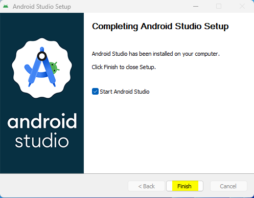
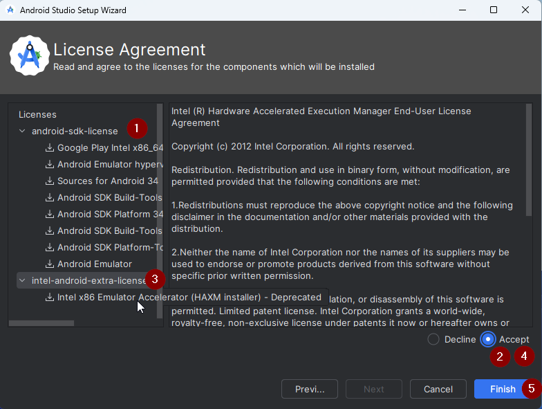
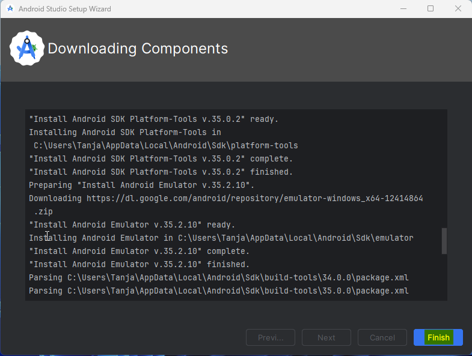
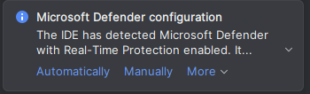
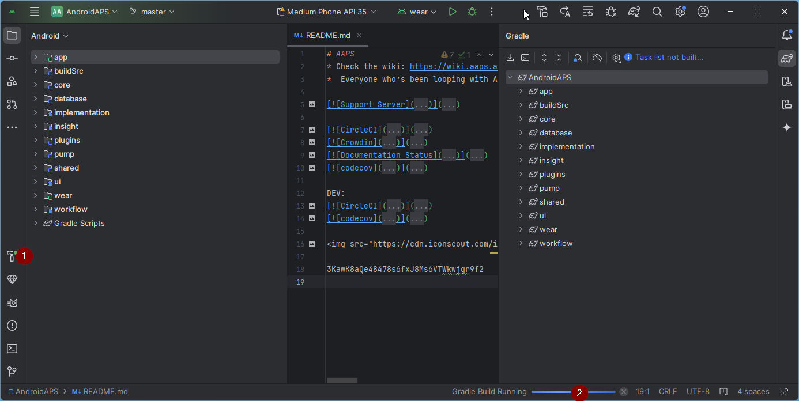

<!-- Android Studio Build, FKA Computer Build. Preserve filenames to avoid breaking URLs. -->

# Compilação no Android Studio

Este é o método tradicional para compilar o seu app AAPS.

Você pode compilar o app sem um computador usando o método [Compilação no navegador](./BrowserBuild.md).

## Compile você mesmo em vez de baixar

**O app AAPS (um arquivo apk) não está disponível para download, por causa das regras sobre dispositivos médicos. É legal compilar o app para uso próprio, mas você não deve dar uma cópia para outras pessoas!**

Veja a página [FAQ para loopers](../UsefulLinks/FAQ.md) para mais detalhes.

---

(Building-APK-recommended-specification-of-computer-for-building-apk-file)=
## Computer and software specifications for building AAPS

* Pode ser necessária uma versão específica do **[Android Studio](https://developer.android.com/studio/)** para compilar o apk. Veja a tabela abaixo:

| Versão AAPS                 | Versão<br/>preferida do<br/>Android Studio | Versão<br/>alternativa do<br/>Android Studio | Gradle | JVM |
| --------------------------- | ------------------------------------------------------ | -------------------------------------------------------- | ------ |:--- |
| 2.6.2                       | 3.6.1                                                  |                                                          | 5.6.4  | 11  |
| 2.8.2.1                     | 4.1.1                                                  |                                                          | 6.1.1  | 13  |
| [3.1.0.3](#version3100)     | 2020.3.1                                               | testado até o Quail 4                                    | 7.3.3  | 17  |
| [3.2.0.4](#version3204)     | Hedgehog (2023.1.1)                                    | testado até o Quail 4                                    | 8.2    | 17  |
| [3.3.1.3](#version3300)     | Ladybug Feature Drop (2024.2.2)                        | testado até o Quail 4                                    | 8.10   | 21  |
| [3.3.2](#version3300)       | Meerkat (2024.3.1)                                     | testado até o Quail 4                                    | 8.11.1 | 21  |
| [3.3.2.1](#version3321)     | Narwhal (2025.1.2)                                     | testado até o Quail 4                                    | 8.13   | 21  |
| [3.4.2.6](#version3426)     | Panda 2 (2025.3.2)                                     | testado até o Quail 4                                    | 9      | 21  |
| [4.0.0-beta1](#version4000) | Rabbit 1                                               | até o Rabbit 1 mais recente                              | 9.8    | 21  |

A "versão preferida" já vem com a versão correta da JVM. A versão preferida é também a versão mínima que você pode usar para compilar o **AAPS**. Você **NÃO** conseguirá compilar com uma versão mais antiga que a "preferida". Se você usar outra versão, poderá ter problemas com a versão da JVM. Veja a página [Resolução de problemas do Android Studio](#troubleshooting_androidstudio-uncommitted-changes) para ajudar a resolver esses problemas. Se a sua versão atual do Android Studio não estiver na tabela, você precisa atualizá-la primeiro.

A versão do Gradle está ligada ao código-fonte. Você sempre terá a versão correta do Gradle ao baixar / atualizar o código-fonte. Ela é citada aqui apenas como referência, você não precisa fazer nada.

* [Sistemas Windows de 32 bits](#troubleshooting_androidstudio-unable-to-start-daemon-process) não são compatíveis com o Android Studio. Lembre-se de que **CPU de 64 bits e sistema operacional de 64 bits são condições obrigatórias.** Se o seu sistema NÃO atende a essa condição, você precisa trocar o hardware ou software afetado, ou o sistema inteiro.

<table class="tg">
<tbody>
  <tr>
    <th class="tg-baqh">OS (Only 64 bit)</th>
    <td class="tg-baqh">Windows 8 or higher</td>
    <td class="tg-baqh">Mac OS 10.14 or higher</td>
    <td class="tg-baqh">Any Linux supports Gnome, KDE, or Unity DE;&nbsp;&nbsp;GNU C Library 2.31 or later</td>
  </tr>
  <tr>
    <th class="tg-baqh"><p align="center">CPU (Only 64 bit)</th>
    <td class="tg-baqh">x86_64 CPU architecture; 2nd generation Intel Core or newer, or AMD CPU with support for a <br><a href="https://developer.android.com/studio/run/emulator-acceleration#vm-windows" target="_blank" rel="noopener noreferrer"><span style="text-decoration:var(--devsite-link-text-decoration,none)">Windows Hypervisor</span></a></td>
    <td class="tg-baqh">ARM-based chips, or 2nd generation Intel Core or newer with support for <br><a href="https://developer.android.com/studio/run/emulator-acceleration#vm-mac" target="_blank" rel="noopener noreferrer"><span style="text-decoration:var(--devsite-link-text-decoration,none)">Hypervisor.Framework</span></a></td>
    <td class="tg-baqh">x86_64 CPU architecture; 2nd generation Intel Core or newer, or AMD processor with support for AMD Virtualization (AMD-V) and SSSE3</td>
  </tr>
  <tr>
    <th class="tg-baqh"><p align="center">RAM</th>
    <td class="tg-baqh" colspan="3"><p align="center">16 GB ou mais</td>
  </tr>
  <tr>
    <th class="tg-baqh"><p align="center">Disk</th>
    <td class="tg-baqh" colspan="3"><p align="center">At least 30GB free space. SSD is recommended.</td>
  </tr>
  <tr>
    <th class="tg-baqh"><p align="center">Resolution</th>
    <td class="tg-baqh" colspan="3"><p align="center">Mínimo 1280 x 800 <br></td>
  </tr>
  <tr>
    <th class="tg-baqh"><p align="center">Internet</th>
    <td class="tg-baqh" colspan="3"><p align="center">Broadband</td>
  </tr>
</tbody>
</table>

**É altamente recomendado (não obrigatório) usar SSD (Solid State Disk) em vez de HDD (Hard Disk Drive), porque a compilação do arquivo apk do AAPS leva menos tempo.**  Você ainda pode usar um HDD para compilar o arquivo apk do **AAPS**. If you do, the building process may take a long time to complete, but once it has started, you can leave it running unattended.

## Help and support during the building process

Se você tiver dificuldades para compilar o app **AAPS**, existe uma seção dedicada de [**resolução de problemas do Android Studio**](../GettingHelp/TroubleshootingAndroidStudio.md): consulte-a primeiro.

Se você acha que algo nas instruções de compilação está errado, faltando ou confuso, ou se ainda tiver dificuldades, entre em contato com o grupo de usuários do **AAPS** no [Facebook](https://www.facebook.com/groups/AndroidAPSUsers) ou no [Discord](https://discord.gg/4fQUWHZ4Mw). Se você quiser mudar algo por conta própria (atualizar capturas de tela _etc._), envie um [pull request (PR)](../SupportingAaps/HowToEditTheDocs.md).

## Step-by-step guide to building the AAPS app

```{admonition} WARNING
:class: warning
Se você já compilou o AAPS antes, não precisa fazer todos os passos a seguir de novo.
Vá direto para o [guia de atualização](../Maintenance/UpdateToNewVersion.md)!
```

```{contents} The overall steps for building the **AAPS** apk file
:depth: 1
:local: true
```

Neste guia você vai encontrar capturas de tela de _exemplo_ da compilação do arquivo apk do **AAPS**. Como o **Android Studio**, o programa que usamos para compilar o apk do **AAPS**, é atualizado com frequência, essas capturas de tela podem não ser idênticas à sua instalação, mas ainda deve ser possível segui-las.

Como o **Android Studio** roda nas plataformas Windows, Mac OS X e Linux, também pode haver pequenas diferenças nos passos para as diferentes plataformas.

(install-git-if-you-dont-have-it)=
### Instale o Git

```{admonition} Why Git? 
:class: dropdown

O Git é conhecido como “_Sistema de Controle de Versões_” (VCS).\
O Git é um programa que permite acompanhar alterações no código e colaborar com outras pessoas. Você vai usar o Git para fazer uma cópia do código-fonte do **AAPS** do site do GitHub para o seu computador. Depois você vai usar o Android Studio no seu computador para compilar o aplicativo **AAPS** (apk). 
```

(BuildingAaps-steps-for-installing-git)=
#### Steps for Installing Git

1.  Verifique se você já não tem o **Git** instalado. Você pode fazer isso digitando “git” na barra de pesquisa do Windows: se aparecer **“Git bash”** ou outra forma do Git, ele já está instalado e você pode ir direto para a [instalação do Android Studio](#install-android-studio):


2. Se você não tem o Git instalado, baixe e instale a versão mais recente para o seu sistema na seção "Download" [**aqui**](https://git-scm.com/downloads). Any recent Git version should work, select the correct version according to your system, either Mac, Windows and Linux.

**Observação para usuários de Mac:** o site do Git também vai orientar você a instalar um programa adicional chamado "homebrew" para ajudar na instalação. If you install Git via homebrew, there is no need to change any preferences.

(Make_a_note_of_Git_path)=

* Durante a instalação, quando for pedido para "select destination location" (selecionar o local de destino), anote _onde_ o Git está sendo instalado (o "**caminho de instalação**"): você vai precisar verificá-lo no próximo passo. It will be something similar to "C:\Program Files\Git\cmd\git.exe"

*  As you proceed through several steps of the Git installation, just accept all the default options.

*  After the install, if you forgot to make a note of the where Git was installed, you can find it as follows: type "git" into the PC search bar, right click on "Git bash", select "open file location" hover over the "Git bash" icon with your mouse, which will then reveal where it is installed.

* Reboot your computer before the next step.

(Building-APK-install-android-studio)=
### Install Android Studio

- **Você precisa ficar conectado à internet o tempo todo durante os passos a seguir, pois o Android Studio baixa várias atualizações**

```{admonition} What is Android Studio?
:class: dropdown
O Android Studio é um programa que roda no seu computador. Ele permite baixar código-fonte da internet (usando o Git) e compilar apps para smartphone (e smartwatch). Você não pode "estragar" uma versão atual do **AAPS** que está fazendo loop no seu smartphone ao compilar um app novo ou atualizado no seu PC com o Android Studio: são processos totalmente separados. 
```

Uma das coisas mais importantes ao instalar o Android Studio é **ter paciência!** Durante a instalação e a configuração, o Android Studio baixa muitos arquivos, o que leva tempo.

```{admonition} Different UI
:class: warning
Nota importante: o Android Studio mudou a sua interface nas últimas versões. Este guia mostra os passos com a *nova interface* (new UI). As capturas de tela foram feitas com o "Ladybug", então versões mais novas podem ter uma aparência um pouco diferente. Se você ainda usa a interface antiga, talvez queira mudar o Android Studio para a nova interface primeiro, seguindo [estas instruções](#computerbuild-NewUI).
```

A versão do Android Studio é muito importante. Veja as [instruções acima](#Building-APK-recommended-specification-of-computer-for-building-apk-file) para escolher a versão certa do Android Studio.

Baixe a [versão atual do Android Studio](https://developer.android.com/studio) ou uma versão mais antiga em [**Archives**](https://developer.android.com/studio/archive) (arquivo de versões) e aceite os termos de download.


Once the download is finished, start the downloaded application to install it on your computer. You might need to accept/confirm some warnings about downloaded apps from Windows!

Install Android Studio by clicking "Next", as shown in the following screenshots. Você **não** precisa alterar nenhuma configuração!


Se quiser economizar espaço no disco rígido, você pode desmarcar Android Virtual Device: ele não é usado para compilar o **AAPS**.


Now click on "Install":


Once it's completed, press "Next"


In the last step, click on "Finished" to start Android Studio for the first time.



You will be asked if you want to help improve Android Studio. Choose the option to your liking, it won't make any difference for the following steps.


The welcome screen greets you to the installation of Android Studio. Press "Next".


Select "Standard" as installation type.


Verify the settings by clicking "Next" again.


Now you need to accept the license agreements. You have two sections (1 + 3) on the left side which you have to select one after the other and each select "Accept" (2 + 4) on the right side.

Then the "Finish" (5) button can be clicked.



Some Android packages will now be downloaded and installed. Be patient and wait.

When it's finished, you will find the following screen where you can select "Finish" again.



You will now see the Welcome screen of Android Studio.


(Building-APK-download-AAPS-code)=
### Download the AAPS code

```{admonition} Why can it take a long time to download the AAPS code?
:class: dropdown

Na primeira vez que o **AAPS** é baixado, o Android Studio se conecta pela internet ao site do GitHub para baixar o código-fonte do **AAPS**. Isso deve levar cerca de 1 minuto. 

Depois o Android Studio usa o **Gradle** (uma ferramenta de desenvolvimento para apps Android) para identificar outros componentes necessários para compilar esses itens no seu computador. 
```

Na tela de boas-vindas do Android Studio, verifique se "**Projects**" (1) está destacado à esquerda.

Depois clique em "**Clone Repository**" (2) à direita:


We will now tell Android Studio where to get the code from:


* "Repository URL" should be selected (by default) on the left (1).
* "Git" should be selected (by default) as version control (2).
* Now copy this URL:
    ```
    https://github.com/nightscout/AndroidAPS.git
    ```
    and paste it into the URL textbox (3).

* Verifique se o diretório (padrão) para salvar o código clonado ainda não existe no seu computador (4). You can change it to some directory, but please remember where you stored it!
* Now click the button "Clone" (5).

```{admonition} INFORMATION
:class: note
Anote o diretório. É nele que o seu código-fonte fica guardado!
```

You will now see a screen telling you that the repository is being cloned:


At some point, Android Studio will close and start again. You may be asked whether you want to trust the project. Click on "Trust project":

  


Only for Windows users: If your firewall asks for permission, grant access:

 

After the repository is cloned successfully, Android Studio will open the cloned project.

(computerbuild-NewUI)=
```{admonition} New UI
:class: note
O Android Studio mudou a sua interface recentemente. Novas instalações do Android Studio usam a nova interface (new UI) por padrão!

Somente se o seu Android Studio estiver diferente, talvez você precise mudar para a nova interface:
Clique no menu hambúrguer no canto superior esquerdo e depois selecione **Settings** (ou **Preferences** em computadores Apple).
Em **Appearance & Behavior**, vá para **New UI** e marque **Enable new UI**. Depois reinicie o Android Studio para começar a usá-la.

Se você não encontrar a opção **New UI**, não se preocupe: você já está usando a nova interface!
```


Quando o Android Studio abrir, espere com paciência (isso pode levar alguns minutos) e, principalmente, **não** atualize o projeto como sugerido na janela pop-up.

Android Studio will start a "Gradle project sync" automatically, which will take a couple of minutes to finish. You can see it (still) running:


```{admonition} NEVER UPDATE GRADLE!
:class: warning

O Android Studio pode recomendar atualizar o sistema gradle. **Nunca atualize o gradle!** Isso vai causar problemas.
```

Somente em computadores Windows: você pode receber uma notificação de que o Windows Defender está em execução. Clique em **Automatically** e confirme: isso vai deixar a compilação mais rápida!




You can leave the gradle sync running and follow the next steps already.

(Building-APK-set-git-path-in-preferences)=
### Set Git path in Android Studio preferences

Agora vamos dizer ao Android Studio onde encontrar o Git, que você instalou [antes](#install-git-if-you-dont-have-it).

* Somente para usuários de Windows: verifique se você reiniciou o computador depois de [instalar o Git](#install-git-if-you-dont-have-it). If not, restart now and re-open Android Studio

No canto superior esquerdo do **Android Studio**, abra o menu hambúrguer e vá para **File** > **Settings** (no Windows) ou **Android Studio** > **Preferences** (no Mac). Isso abre a janela a seguir. Clique para expandir o menu suspenso chamado **Version Control** (1) e selecione **Git** (2)


Verifique se o **Android Studio** consegue encontrar sozinho o **Path to Git executable** (caminho do executável do Git) correto, clicando no botão "Test" (1):


Se a configuração automática funcionar, a sua versão atual do **Git** vai aparecer ao lado do caminho.

   


Se o **git.exe** não for encontrado automaticamente, ou se clicar em "Test" der erro, você pode
* digitar manualmente o caminho que você anotou [antes](#BuildingAaps-steps-for-installing-git), ou
* clique no ícone de pasta (1) e vá manualmente até o diretório onde o **git.exe** foi instalado [antes](#BuildingAaps-steps-for-installing-git)
* Verifique as suas configurações com o botão **Test**!

  

(Building-APK-generate-signed-apk)=
### Build the AAPS "signed" APK

```{admonition} Why does the AAPS app need to be "signed"?
:class: dropdown

O Android exige que cada app seja _assinado_, para garantir que ele só possa ser atualizado depois pela mesma fonte confiável que publicou o app original. Para mais informações sobre esse assunto, siga [este link](https://developer.android.com/studio/publish/app-signing.html#generate-key). 

Para nós, isso significa apenas que geramos um arquivo de assinatura, ou "keystore", e o usamos quando compilamos o app **AAPS**.
```


**Importante: verifique se a sincronização do gradle terminou com sucesso antes de continuar!**


Click the hamburger menu on the top left to open the menu bar. Selecione **Build** (1) e depois selecione **Generate Signed App Bundle / APK** (2)


Selecione "APK" (1) em vez de "Android App Bundle" e clique em "Next" (2):


Na próxima tela, verifique se "Module" está definido como "AndroidAPS.app" (1). A parte antes de ".app" é o nome da pasta para a qual você clonou o código.

(Building-APK-wearapk)=
```{admonition} INFORMATION!
:class: note
Se você quiser criar o apk para o seu relógio, agora precisa selecionar AndroidAPS.wear!
```


Click "Create new..." (2) to start creating your key store.

```{admonition} INFORMATION!
:class: note
Você só vai precisar criar a keystore uma vez.
Se você já compilou o AAPS antes, NÃO crie uma nova keystore: selecione a que você já tem e digite as senhas dela!
```

**_Observação:_** a keystore é um arquivo em que ficam guardadas as informações para assinar o app. It is encrypted, and the information is secured with passwords.


* Click the "folder" symbol (1) to select a path on your computer for your key store.

  **Não** use o diretório em que você guardou o seu código-fonte, mas algum diretório que você também transferiria para um computador novo.

```{admonition} WARNING!
:class: warning
Anote para você onde a sua keystore está guardada. Você vai precisar dela quando compilar a próxima atualização do AndroidAPS!
```

* Now choose a simple password (and make a note of it), enter it in the password box (2), and confirm it (2).

  The passwords for key store and key do not have to be sophisticated. Se você perder a sua senha no futuro, veja [Reinstalar o AAPS com uma nova keystore](#reinstall-aaps).

```{warning}
**Evite caracteres especiais nas suas senhas.** Use apenas letras e números nas senhas da keystore e da chave. Principalmente, não use `$`, crase (backtick), `"` ou `\`. Se depois você mudar para a [Compilação no navegador](#aaps-ci-option2) e reutilizar esta keystore, esses caracteres podem fazer a etapa de assinatura falhar; veja [Compilação no navegador: resolução de problemas](#aaps-ci-password-special-characters).
```

* The default alias (3) for your key is "key0", leave this unchanged.

* You now need a password for your key. To keep it simple, if you want, you can use the same password you used for your keystore, above. Enter a password (4) and confirm it.

```{admonition} WARNING!
:class: warning
Anote essas senhas! Você vai precisar delas quando compilar a próxima atualização do AAPS!
```

* The validity is 25 years by default, leave it as it is.

* Enter your first and last name (5). No other information needs to be added but you are free to do (6-7).

* Click "OK" (8) to continue:


Na página **Generate signed App Bundle or APK**, o caminho da sua keystore vai aparecer agora. Now re-enter the Key Store password (1) and Key password (2), and tick the box (3) to remember passwords, so you don't have to enter them again next time you build the apk (i.e. when updating to a new AAPS version). Click "Next" (4):


Na próxima tela, selecione a variante de compilação "fullRelease" (1) e clique em "Create" (3). Lembre-se da pasta de destino mostrada em (2), pois depois você vai encontrar o seu arquivo apk compilado nela!

   

Agora o Android Studio vai compilar o apk do **AAPS**. It will show "Gradle Build running" (2) at the bottom right. O processo leva algum tempo, dependendo do seu computador e da sua conexão com a internet, então **tenha paciência!** Se quiser acompanhar o progresso da compilação, clique no pequeno martelo "build" (1) na parte de baixo do Android Studio:



Now you can watch the building progress:


Android Studio will display the information "BUILD SUCCESSFUL" after build is finished. You may see a popup notification which you can click to select "locate". Se você perder isso, clique no ícone de notificações (1) para abrir as notificações e depois em **locate** (2):


**_Se a compilação não deu certo, veja a seção [Resolução de problemas do Android Studio](../GettingHelp/TroubleshootingAndroidStudio.md)._**

In the Notifications box, click on the blue link "locate":

 O seu gerenciador de arquivos vai abrir e mostrar o arquivo apk que você acabou de compilar.

   

Parabéns! Agora que você compilou o arquivo apk do **AAPS**, vai transferir esse arquivo para o seu smartphone na próxima seção da documentação.

```{tip}
Se você acha que talvez queira usar um smartwatch Android Wear no futuro, este é o melhor momento para compilar o apk do AAPS Wear, para ter certeza de que ele vai estar sincronizado com o seu apk do AAPS.
```

Passe para a próxima etapa: [Transferir e instalar o **AAPS**](../SettingUpAaps/TransferringAndInstallingAaps.md).


