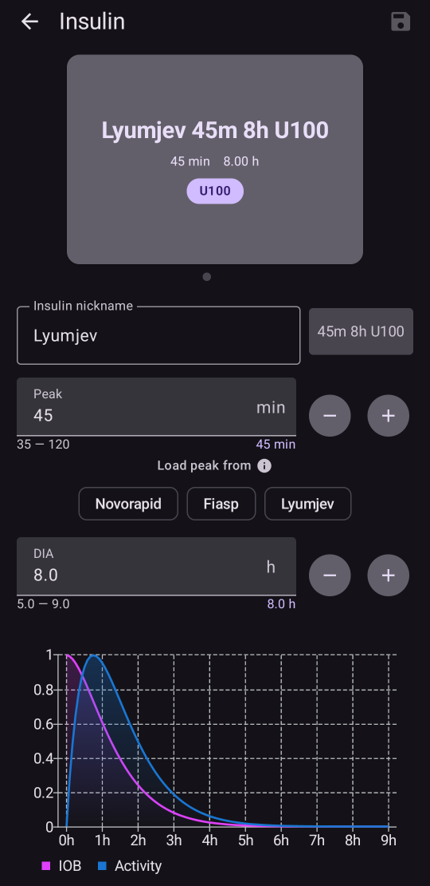
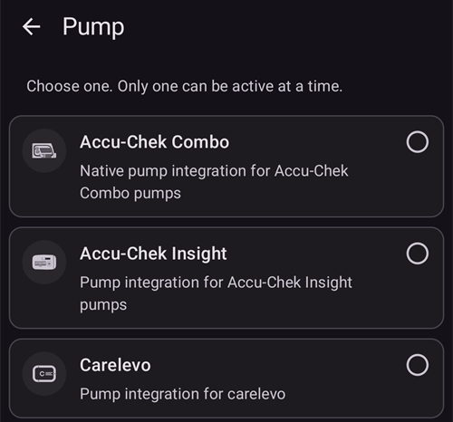
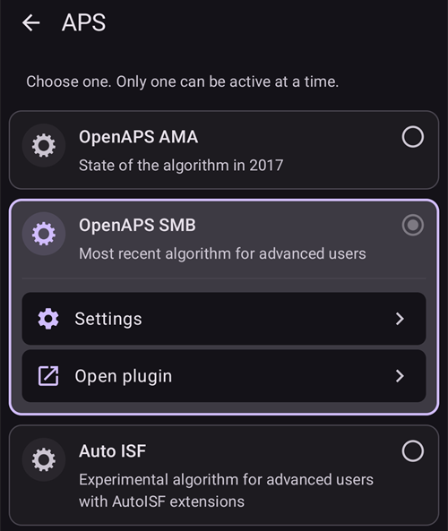
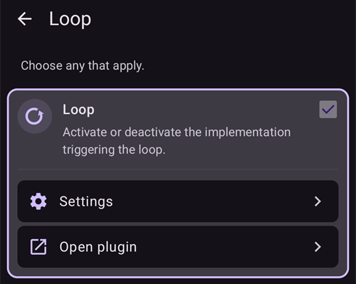

# Configuração (Config Builder)

```{admonition} Coming from AAPS v3?
:class: note
O **Config Builder** agora se chama **Configuração** e fica no **menu** (☰). Veja [O que mudou no AAPS v4](#v4-changes).
```

Em **Configuração** você escolhe quais plugins estão ativos (CGM, bomba, algoritmo APS, sensibilidade, sincronização, …) e abre cada plugin e as configurações dele. O [passo a passo](#configuration-v4) está abaixo; o resto desta página descreve cada seção em detalhes.

(configuration-v4)=
## Configuração no AAPS v4

No **AAPS** v4, toque no **menu** (☰) no canto **superior esquerdo** da tela principal e escolha **Configuração** (_“Defina sua configuração (CGM, bomba, …) e ative recursos”_).


Os plugins são agrupados por **categoria** — por exemplo _Suavização_, _Calibração_, _Detecção de sensibilidade_, _APS_, _Comunicação_ e _Geral_. Cada linha mostra o nome da categoria e o plugin **atualmente ativo** (por exemplo _APS → SMB OpenAPS_). Toque em uma linha para abrir uma categoria.


Dentro de uma categoria você vê os plugins disponíveis para ela. Nas categorias de escolha única, você escolhe o plugin ativo; algumas categorias permitem escolher vários (_“Escolha todas as opções aplicáveis.”_). Cada plugin oferece duas ações:

- **Abrir plugin** — abre a tela própria do plugin.
- **Settings** — opens the plugin's preferences (settings may be grouped into expandable sections).


(configuration_sync_icon)=
### O ícone de celular — “sincronizado a partir do dispositivo principal”

Um pequeno **ícone de celular (telefone)** ao lado de uma categoria ou configuração significa que esse item é **sincronizado a partir do dispositivo principal** — o valor/a seleção dele chega a este dispositivo pelo canal NSClientV3 (Nightscout).

Em um **cliente** (**AAPSClient**), esses itens são **mantidos sincronizados com o dispositivo principal**. O ícone só aparece em um cliente, por isso ele não aparece na captura de tela acima, que foi feita no app **AAPS** principal. Em um cliente, ele normalmente aparece em _Suavização_, _Calibração_, _Detecção de sensibilidade_ e _APS_. Como exatamente o dispositivo principal e os clientes ficam alinhados — e quais configurações você pode mudar de cada lado — está explicado em [Controle dispositivo principal ↔ cliente](#client-master-config-prefs).

O mesmo ícone também aparece **dentro das configurações**, ao lado de cada preferência que é sincronizada. No exemplo abaixo, _Limite de absorção_ tem o ícone; as configurações sem o ícone são definidas em cada dispositivo:


Os itens **sem** o ícone são configurados **em cada dispositivo**. O exemplo mais importante é a própria conexão **NSClientV3 (Comunicação)** — a **URL do Nightscout**, o **token de acesso** e os **websockets** são definidos em cada telefone separadamente, por isso **não** mostram o ícone de celular.

---

(Config-Builder-tab-or-hamburger-menu)=
## Abrir a tela de um plugin

A tela de cada plugin é aberta de uma destas formas (as abas e a caixa de seleção do olho do **AAPS** v3 não existem mais, veja [O que mudou no AAPS v4](#v4-changes)):

- **Configuração** → a categoria do plugin → **Abrir plugin**,
- o painel **Gerenciar** da navegação inferior, para as telas que você usa mais (Perfil, Configurações de insulina, Bomba, Automação, Alimentos...),
- um botão de [Acesso rápido](../DailyLifeWithAaps/QuickLaunch.md) que você mesmo adiciona,
- a **barra de pesquisa** na tela principal.

```{contents}
:backlinks: entry
:depth: 2
```

(ConfigBuilder_Profile)=

## Perfil

Este módulo não pode ser desativado, porque é uma parte central do **AAPS**.

Veja [Seu perfil do AAPS](../SettingUpAaps/YourAapsProfile.md) para entender o básico do que vai dentro do seu **Perfil**.

(insulin)=
(Config-Builder-insulin)=
## Insulina


No **AAPS** 4, a insulina não é mais um plugin selecionado em **Configuração**. Abra **Gerenciar → Configurações de insulina** para configurar a insulina que você usa.

O editor de insulina permite:

- dê à insulina um **Apelido da insulina** para que ela seja fácil de reconhecer,
- defina o **Pico** (tempo até a atividade máxima da insulina, em minutos) e a **DIA** (duração da ação da insulina, em horas), digitando o valor ou usando os botões **–** / **+**,
- toque em um botão de predefinição de **Carregar pico de** — **Novorapid** (75 min), **Fiasp** (55 min) ou **Lyumjev** (45 min) — para preencher em um só passo o tempo de pico padrão dessa insulina.

As faixas permitidas são as mesmas para qualquer insulina:

- **DIA**: de 5 a 9 horas (de 5 a 10 horas se o tipo de paciente for **Grávida**). Veja [Duração da ação da insulina (DIA) e pico](#Config-Builder-insulin-dia) para escolher um valor.
- **Pico**: de 35 a 120 minutos.

As curvas de **IOB** (insulina ativa) e de **Atividade** mostradas na parte de baixo do editor são atualizadas enquanto você muda os valores, então você vê na hora como as suas configurações moldam a ação da insulina.

Mais informações para entender o perfil da insulina como mostrado no **AAPS** [aqui](#AapsScreens-insulin-profile).

(Config-Builder-insulin-change-active)=
### Mudar a insulina em uso (DIA ou pico)

A insulina marcada como **ATIVO** é a que o seu perfil em uso usa. Os campos dela ficam em cinza: você não pode editá-la nem excluí-la. Assim, o nome da insulina mostrado no seu perfil em execução sempre corresponde às configurações realmente em uso.

Para mudar a DIA ou o pico que você usa:

1. Abra **Gerenciar → Configurações de insulina**. Se a tela abrir somente para leitura (um **✏️ lápis** na barra superior), toque no lápis e desbloqueie as suas configurações.
2. Toque em **+** (_Adicionar nova insulina_). O **AAPS** cria uma cópia da insulina mostrada na tela.
3. Defina o novo **Pico** e/ou a nova **DIA** e depois toque no ícone de salvar (canto superior direito).
4. Toque em **▶** (_Ativar insulina_) e confirme. A nova insulina passa a ser **ATIVO**.

```{admonition} The name includes peak and DIA
:class: note
O **AAPS** adiciona automaticamente o pico, a DIA e a concentração ao nome da insulina (por exemplo _Fiasp 55m 8h U100_), para que você possa distinguir as suas configurações num relance.
```

Você pode excluir a insulina antiga quando ela não estiver mais ativa.

### As predefinições de "Carregar pico de"

No **AAPS** 4 não há uma lista de tipos de insulina para escolher. Todas as insulinas usam a mesma curva de atividade exponencial; só o **Pico** e a **DIA** mudam. As predefinições de **Carregar pico de** no editor de insulina preenchem com um toque o pico recomendado para as insulinas mais comuns (o pequeno ⓘ ao lado de **Carregar pico de** mostra a lista com os valores de pico). Depois, você ainda pode ajustar o **Pico** e a **DIA**.

Só mude o pico para longe do valor recomendado se você entender o efeito disso. O [gráfico das curvas de insulina](#AapsScreens-insulin-profile) ajuda você a entender as curvas.

#### Novorapid


- recomendado para Humalog, Novolog e Novorapid (chamado _Rapid-Acting Oref_ no **AAPS** v3)
- Pico = 75 minutos após a injeção

#### Fiasp


- recomendado para Fiasp (chamado _Ultra-Rapid Oref_ no **AAPS** v3)
- Pico = 55 minutos após a injeção

(Config-Builder-lyumjev)=
#### Lyumjev



- recomendado para Lyumjev
- Pico = 45 minutos após a injeção

#### Pico personalizado

- Não existe um tipo de insulina separado "Oref Pico-Livre" no **AAPS** 4: digite qualquer **Pico** (de 35 a 120 minutos) diretamente no [editor de insulina](#Config-Builder-insulin), sem usar uma predefinição.
- A custom peak is useful if you use an insulin that is not in the list, or a mixture of different insulins.

(Config-Builder-insulin-dia)=
### Duração da ação da insulina (DIA) e pico

```{warning}
No loop, diminuir a DIA ou o pico sempre aumenta a insulina administrada. A DIA funciona de forma diferente no AAPS do que nos sistemas AID comerciais, e mudanças descuidadas nessas configurações podem mudar a dosagem de insulina de um jeito muito maior ou menor do que o esperado.
```

O AAPS modela a linha do tempo da ação da insulina com uma fórmula matemática, configurada com a **DIA** e com a configuração de **pico**, que está muito ligada a ela. A DIA é a duração teórica até a IOB chegar a zero, e o pico é o momento em que o efeito da insulina é mais forte. Isso gera uma curva de IOB e uma curva de atividade, que é simplesmente a **velocidade** com que o IOB diminui.

Lembre-se de que, quando o AAPS está em loop, é normal ter períodos de [basal temporária zero](#Open-APS-features-super-micro-bolus-smb). Essa insulina basal que falta é totalmente subtraída da IOB. Isso explica por que, na prática, a IOB chega a zero muitas horas antes da DIA configurada. Você pode ver o [IOB de bólus e o IOB de basal](#aaps-screens-iob-cob-basal-sens) separadamente na tela principal.

Para configurar a DIA e o pico, toque em **Gerenciar** na tela principal e depois toque em **Configurações de insulina**. O AAPS mostra a configuração da insulina ativa assim:


Neste exemplo, o pico está em 55 minutos, a DIA em 8 horas e a [concentração da insulina](#Insulin-Concentration) é a padrão, de 100 U/ml.

Por causa da influência da basal temporária zero explicada acima e da fórmula usada no AAPS para a redução da IOB, a maioria dos usuários define uma DIA bem mais alta do que nos sistemas comerciais. Em geral, muitas pessoas acham que uma **DIA** de 9 h funciona bem para elas. Depois de ganhar mais experiência com o AAPS e ter um perfil bem ajustado, você pode tentar encontrar configurações de DIA e de pico personalizadas com as informações abaixo.

````{admonition} Details on the impact of DIA and peak configuration
:class: dropdown

Como a taxa basal tem uma influência indireta na diminuição do IOB no AAPS, taxas basais altas demais podem esconder uma DIA alta demais, e vice-versa. Faz sentido primeiro ajustar com cuidado as taxas basais antes de ajustar a DIA e o pico. Além disso, lembre-se de que as configurações de DIA e de pico interagem: o efeito da DIA depende do pico, e vice-versa.

Estes gráficos mostram o impacto exato da DIA e do pico nas curvas de IOB, em toda a faixa de valores permitidos.

Ajuste da DIA:

```{image} ../images/Profile/iob_remaining_static_peak.png
:width: 400px
```

Ajuste do pico:

```{image} ../images/Profile/iob_remaining_static_dia.png
:width: 400px
```

Por fim, uma comparação ajustando a DIA e o pico ao mesmo tempo. A lógica aqui é que os dois valores são ajustados nas mesmas proporções, de modo que `49/35 ~ 7/5`. Ou, do mesmo jeito, `120/93 ~ 9/7`. Os intervalos serão consistentes, qualquer que seja a DIA ou o pico de partida, desde que a mudança relativa seja a mesma para os dois.

```{image} ../images/Profile/iob_remaining_uniform.png
:width: 400px
```

Observe que, quando a DIA e o pico são ajustados dessa forma, cada ponto da curva se desloca na mesma proporção.

````

#### Mais leitura sobre a configuração da DIA e do pico

- [Detalhes técnicos e histórico do antecessor do AAPS, o OpenAPS](https://openaps.readthedocs.io/en/latest/docs/While%20You%20Wait%20For%20Gear/understanding-insulin-on-board-calculations.html#understanding-the-new-iob-curves-based-on-exponential-activity-curves).
- [Why we are regularly wrong in the duration of insulin action (DIA) times we use, and why it matters…](https://www.diabettech.com/insulin/why-we-are-regularly-wrong-in-the-duration-of-insulin-action-dia-times-we-use-and-why-it-matters/) on Diabettech.
- [Exponential Insulin Curves + Fiasp](https://web.archive.org/web/20220630154425/http://seemycgm.com/2017/10/21/exponential-insulin-curves-fiasp/) on See My CGM (archive).
- [Revised Humalog model in a closed loop](https://bionicwookiee.com/2022/04/13/revised-humalog-model-in-a-closed-loop/) and other articles on Bionic Wookie, recommending a DIA of 9h for Lyumjev, Fiasp, NovoRapid, Humalog.

(Config-Builder-bg-source)=
## Fonte de BG
Selecione a fonte de glicose que você usa. Veja a página [Fonte de BG](../Getting-Started/CompatiblesCgms.md) para mais informações de configuração.


Role para baixo para ver as outras fontes:


- [xDrip+](../CompatibleCgms/xDrip.md) - também para apps compatíveis, como o [Juggluco](../CompatibleCgms/Juggluco.md)
- [Glicemia via NSClient](../CompatibleCgms/CgmNightscoutUpload.md) - só se você souber o que está fazendo, veja [Fonte de BG](../Getting-Started/CompatiblesCgms.md).
- [MM640g](../CompatibleCgms/MM640g.md)
- Glimp - só a versão 4.15.57 e as mais novas são compatíveis
- [BYODA (Build Your Own Dexcom App)](#DexcomG6-if-using-g6-with-build-your-own-dexcom-app).
- App CGM MicroTech - para o CGM Aidex / LinX
- [Poctech](../CompatibleCgms/PocTech.md)
- Tomato (MiaoMiao) - app Tomato para o dispositivo MiaoMiao
- [Glunovo](https://infinovo.com/) - app Glunovo para o sistema de CGM Glunovo
- Intelligo - app Intelligo
- Syai/Ottai - para os apps Syai e Ottai (veja [Syai Tag](../CompatibleCgms/SyaiTagX1.md) e [Ottai](../CompatibleCgms/OttaiM8.md))
- App SI - app SI modificado ou app Sibionics para o CGM Sibionics
- App Sino - app modificado para o CGM Sinocare
- Leitor de notificações - lê os valores de glicose das notificações mostradas pelos apps oficiais de CGM (Dexcom, Medtronic, Eversense etc.)
- Instara - app Instara
- Glicemia aleatória - gera dados de glicose aleatórios para testes. Ela só pode ser ativada em uma compilação de engenharia (de desenvolvedor) com a **Bomba virtual**, por isso não pode ser usada em uma instalação normal do **AAPS**.

## Smoothing


Veja [Suavização dos dados de glicose](../CompatibleCgms/SmoothingBloodGlucoseData.md).

## Calibração

Escolha como o **AAPS** trata os valores que recebe do seu sensor:

- **Sem calibração**: os valores do sensor são usados como estão. Use esta opção quando o sensor já tiver calibração de fábrica e for preciso. Esta é a opção padrão.
- **Linear calibration**: **AAPS** corrects the sensor values with a slope and an offset that it computes from your fingerstick entries.

Como usar a **Calibração linear**:

1. Selecione **Calibração linear** na categoria **Calibração**.
2. Quando você inserir um sensor novo, registre a troca do sensor: use **Registrar troca de sensor** na tela de calibração ou registre uma inserção do sensor do CGM no Careportal. Isso informa ao **AAPS** quando a sessão do sensor começou. Se o **AAPS** perceber uma lacuna de mais de 30 minutos nas leituras, ele pode pedir que você marque uma troca de sensor; esse aviso aparece só no dispositivo principal, não em um cliente.
3. Abra o plugin e toque em **Adicionar calibração**. Digite o valor da sua glicose capilar. O **AAPS** junta esse valor ao valor do sensor dos últimos 10 minutos.

Uma calibração só é aceita quando:

- uma troca de sensor foi registrada e se passaram pelo menos **2 horas** desde então (aquecimento),
- a sua glicose está estável. Se ela muda rápido demais, o diálogo avisa você e mostra o limite,
- existe uma leitura do CGM dos últimos 10 minutos,
- ela é para o momento atual. Você não pode digitar valores de glicose capilar mais antigos.

Como a correção funciona:

- O **AAPS** traça uma linha reta pelos pares do sensor atual: `corrected value = slope × sensor value + offset` (valor corrigido = inclinação × valor do sensor + deslocamento).
- Os pares mais novos contam mais do que os mais antigos: um par com 2 dias conta cerca de 37%, um par com 4 dias cerca de 14%. Assim, a linha acompanha o seu sensor quando ele se desvia.
- São necessários pelo menos **2 pares**.
- Se os pares estiverem próximos uns dos outros (diferença menor que 54 mg/dl / 3 mmol/l), os valores são apenas deslocados (deslocamento, sem inclinação).
- A inclinação é mantida entre 0,55 e 1,6. Uma inclinação fora dessa faixa é limitada ao valor mais próximo.
- Limite de segurança: se a correção em 100 mg/dl (5,5 mmol/l) for maior que ±30 mg/dl (1,7 mmol/l), nenhuma correção é aplicada. Isso protege você de um valor digitado errado.

O que ela muda:

- O valor corrigido é usado em todo lugar: na glicose da tela principal, no gráfico e no loop. As leituras do sensor em si não são alteradas. A correção é aplicada por cima, também às leituras anteriores do sensor atual.
- Uma nova troca de sensor começa do zero. Os pares de sensores anteriores não contam mais.
- No gráfico, uma calibração é mostrada como um marcador no valor da glicose capilar.
- As calibrações são sincronizadas pelo Nightscout, então os seus clientes mostram os mesmos valores corrigidos.

Verificar e remover entradas:

- **Abrir plugin** mostra o estado (por exemplo _Inclinação 0,85, correção do ponto médio -0,4_), um gráfico dos seus pares com a linha e a lista de entradas.
- Se uma entrada estiver errada (por exemplo, você tinha açúcar no dedo), toque no ícone de lixeira ao lado dela. A linha é calculada de novo na hora.

```{admonition} Using xDrip+ as BG source?
:class: note
O xDrip+ tem a sua própria calibração. Calibre em um só lugar, para que os valores do sensor não sejam corrigidos duas vezes.
```

```{admonition} Calibrate with care
:class: warning
Um valor errado de glicose capilar leva a valores de glicose errados e, portanto, a uma dosagem de insulina errada. Lave as mãos antes de medir e não calibre enquanto a sua glicose estiver mudando rápido.
```


(Config-Builder-pump)=
## Bomba
Selecione a bomba que você está usando. Veja a página [Bombas compatíveis](../Getting-Started/CompatiblePumps.md) para mais informações de configuração.



Role para baixo para ver todos os drivers de bomba:


Quando você seleciona outra bomba, o **AAPS** pede que você confirme a mudança:


- [Dana R](../CompatiblePumps/DanaR-Insulin-Pump.md)
- Dana R Korean (para a bomba DanaR vendida na Coreia)
- Dana Rv2 (bomba DanaR com atualização de firmware não oficial)
- [Dana-i/RS](../CompatiblePumps/DanaRS-Insulin-Pump.md)
- [Accu Chek Insight](../CompatiblePumps/Accu-Chek-Insight-Pump.md)
- [Accu Chek Combo](../CompatiblePumps/Accu-Chek-Combo-Pump-v2.md)
- Omnipod para o [Omnipod Eros](../CompatiblePumps/OmnipodEros.md)
- Dash para o [Omnipod DASH](../CompatiblePumps/OmnipodDASH.md)
- [Medtronic](../CompatiblePumps/MedtronicPump.md)
- [Diaconn G8](../CompatiblePumps/DiaconnG8.md)
- [EOPatch2](../CompatiblePumps/EOPatch2.md)
- [Medtrum](../CompatiblePumps/MedtrumNano.md)
- [Equil 5.3](../CompatiblePumps/Equil5.3.md)
- [Carelevo](../CompatiblePumps/CareLevo.md)
- Bomba virtual: loop aberto - apenas sugestões do **AAPS**
  - enquanto você dá os primeiros passos com o **AAPS**, durante os primeiros [objetivos](../SettingUpAaps/CompletingTheObjectives.md)
  - para uma bomba que ainda não tem driver

(config-builder-wrong-pump-data)=
### Mensagem: "Os dados estão vindo de uma bomba diferente"

O **AAPS** lembra a bomba à qual está conectado (tipo de bomba e número de série). Se receber dados de outra bomba, por exemplo depois que a sua bomba foi substituída por uma nova do mesmo modelo, ele mostra esta mensagem e ignora os dados dessa bomba:


Para usar a nova bomba, mude o driver da bomba: selecione **Bomba virtual**, confirme e depois selecione a sua bomba de novo. O **AAPS** então registra a bomba à qual está conectado agora.

(Config-Builder-sensitivity-detection)=

## Detecção de sensibilidade


Selecione o tipo de detecção de sensibilidade. Para mais detalhes sobre os diferentes modelos, [leia aqui](../DailyLifeWithAaps/SensitivityDetectionAndCob.md). Ele analisa os dados históricos continuamente e faz ajustes se perceber que você está reagindo à insulina de forma mais sensível (ou, ao contrário, mais resistente) do que o normal. Mais detalhes sobre como a própria razão de sensibilidade é calculada estão em [Principais recursos do AAPS > Autosens](#Open-APS-features-autosens).

Você pode ver a sua sensibilidade na tela principal em um [gráfico adicional](#AapsScreens-section-g-additional-graphs), selecionando SENS% e observando a linha branca. Observe que você precisa estar no [Objetivo 8](#objectives-objective8) para deixar a detecção de sensibilidade/o [Autosens](#Open-APS-features-autosens) ajustar automaticamente a quantidade de insulina administrada. Antes de chegar a esse objetivo, a porcentagem do Autosens / a linha no seu gráfico é mostrada apenas como informação.

### Configurações de absorção
Se você usa o Oref1 com **SMB**, precisa mudar **min_5m_carbimpact** para 8. O valor só é usado durante falhas nas leituras do **CGM** ou quando a atividade física "consome" toda a subida da glicose que, de outra forma, faria o **AAPS** reduzir o COB. Nos momentos em que a [absorção de carboidratos](../DailyLifeWithAaps/CobCalculation.md) não pode ser calculada dinamicamente a partir das reações do seu sangue, ele aplica uma redução padrão aos seus carboidratos. Basicamente, é uma medida de segurança.

(Config-Builder-aps)=
## APS



Selecione o algoritmo APS desejado para ajustes de terapia. Você pode ver os detalhes ativos do algoritmo escolhido com **Abrir plugin**.
- OpenAPS AMA
  - Advanced Meal Assist (Assistente avançado de refeição): algoritmo mais antigo, não é mais recomendado.
  - Em termos simples, o benefício é que, depois que você faz um bólus de refeição, o sistema pode usar uma basal temporária alta mais rapidamente SE você informar os carboidratos de forma confiável.
- [SMB OpenAPS](#Open-APS-features-super-micro-bolus-smb)
  - Super Micro Bólus: o algoritmo mais recente, recomendado para todos os usuários.
  - Ao contrário do AMA, o SMB não usa taxas basais temporárias para controlar a glicose, mas principalmente pequenos **Super Micro Bólus**.
  - Observação: é recomendado usar este algoritmo desde o início, mesmo que você só receba SMBs de verdade a partir do [Objetivo 9](#objectives-objective9).
- [Auto ISF](#Open-APS-features-auto-isf)
  - Algoritmo experimental para usuários avançados. Ele só aparece na lista depois que os objetivos forem concluídos.

Ao mudar do algoritmo AMA para o SMB, _min_5m_carbimpact_ precisa ser mudado manualmente para **8** (valor padrão para o SMB) em [Configurações → Configurações de absorção](#Preferences-min_5m_carbimpact).

## Loop

Este módulo não pode ser desativado, porque é uma parte central do **AAPS**.



## Restrições


### Objetivos

O **AAPS** tem um programa de aprendizado (uma série de objetivos) que você precisa cumprir passo a passo. Ele deve guiar você com segurança na configuração de um sistema de loop fechado.

Veja a página [Objetivos](../SettingUpAaps/CompletingTheObjectives.md) para mais informações.

## Comunicação

Nesta categoria (chamada **Sincronização** no **AAPS** v3), você escolhe se e para onde quer que o **AAPS** envie os seus dados.


Role para baixo para ver o resto da lista:


### NSClientV3

Pode ser usado como [servidor de relatórios](../SettingUpAaps/SettingUpTheReportingServer.md) e/ou para [monitoramento remoto](../RemoteFeatures/RemoteMonitoring.md) e [controle remoto](../RemoteFeatures/RemoteControl.md).

Veja [Sincronização com o servidor de relatórios](#SetupWizard-synchronization-with-the-reporting-server-and-more) para configurar a sincronização NSClientV3.

### Tidepool

Pode ser usado como [servidor de relatórios](../SettingUpAaps/SettingUpTheReportingServer.md).

Veja [Tidepool](../SettingUpAaps/Tidepool.md).

### xDrip

Usado para **enviar** dados como valores de glicose e tratamentos para o xDrip+ no mesmo telefone. As configurações dele também contêm **Enviar status para o xDrip+**, uma linha de status com IOB e COB que o xDrip+ e alguns apps companheiros de relógio mostram.

### Open Humans

Veja [Open Humans](../SupportingAaps/OpenHumans.md).

(Config-Builder-wear)=
### Wear
Monitore e controle o **AAPS** a partir de um relógio Wear OS. A configuração do relógio é explicada em [Configurar o AAPS no seu relógio Wear OS](../WearOS/WearOsSmartwatch.md). Depois de ativar o plugin, escolha as opções dele em [Configurações > Wear](#preferences-wear). O uso do relógio é explicado em [Uso do AAPS pelo seu smartwatch Wear OS](../RemoteFeatures/RemoteControlWearOS.md).

(external-companion-apps)=
### Apps companheiros externos

Transmite os dados de status do **AAPS** no telefone para que outros apps instalados nele possam mostrá-los — por exemplo, apps companheiros de relógio ou de widget. A transmissão inclui glicose e tendência, IOB, COB, basal e basal temporária, nome do perfil, status do loop, bateria do telefone e da bomba, nível do reservatório e andamento do bólus. Só ative se um app companheiro que você usa pedir esses dados.

Os apps que leem essa transmissão são o [WatchDrip+](https://bigdigital.home.blog/) (relógios Xiaomi e Amazfit), o [GlucoDataHandler](https://github.com/pachi81/GlucoDataHandler) (complicações e widgets do Wear OS, e Android Auto pelo GlucoDataAuto) e o app G-Watch. A configuração deles está descrita em [Smartwatches e o AAPS](#watches-external-companion-apps). Alguns deles também usam **Enviar status para o xDrip+** do plugin **xDrip** acima, para uma linha de status com IOB e COB.

Em versões anteriores, este plugin se chamava **Samsung Tizen**, por causa do [app G-Watch para relógios Samsung Tizen](#Watchfaces-tizen) para o qual ele foi feito primeiro.

### Garmin

Conexão com um dispositivo Garmin (Fenix, Edge...)
## Tratamentos
Abra o **menu** (☰) e selecione [Histórico de tratamentos](#aaps-screens-treatments) para ver os tratamentos que foram registrados. Se você quiser editar ou excluir uma entrada (por exemplo, você comeu menos carboidratos do que esperava), selecione 'Remover' e digite o novo valor (mude a hora, se for preciso) em **Tratamentos → Carboidratos** na navegação inferior (veja [Carboidratos](#screens-bolus-carbs)).

## Geral

No **AAPS** 4, a categoria **Geral** de **Configuração** só mostra o **Autotune**. Os outros recursos descritos abaixo estão sempre disponíveis e não precisam mais ser ativados aqui; cada parágrafo diz onde encontrá-los.


### Visão geral

A [tela principal](#AapsScreens-the-homescreen) do **AAPS** não é mais um plugin e não tem configurações próprias em **Configuração**. As opções que ficavam aqui estão em **Configurações** (ícone de engrenagem): [Mostrar notas nos diálogos](#Preferences-show-notes-field-in-treatments-dialogs), [Luzes de estado](#Preferences-status-lights) e a [Porcentagem do bolus](#Preferences-deliver-this-part-of-bolus-wizard-result) usada pelo assistente de bólus. A opção de super bólus do **AAPS** 3.x [não está disponível como configuração](#Preferences-advanced-settings-overview) no **AAPS** 4.

(Config-Builder-actions)=
### Ações

A aba Ações do **AAPS** 3.x não existe mais. Os botões dela agora estão no painel **Gerenciar** — veja [Para onde foi a aba Ações?](#screens-action-tab).

### Automação

**Gerenciar → Automação** permite gerenciar as suas [Automações](../DailyLifeWithAaps/Automations.md), a partir do [Objetivo 10](#objectives-objective10).

(Config-Builder-sms-communicator)=
### Comunicador SMS
Permite que cuidadores a distância controlem alguns recursos do **AAPS** por SMS. Veja [Comandos SMS](../RemoteFeatures/SMSCommands.md) para mais informações de configuração.

### Alimentos
**Gerenciar → Alimentos** mostra as predefinições de alimentos definidas no banco de alimentos do Nightscout. Veja o [Nightscout Readme](https://github.com/nightscout/cgm-remote-monitor#food-custom-foods) para mais informações de configuração.

Observação: as entradas não podem ser usadas na calculadora do **AAPS**. (somente visualização)

(Config-Builder-autotune)=
### Autotune

Você pode ativar o Autotune, veja [aqui](../AdvancedOptions/Autotune.md).

### Manutenção

Abra o **menu** (☰) e selecione **Manutenção** para exportar / importar configurações e gerenciar os arquivos de log.


### Configuração

Agora se chama **Configuração**: esta página.