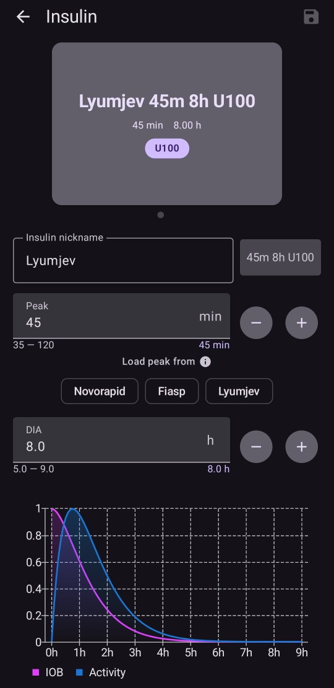
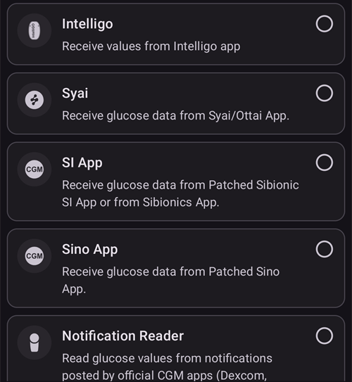

# Configuração (Config Builder)

```{admonition} Vindo do AAPS v3? :class: note O **Config Builder** (Configurador) agora se chama **Configuração** e fica no **menu** (☰). Veja [O que mudou no AAPS v4](#v4-changes).

    <br />**Configuração** é onde você escolhe quais plugins estão ativos (CGM, bomba, algoritmo APS, sensibilidade, sincronização, …) e abre cada plugin e as suas configurações. O [passo a passo](#configuration-v4) está abaixo; o resto desta página descreve cada seção em detalhes.
    
    (configuration-v4)=
    ## Configuração no AAPS v4
    
    No **AAPS** v4, toque no **menu** (☰) no **canto superior esquerdo** da tela principal e escolha **Configuração** (*“Defina sua configuração (CGM, bomba, ...) e ative recursos”*).
    
    
    
    Os plugins são agrupados por **categoria** — por exemplo *Suavização*, *Calibração*, *Detecção de sensibilidade*, *APS*, *Comunicação* e *Geral*. Cada linha mostra o nome da categoria e o plugin **atualmente ativo** (por exemplo *APS → SMB OpenAPS*). Toque em uma linha para abrir uma categoria.
    
    
    
    Dentro de uma categoria, você vê os plugins disponíveis para ela. Nas categorias de escolha única, você escolhe o plugin ativo; algumas categorias permitem escolher vários (*“Escolha todas as opções aplicáveis.”*). Cada plugin oferece duas ações:
    
    - **Abrir plugin** — abre a tela do próprio plugin.
    - **Configurações** — abre as preferências do plugin (as configurações podem estar agrupadas em seções que se expandem).
    
    
    
    (configuration_sync_icon)=
    ### O ícone de celular — “sincronizado a partir do dispositivo principal”
    
    Um pequeno **ícone de celular (telefone)** ao lado de uma categoria ou configuração significa que esse item é **sincronizado a partir do dispositivo principal** — o seu valor/a sua seleção chega a este dispositivo pelo canal NSClientV3 (Nightscout).
    
    Em um **cliente** (**AAPSClient**), esses itens são **mantidos sincronizados com o dispositivo principal**. O ícone só aparece em um cliente, por isso não está na captura de tela acima, que foi feita no app **AAPS** principal. Em um cliente, ele normalmente aparece em *Suavização*, *Calibração*, *Detecção de sensibilidade* e *APS*. Como exatamente o dispositivo principal e os clientes ficam alinhados — e quais configurações você pode mudar de cada lado — está explicado em [Controle dispositivo principal ↔ cliente](#client-master-config-prefs).
    
    O mesmo ícone também aparece **dentro das configurações**, ao lado de cada preferência que é sincronizada. No exemplo abaixo, *Limite de absorção* tem o ícone; as configurações sem o ícone são definidas em cada dispositivo:
    
    
    
    Os itens **sem** o ícone são configurados **em cada dispositivo**. O exemplo mais importante é a própria conexão **NSClientV3 (Comunicação)** — a **URL do Nightscout**, o **token de acesso** e os **websockets** são definidos em cada telefone separadamente, por isso **não** mostram o ícone de celular.
    
    ---
    
    (Config-Builder-tab-or-hamburger-menu)=
    ## Abrir a tela de um plugin
    
    A tela de cada plugin é aberta de uma destas formas (as abas e a caixa de seleção com o olho do **AAPS** v3 não existem mais, veja [O que mudou no AAPS v4](#v4-changes)):
    
    - **Configuração** → a categoria do plugin → **Abrir plugin**,
    - o painel **Gerenciar** da navegação inferior, para as telas que você mais usa (Perfil, Configurações de insulina, Bomba, Automação, Alimentos...),
    - um botão de [acesso rápido](../DailyLifeWithAaps/QuickLaunch.md) que você mesmo adiciona,
    - a **barra de pesquisa** na tela principal.
    
    ```{contents}
    :backlinks: entry
    :depth: 2
    

(ConfigBuilder_Profile)=

## Perfil

Este módulo não pode ser desativado, porque é uma parte essencial do **AAPS**.

Veja [Seu perfil do AAPS](../SettingUpAaps/YourAapsProfile.md) para entender o básico sobre o que faz parte do seu **Perfil**.

(insulin)= (Config-Builder-insulin)=

## Insulina


No **AAPS** 4, a insulina não é mais um plugin selecionado em **Configuração**. Abra **Gerenciar → Configurações de insulina** para configurar a insulina que você usa.

O editor de insulina permite:

* dar ao perfil um **Apelido da insulina**, para que seja fácil reconhecê-lo,
* definir o **Pico** (tempo até a atividade máxima da insulina, em minutos) e a **DIA** (duração da ação da insulina, em horas), digitando o valor ou usando os botões **–** / **+**,
* tocar em um botão predefinido de **Carregar pico de** — **Novorapid** (75 min), **Fiasp** (55 min) ou **Lyumjev** (45 min) — para preencher, em um passo, o tempo de pico padrão dessa insulina.

As faixas permitidas são as mesmas para qualquer insulina:

* **DIA**: 5 a 9 horas (5 a 10 horas se o tipo de paciente for **Grávida**). Veja [Duração da ação da insulina (DIA) e pico](#Config-Builder-insulin-dia) para escolher um valor.
* **Pico**: 35 a 120 minutos.

As curvas de **IOB** (insulina ativa) e de **Atividade** mostradas na parte de baixo do editor mudam conforme você altera os valores, assim você vê na hora como as suas configurações mudam a ação da insulina.

Mais informações para entender o perfil de insulina mostrado no **AAPS** [aqui](#AapsScreens-insulin-profile).

(Config-Builder-insulin-change-active)=

### Mudar a insulina em uso (DIA ou pico)

A insulina marcada como **ATIVO** é a que o seu perfil em execução usa. Os campos dela ficam em cinza: você não pode editá-la nem excluí-la. Assim, o nome da insulina mostrado no seu perfil em execução sempre corresponde às configurações realmente em uso.

Para mudar a DIA ou o pico que você usa:

1. Abra **Gerenciar → Configurações de insulina**. Se a tela abrir em modo somente leitura (um **✏️ lápis** na barra superior), toque no lápis e desbloqueie as suas configurações.
2. Toque em **+** (*Adicionar nova insulina*). O **AAPS** cria uma cópia da insulina mostrada na tela.
3. Defina o novo **Pico** e/ou a nova **DIA** e depois toque no ícone de salvar (canto superior direito).
4. Toque em **▶** (*Ativar insulina*) e confirme. A nova insulina fica marcada como **ATIVO**.

```{admonition} O nome inclui o pico e a DIA :class: note O **AAPS** adiciona automaticamente o pico, a DIA e a concentração ao nome da insulina (por exemplo *Fiasp 55m 8h U100*), assim você distingue as suas configurações rapidamente.

    <br />Você pode excluir a insulina antiga quando ela não estiver mais ativa.
    
    ### As predefinições de "Carregar pico de"
    
    No **AAPS** 4 não há uma lista de tipos de insulina para escolher. Todas as insulinas usam a mesma curva de atividade exponencial; só o **Pico** e a **DIA** mudam. As predefinições de **Carregar pico de** no editor de insulina preenchem com um toque o pico recomendado para as insulinas mais comuns (o pequeno ⓘ ao lado de **Carregar pico de** mostra a lista com os valores de pico). Depois, você ainda pode ajustar o **Pico** e a **DIA**.
    
    Só mude o pico para longe do valor recomendado se você entender o efeito disso. O [gráfico das curvas de insulina](#AapsScreens-insulin-profile) ajuda você a entender as curvas.
    
    #### Novorapid
    
    
    
    * recomendado para Humalog, Novolog e Novorapid (chamado *Rapid-Acting Oref* no **AAPS** v3)
    * Pico = 75 minutos após a injeção
    
    #### Fiasp
    
    
    
    * recomendado para Fiasp (chamado *Ultra-Rapid Oref* no **AAPS** v3)
    * Pico = 55 minutos após a injeção
    
    (Config-Builder-lyumjev)=
    #### Lyumjev
    
    
    
    * recomendado para Lyumjev
    * Pico = 45 minutos após a injeção
    
    #### Pico personalizado
    
    * Não existe um tipo de insulina "Free-Peak Oref" separado no **AAPS** 4: digite qualquer **Pico** (35 a 120 minutos) diretamente no [editor de insulina](#Config-Builder-insulin), sem usar uma predefinição.
    * Um pico personalizado é útil se você usa uma insulina que não está na lista, ou uma mistura de insulinas diferentes.
    
    (Config-Builder-insulin-dia)=
    ### Duração da ação da insulina (DIA) e pico
    
    ```{warning}
    No loop, diminuir a DIA ou o pico sempre aumenta a insulina administrada. A DIA funciona de forma diferente no AAPS do que nos sistemas AID comerciais, e mudanças descuidadas nessas configurações podem alterar a dose de insulina muito mais ou muito menos do que o esperado.
    

O AAPS modela a linha do tempo da ação da insulina com uma fórmula matemática, configurada pela **DIA** e pela configuração de **pico**, que está muito ligada a ela. A DIA é a duração teórica até a IOB chegar a zero, e o pico é o momento em que o efeito da insulina é mais forte. Isso gera uma curva de IOB e uma curva de atividade, que é simplesmente a **velocidade** com que a IOB diminui.

Lembre-se de que, quando o AAPS está em loop, é normal ter períodos de [basal temporária zero](#Open-APS-features-super-micro-bolus-smb). Essa insulina basal que falta é totalmente subtraída da IOB. Isso explica por que, na prática, a IOB chega a zero muitas horas antes da DIA configurada. Você pode ver a [IOB do bólus e a IOB da basal](#aaps-screens-iob-cob-basal-sens) separadamente na tela principal.

Para configurar a DIA e o pico, toque em **Gerenciar** na tela principal e depois em **Configurações de insulina**. O AAPS mostra a configuração da insulina ativa assim:


Neste exemplo, o pico é de 55 minutos, a DIA é de 8 horas e a [concentração da insulina](#Insulin-Concentration) é a padrão de 100 UI/mL.

Por causa da influência da basal temporária zero explicada acima e da fórmula usada no AAPS para a redução da IOB, a maioria dos usuários define uma DIA bem mais alta do que nos sistemas comerciais. Em geral, muitas pessoas acham que uma **DIA** de 9 h funciona bem para elas. Depois de ganhar mais experiência com o AAPS e ter um perfil bem ajustado, você pode tentar encontrar configurações de DIA e de pico personalizadas com as informações abaixo.

````{admonition} Detalhes sobre o impacto da configuração da DIA e do pico :class: dropdown

Como a taxa basal tem uma influência indireta na redução da IOB no AAPS, taxas basais altas demais podem esconder uma DIA alta demais, e vice-versa. Faz sentido ajustar primeiro as taxas basais com cuidado, antes de ajustar a DIA e o pico. Além disso, lembre-se de que as configurações de DIA e de pico interagem: o efeito da DIA depende do pico, e vice-versa.

Estes gráficos mostram o impacto exato da DIA e do pico nas curvas de IOB, em toda a faixa de valores permitidos.

Ajuste da DIA:

```{image} ../images/iob_remaining_static_peak.png :width: 400px

    <br />Ajuste do pico:
    
    ```{image} ../images/iob_remaining_static_dia.png
    :width: 400px
    

Por fim, uma comparação ajustando a DIA e o pico ao mesmo tempo. A lógica aqui é que os dois valores são ajustados na mesma proporção, de modo que `49/35 ~ 7/5`. Ou, da mesma forma, `120/93 ~ 9/7`. Os intervalos serão os mesmos, qualquer que seja a DIA ou o pico de partida, desde que a mudança relativa seja a mesma para os dois.

```{image} ../images/iob_remaining_uniform.png :width: 400px

    <br />Observe que, quando a DIA e o pico são ajustados dessa forma, cada ponto da curva se desloca na mesma proporção.
    
    ````
    
    #### Leitura adicional sobre a configuração da DIA e do pico
    
    * [Detalhes técnicos e histórico do OpenAPS, o antecessor do AAPS](https://openaps.readthedocs.io/en/latest/docs/While%20You%20Wait%20For%20Gear/understanding-insulin-on-board-calculations.html#understanding-the-new-iob-curves-based-on-exponential-activity-curves).
    * [Why we are regularly wrong in the duration of insulin action (DIA) times we use, and why it matters…](https://www.diabettech.com/insulin/why-we-are-regularly-wrong-in-the-duration-of-insulin-action-dia-times-we-use-and-why-it-matters/) (Por que erramos com frequência os tempos de duração da ação da insulina (DIA) que usamos, e por que isso importa) no Diabettech.
    * [Exponential Insulin Curves + Fiasp](https://web.archive.org/web/20220630154425/http://seemycgm.com/2017/10/21/exponential-insulin-curves-fiasp/) (Curvas de insulina exponenciais + Fiasp) no See My CGM (arquivo).
    * [Revised Humalog model in a closed loop](https://bionicwookiee.com/2022/04/13/revised-humalog-model-in-a-closed-loop/) (Modelo revisado da Humalog em um loop fechado) e outros artigos no Bionic Wookie, que recomendam uma DIA de 9 h para Lyumjev, Fiasp, NovoRapid e Humalog.
    
    (Config-Builder-bg-source)=
    ## Fonte de BG
    Selecione a fonte de glicose que você está usando. Veja a página [Fonte de BG](../Getting-Started/CompatiblesCgms.md) para mais informações de configuração.
    
    
    
    Role para baixo para ver as outras fontes:
    
    
    
    
    
    * [xDrip+](../CompatibleCgms/xDrip.md) - também para apps compatíveis, como o [Juggluco](../CompatibleCgms/Juggluco.md)
    * [Glicemia via NSClient](../CompatibleCgms/CgmNightscoutUpload.md) - só se você souber o que está fazendo, veja [Fonte de BG](../Getting-Started/CompatiblesCgms.md).
    * [MM640g](../CompatibleCgms/MM640g.md)
    * Glimp - só a versão 4.15.57 e mais novas são compatíveis
    * [BYODA (Build Your Own Dexcom App)](#DexcomG6-if-using-g6-with-build-your-own-dexcom-app).
    * App CGM MicroTech - para o CGM Aidex / LinX
    * [Poctech](../CompatibleCgms/PocTech.md)
    * Tomato (MiaoMiao) - app Tomato para o dispositivo MiaoMiao
    * [Glunovo](https://infinovo.com/) - app Glunovo para o sistema CGM Glunovo
    * Intelligo - app Intelligo
    * Syai/Ottai - para os apps Syai e Ottai (veja [Syai Tag](../CompatibleCgms/SyaiTagX1.md) e [Ottai](../CompatibleCgms/OttaiM8.md))
    * App SI - app SI modificado ou app Sibionics para o CGM Sibionics
    * App Sino - app modificado para o CGM Sinocare
    * Leitor de notificações - lê os valores de glicose das notificações mostradas pelos apps oficiais dos CGMs (Dexcom, Medtronic, Eversense etc.)
    * Instara - app Instara
    * Glicemia aleatória - gera dados de glicose aleatórios para testes. Ela só pode ser ativada em uma compilação de engenharia (de desenvolvedor) com a **Bomba virtual**, por isso não pode ser usada em uma instalação normal do **AAPS**.
    
    ## Suavização
    
    
    
    Veja [Suavização dos dados de glicose](../CompatibleCgms/SmoothingBloodGlucoseData.md).
    
    ## Calibração
    
    Escolha como o **AAPS** trata os valores que recebe do seu sensor:
    
    - **Sem calibração**: os valores do sensor são usados como estão. Use esta opção quando o sensor já tiver calibração de fábrica e for preciso. Esta é a opção padrão.
    - **Calibração linear**: o **AAPS** corrige os valores do sensor com uma inclinação (slope) e um deslocamento (offset) que calcula a partir das suas medições de glicose capilar.
    
    Como a **Calibração linear** funciona:
    
    - Ela precisa que uma **troca de sensor** seja registrada, para saber quando a sessão do sensor começou. As primeiras 2 horas de uma sessão são ignoradas como aquecimento.
    - Ela precisa de pelo menos **2 medições de glicose capilar**. Medições recentes contam mais do que as antigas.
    - A correção só é aplicada quando o resultado está em uma faixa segura. Se as suas medições estiverem muito próximas umas das outras, só o deslocamento (offset) é corrigido.
    - **Abrir plugin** mostra o status da calibração, a inclinação e a correção em uso, e a lista das medições de glicose capilar. Você pode adicionar uma medição com **Adicionar calibração** e remover uma errada.
    
    ```{admonition} Calibre com cuidado
    :class: warning
    Um valor de glicose capilar errado leva a valores de glicose errados e, portanto, a doses de insulina erradas. Lave as mãos antes de medir e não calibre enquanto a sua glicose estiver mudando rápido.
    


(Config-Builder-pump)=

## Bomba

Selecione a bomba que você está usando. Veja a página [Bombas compatíveis](../Getting-Started/CompatiblePumps.md) para mais informações de configuração.


Role para baixo para ver todos os drivers de bomba:


Quando você seleciona outra bomba, o **AAPS** pede que você confirme a mudança:


* [Dana R](../CompatiblePumps/DanaR-Insulin-Pump.md)
* Dana R Korean (para a bomba DanaR vendida na Coreia)
* Dana Rv2 (bomba DanaR com atualização de firmware não oficial)
* [Dana-i/RS](../CompatiblePumps/DanaRS-Insulin-Pump.md)
* [Accu Chek Insight](../CompatiblePumps/Accu-Chek-Insight-Pump.md)
* [Accu Chek Combo](../CompatiblePumps/Accu-Chek-Combo-Pump-v2.md)
* Omnipod para [Omnipod Eros](../CompatiblePumps/OmnipodEros.md)
* Dash para [Omnipod DASH](../CompatiblePumps/OmnipodDASH.md)
* [Medtronic](../CompatiblePumps/MedtronicPump.md)
* [Diaconn G8](../CompatiblePumps/DiaconnG8.md)
* [EOPatch2](../CompatiblePumps/EOPatch2.md)
* [Medtrum](../CompatiblePumps/MedtrumNano.md)
* [Equil 5.3](../CompatiblePumps/Equil5.3.md)
* [Carelevo](../CompatiblePumps/CareLevo.md)
* Bomba virtual: loop aberto - apenas sugestões do **AAPS** 
  * quando você dá os seus primeiros passos com o **AAPS**, durante os primeiros [objetivos](../SettingUpAaps/CompletingTheObjectives.md)
  * para uma bomba que ainda não tem driver

(config-builder-wrong-pump-data)=

### Mensagem: "Os dados estão vindo de uma bomba diferente"

O **AAPS** lembra a bomba à qual está conectado (tipo de bomba e número de série). Se receber dados de outra bomba, por exemplo depois que a sua bomba foi substituída por uma nova do mesmo modelo, ele mostra esta mensagem e ignora os dados dessa bomba:


Para usar a nova bomba, mude o driver da bomba: selecione **Bomba virtual**, confirme e depois selecione a sua bomba de novo. Então o **AAPS** registra a bomba à qual está conectado agora.

(Config-Builder-sensitivity-detection)=

## Detecção de sensibilidade


Selecione o tipo de detecção de sensibilidade. Para mais detalhes sobre os diferentes modelos, [leia aqui](../DailyLifeWithAaps/SensitivityDetectionAndCob.md). Ele analisa os dados históricos continuamente e faz ajustes se perceber que você está reagindo à insulina de forma mais sensível (ou, ao contrário, mais resistente) do que o normal. Mais detalhes sobre como a própria razão de sensibilidade é calculada estão em [Principais recursos do AAPS > Autosens](#Open-APS-features-autosens).

Você pode ver a sua sensibilidade na tela principal em um [gráfico adicional](#AapsScreens-section-g-additional-graphs), selecionando SEN e observando a linha branca. Observe que você precisa estar no [Objetivo 8](#objectives-objective8) para que a detecção de sensibilidade/o [Autosens](#Open-APS-features-autosens) ajuste automaticamente a quantidade de insulina administrada. Antes de chegar a esse objetivo, a porcentagem do Autosens / a linha no seu gráfico é mostrada apenas como informação.

### Configurações de absorção

Se você usa o Oref1 com **SMB**, precisa mudar **min_5m_carbimpact** para 8. O valor só é usado durante falhas nas leituras do **CGM** ou quando a atividade física "consome" toda a subida da glicose que, de outra forma, faria o **AAPS** reduzir os COB. Quando a [absorção de carboidratos](../DailyLifeWithAaps/CobCalculation.md) não pode ser calculada dinamicamente com base nas reações da sua glicose, ele aplica uma redução padrão aos seus carboidratos. Basicamente, é uma medida de segurança.

(Config-Builder-aps)=

## APS


Selecione o algoritmo APS desejado para ajustes de terapia. Você pode ver os detalhes atuais do algoritmo escolhido com **Abrir plugin**.

* OpenAPS AMA 
  * Advanced Meal Assist (Assistente avançado de refeição): algoritmo mais antigo, não é mais recomendado.
  * Em termos simples, o benefício é que, depois que você faz um bólus de refeição, o sistema pode usar uma basal temporária alta mais rapidamente SE você informar os carboidratos de forma confiável.
* [SMB OpenAPS](#Open-APS-features-super-micro-bolus-smb) 
  * Super Micro Bólus: o algoritmo mais recente, recomendado para todos os usuários.
  * Ao contrário do AMA, o SMB não usa basais temporárias para controlar a glicose, mas principalmente pequenos **Super Micro Bólus**.
  * Observação: recomenda-se usar este algoritmo desde o início, mesmo que você só receba SMBs de fato a partir do [Objetivo 9](#objectives-objective9).
* [Auto ISF](#Open-APS-features-auto-isf) 
  * Algoritmo experimental para usuários avançados. Ele só aparece na lista depois que os objetivos forem concluídos.

Se você mudar do algoritmo AMA para o SMB, *min_5m_carbimpact* precisa ser mudado manualmente para **8** (valor padrão para o SMB) em [Configurações → Configurações de absorção](#Preferences-min_5m_carbimpact).

## Loop

Este módulo não pode ser desativado, porque é uma parte essencial do **AAPS**.


## Restrições


### Objetivos

O **AAPS** tem um programa de aprendizado (uma série de objetivos) que você precisa cumprir passo a passo. Ele deve guiar você com segurança na configuração de um sistema de loop fechado.

Consulte a página [Objetivos](../SettingUpAaps/CompletingTheObjectives.md) para obter mais informações.

## Comunicação

Nesta categoria (chamada **Sincronização** no **AAPS** v3), você escolhe se e para onde quer que o **AAPS** envie os seus dados.


Role para baixo para ver o resto da lista:


### NSClientV3

Pode ser usado como [servidor de relatórios](../SettingUpAaps/SettingUpTheReportingServer.md) e/ou para [monitoramento remoto](../RemoteFeatures/RemoteMonitoring.md), [controle remoto](../RemoteFeatures/RemoteControl.md).

Veja [Sincronização com o servidor de relatórios](#SetupWizard-synchronization-with-the-reporting-server-and-more) para configurar a sincronização do NSClientV3.

### Tidepool

Pode ser usado como [servidor de relatórios](../SettingUpAaps/SettingUpTheReportingServer.md).

Veja [Tidepool](../SettingUpAaps/Tidepool.md).

### xDrip

Usado para **enviar** dados, como valores de glicose e tratamentos, para o xDrip+ no mesmo telefone. As configurações dele também têm **Enviar status para o xDrip+**, uma linha de status com IOB e COB que o xDrip+ e alguns apps companheiros de relógio mostram.

### Open Humans

Veja [Open Humans](../SupportingAaps/OpenHumans.md).

(Config-Builder-wear)=

### Wear

Monitore e controle o **AAPS** a partir de um relógio Wear OS. A configuração do relógio está explicada em [Smartwatch Wear OS](../WearOS/WearOsSmartwatch.md). Depois de ativar o plugin, escolha as opções dele em [Configurações > Wear](#preferences-wear). O uso do relógio está explicado em [Uso do AAPS pelo seu smartwatch Wear OS](../RemoteFeatures/RemoteControlWearOS.md).

(external-companion-apps)=

### Apps companheiros externos

Transmite dados de status do **AAPS** no telefone, para que outros apps instalados nele possam mostrá-los — por exemplo, apps companheiros de relógio ou de widget. A transmissão inclui glicose e tendência, IOB, COB, basal e basal temporária, nome do perfil, status do loop, bateria do telefone e da bomba, nível do reservatório e andamento do bólus. Só ative se um app companheiro que você usa pedir esses dados.

Os apps que sabidamente leem esta transmissão são o [WatchDrip+](https://bigdigital.home.blog/) (relógios Xiaomi e Amazfit), o [GlucoDataHandler](https://github.com/pachi81/GlucoDataHandler) (complicações e widgets do Wear OS, e Android Auto pelo GlucoDataAuto) e o app G-Watch. A configuração deles está descrita em [Smartwatches e o AAPS](#watches-external-companion-apps). Alguns deles também usam **Enviar status para o xDrip+** do plugin **xDrip** acima, para uma linha de status com IOB e COB.

Em versões anteriores, este plugin se chamava **Samsung Tizen**, por causa do [app G-Watch para relógios Samsung Tizen](#Watchfaces-tizen), para o qual foi feito no início.

### Garmin

Conexão com um dispositivo Garmin (Fenix, Edge...)

## Tratamentos

Abra o **menu** (☰) e selecione [Histórico de tratamentos](#aaps-screens-treatments) para ver os tratamentos que foram registrados. Se quiser editar ou excluir um registro (por exemplo, você comeu menos carboidratos do que esperava), selecione 'Remover' e digite o novo valor (mude o horário, se necessário) em **Tratamentos → Carboidratos** na navegação inferior (veja [Carboidratos](#screens-bolus-carbs)).

## Geral

No **AAPS** 4, a categoria **Geral** da **Configuração** mostra apenas o **Autotune**. Os outros recursos descritos abaixo estão sempre disponíveis e não precisam mais ser ativados aqui; cada parágrafo diz onde encontrá-los.


### Visão geral

A [tela principal](#AapsScreens-the-homescreen) do **AAPS** não é mais um plugin e não tem configurações próprias em **Configuração**. As opções que ficavam aqui estão em **Configurações** (ícone de engrenagem): [Mostrar notas nos diálogos](#Preferences-show-notes-field-in-treatments-dialogs), [Luzes de status](#Preferences-status-lights) e a [Porcentagem do bólus](#Preferences-deliver-this-part-of-bolus-wizard-result) usada pelo Assistente de Bólus. A opção de super bólus do **AAPS** 3.x [não está disponível como configuração](#Preferences-advanced-settings-overview) no **AAPS** 4.

(Config-Builder-actions)=

### Ações

A aba Ações do **AAPS** 3.x não existe mais. Os botões dela agora estão no painel **Gerenciar** — veja [Para onde foi a aba Ações?](#screens-action-tab).

### Automação

**Gerenciar → Automação** permite gerenciar as suas [Automações](../DailyLifeWithAaps/Automations.md), a partir do [Objetivo 10](#objectives-objective10).

(Config-Builder-sms-communicator)=

### Comunicador SMS

Permite que cuidadores controlem à distância alguns recursos do **AAPS** por SMS. Veja [Comandos SMS](../RemoteFeatures/SMSCommands.md) para mais informações de configuração.

### Alimentos

**Gerenciar → Alimentos** mostra as predefinições de alimentos definidas no banco de alimentos do Nightscout. Veja o [Readme do Nightscout](https://github.com/nightscout/cgm-remote-monitor#food-custom-foods) para mais informações de configuração.

Observação: os itens não podem ser usados na calculadora do **AAPS**. (somente visualização)

(Config-Builder-autotune)=

### Autotune

Você pode ativar o Autotune, veja [aqui](../AdvancedOptions/Autotune.md).

### Manutenção

Abra o **menu** (☰) e selecione **Manutenção** para exportar / importar configurações e gerenciar os arquivos de log.


### Configuração

Agora se chama **Configuração**: esta página.