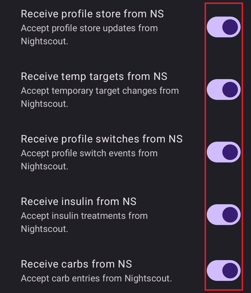

# Nightscout

(Nightscout-security-considerations)=

## Questões de segurança

O Nightscout é o servidor de relatórios e de monitoramento do **AAPS**: o **AAPS** envia os seus dados para ele, e você ou os seus cuidadores os veem no site do Nightscout ou em apps de seguidor. Ele guarda os seus dados médicos, perfis e tratamentos, por isso vale a pena pensar em proteger o seu site do Nightscout.

No **AAPS** 4, o controle remoto não passa pelo site do Nightscout. Enquanto o controle do cliente está ativado ([modo reforçado](#client-master-control-hardened-mode)), tratamentos ou alvos digitados diretamente no Nightscout **não são aplicados** pelo **AAPS**. Em vez disso, os comandos remotos vêm de um **AAPSClient** pareado — veja [Controle dispositivo principal ↔ cliente](#client-master-control).

Tenha o máximo de cuidado se usar o Nightscout como fonte de dados de BG do AAPS.

### Configurações do Nightscout

Você pode negar o acesso público ao seu site do Nightscout usando [funções de autenticação](https://nightscout.github.io/nightscout/security): compartilhe a sua URL somente com um token `readable`, nunca com um token `admin`.

O `API_SECRET` do Nightscout é a senha principal do seu site: não o compartilhe publicamente.

(Nightscout-aaps-settings)=

### Configurações do AAPS

Aceitar dados do Nightscout (mudanças de perfil, tratamentos, ...) é opcional e está desativado por padrão. As chaves descritas abaixo ficam ocultas enquanto o controle do cliente está ativado (modo reforçado) e no [Modo simples](#preferences-simple-mode).

* Acesse as configurações de **Sincronização** do plugin NSClientV3 de uma destas formas: 1) **Configurações** (ícone de engrenagem na tela principal) -> **NSClientV3** -> **Sincronização**, ou 2) **Configuração** (menu ☰) -> **Comunicação** -> "**Configurações**" em NSClientV3.
* Ative "Enviar dados para o NS".
* "Enviar dados de glicemia para o NS" fica nas configurações da sua fonte de BG (**Configuração → Fonte de BG → Configurações**). Ative-a, a não ser que a fonte de dados de BG do seu AAPS seja o Nightscout: nesse caso, **não** a ative.
* Não ative "Receber dados de CGM do NS", a não ser que o Nightscout seja a sua fonte de dados de BG.

#### Não sincronizar a partir do Nightscout

Keeping all the "Receive … from NS" options disabled makes sure no Nightscout change will be used by AAPS:

#### Aceitar mudanças do Nightscout

Ativar essas opções permite mudar configurações do AAPS pelo Nightscout, como modificar e trocar perfis, alvos temporários e adicionar carboidratos, que serão levados em conta pelo AAPS. Elas só aparecem quando o controle do cliente e o Modo simples estão desativados.  
Observe que tratamentos com insulina só serão usados em cálculos, como "Não fazer bólus, apenas registrar".

### Outras configurações de segurança

Mantenha o seu telefone atualizado, como descrito em [Segurança em primeiro lugar](#preparing-safety-first).

(Nightscout-manual-nightscout-setup)=

## Configuração manual do Nightscout

Presume-se que você já tem um site do Nightscout. Se não tiver, visite a página do [Nightscout](http://nightscout.github.io/nightscout/new_user/) para ver as instruções completas de configuração. As instruções abaixo são configurações que você também precisa adicionar ao seu site do Nightscout. O seu site do Nightscout precisa ter pelo menos a versão 15. Verifique se você está usando a [versão mais recente](https://nightscout.github.io/update/update/#updating-your-site-to-the-latest-version), senão você verá uma mensagem de erro no seu app AAPS.

* [Edite as suas variáveis](https://nightscout.github.io/nightscout/setup_variables/#nightscout-configuration)

* Adicione ou edite as variáveis assim:
  
  * `ENABLE` = `careportal boluscalc food bwp cage sage iage iob cob basal dbsize pushover pump openaps`
  * `DEVICESTATUS_ADVANCED` = `true`
  * `SHOW_FORECAST` = `openaps`
  * `PUMP_FIELDS` = `reservoir battery clock`
  * Vários alarmes podem ser definidos para [monitorar a bomba](https://github.com/nightscout/cgm-remote-monitor#pump-pump-monitoring). O alarme da % da bateria, em especial, é recomendado: 
    * `PUMP_WARN_BATT_P` = `51`
    * `PUMP_URGENT_BATT_P` = `26` 

* Salve as alterações. O seu site do Nightscout agora deve permitir que você mostre as pílulas (pills). Você pode forçar a exibição padrão adicionando-as em `SHOW_PLUGINS`.
  
  * `SHOW_PLUGINS` = `careportal boluscalc food bwp cage sage iage iob cob basal dbsize pushover pump openaps`
  
  

## Nightscout como SaaS pago (Software as a Service)

Use a interface web do fornecedor para definir as variáveis. Se necessário, entre em contato com o suporte do fornecedor.