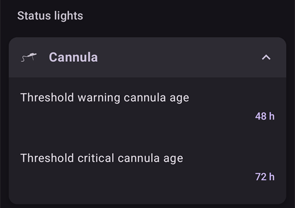
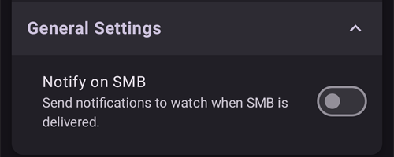

# Configurações

No **AAPS** v4, as preferências ficam na tela **Configurações**. Há três caminhos para chegar a elas — veja [Alterar a configuração do AAPS](../SettingUpAaps/ChangeAapsConfiguration.md) para mais detalhes:

1. Toque no ícone **Configurações** (engrenagem) no canto superior direito da tela principal: todas as configurações, agrupadas em seções que se expandem.
2. Em **Configuração**, toque em "**Configurações**" abaixo de um plugin ativo: só as configurações desse plugin.
3. Use a **barra de pesquisa** no topo da tela principal: basta começar a digitar parte do texto que você procura. Ela encontra configurações individuais (até as que não aparecem na tela Configurações), diálogos e a documentação.


- As **seções** são abertas e fechadas com um toque. As seções que você vê dependem dos plugins que você ativou e do [Modo simples](#preferences-simple-mode).


```{contents}
:backlinks: entry
:depth: 2
```

(Preferences-general)=
## Geral


**Unidades**

- Defina as unidades como mmol/l ou mg/dl, conforme a sua preferência.

**Idioma**

- By default **AAPS** follows the language of the phone (recommended).

- If you want **AAPS** in another language than the phone, choose it here. On Android 13 and newer, **AAPS** registers it as its own app language in Android, so all its screens, the main screen, the widgets and the way numbers are written follow it.

- Quando você muda o idioma, os textos do **AAPS** passam para o novo idioma na hora. Se alguns textos ainda aparecerem no idioma antigo, reinicie o **AAPS**.
- On Android 12 this setting is not shown: **AAPS** always uses the language of the phone.
- Configuração oculta no [Modo simples](#preferences-simple-mode).

(preferences-simple-mode)= **Modo simples**

O **Modo simples** é ativado por padrão quando você instala o **AAPS** pela primeira vez. No **Modo simples**, muitas configurações ficam ocultas e as preferências são substituídas por valores predefinidos. Você deve desativar o Modo simples quando estiver familiarizado com a interface e as configurações do **AAPS**.

**Suporte a concentrações de insulina**

- Ativa o suporte a diferentes concentrações de insulina (U50, U200, ...). Só ative isto se você realmente usa uma concentração diferente de U100, e leia os avisos com atenção.
- Configuração oculta no [Modo simples](#preferences-simple-mode).

**Manter a tela ligada**

- Força o Android a manter a tela sempre ligada. Isto é útil para apresentações, etc. Mas gasta muita bateria. Por isso, recomenda-se conectar o smartphone a um carregador.

**Nome da instância**

- O nome da pessoa que usa este telefone. Ele diferencia esta instância do **AAPS** nos relatórios e na sincronização, por exemplo se duas crianças com diabetes tipo 1 da sua família usam o **AAPS**.
- Usado nos nomes dos arquivos de configurações exportados.
- Mostrado no [mostrador Dual](../WearOS/WearOsSmartwatch.md).

(Preferences-skin)=
### Tema

A seleção de tema (skin) do **AAPS** 3.x (Original, Baixa resolução, Tela grande...) não existe mais no **AAPS** 4. A nova interface se adapta à sua tela automaticamente, e o esquema de cores pode ser mudado em [Aparência](#preferences-appearance).

(preferences-appearance)=
## Aparência


(Preferences-range-for-visualization)=
### Intervalo para visualização

Escolha os limites alto e baixo do gráfico de glicose na tela principal do **AAPS** e no smartwatch. É apenas a visualização, não a faixa-alvo da sua glicose. Exemplo: 70 - 180 mg/dl ou 3,9 - 10 mmol/l

(Preferences-show-notes-field-in-treatments-dialogs)=
### Mostrar notas nos diálogos

Dá a opção de adicionar notas curtas de texto aos seus tratamentos (Assistente de Bólus, carboidratos, insulina...)

Configuração oculta no [Modo simples](#preferences-simple-mode).

### Esquema de cores do aplicativo

Escolha entre o tema claro, o tema escuro ou seguir a configuração do sistema do telefone.

(Preferences-protection)=
## Proteção


(Preferences-master-password)=
### Senha mestra

Obrigatória para poder [exportar configurações](../Maintenance/ExportImportSettings.md), porque elas são criptografadas desde a versão 2.7.

**A proteção biométrica pode não funcionar em telefones OnePlus. Este é um problema conhecido da OnePlus em alguns telefones.**


(Preferences-settings-protection)=
### Proteção das configurações

- Proteja as suas configurações com uma senha ou com a autenticação biométrica do telefone (por exemplo, quando uma [criança usa o **AAPS**](../RemoteFeatures/RemoteMonitoring.md)). Se você ativar este recurso, será pedida uma autenticação toda vez que quiser abrir qualquer tela relacionada às configurações.

- As telas de gerenciamento (**Perfil**, **Configurações de insulina**, **Alvo temporário**, **Assistente rápido**) passam a abrir em modo **somente leitura**. Você ainda pode ativar ou usar um item, mas adicionar, editar, clonar e excluir ficam ocultos até você desbloquear as suas configurações. Veja [A proteção das configurações agora também bloqueia as telas de gerenciamento](#v4changes-read-only-management).

- Use uma senha personalizada se quiser usar a senha mestra só para proteger as [configurações exportadas](../Maintenance/ExportImportSettings.md), e usar outra senha para editar as configurações.

- Se você usa uma senha personalizada, toque na linha "Senha das configurações" para definir a senha como descrito [acima](#Preferences-master-password).

### Proteção do aplicativo

Se o app estiver protegido, você precisa digitar a senha ou usar a autenticação biométrica do telefone para abrir o **AAPS**, e de novo quando voltar a ele depois do [tempo limite de proteção](#Preferences-password-and-pin-retention).

O **AAPS** fecha imediatamente se uma senha errada for digitada - mas continua funcionando em segundo plano se já tiver sido aberto com sucesso antes.

### Proteção do bólus

- A proteção do bólus pode ser útil se o **AAPS** for usado por uma criança pequena e você [fizer bólus por SMS](../RemoteFeatures/SMSCommands.md).

- A **Proteção do bólus** só pode ser selecionada depois que a **Proteção das configurações** (nível 2) estiver definida.

- No exemplo abaixo, a proteção do bólus usa a **Senha mestra**: o **AAPS** pede a senha antes de abrir um diálogo de tratamento, como **Insulina**. Com **Biometria**, se a autenticação biométrica não funcionar, você pode digitar a senha mestra no lugar.


(Preferences-password-and-pin-retention)=
### Retenção de senha e PIN

O **Tempo limite de proteção** define por quanto tempo (em segundos) as configurações ou as funções de bólus ficam desbloqueadas depois que você digita a senha com sucesso.

## Segurança do tratamento


(preferences-patient-type)=
### Idade do paciente

- Os limites de segurança são definidos com base na idade que você seleciona nesta configuração.
- Se você começar a atingir esses limites rígidos (como o bólus máximo), é hora de subir um nível.
- It's a bad idea to select higher than real age because it can lead to overdosing by entering the wrong value in the insulin dialog (by skipping the decimal separator, for example).
- Se você quiser saber os números reais desses limites de segurança fixos no código, role até o recurso do algoritmo que você usa [nesta página](../DailyLifeWithAaps/KeyAapsFeatures.md).

(Preferences-maximum-bolus)=
### Bólus máximo

- Define a quantidade máxima de insulina de bólus, em unidades de insulina, que o **AAPS** pode administrar de uma vez.
- Esta configuração existe como um limite de segurança para impedir a administração de um bólus enorme por causa de uma entrada acidental ou de um erro do usuário.
- Recomenda-se definir um valor sensato, que corresponda mais ou menos à maior quantidade de insulina de bólus de que você provavelmente vai precisar para uma refeição ou uma dose de correção.
- Esta restrição também é aplicada aos resultados da calculadora de bólus.

### Máximo de carboidratos permitido

- Define a quantidade máxima de carboidratos, em gramas, para a qual a calculadora de bólus do **AAPS** pode calcular uma dose.
- Esta configuração existe como um limite de segurança para impedir a administração de um bólus enorme por causa de uma entrada acidental ou de um erro do usuário.
- Recomenda-se definir um valor sensato, que corresponda mais ou menos à maior quantidade de carboidratos de que você provavelmente vai precisar para uma refeição.

## Fonte de BG

As configurações da [Fonte de BG](#Config-Builder-bg-source) selecionada aparecem como uma seção própria. Por exemplo, com **xDrip+**:


- **Enviar dados de glicemia para o NS**: deixa o **AAPS** enviar ao Nightscout os valores de glicose recebidos. Só ative isto se o próprio app do CGM ainda não estiver enviando esses valores.
- **Registrar troca do sensor**: cria automaticamente um evento de terapia de troca de sensor quando o sensor é inserido.

## A tela principal

No **AAPS** 3.x, essas configurações ficavam agrupadas em uma seção "Overview" (Visão geral). No **AAPS** 4, elas são configuradas diretamente nos elementos da tela principal a que pertencem.

(Preferences-buttons)=
### Botões de acesso rápido

Defina quais botões de ação ficam visíveis na tela principal: toque na pequena **engrenagem** no centro da parte de baixo da tela principal ("Configurar acesso rápido") e toque em **Adicionar** para as ações que você quer acessar rapidamente (tratamentos, ações do CGM, registros do CarePortal...).


(Preferences-quick-wizard)=
### Assistente rápido

Crie botões personalizados para certas refeições ou lanches padrão, que serão mostrados na tela principal. Útil para refeições padrão que você come com frequência.

Para cada botão, você define os carboidratos e o método de cálculo do bólus. Depois, você define em qual período o botão fica visível na tela principal - só um botão por período. O botão não fica visível fora do período de tempo definido ou se você tiver IOB suficiente para cobrir os carboidratos definidos no botão do Assistente rápido. Se você definir horários diferentes para as diferentes refeições, sempre terá o botão de refeição padrão adequado na tela principal, conforme a hora do dia.

Para gerenciar as suas predefinições do Assistente rápido, digite "QuickWizard" na barra de pesquisa da tela principal e abra **Assistente rápido - Gerenciar predefinições do Assistente rápido**.

Se você tocar no botão do Assistente rápido, o **AAPS** calcula e propõe um bólus para esses carboidratos com base nas suas relações atuais (considerando o valor da glicose ou a insulina ativa, se configurado).

A proposta precisa ser confirmada antes que a insulina seja administrada.

(Preferences-default-temp-targets)=
### Alvos temporários padrão

Os [alvos temporários (TT)](../DailyLifeWithAaps/TempTargets.md) permitem mudar o seu alvo de glicose por um certo período. Ao definir um TT padrão, você pode mudar facilmente o seu alvo para atividade, comer em breve etc.

Toque na **faixa-alvo** na tela principal para abrir a tela **Alvo temporário**. Passe pelos cartões das predefinições (Comer em breve, Atividades, Hipo) e mude o alvo e a duração de cada predefinição em **Configurações predefinidas**. Os valores predefinidos são:

* Comer em breve: alvo 90 mg/dl / 5,0 mmol/l, duração 45 min
* Atividades: alvo 140 mg/dl / 7,8 mmol/l, duração 90 min
* Hipo: alvo 160 mg/dl / 8,9 mmol/l, duração 60 min


Saiba como [ativar alvos temporários aqui](#TempTargets-where-can-i-select-a-temp-target).

### Quantidades padrão de insulina para Purgar/Preencher

Se você quiser preencher o tubo ou purgar a cânula pelo **AAPS**, pode fazer isso com os botões **Purgar/Preencher** no painel de status expandido da tela principal.

As quantidades padrão dos três botões de preenchimento podem ser definidas nas configurações de **Purgar/Preencher**, conforme o comprimento do seu cateter. Digite "prime" na barra de pesquisa da tela principal para abri-las.


(Preferences-status-lights)=
### Luzes de status

As luzes de status dão um aviso visual para:

- Idade do sensor
- Idade da insulina (dias de uso do reservatório)
- Nível do reservatório (unidades)
- Idade da cânula
- Idade da bateria da bomba
- Nível da bateria da bomba (%)

Se o limite de alerta for ultrapassado, os valores aparecem em amarelo. Se o limite crítico for ultrapassado, os valores aparecem em vermelho.

Para mudar os limites, expanda o painel de status na tela principal (seta à direita da linha de status) e toque no pequeno ícone **Configurações** ao lado de "Status":


Toque em um item (**Cânula**, **Insulina**, **Sensor** ou **Bateria da bomba**) para abrir os limites de alerta e crítico dele:



A última opção permite importar essas configurações do Nightscout, se estiverem definidas lá. Veja a [documentação do Nightscout](https://nightscout.github.io/nightscout/setup_variables/#age-pills) para mais informações.

(Preferences-deliver-this-part-of-bolus-wizard-result)=
### Configurações do Assistente de Bólus

Digite "bolus" na barra de pesquisa da tela principal para abrir as configurações do **Assistente de Bólus**:


A **Porcentagem do bólus** define a [porcentagem padrão](#AapsScreens-section-j) do bólus calculado ao usar o Assistente de Bólus.

O padrão é 100%: nenhuma correção. Mesmo que você defina um valor diferente aqui, ainda pode mudá-lo cada vez que usar o Assistente de Bólus. Se esta configuração for 75% e você precisasse de um bólus de 10 U, o Assistente de Bólus vai propor um bólus de refeição de apenas 7,5 unidades.

Ao usar [SMB](#objectives-objective9), muitas pessoas não fazem 100% da insulina necessária como bólus de refeição, mas apenas uma parte (por exemplo, 75%), e deixam o SMB com UAM (detecção de refeições não anunciadas) fazer o resto. Usar aqui um valor menor que 100% pode ser útil:
* para pessoas com digestão lenta: dar todo o bólus de uma vez no início pode causar hipoglicemia, porque a ação da insulina é mais rápida do que a digestão.
* para deixar mais espaço para o **AAPS** lidar sozinho com a **subida da glicose**. Nos dois casos, o **AAPS** compensa a parte que falta do bólus com SMBs, se/quando achar adequado.

**Usar orientador de bólus**

Quando ativado, se você usar o Assistente de Bólus durante uma hiperglicemia, receberá um aviso perguntando se quer fazer o pré-bólus e comer mais tarde, quando a sua **glicose** voltar para a faixa-alvo.

(Preferences-advanced-settings-overview)=
### Superbolus

A opção Superbolus do **AAPS** 3.x não está disponível como configuração no **AAPS** 4.

## Loop

Veja [Telas do AAPS > A tela principal > Status do loop](#AapsScreens-loop-status) para mudar o modo do loop agora.

(Preferences-minimal-request-change)=
### Alteração mínima no modo aberto

Ao usar **Loop aberto**, você recebe notificações toda vez que o **AAPS** recomendar ajustar a taxa basal. Para reduzir o número de notificações, você pode usar uma [faixa-alvo de glicose mais larga](#profile-glucose-targets) ou aumentar a porcentagem da configuração "**Alteração mínima no modo aberto**". Define a alteração relativa necessária para acionar uma notificação.


## Advanced Meal Assist (AMA) ou Super Micro Bólus (SMB)

Dependendo das suas configurações em [Configuração > APS](../SettingUpAaps/ConfigBuilder.md), você pode escolher entre dois algoritmos:

- [Advanced meal assist (OpenAPS AMA)](#Open-APS-features-advanced-meal-assist-ama) - o estado do algoritmo em 2017
- [Super Micro Bólus (OpenAPS SMB)](#Open-APS-features-super-micro-bolus-smb) - o algoritmo mais recente, recomendado para iniciantes

As of [**AAPS** version 3.3](#version3300), the [Dynamic ISF](../DailyLifeWithAaps/DynamicISF.md) feature has been moved into OpenAPS SMB.

### OpenAPS AMA

Todas as configurações do OpenAPS AMA estão descritas na seção dedicada em [Principais recursos do AAPS > Assistente avançado de refeição (AMA)](#Open-APS-features-advanced-meal-assist-ama).

(Preferences-openaps-smb-settings)=
### SMB OpenAPS

Todas as configurações do OpenAPS SMB estão descritas na seção dedicada em [Principais recursos do AAPS > Super Micro Bólus (SMB)](#Open-APS-features-super-micro-bolus-smb).

A lista de configurações que você vê depende do seu progresso nos [Objetivos](../SettingUpAaps/CompletingTheObjectives.md) e do [Modo simples](#preferences-simple-mode). Em uma instalação nova, só aparece **Usar sensibilidade dinâmica**. Depois que os objetivos forem concluídos, a seção fica assim:


As **Configurações Avançadas** no final da seção têm valores que normalmente você não precisa mudar:


## Configurações de absorção


(Preferences-min_5m_carbimpact)=
### Impacto mínimo de carboidratos em 5 min do SMB (min_5m_carbimpact)

Configuração oculta no [Modo simples](#preferences-simple-mode).

O algoritmo usa o BGI (impacto na glicose) para determinar quando os [carboidratos são absorvidos](../DailyLifeWithAaps/CobCalculation.md).

Quando a absorção de carboidratos não pode ser calculada dinamicamente com base nas reações da sua glicose, o **AAPS** aplica uma redução padrão aos seus carboidratos. Basicamente, é uma medida de segurança. Este valor só é usado durante falhas nas leituras do **CGM** ou quando a atividade física “consome” toda a subida da glicose que, de outra forma, faria o **AAPS** reduzir os COB.

Em termos simples: o algoritmo "sabe" como a sua glicose *deveria* se comportar sob o efeito da dose atual de insulina etc. Sempre que há um desvio positivo em relação ao comportamento esperado, alguns carboidratos são considerados absorvidos. Grande mudança = muitos carboidratos etc.

O min_5m_carbimpact define o impacto padrão da absorção de carboidratos a cada 5 minutos. Para a referência completa do parâmetro, veja a [documentação de preferências e configurações de segurança do OpenAPS](https://openaps.readthedocs.io/en/latest/docs/While%20You%20Wait%20For%20Gear/preferences-and-safety-settings.html?highlight=carbimpact#min-5m-carbimpact).

O valor padrão para o AMA é 3, para o SMB é 8.

O gráfico de COB na tela principal mostra quando o min_5m_carbimpact está sendo usado, colocando pontos laranja ao longo do topo da curva de COB.


### Limite de absorção

Momento em que qualquer refeição é considerada absorvida; os carboidratos restantes serão descartados. Se você costuma comer refeições ricas em gordura ou proteína, vai precisar aumentar o tempo de absorção da refeição.

### Configurações avançadas - razão do autosens


- Defina a razão mínima e máxima do [autosens](#Open-APS-features-autosens).
- Normalmente, os valores padrão (máx. 1,2 e mín. 0,7) não devem ser mudados.

## Bomba


### Monitor BT

Ative o Monitor BT se necessário (por exemplo, para bombas Dana). Ele desliga o Bluetooth por um segundo se não for possível conectar à bomba. Isso pode ajudar em alguns telefones em que a pilha Bluetooth trava.

## Configurações da bomba

As opções aqui variam conforme o driver de bomba que você selecionou em [Configuração > Bomba](#Config-Builder-pump). Pareie e configure a sua bomba conforme as [instruções da sua bomba](../Getting-Started/CompatiblePumps.md).

Por exemplo, com a **Bomba virtual**, a seção se chama **Configurações da bomba virtual**. Você escolhe o **Tipo de bomba** que a bomba virtual imita, e se o status dela é enviado ao Nightscout:


## Tidepool

Mais informações na página dedicada do [Tidepool](../SettingUpAaps/Tidepool.md).

(Preferences-nsclient)=
## NSClientV3


O plugin NSClient (mostrado como **NSClientV3** no menu de configuração) sincroniza os seus dados com o Nightscout. Ele usa a API v3 do Nightscout.

```{admonition} Data uploaders
:class: warning

Ao usar o NSClientV3, todos os uploaders precisam usar a API v3 do Nightscout. Se outro uploader (por exemplo, o seu app do CGM) não for compatível com a API v3, **deixe o AAPS enviar todos os dados** (glicose, tratamentos, ...) para o Nightscout e desative esse uploader.
```

- Defina a sua *URL do Nightscout* (por exemplo, <https://yoursitename.yourplatform.dom>).
- **Verifique se a URL está SEM /api/v1/ no final.**
- No Nightscout, crie um *[token de administrador](https://nightscout.github.io/nightscout/security/#create-a-token)* (é preciso o [Nightscout 15](https://nightscout.github.io/update/update/) para usar a API V3) e digite-o em **Token de acesso do Nightscout** (não o seu API Secret!). No **AAPSClient**, você pode escanear o código QR do telefone principal, o que configura um token próprio do cliente. Um cliente pareado com o PIN recebe o seu próprio token do telefone principal depois do pareamento. Veja [O token próprio do Nightscout do cliente](#client-master-control-own-token).
- Isso permite que os dados sejam lidos e gravados entre o site do Nightscout e o **AAPS**.
- Se você estiver travado no Objetivo 1, confira aqui se há erros de digitação.
- Deixe "Usar websockets" ativado (recomendado).

(Preferences-nsclient-synchronization)=
### Sincronização


As escolhas de sincronização vão depender da forma como você quer usar o **AAPS**.

Você pode selecionar quais dados quer [enviar para o Nightscout ou receber dele](#Nightscout-aaps-settings).

Enquanto o controle do cliente está ativado (sempre no Modo simples), estas configurações ficam ocultas: o **AAPS** está então no [modo reforçado](#client-master-control-hardened-mode), não aceita mudanças feitas diretamente no Nightscout e envia todos os seus dados.

### Opções de alarme


- As opções de alarme permitem selecionar quais alarmes do Nightscout usar pelo app. O **AAPS** vai alarmar quando um alarme do Nightscout disparar.
- Para que os alarmes toquem, você precisa definir os valores dos alarmes Urgent High, High, Low e Urgent Low (alta urgente, alta, baixa e baixa urgente) nas suas [variáveis do Nightscout](https://nightscout.github.io/nightscout/setup_variables/#alarms).
- Eles só funcionam enquanto você tem conexão com o Nightscout e são destinados a pais/cuidadores.
- Se você tem a fonte do **CGM** no seu telefone (por exemplo, xDrip ou BYODA), use esses alarmes em vez dos alarmes do Nightscout.
- Anúncios do NS repete os [anúncios](https://nightscout.github.io/nightscout/discover/#announcement) do Nightscout nas notificações do **AAPS**.
- Você pode mudar o limite dos alarmes de dados obsoletos e de dados obsoletos urgentes, quando nenhum dado é recebido do Nightscout depois de um certo tempo.

### Controle remoto

A chave "**Permitir controle pelo cliente**" não fica mais nestas configurações: ela fica no topo de **Gerenciar → Clientes autorizados**, onde os clientes pareados são gerenciados. Veja a página dedicada [Controle dispositivo principal ↔ cliente](../RemoteFeatures/ClientMasterControl.md), incluindo o [modo reforçado](#client-master-control-hardened-mode), que esta chave ativa.

### Configurações de conexão


- As configurações de conexão definem quando a conexão com o Nightscout estará ativada.
- Restrinja o envio para o Nightscout somente ao Wi-Fi ou até a certos SSIDs de Wi-Fi.
- Se você quiser usar só uma rede Wi-Fi específica, pode digitar o SSID dessa rede Wi-Fi.
- Vários SSIDs podem ser separados por ponto e vírgula.
- Para apagar todos os SSIDs, digite um espaço em branco no campo.

(Preferences-advanced-settings-nsclient)=
### Advanced settings (NSClientV3)


As opções das configurações avançadas são fáceis de entender.

## Comunicador SMS

Mais informações na página dedicada [Comandos SMS](../RemoteFeatures/SMSCommands.md).

(preferences-wear)=
## Wear

Esta seção aparece quando o plugin **Wear** está ativado em [Configuração > Comunicação](#Config-Builder-wear). Mais informações nas páginas dedicadas [Smartwatch Wear OS](../WearOS/WearOsSmartwatch.md) e [Uso do AAPS pelo seu smartwatch Wear OS](../RemoteFeatures/RemoteControlWearOS.md).


- **Controle do Wear**: permite enviar tratamentos e outras ações a partir do relógio. Sem ele, o relógio só mostra dados: o telefone recusa qualquer comando do relógio, e tocar em uma complicação que abriria uma tela de controle abre, em vez disso, o menu do **AAPS** no relógio.

As **Configurações do Assistente do Wear** definem quais cálculos entram no resultado do Assistente de Bólus no relógio. No relógio, você só digita os carboidratos; estas chaves substituem as escolhas que você faria no Assistente de Bólus no telefone:

- **Incluir glicemia na calculadora**: adiciona uma correção para a diferença entre a sua glicose atual e o seu alvo.
- **Incluir alvo temporário na calculadora**: usa o alvo temporário em execução, em vez do alvo do perfil, para essa correção.
- **Incluir tendência na calculadora**: leva em conta a tendência atual da glicose.
- **Incluir COB na calculadora**: adiciona insulina para os carboidratos que ainda estão ativos.
- **Incluir IOB na calculadora**: subtrai a insulina que ainda está ativa.


**Configurações personalizadas de Watchface** contém **Autorizar mostradores personalizados**. Um arquivo de mostrador personalizado pode incluir valores para algumas configurações do relógio. Quando esta chave está ativada, carregar um mostrador desses pode mudar essas configurações no relógio; quando está desativada, o mostrador é carregado, mas as configurações continuam como estão:


**Configurações gerais** contém **Notificar sobre SMB**, para receber uma notificação no relógio cada vez que um SMB for administrado:



## Autotune

Esta seção aparece quando o plugin **Autotune** está ativado em [Configuração > Geral](#Config-Builder-autotune). As configurações estão descritas na página dedicada do [Autotune](../AdvancedOptions/Autotune.md).


## Automação


Selecione qual serviço de localização deve ser usado:

- Usar localização passiva: o **AAPS** só obtém a localização se outros apps a estiverem pedindo
- Usar localização pela rede: localização do seu Wi-Fi
- Usar localização por GPS (Atenção! Pode gastar muita bateria!)

## Alertas locais


As configurações devem ser fáceis de entender.

**Override Do Not Disturb mode** (on by default): the **AAPS** alarms ring even when the phone is silent or in Do Not Disturb. Turn it off if **AAPS** should respect those modes: the alarms do not ring then, and in Do Not Disturb they only vibrate, on the phone and on the watch. Loop suggestions that arrive during Do Not Disturb are shown without a sound.

When an alarm rings, the alarm screen offers **Silence alarm** (the screen stays open, so you can read the message) and **Silence and close**. Swiping the alarm notification away in the notification tray mutes the alarm. When you open **AAPS** later, an alarm you did not answer is shown again.

(preferences-maintenance-settings)=
## Configurações de manutenção


**Destinatário do e-mail**: o destinatário padrão dos logs é <logs@aaps.app>.

**Número de logs a enviar**: quantos dos arquivos de log mais recentes são anexados quando você envia os logs.

**Escolha de Dados**


Você pode ajudar a desenvolver o **AAPS** enviando relatórios de falhas para os desenvolvedores.

**Exportação automática de configurações**<br/> Ao ativar este recurso, você permite que o **AAPS** faça exportações de configurações sem a intervenção do usuário. For this the master password is securely stored on your phone (only) at the next manual export. A senha guardada será usada por até 4 semanas. Depois de 4 semanas, você será avisado de que a senha está para expirar. Durante um período de tolerância de 1 semana, a senha pode ser renovada exportando as configurações manualmente pelo menu de manutenção.

Depois que o período de tolerância de 1 semana passar, a senha guardada expira e qualquer exportação automática de configurações é cancelada, com uma notificação ao usuário pedindo para digitar a senha de novo. [(**Exportações automáticas de configurações**)](../DailyLifeWithAaps/Automations.md#automating-preference-settings-export) serão registradas nas listas 'CarePortal' e 'Entrada do usuário' do **AAPS**, em Tratamentos.

Depois de ativar esta opção, faça uma exportação manual das configurações, em que será pedida a sua senha, para que o **AAPS** possa guardá-la.

### Arquivos de log

O AAPS salva logs para a resolução de problemas.

Não desative este recurso: ele ajuda a entender os motivos se algo der errado.

Se você precisar enviar os logs para os desenvolvedores, descreva o problema com precisão no e-mail. É melhor enviar logs somente quando alguém pedir, depois de um [relato de problema no GitHub](https://github.com/nightscout/AndroidAPS/issues).

Você encontra os logs do AAPS na memória do telefone -> Android -> data -> info.nightscout.androidaps -> files.

O tratamento dos logs (configurações de log, envio e exclusão de logs) e o gerenciamento de arquivos ficam na tela **Manutenção**, aberta pelo **menu** (☰) no canto superior esquerdo da tela principal:


(preferences-maintenance-logdirectory)=

### Definir o diretório local do AAPS

A tela **Manutenção** também inclui o **Diretório do AAPS**. Esta configuração permite que o usuário escolha um diretório no telefone onde o **AAPS** vai guardar as preferências, os logs e outros arquivos. Depois que um diretório é escolhido, o caminho dele (por exemplo `Documents/AAPS`) aparece abaixo de **Diretório do AAPS**, assim você sempre vê onde os seus arquivos são salvos.

É altamente recomendado usar um diretório diretamente na raiz da memória do seu telefone. O padrão é AAPS.


Se você selecionar um subdiretório de AAPS, verá uma mensagem de erro. Toque em "OK" e tente de novo, selecionando o diretório correto (um nível acima). Não selecione "DISMISS" (dispensar), a não ser que saiba exatamente o que está fazendo.


O Android pode retirar a permissão do diretório sem avisar, por exemplo depois que você reinstala o **AAPS** ou limpa o armazenamento dele. Quando isso acontece, o **AAPS** mostra uma notificação permanente **O acesso ao diretório do AAPS foi perdido**, e a exportação local de configurações para de funcionar até você voltar aqui e selecionar o diretório de novo. Faça isso logo, senão os seus backups no telefone deixam de ser atualizados.

(preferences-maintenance-cloud)=

### Definir um diretório na nuvem

Você pode exportar as suas configurações, logs e dados CSV para um serviço na nuvem.

1. Abra o **menu** (☰), selecione **Manutenção** e toque em **Diretório da nuvem** (em **Gerenciamento de arquivos**).

   

2. Em **Selecionar tipo de armazenamento**, selecione **Google Drive**.

   

3. Abre-se uma página de login do Google. Escolha a conta do Google que vai guardar os seus backups (você pode usar uma [conta do Google dedicada](../UsefulLinks/DedicatedGoogleAccountForAaps.md)).

   

4. Confira se a conta é a correta e toque em **Continue** (Continuar) para dar acesso ao **AAPS**. Se você já configurou o diretório na nuvem antes, a página diz que o **AAPS** já tem algum acesso.

   

5. De volta ao **AAPS**, a mensagem **Autenticação do armazenamento em nuvem concluída** aparece na parte de baixo da tela principal:

   

   No menu **Manutenção**, o **Diretório da nuvem** agora tem um ponto verde, e os botões **Nuvem** ao lado de **Enviar logs**, **Exportar configurações**, **Importar configurações** e **Exportar Entradas de Usuário para Excel (csv)** estão disponíveis.

   

Para parar de exportar para a nuvem, toque no ícone **✕** (**Limpar configurações**) no final da linha **Diretório da nuvem** no menu **Manutenção** (ele aparece depois que um serviço na nuvem é configurado) e confirme **Limpar configurações da nuvem**. Isso volta para o armazenamento local e apaga a autorização.

## Open Humans

Você pode ajudar a comunidade doando os seus dados para projetos de pesquisa! Os detalhes estão descritos na [página do Open Humans](../SupportingAaps/OpenHumans.md).

Em **Configurações → Open Humans**, você pode definir quando os dados devem ser enviados
- somente se estiver conectado ao Wi-Fi
- somente durante o carregamento
