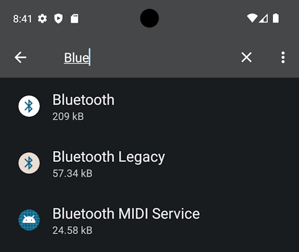
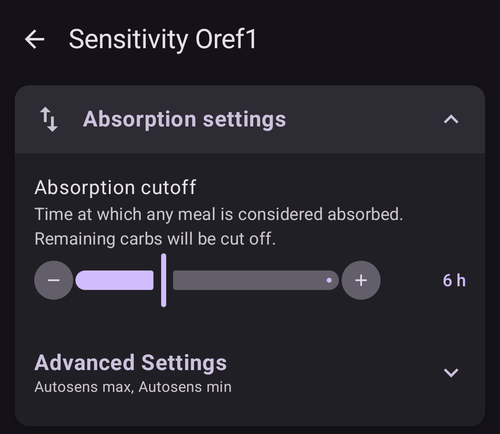

# Assistente de configuração do AAPS

```{contents} In this page
:backlinks: entry
:depth: 2
```

Quando você inicia o **AAPS** pela primeira vez, você é guiado pelo "**Assistente de Configuração**", para fazer rapidamente todas as configurações básicas do seu app de uma só vez. O **Assistente de Configuração** guia você para evitar que você esqueça algo essencial. Por exemplo, as **configurações de permissões** são fundamentais para configurar o **AAPS** corretamente.

No entanto, não é obrigatório deixar tudo completamente configurado na primeira vez que você usa o **Assistente de Configuração**; você pode sair facilmente do assistente e voltar a ele mais tarde. Depois do **Assistente de Configuração**, há três caminhos para otimizar ou mudar ainda mais a configuração. These will be explained in the next section. So, it's okay if you skip some points in the Setup Wizard, you can easily configure them later.

Durante o uso do **Assistente de Configuração**, e logo depois, você pode não notar nenhuma mudança visível importante no **AAPS**. Para ativar o seu loop do **AAPS**, você precisa seguir os **Objetivos**, que liberam um recurso depois do outro. Você vai iniciar o **Objetivo 1** no final do Assistente de Configuração. Você é quem controla o **AAPS**, e não o contrário.

```{admonition} Preview Objectives
:class: note
Se você quiser conhecer a estrutura dos objetivos, leia [Completar os objetivos](../SettingUpAaps/CompletingTheObjectives.md), mas depois volte aqui para executar primeiro o Assistente de Configuração.

```

Pela experiência anterior, sabemos que quem está começando muitas vezes se pressiona para configurar o **AAPS** o mais rápido possível, o que pode causar frustração, porque há muito para aprender.

Por isso, não tenha pressa ao configurar o seu loop: os benefícios de um loop do **AAPS** funcionando bem são enormes.

```{admonition} Ask for Help
:class: note
If there is an error in the documentation or you have a better idea for how something can be explained, you can ask for help from the community as explained at [Connect with other users](../GettingHelp/WhereCanIGetHelp.md).
```
## Welcome message

Quando o Assistente de Configuração abre, ele mostra uma breve mensagem de boas-vindas e logo mostra um painel "**Permissões necessárias**" na parte inferior da tela (veja a próxima seção).

Depois que você concede as permissões, o painel fecha e a tela de boas-vindas mostra um botão "**Avançar**". Toque em "**Avançar**" para continuar:


## Required permissions

O **AAPS** precisa de algumas permissões para funcionar corretamente. O assistente reúne todas elas em um único painel "**Permissões necessárias**", cada uma com o seu próprio botão "**Conceder**". Conceda as permissões uma por uma — o ícone ao lado de cada item vira um visto (✓) quando estiver feito.


### Otimização de bateria

O consumo de bateria nos smartphones é um ponto importante, porque o desempenho das baterias ainda é bastante limitado. Por isso, o sistema operacional Android do seu smartphone é restritivo ao permitir que aplicativos funcionem e consumam tempo de CPU e, portanto, bateria.

No entanto, o **AAPS** precisa funcionar regularmente, _por exemplo_ para receber os valores de glicose a cada poucos minutos e depois aplicar o algoritmo para decidir como lidar com os seus níveis de glicose, com base nas suas configurações. Por isso, ele precisa ser excluído da otimização da bateria.

Toque em "**Conceder**" ao lado de "**Otimização da bateria**" e depois selecione "**Allow**" (Permitir) na janela "Let app always run in background?" (Permitir que o app seja sempre executado em segundo plano?):


(SetupWizard-StoragePermission)=

### Diretório do AAPS

O **AAPS** precisa armazenar as suas configurações e informações de log no armazenamento permanente do seu smartphone. Permanent storage means that it will be available even after rebooting your smartphone. Other information is just lost, as it is not saved to permanent storage.

Toque em "**Conceder**" ao lado de "**Diretório do AAPS**". Isso abre o sistema de arquivos do seu telefone e permite que você escolha onde o **AAPS** armazena as suas informações.

```{tip}
Recomendamos escolher o diretório padrão do AAPS.</br>
**Não** selecione um subdiretório do AAPS.
```

O diretório padrão é **AAPS**, mas você pode usar qualquer diretório exclusivo que preferir. Crie o diretório se for necessário, entre nele e escolha "**USE THIS FOLDER**" (Usar esta pasta):


Confirme com "**ALLOW**" (Permitir) que você quer dar ao **AAPS** acesso ao diretório selecionado:


### Notificações

Android requires special permission for apps if they want to send you notifications.

Embora seja útil desativar as notificações, _por exemplo_ de apps de redes sociais, é essencial que você permita que o **AAPS** envie notificações para você.

Toque em "**Conceder**" ao lado de "**Notificações**" e selecione "**Allow**" (Permitir) no pedido do sistema:


### Alarmes e lembretes

No **Android 14 e mais recentes**, o **AAPS** precisa da permissão "**Alarmes e lembretes**" para que os alarmes possam ligar a tela enquanto o **AAPS** está em segundo plano, e para que os lembretes (por exemplo, de uma **Automação**) toquem na hora certa.

Este item só é mostrado enquanto for necessário. Depois que o **AAPS** é excluído da otimização da bateria (veja acima), o Android concede automaticamente os alarmes exatos e o item desaparece. Se ele ainda estiver na lista, toque em "**Conceder**" ao lado de "**Alarmes e lembretes**". Isso abre uma tela de configurações do sistema para o **AAPS**; ative a chave e volte para o **AAPS**. No Android 13 e mais antigos, este item não aparece e não é preciso fazer nada.

Quando todas as permissões mostrarem um visto (três, ou quatro no Android 14 e mais recentes), o painel "**Permissões necessárias**" fecha sozinho e você pode tocar em "**Avançar**" na tela de boas-vindas para continuar.

(setup-wizard-bluetooth-battery-optimisation)=
### Otimização da bateria do Bluetooth

```{admonition} Extra Android setting, not part of the Wizard
:class: note
O que segue é uma configuração extra do Android, feita fora do Assistente de Configuração. Ela não é um dos botões "Conceder" acima, mas é importante para uma conexão confiável com a bomba.
```

As versões mais novas do Android também colocaram otimização da bateria no app de sistema Bluetooth.

Além de desativar a otimização da bateria para o **AAPS**, você provavelmente também vai precisar desativá-la para o app de sistema Bluetooth. Se você não fizer isso, podem ocorrer quedas de conexão e problemas com a bomba.

***OBSERVAÇÃO: a documentação do xDrip explica como fazer isso aqui: [documentação do xDrip](https://navid200.github.io/xDrip/docs/BluetoothBatteryOpt.html)***

Siga estes passos no Android 16; em outras versões, as telas serão um pouco diferentes das capturas de tela mostradas:

1. Abra as configurações do Android, pesquise **Apps** e abra as configurações de apps.

   

2. Você vai ver as configurações de apps, mas é preciso expandir a lista para ver todos os apps: clique em **See all apps** (Ver todos os apps) para expandir.

   

3. Como o app Bluetooth é um app de sistema, ele fica oculto por padrão, então é preciso mostrar os apps de sistema. Clique nos **três pontos** (⋮) no canto superior direito (1). Depois clique em **Show system** (Mostrar sistema) (2).

   

4. Pesquise o app `Bluetooth` e clique em `Bluetooth` e/ou `Legacy Bluetooth`; se os dois existirem, siga o procedimento para ambos.

   ***OBSERVAÇÃO: você pode ignorar com segurança o `Bluetooth MIDI Service`; ele não é usado pelo AAPS***

           

   1. On Android 12 click on `Battery`, on Android 13+ click on `App battery usage`.

      

5. No Android 12 ou mais recente, selecione a opção `Unrestricted` (Sem restrições); no Android 15 ou mais recente, você precisa expandir a configuração `Allow background usage` (Permitir uso em segundo plano): clique na área destacada em vermelho para fazer isso e depois siga o passo 6 para concluir.

       

6. No Android 16, selecione `Unrestricted` (Sem restrições)

   

## License agreement

O contrato de licença do usuário final contém informações importantes sobre os aspectos legais do uso do **AAPS**. Please read it carefully.

Se você não entende ou não pode concordar com o contrato de licença do usuário final, não use o **AAPS** de forma alguma!

Se você entende e concorda, toque no botão "**EU ENTENDO E CONCORDO**" e siga o Assistente de Configuração:


Um botão "**Avançar**" aparece depois que você concorda. Toque em "**Avançar**".

A próxima tela, "**Permissões**", mostra as permissões de novo. Todas devem mostrar um visto, porque você as concedeu no início. Se faltar alguma, toque em "**Conceder**" ao lado dela. Toque em "**Avançar**" para continuar:


## Senha mestra

Como a configuração do **AAPS** contém alguns dados sensíveis (_por exemplo_ o token de acesso do seu servidor Nightscout), ela é criptografada com uma senha que você define aqui.

O assistente mostra "**Senha não foi definida**". Toque em "**Definir**":


Isso abre a tela "**Proteção**". Toque em "**Senha mestra**" (mostrada como "Senha não foi definida"):


Digite a mesma senha nos dois campos e toque em "**OK**":


Volte com a seta no canto superior esquerdo. O assistente agora mostra "**Senha foi definida!**":


```{admonition} Do not lose your Master Password
:class: danger
**NÃO PERCA A SUA SENHA MESTRA**. Anote-a, _por exemplo_ no Google Drive, que é um bom lugar, porque o Google faz o backup para você. Your smartphone or PC can crash and you may have no actual copy. If you forget your Master Password, it can be difficult to recover your profile configuration and progress through the **Objectives** at a later date.
```

Quando terminar, toque em "**Avançar**" para ir para a próxima tela.

(setup-wizard-import-settings)=
## Importar configurações

Esta tela só é mostrada quando o **AAPS** encontra configurações exportadas antes no diretório do **AAPS** ("Configurações encontradas"), por exemplo quando você reinstala o app ou muda para um telefone novo.

- Para restaurar a sua configuração anterior, toque em "**Importar configurações**" — veja [Criação e restauração de backups](../Maintenance/ExportImportSettings.md).
- Para começar com uma configuração nova, toque em "**Avançar**" e continue com o assistente.


## Unidades (mg/dl <-> mmol/l)

Selecione se os seus valores de glicose estão em mg/dl ou mmol/l e depois toque no botão "**Avançar**":


## Configurações de exibição

Aqui você define a "**Marca BAIXA**" e a "**Marca ALTA**" para a exibição da glicose do sensor. Os valores de glicose entre essas duas marcas são mostrados como "na faixa-alvo". Por enquanto, você pode deixar os valores padrão (72 e 180 mg/dl) e editá-los mais tarde.

The values you choose only affect the graphical presentation of the diagram, and nothing else.

O seu alvo de glicose, _por exemplo_, é configurado separadamente no seu perfil.

Your range to analyze TIR (time in range) is configured separately in your reporting server.

Ajuste as marcas com os botões "−" / "+" se for necessário e depois toque no botão "**Avançar**":


(SetupWizard-synchronization-with-the-reporting-server-and-more)=
## Comunicação

A tela "**Comunicação**" mostra os plugins usados para enviar, sincronizar e transmitir os seus dados:

- **Comunicador SMS** – controle remoto do **AAPS** por comandos SMS
- **NSClientV3** – sincroniza os seus dados com o Nightscout usando a API v3
- **Tidepool** – envia dados para o Tidepool
- **xDrip** – envia dados para o xDrip
- **Open Humans** – envie e doe os seus dados de diabetes para projetos científicos
- **Wear** – monitore e controle o **AAPS** a partir de um relógio WearOS
- **Apps companheiros externos** – transmissão de dados para vários apps externos
- **Garmin** – conexão com um dispositivo Garmin


Role para baixo para ver o resto da lista:


Você poderia configurar vários deles agora, mas na primeira vez vamos nos concentrar apenas no servidor de relatórios. Se você não conseguir configurá-lo agora, pule por enquanto — você pode configurá-lo mais tarde.

Neste exemplo, usamos o Nightscout como servidor de relatórios. Marque a caixa à direita de "**NSClientV3**" para ativá-lo. For Tidepool it is even simpler, as you only need your personal login information.

Depois de ativado, toque em "**Configurações**" abaixo do NSClientV3 para configurá-lo:


Aqui você configura o servidor de relatórios Nightscout. As configurações do NSClientV3 são mostradas em uma única página com rolagem:


Toque em "**URL do Nightscout**" e digite o endereço do seu servidor Nightscout pessoal (a URL que você mesmo configurou, ou que recebeu do seu provedor de serviço). Confirme com "**OK**".

Toque em "**Token de acesso do Nightscout**" e digite o token de acesso do seu servidor Nightscout. Without this token, access will not work. Se você ainda não tem o token, consulte a documentação sobre a configuração do servidor de relatórios.

Deixe "**Usar websockets**" ativado para a comunicação em tempo real com o Nightscout.

Por enquanto, as outras seções podem ficar com os valores padrão. Elas são descritas aqui para que você saiba onde encontrá-las mais tarde:

**Opções de alarme** — alarmes e anúncios do Nightscout e limites para dados desatualizados. Por enquanto, deixe as chaves desativadas; nós só abrimos esta seção para que você conheça as opções.

**Configurações de conexão** — escolha como os dados são transferidos. Os cuidadores devem ativar "**Usar dados móveis**"; senão, o telefone da pessoa de quem cuidam (_por exemplo_ uma criança) não consegue enviar dados fora do alcance do Wi-Fi, _por exemplo_ no caminho para a escola. Outros usuários podem desativar a transferência por dados móveis para economizar dados ou bateria. Em caso de dúvida, deixe tudo ativado.


**Configurações Avançadas** — ative "**Registrar evento de início do app**" se você quiser ver no Nightscout quando o app reinicia (útil para cuidadores). Mantenha "**Criar anúncios a partir de erros**" e "**Criar anúncios a partir de solicitações de carboidratos**" ativados. Deixe "**Usar sincronização lenta**" desativado; você só o usaria se o servidor Nightscout fosse lento para processar uma grande quantidade de dados.


Volte para a lista de plugins e toque em "**Avançar**" para ir para a próxima tela.

## Controle do cliente

A partir da versão 4 do **AAPS**, dispositivos cliente com o **AAPSClient** podem ser **pareados** com este telefone (o **dispositivo principal**) e controlá-lo com comandos assinados enviados pelo Nightscout. Esta é a nova forma recomendada de controlar o **AAPS** remotamente — veja [Controle dispositivo principal ↔ cliente](../RemoteFeatures/ClientMasterControl.md) para a explicação completa e a configuração.

Não há nada que você precise configurar nesta tela agora; você pode parear clientes a qualquer momento mais tarde em **Gerenciar → Clientes autorizados**. Lá você adiciona um cliente com um **código QR** (ele também configura o Nightscout no cliente) ou com um **PIN**, e dá a ele uma **função**.

- "**Clientes autorizados**" — gerencie os dispositivos cliente pareados que têm permissão para controlar este dispositivo principal.
- "**Aceitação de dados do Nightscout**" — aceitar tratamentos e dados inseridos diretamente no Nightscout (a forma antiga e menos segura) agora fica desativado por padrão. Só abra estas configurações se você ainda precisar disso, _por exemplo_ para inserir dados pelo Nightscout ou por apps de terceiros.

Quando o controle do cliente já está ativado — sempre no [Modo simples](#preferences-simple-mode) — este telefone está no [modo reforçado](#client-master-control-hardened-mode): ele só aceita mudanças de clientes pareados, então a tela explica o modo reforçado em vez de oferecer as configurações de "**Aceitação de dados do Nightscout**".


"**Aceitação de dados do Nightscout**" abre as configurações de "**Sincronização**", onde cada tipo de dado recebido do Nightscout tem a sua própria chave:


Toque em "**Avançar**" para ir para a próxima tela.

(setup-wizard-instance-name)=
## Quem está usando este telefone?

Aqui você digita o nome da pessoa que usa este telefone. Ele diferencia esta instância do **AAPS** de outras nos relatórios e na sincronização, por exemplo se duas crianças da sua família usam o **AAPS**. Ele também é usado nos nomes dos arquivos de configurações exportados e mostrado no relógio.

It can be anything. Você pode mudá-lo mais tarde em **Configurações → Geral → Nome da instância**.

Toque em "**Avançar**" para ir para a próxima tela.


## Patient type

Aqui você seleciona o seu "Tipo de paciente", o que é importante, porque o software **AAPS** tem limites diferentes conforme a idade do paciente. This is important for security and safety reasons.

Aqui você também configura o **bólus máximo permitido** para uma refeição. That is, the largest bolus you need to give to cover your typical meals. É um recurso de segurança que ajuda a evitar uma superdosagem acidental quando você dá um bólus para uma refeição.

The second limit is similar in concept, but relates to the max carbohydrate intake you expect.

Depois de definir esses valores, toque em "**Avançar**" para ir para a próxima tela:


## Insulina

Aqui você configura a insulina usada na sua bomba. Novos perfis de insulina exigem uma **DIA de pelo menos 5 h**.

Toque no botão "**Insulina**" para abrir o editor de insulina:


No editor, você pode dar um **apelido** à insulina e definir o seu **Pico** (em minutos) e a sua **DIA** (em horas). A forma mais rápida é carregar uma predefinição com "**Carregar pico de**" — escolha **Novorapid**, **Fiasp** ou **Lyumjev** — e o pico é preenchido para você. O gráfico na parte inferior mostra uma prévia da curva de atividade da insulina resultante.


Escolha a predefinição que corresponde à sua insulina, por exemplo **Fiasp**:


```{admonition} Use your insulin brand's preset peak
:class: danger
Não mude o pico, a menos que você seja um especialista — normalmente os valores predefinidos funcionam bem para cada marca de insulina.
```

Se você é um novo usuário do **AAPS**, defina a **DIA** em 9 horas — veja [Duração da ação da insulina (DIA) e pico](#Config-Builder-insulin-dia) para entender por quê.

```{admonition} "Insulin configuration changed" dialog
:class: note
Se um cliente pareado (_por exemplo_ outro telefone) mudou a configuração de insulina, aparece uma janela. Toque em **OK** para carregar as mudanças dele, ou em **Cancelar** para continuar editando (o seu próximo salvamento vai substituir as mudanças dele).
```


Toque no ícone de salvar (canto superior direito) e depois toque em "**Avançar**" para ir para a próxima tela.

## Blood sugar source

Aqui você seleciona de onde o **AAPS** recebe os dados de glicose. Leia a documentação da sua [fonte de BG](../Getting-Started/CompatiblesCgms.md).

Há muitas fontes disponíveis — role a lista e selecione a que você usa:


Quando você seleciona uma fonte, o cartão dela se expande e mostra dois botões: "**Configurações**", para ajustar como os dados são recebidos, e "**Abrir plugin**", para abrir a tela da própria fonte. No exemplo abaixo, o **BYODA** está selecionado. Algumas fontes não têm nada para configurar nesta etapa, então normalmente você pode ir direto para a próxima tela:


Depois de fazer a sua escolha, toque em "**Avançar**" para ir para a próxima tela.

(setup-wizard-profile)=
## Perfil

Now we are entering a very important part of the Setup Wizard.

Leia a documentação sobre [perfis](../SettingUpAaps/YourAapsProfile.md) antes de tentar inserir os dados do seu perfil na próxima tela.

```{admonition} Working profile required - no exceptions here !
:class: danger
Um perfil exato é necessário para controlar a ação segura do **AAPS**.

É necessário que você tenha definido e discutido o seu perfil com o seu médico, e que ele tenha sido comprovado por testes bem-sucedidos de taxa basal, ISF e IC!

Se um robô recebe dados de entrada errados, ele vai falhar - sempre. O **AAPS** só pode trabalhar com as informações que recebe. Se o seu perfil for forte demais, você corre risco de hipoglicemia; se for fraco demais, corre risco de hiperglicemia. 
```

Toque no botão "**Perfil**" para abrir o editor de perfil:


O editor abre vazio ("Nenhum registro disponível"). Toque no botão "**+**" na parte inferior para criar um novo perfil:


You can have several profiles in the long-term if needed. We only create one here.

```{admonition} Profile only for tutorial - not for your usage
:class: note
O perfil de exemplo aqui serve apenas para mostrar como inserir os dados.

Ele não pretende ser um perfil exato nem algo muito bem otimizado, porque as necessidades de cada pessoa são muito diferentes.

Não use isso para fazer loop de verdade!
```

O novo perfil (por exemplo "**LocalProfile1**") tem quatro abas: **IC**, **ISF**, **BAS** e **ALV**. Toque no lápis ao lado do nome do perfil para renomeá-lo. Preencha todas as abas — uma aba fica vermelha e mostra uma mensagem de erro até ter valores válidos:


Toque em "**IC**" e insira os seus valores de [IC](#your-aaps-profile-insulin-to-carbs-ratio). Use o botão "**+**" para adicionar mais blocos de horário:


Toque em "**ISF**" e insira os seus [valores de ISF](#your-aaps-profile-insulin-sensitivity-factor):


Toque em "**BAS**" e insira os seus [valores de basal](#your-aaps-profile-basal-rates):


Toque em "**ALV**" e insira os seus valores de alvo de glicose.

No loop aberto, este alvo pode ser uma faixa mais ampla, porque senão o **AAPS** avisa você o tempo todo para mudar a basal temporária ou outra configuração, o que pode ser cansativo.

Later, for closed looping, you will generally have only one value for top and bottom. Isso torna mais fácil para o **AAPS** atingir o alvo e dar a você um controle melhor do diabetes no geral.


Quando as quatro abas forem válidas, o **ícone de salvar** (canto superior direito) fica ativo. Toque nele para salvar o perfil:


Feche o editor com o "**X**" no canto superior esquerdo. O resumo do perfil então mostra o nome, a basal diária total (∑), as unidades e os valores de IC e ISF com os seus gráficos:


```{admonition} Several defined but only one active profile
:class: note
Você pode ter vários perfis definidos, mas só um perfil ativo funcionando de cada vez.
```

Toque no botão "**▶**" (ativar) no canto inferior direito. A tela "**Ativar**" abre. Como ainda não há nenhuma insulina em uso, ela pede primeiro que você selecione a insulina que usa, para que a troca de perfil possa registrá-la. O botão "**Ativar**" fica cinza (inativo) até você fazer isso:


Toque em "**Selecionar insulina**" e escolha a insulina que você configurou antes. Deixe a porcentagem em 100 % e toque em "**Ativar**":


Aparece uma janela de troca de perfil. Neste caso, deixe como está e confirme com "**OK**":

```{admonition} Profile switch dialog
:class: note
Mais tarde você vai aprender a usar esta janela geral para lidar com situações como doença ou esporte, em que você precisa mudar o seu perfil para se adaptar às circunstâncias.
```


O seu perfil agora está ativo. Toque em "**Avançar**" para ir para a próxima tela.

## Bomba de insulina

Agora você seleciona a sua bomba de insulina. Leia a documentação da sua [bomba de insulina](../Getting-Started/CompatiblePumps.md).

Role a lista e selecione a sua bomba. Neste exemplo, usamos a "**Bomba virtual**", que é útil enquanto você ainda está aprendendo e ainda não conectou uma bomba real:


Muitas bombas são suportadas — role para baixo para encontrar a sua:


Quando você seleciona uma bomba real, o **AAPS** pede uma confirmação, porque ele vai copiar as taxas basais do seu perfil para a bomba e substituir as taxas basais salvas nela. Toque em "**OK**" apenas se as taxas basais do seu perfil do **AAPS** estiverem corretas; caso contrário, toque em "**Cancelar**" e mude para a bomba mais tarde:


If the pump you select communicates over Bluetooth, **AAPS** asks for permission to connect to nearby devices once you finish the Wizard (see [Bluetooth permission](#setup-wizard-bluetooth-permission)).

Se você já configurou o seu perfil e sabe como conectar a sua bomba, fique à vontade para conectá-la agora. Caso contrário, deixe na **Bomba virtual** por enquanto — você pode mudar a qualquer momento, ou sair do Assistente de Configuração pela seta no canto superior esquerdo e deixar o **AAPS** mostrar primeiro alguns valores de glicose.

Toque em "**Avançar**" para ir para a próxima tela.

## Algoritmo APS

Use the OpenAPS SMB algorithm as your APS algorithm. Apesar do nome, o recurso SMB do algoritmo fica desativado até você conhecer bem o AAPS e ter cumprido os primeiros objetivos. De qualquer forma, o OpenAPS SMB é mais novo e, em geral, melhor que o OpenAPS AMA.

O SMB fica desativado no início porque o recurso SMB reage mais rápido a um aumento da glicose, usando um Super Micro Bolus (SMB) em vez de aumentar a porcentagem da taxa basal. Como no início o seu perfil em geral não é tão bom quanto depois de alguma experiência, o recurso fica desativado no começo.

```{admonition} Only use the older algorithm **OpenAPS AMA** if you know what you are doing
:class: note
O OpenAPS AMA é o algoritmo mais básico, que não suporta microbólus para corrigir valores altos. Pode haver situações em que é melhor usar este algoritmo, mas ele não é o recomendado.
```

Selecione "**SMB OpenAPS**" e depois toque em "**Configurações**" para ver os detalhes:


A única opção aqui é "**Usar sensibilidade dinâmica**". Deixe-a desativada e não mude nada por enquanto — apenas leia o texto.

Por causa das limitações impostas pelos **Objetivos**, de qualquer forma você não pode usar o "loop fechado" nem os "recursos de SMB" no momento.

Volte e toque em "**Avançar**" para ir para a próxima tela:


## Detecção de sensibilidade

Deixe "**Sensibilidade Oref1**" selecionado como o plugin de sensibilidade padrão:


Se você tocar em "**Configurações**", pode revisar as configurações de absorção; os valores padrão (_por exemplo_ um limite de absorção de 6 h) estão bons por enquanto.



Toque em "**Avançar**" para ir para a próxima tela.

## Start Objective 1

Agora você está entrando nos Objetivos — a qualificação para ter acesso a mais recursos do **AAPS**.

Toque em "**Abrir objetivos**":


Here we start Objective 1, even if at the moment our setup is not completely ready to successfully complete this Objective. But this is the start.

Press the "**Start**" button of **Objective 1**:


O objetivo se expande e mostra as suas verificações individuais. Você pode ver que já fez algum progresso, enquanto outros itens ainda precisam ser feitos:


Volte e depois toque em "**Finalizar Configuração**" para concluir o Assistente de Configuração:


Depois de tocar em "**Finalizar Configuração**", você chega à tela principal do **AAPS**. Um painel "**Notificação**" pode abrir com mensagens informativas, por exemplo sobre a troca de perfil que você acabou de fazer — toque em "**Dispensar**" abaixo de cada mensagem para removê-la.

Se você sair do Assistente de Configuração sem querer em algum momento, você pode simplesmente iniciar o assistente de novo ou mudar a [configuração do loop do AAPS](../SettingUpAaps/ChangeAapsConfiguration.md) manualmente.

(setup-wizard-bluetooth-permission)=
## Permissão de Bluetooth

Se você selecionar uma bomba que se conecta por Bluetooth (por exemplo **Omnipod Dash**), um aviso lembra que o **AAPS** precisa da permissão de Bluetooth. Por enquanto, você pode tocar em "**Dispensar**" — a permissão é concedida depois que você terminar o assistente:


Quando o Assistente de Configuração terminar, a tela principal do **AAPS** mostra um painel "**Permissões necessárias**". As outras permissões já foram concedidas; toque em "**Conceder**" ao lado de "**Bluetooth**":


Selecione "**Allow**" (Permitir) para que o **AAPS** possa encontrar a sua bomba e se conectar a ela:


Se o seu loop do **AAPS** já está totalmente configurado, passe para a próxima seção ["Completar os objetivos"](../SettingUpAaps/CompletingTheObjectives.md).
