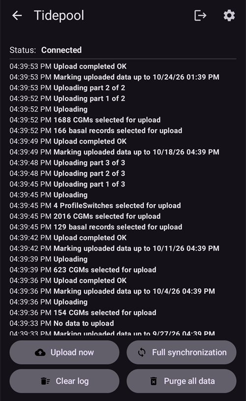

# Tidepool

O Tidepool é uma ferramenta de terceiros que coleta dados de glicose (BG), insulina e carboidratos (e as notas que você adiciona aos seus tratamentos). Ele pode ser usado para analisar esses dados e compartilhá-los com a sua equipe médica. Desde a versão 3.2 do AAPS, ele pode ser usado como alternativa ao Nightscout para cumprir parte do Objetivo 1. It can also be used in combination with Nightscout as an alternative reporting platform that integrates well with clinical settings. This may be the desired option for children using AAPS who want to have the remote monitoring and control capabilities of Nightscout, but want a reporting platform that their clinical team are more comfortable with.

É importante entender que o Tidepool serve apenas para relatórios. It is NOT a real-time follow app. Se você precisa de seguidores além do telefone principal do AAPS, também deve configurar o Nightscout.

Observação: a organização Tidepool lançou no mercado o produto iOS Loop com aprovação da FDA. This effort has nothing to do with their data reporting platform or AAPS.

## Etapa 1 - Crie uma conta no Tidepool

- Acesse [tidepool.org](https://www.tidepool.org/)

- Selecione “Personal Sign Up” ou “Sign Up” (cadastro)

- Crie um e-mail e uma senha e anote-os

- Selecione “Personal Account” (conta pessoal) e clique em “Continue”

- Preencha a seção de informações do paciente e aceite os termos de uso

- Confirme o seu endereço de e-mail seguindo as instruções que você recebeu por e-mail

## Etapa 2 - Conecte o AAPS ao Tidepool

- Abra o **menu** (☰) no canto superior esquerdo da tela principal e selecione "**Configuração**"

- Abra a categoria "**Comunicação**" e ative "**Tidepool**":

- Toque em "**Abrir plugin**" abaixo do Tidepool e depois toque no ícone **Login** (uma seta entrando em uma porta) no canto superior direito

- Uma janela do navegador abre na página de login do Tidepool. Faça login com o endereço de e-mail e a senha que você criou na Etapa 1 acima:

- Depois de um login bem-sucedido, o navegador fecha e a tela do Tidepool mostra o status "**Conectado**"; o registro abaixo mostra os envios de dados. Se o login falhar, confirme que os seus dados de acesso estão corretos e que você confirmou o seu endereço de e-mail no Tidepool.

- Nas "**Configurações**" do plugin Tidepool, abra "**Configurações de conexão**". Por padrão, "**Usar as configurações de conexão do Nightscout**" está ativado, então o Tidepool envia dados nas mesmas condições que você definiu para o Nightscout. Desative se você quiser condições separadas para o Tidepool, por exemplo, para enviar ao Tidepool apenas no Wi-Fi e durante o carregamento, enquanto o Nightscout também usa dados móveis.

 

Para mais ajuda sobre como usar os seus dados depois que forem enviados ao Tidepool, visite: [https://www.tidepool.org/viewing-your-data](https://www.tidepool.org/viewing-your-data)

(tidepool-menu)=
## Os botões do Tidepool

No canto superior direito da tela do Tidepool:

- O ícone **Login** ou **Sair da sua conta** — conecta à sua conta do Tidepool ou desconecta dela. Apenas um deles é mostrado: **Login** enquanto você está desconectado, **Sair da sua conta** enquanto você está conectado. O **AAPS** pede que você confirme antes de desconectar você.
- O ícone de engrenagem — as configurações do Tidepool.

Os botões na parte inferior da tela do Tidepool:

- "**Enviar agora**" — envia os dados novos imediatamente, em vez de esperar o próximo envio automático.
- "**Sincronização completa**" — envia de novo todos os dados armazenados no **AAPS**.
- "**Apagar todos os dados**" — apaga **todos** os dados que o **AAPS** enviou para a sua conta do Tidepool. Isso não pode ser desfeito. Use apenas para remover dados errados ou duplicados e depois execute "**Sincronização completa**" para enviar os seus dados de novo.
- "**Limpar registros**" — esvazia o registro mostrado na tela do Tidepool.

No Tidepool, os dados enviados pelo **AAPS** 4 são mostrados com o nome de dispositivo **AAPS**. Veja [O que mudou no AAPS v4](#v4changes-tidepool) se você usava o Tidepool com uma versão mais antiga. 
