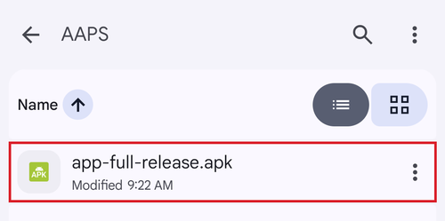

# Transferring and Installing AAPS on your smartphone

Na seção anterior, [compilar o **AAPS**](../SettingUpAaps/BuildingAaps.md), você compilou o app **AAPS** (que é um arquivo .apk) em um computador.

As próximas etapas são **transferir** o arquivo APK do **AAPS** (e também outros apps de que você possa precisar, como o BYODA, o xDrip ou outro app receptor de CGM) para o seu smartphone Android e depois **instalar** o(s) app(s). Depois de instalar o **AAPS** no smartphone, você poderá passar para a [**configuração do loop do AAPS**](../SettingUpAaps/SetupWizard.md).

Esta página também explica a [verificação de desenvolvedor do Android](#android-developer-verification), uma mudança que o Google está introduzindo a partir de setembro de 2026 e que afeta a instalação de apps compilados por você mesmo, e os [métodos gratuitos de instalação](#android-developer-verification-free-methods) que continuam funcionando depois da mudança.

```{contents} Table of contents
:depth: 1
:local: true
```

## Instalar o AAPS tocando no arquivo APK

Hoje, você instala o **AAPS** transferindo o arquivo APK para o seu telefone e abrindo o arquivo (tocando nele). Há várias formas de transferir o arquivo APK do **AAPS** do seu computador para o smartphone. Here we explain two different ways:

* Option 1 -  Use your Google drive (Gdrive)
* Option 2 -  Use a USB cable

Please note that transfer by email might cause difficulties, and is discouraged.

```{admonition} Android developer verification
:class: warning
O Google está introduzindo a [verificação de desenvolvedor do Android](#android-developer-verification) a partir de setembro de 2026 (começando no Brasil, Indonésia, Singapura e Tailândia; no mundo todo em 2027). Onde ela for aplicada, a instalação de um APK tocando no arquivo — como descrito nas duas opções abaixo — fica bloqueada. Nesse caso, use um dos [métodos gratuitos de instalação](#android-developer-verification-free-methods) mais abaixo nesta página.
```

### Option 1. Use Google drive to transfer files

Abra [Google.com](https://www.google.com/) no seu navegador e entre na sua Conta do Google.

On the right upper side select the Drive app in the Google menu.


Clique em **New** (Novo) no canto superior esquerdo (ou clique com o botão direito em uma área vazia abaixo dos seus arquivos e pastas) e selecione **File upload** (Upload de arquivo).


The apk file should now be uploaded on Google Drive.

#### Use the Google Drive app to execute the apk file for installation

Switch to your mobile and start the Google Drive app. It is a preinstalled app and can be found where the other Google apps are located or with search for the name of the app.


Inicie a instalação do apk tocando no nome do arquivo no app Google Drive do celular.



Se você receber um aviso de segurança de que no momento não é permitido instalar apps a partir do Google Drive, toque em "Settings" (Configurações) e permita isso só por esse curto momento. Depois, proíba de novo, porque deixar isso ativado o tempo todo é um risco de segurança.


Depois que a instalação terminar, esta etapa está concluída.

Você deve ver o ícone do **AAPS** e conseguir abrir o app.

```{warning}
**AVISO DE SEGURANÇA IMPORTANTE**
Você se lembrou de proibir de novo a instalação a partir do Google Drive?
```

Continue com a [configuração do loop do AAPS](../SettingUpAaps/SetupWizard.md).

### Option 2. Use a USB cable to transfer files

A segunda forma de transferir o arquivo apk do AAPS é com um [cabo USB](https://support.google.com/android/answer/9064445?hl=en).

Transfer the file from its location on your computer to the "downloads" folder on the phone.

On your phone, you will have to allow installation from unknown sources. Explicações de como fazer isso podem ser encontradas na internet (_por exemplo_ [aqui](https://www.expressvpn.com/de/support/vpn-setup/enable-apk-installs-android/) ou [aqui](https://www.androidcentral.com/unknown-sources)).

Depois de transferir o arquivo arrastando-o, abra a pasta "Downloads" no telefone e toque no arquivo apk do AAPS:


Na primeira vez, o Android avisa que o telefone não tem permissão para instalar apps desconhecidos desta fonte. Toque em "**Settings**" (Configurações):


Ative "**Allow from this source**" (Permitir desta fonte) e depois volte:


Toque de novo no arquivo apk e selecione "**Install**" (Instalar):


Quando a instalação terminar, toque em "**Open**" (Abrir) para iniciar o **AAPS**, ou em "**Done**" (Concluído) para abri-lo mais tarde:


```{warning}
**AVISO DE SEGURANÇA IMPORTANTE**
Lembre-se de desativar de novo "Allow from this source" (Permitir desta fonte) depois da instalação, porque deixar isso ativado o tempo todo é um risco de segurança.
```

Continue com a [configuração do loop do AAPS](../SettingUpAaps/SetupWizard.md).

(transferring-installing-play-protect-warning)=
## Aviso do Google Play Protect

Quando você instala o **AAPS**, o Google Play Protect pode avisar que o app não é seguro, que foi criado para uma versão mais antiga do Android e que não inclui as proteções de privacidade mais recentes.


Isso é esperado para um app que você mesmo compilou. Toque em **More details** (Mais detalhes) e depois em **Install anyway** (Instalar mesmo assim).

Se a instalação for **bloqueada** com uma mensagem sobre um desenvolvedor não verificado (não apenas um aviso), veja [Verificação de desenvolvedor do Android](#android-developer-verification) abaixo.

(android-developer-verification)=

## Verificação de desenvolvedor do Android

O Google está introduzindo a **verificação de desenvolvedor do Android**: na maioria dos telefones Android, os apps só serão instalados se tiverem sido registrados no Google por um desenvolvedor verificado. Isso também vale para apps instalados a partir de um arquivo APK ("sideloading") — que é a forma como você instala o app **AAPS** que você mesmo compilou.

### O que está mudando

Quando você instala o **AAPS** em um telefone com os serviços do Google (um dispositivo Android "certificado" — praticamente todo telefone vendido com a Play Store), o Android verifica se o app vem de um desenvolvedor registrado no Google. Se não vier, a instalação normal tocando no arquivo APK fica bloqueada.

**A verificação acontece quando um app é instalado ou atualizado.** Ela não remove apps que já estão instalados e funcionando.

O Google está introduzindo isso aos poucos:

| Quando                 | O que acontece                                                                                                                                                     |
| ---------------------- | ------------------------------------------------------------------------------------------------------------------------------------------------------------------ |
| Agosto de 2026         | Contas de desenvolvedor gratuitas de "distribuição limitada" ficam abertas no mundo todo, e o "fluxo avançado" começa a chegar aos telefones                       |
| 30 de setembro de 2026 | A verificação passa a ser aplicada no **Brasil, Indonésia, Singapura e Tailândia**, para apps instalados a partir do Google Play e de algumas outras lojas de apps |
| 2027                   | A aplicação se estende ao **resto do mundo** e a **todas as instalações**, incluindo arquivos APK                                                                  |

Os detalhes são publicados pelo Google nas páginas de [verificação de desenvolvedor do Android](https://developer.android.com/developer-verification), incluindo um [FAQ](https://developer.android.com/developer-verification/guides/faq). O Google ainda pode ajustar datas e detalhes; esta página será atualizada conforme a introdução avançar.

### Isso me afeta?

- **Compilar o AAPS não é afetado de forma alguma.** A [compilação no navegador](#browser-build), a [compilação com o Android Studio](ComputerBuild.md) e a [compilação pela linha de comando (CLI)](CLIBuild.md) funcionam exatamente como antes, e a sua keystore não muda.
- **O seu AAPS atual continua funcionando.** A verificação só é feita ao instalar ou atualizar um app.
- **Se você mora no Brasil, Indonésia, Singapura ou Tailândia:** a partir de 30 de setembro de 2026, a verificação é aplicada para apps instalados a partir do Google Play e de algumas outras lojas de apps. O Google afirma que a instalação direta de um arquivo APK não está incluída nesta primeira etapa, então o **AAPS** ainda deve ser instalado normalmente. Mesmo assim, prepare agora um dos [métodos gratuitos de instalação](#android-developer-verification-free-methods) abaixo, para não ser pego de surpresa se isso mudar.
- **Se você mora em qualquer outro lugar:** nada muda para você antes de 2027, e não fazer nada por enquanto é uma escolha válida. Mas configure um dos [métodos gratuitos de instalação](#android-developer-verification-free-methods) abaixo enquanto nada está quebrado: descobrir o bloqueio no dia em que uma atualização é recusada, com a espera de 24 horas do [fluxo avançado](#android-developer-verification-advanced-flow) pela frente, é o momento errado.
- **Telefones antigos:** a verificação vale para telefones com Android 7 ou mais recente, ou seja, todo telefone capaz de rodar o **AAPS**.

(android-developer-verification-free-methods)=

## Formas gratuitas de instalar o AAPS

Você **não** precisa pagar nada ao Google para continuar usando o **AAPS**. Há vários métodos gratuitos; escolha o que combina com a sua situação.

```{admonition} Which method should I use?
:class: tip
- Você tem um **computador** (não importa como você compilou o **AAPS**): use o [ADB](#android-developer-verification-adb) ou, se preferir evitar a linha de comando, o [instalador web](#android-developer-verification-web). Os dois são isentos da verificação, não têm limites e não precisam de conta do Google.
- Você **não tem nenhum computador**: use o [fluxo avançado](#android-developer-verification-advanced-flow) no seu telefone.
- Você prefere se registrar no Google para que a instalação normal "tocando no APK" continue funcionando: existe uma [conta gratuita de distribuição limitada](#android-developer-verification-limited-account), mas ela não foi testada com o **AAPS**.
```

(android-developer-verification-adb)=

### Opção 1: Instalar com o ADB (precisa de um computador)

O ADB (Android Debug Bridge) é a ferramenta oficial do Google para instalar apps de um computador em um telefone com um cabo USB. O Google confirmou que **apps instalados com o ADB não precisam de verificação** — não há período de espera, nem limite de dispositivos, nem registro.

Preparação (feita uma única vez):

1. No seu telefone, ative as opções de desenvolvedor ocultas: vá em **Settings** (Configurações) > **About phone** (Sobre o telefone) (em alguns telefones **Software information** (Informações do software)) e toque sete vezes em **Build number** (Número da versão), até o telefone confirmar que você é um desenvolvedor.
1. Volte às **Settings** (Configurações) principais, abra o novo item **Developer options** (Opções do desenvolvedor) e ative **USB debugging** (Depuração USB).
1. No seu computador, verifique se o ADB está disponível:
   - Se você usa o **Android Studio**, o ADB já está instalado com ele.
   - Caso contrário, baixe as [SDK Platform Tools](https://developer.android.com/tools/releases/platform-tools) gratuitas do Google e descompacte a pasta. Não é preciso instalar nada; o ADB é o programa `adb` dentro dessa pasta.

Instalar (e mais tarde atualizar) o **AAPS**:

1. Conecte o telefone ao computador com um cabo USB. Não é preciso transferir antes o arquivo APK para o telefone: o ADB o envia direto do computador.
1. No telefone, aceite o pedido **Allow USB debugging?** (Permitir depuração USB?) (apenas na primeira vez).
1. No computador, abra um terminal (prompt de comando) na pasta que contém o ADB e o arquivo APK do **AAPS** e execute:

   ```
   adb install -r app-full-release.apk
   ```

   Substitua `app-full-release.apk` pelo nome real do seu arquivo APK. A opção `-r` atualiza um **AAPS** já instalado, mantendo todos os seus dados e configurações.

1. Aguarde até aparecer `Success`. O **AAPS** agora está instalado no seu telefone.

O mesmo comando é usado para todas as próximas atualizações. As [páginas do Wear OS](../WearOS/WearOsSmartwatch.md) já usam o ADB da mesma forma para instalar o app do relógio.

Se você preferir não usar cabo: no Android 11 e mais recentes, a **wireless debugging** (depuração por Wi-Fi, também em **Developer options** (Opções do desenvolvedor)) pode fazer o mesmo pelo Wi-Fi, depois de um pareamento único com um código mostrado no telefone.

(android-developer-verification-web)=

### Opção 2: Instalar a partir de uma página web (computador, sem linha de comando)

Se a linha de comando não é para você, uma página web pode fazer exatamente o que o ADB faz, direto do seu navegador. Como ela se comunica com o telefone pelo mesmo mecanismo do ADB, ela tem a **mesma isenção da verificação** — mas não há nada para baixar, nenhuma pasta para descompactar e nenhum comando para digitar.

Este é o caminho mais fácil se você usou a [compilação no navegador](#browser-build) e nunca abriu uma linha de comando.

1. Ative a **USB debugging** (Depuração USB) no telefone (passos 1 e 2 do [método ADB](#android-developer-verification-adb) acima — configuração feita uma única vez).
1. Abra o **[Instalador web do AAPS](#web-installer)** no seu navegador.
1. Conecte o telefone com um cabo USB e siga as instruções da página: conectar, escolher o seu arquivo APK e instalar.

Três coisas que você deve saber:

- Funciona apenas no **Chrome, Edge ou Opera**. Firefox e Safari não conseguem se comunicar com dispositivos USB.
- Apenas um programa por vez pode usar a conexão ADB do telefone, então **feche o Android Studio** (ou qualquer outro programa que use o ADB) antes de conectar.
- Uma página web conectada desta forma tem controle total do seu telefone. **Use apenas o endereço acima**, a partir da documentação do **AAPS** — nunca uma página de instalação encontrada por um mecanismo de busca. O instalador web do **AAPS** funciona inteiramente no seu navegador: o seu arquivo APK não é enviado para lugar nenhum.

```{admonition} No computer? A second phone works too
:class: tip
O instalador web também funciona a partir do **Chrome em outro telefone Android** com um cabo USB-C para USB-C — assim os pais podem instalar o **AAPS** no telefone de uma criança sem ter nenhum computador em casa.
```

(android-developer-verification-advanced-flow)=

### Opção 3: O "fluxo avançado" no seu telefone (sem computador)

O Google oferece uma saída para usuários experientes que entendem os riscos de instalar apps não verificados, chamada **fluxo avançado**. O Google começou a liberar o fluxo para os telefones em agosto de 2026, antes da aplicação da verificação, então você pode configurá-lo agora. É uma configuração feita uma única vez no próprio telefone, que **leva 24 horas** para ser concluída:

1. Ative as opções de desenvolvedor ocultas (veja o passo 1 do método ADB acima) e depois abra **Settings** (Configurações) > **Developer options** (Opções do desenvolvedor) > **Apps from unverified developers** (Apps de desenvolvedores não verificados).
1. Ative **Allow apps from unverified developers** (Permitir apps de desenvolvedores não verificados). O telefone pede o seu bloqueio de tela para confirmar que é você.
1. O telefone pergunta se alguém está pedindo que você ative esta configuração e explica que bancos, órgãos do governo ou a polícia nunca pediriam isso. Leia o aviso e confirme que ninguém está pressionando ou orientando você (isso é uma proteção contra golpistas).
1. **Reinicie o seu telefone.** Isso inicia um **período de espera de 24 horas**, feito uma única vez.
1. Depois de 24 horas, volte a **Settings** (Configurações) > **Developer options** (Opções do desenvolvedor) > **Apps from unverified developers** (Apps de desenvolvedores não verificados) para concluir a configuração.
1. Escolha se quer permitir apps não verificados por **7 days** (7 dias) ou **indefinitely** (por tempo indeterminado). Para o **AAPS**, escolha **indefinitely** (por tempo indeterminado); caso contrário, a sua próxima atualização será bloqueada depois que os 7 dias passarem.

Depois desta configuração, instalar ou atualizar o APK do **AAPS** funciona como hoje, com um aviso a mais de que o app é de um desenvolvedor não verificado — toque em **Install anyway** (Instalar mesmo assim).

Bom saber:

- Depois você pode desativar de novo as **Developer options** (Opções do desenvolvedor): o fluxo avançado continua ativado. O Google também não dá aos apps (como apps de bancos) nenhuma forma de detectar que o fluxo avançado está ativado.
- Se você desativar o fluxo avançado, a instalação **ou atualização** do **AAPS** volta a ser bloqueada (o **AAPS** instalado continua funcionando). Você tem 10 minutos para ativá-lo de novo; depois disso, o período de espera de 24 horas começa outra vez.
- Mudar o relógio do telefone não encurta o período de espera, e o ADB não consegue pulá-lo.
- O Google afirma que a sua escolha acompanha a sua conta do Google nos seus outros dispositivos, então um telefone novo não deve significar outra espera de 24 horas.
- Se você não encontrar **Apps from unverified developers** (Apps de desenvolvedores não verificados) nas opções de desenvolvedor, o seu telefone ainda não recebeu o recurso. Ele é entregue por um componente do sistema chamado **Android Developer Verifier**, que o Google está liberando aos poucos pela Play Store. Você pode ajudar a acelerar isso abrindo o **Android Developer Verifier** na Play Store.

```{note}
O Google descreve isso como uma primeira versão e ainda pode mudar as telas e os passos; esta seção será atualizada com capturas de tela quando a versão final estiver disponível.
```

(android-developer-verification-limited-account)=

### Opção 4: Registrar-se no Google (conta gratuita de distribuição limitada)

O Google oferece um tipo de conta de desenvolvedor **gratuita** para hobby e uso pessoal, chamada **conta de distribuição limitada**, aberta para todos desde agosto de 2026:

- **Sem documento de identidade oficial** e **sem taxa** (ao contrário da conta de desenvolvedor paga, que não é necessária para o uso pessoal do **AAPS**). Você precisa de uma conta do Google com verificação em duas etapas, um perfil de pagamentos do Google com o seu nome legal e endereço, e um endereço de e-mail de contato.
- Você registra o nome do pacote do seu app no Android Developer Console do Google e autoriza os telefones em que ele pode ser instalado, até **20 dispositivos**, por meio de uma confirmação com um código QR ou link entre o telefone e o console.
- Depois do registro, a instalação normal (tocando no arquivo APK) volta a funcionar nos telefones autorizados, sem ADB e sem o fluxo avançado.
- Uma conta de distribuição limitada pode depois ser transformada em uma conta completa, mas não o contrário.

```{warning}
O Google não explicou como o registro funciona quando muitas pessoas compilam o mesmo app de código aberto: todo **AAPS** compilado por conta própria usa o mesmo nome de pacote (`info.nightscout.androidaps`) com uma chave de assinatura diferente, e o FAQ do Google diz que um nome de pacote que já é usado por outros não pode simplesmente ser reivindicado e exige uma análise adicional. O resultado dessa análise é desconhecido, e a conta de desenvolvedor paga (US$ 25 e um documento de identidade oficial) não ajuda aqui: pagar só remove o limite de 20 dispositivos, não a análise do nome do pacote.

Por esse motivo, ainda não é possível escrever instruções passo a passo. Esta seção será concluída quando o registro tiver sido testado com o **AAPS**. Enquanto isso, o ADB, o instalador web e o fluxo avançado acima são alternativas confiáveis.
```

## O que não muda

- Compilar o **AAPS** você mesmo, com qualquer um dos três [métodos de compilação](BuildingAaps.md).
- A sua conta do GitHub, o seu repositório de compilação (AAPS Builder) ou fork, e a sua keystore.
- O seu app **AAPS** instalado, as suas configurações e os seus [objetivos](CompletingTheObjectives.md).
- Telefones sem os serviços do Google e, em geral, as [instalações com o ADB](#android-developer-verification-adb).

## Onde obter ajuda

1. **Leia** o [FAQ da verificação de desenvolvedor](https://developer.android.com/developer-verification/guides/faq) do Google para dúvidas sobre a própria verificação.
2. **Pergunte** no canal *#AAPS* no [Discord](https://discord.gg/4fQUWHZ4Mw), ou em um dos outros [canais da comunidade](../GettingHelp/WhereCanIGetHelp.md), se uma instalação for bloqueada.
3. Ao pedir ajuda, informe a marca e o modelo do seu telefone, a versão do Android, o seu país e a mensagem exata que aparece quando a instalação falha.

```{toctree}
:hidden:

Instalador web do AAPS <WebInstaller.md>
```
