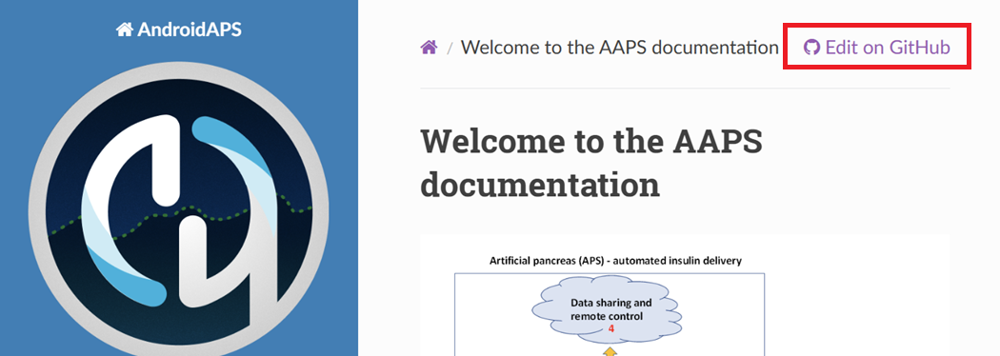
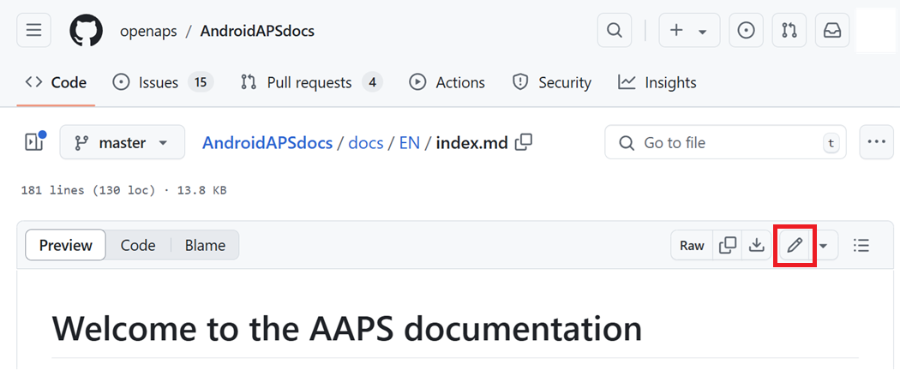

# Como editar a documentação

**Esta descrição serve apenas para editar a documentação em inglês. Todas as informações novas devem ser adicionadas primeiro em inglês. Se você quer traduzir para outras línguas (obrigado), use o [Crowdin](https://crowdin.com/project/androidapsdocs).**

For hints how to format text (headline, bold...) and set links please see the ["code syntax"](#edit-the-docs-code-syntax) section of this page.

## Geral

Para perguntas, comentários ou novas ideias, você pode entrar em contato com a equipe da documentação pelo [Discord](https://discord.gg/4fQUWHZ4Mw).

Em algum momento, vão sugerir que você faça um pull request (PR), que é a forma como as suas mudanças na documentação são de fato colocadas nas páginas web do AAPS, que ficam no GitHub. Na verdade, fazer um PR não é muito difícil, e é uma ótima forma de contribuir. Você está lendo esta documentação agora porque pessoas como você fizeram PRs. Não se preocupe em cometer um erro ou editar os documentos errados. As suas mudanças são revisadas antes de receberem merge no repositório "oficial" da documentação do AAPS. Você não consegue estragar os originais por nenhum acidente no processo. O processo geral é:

- Faça edições e melhorias no código ou na documentação, editando o conteúdo existente.
- Confira se as suas edições estão boas.
- Anote brevemente o que mudou, para que as pessoas entendam as edições.
- Crie um pull request, que pede aos administradores que usem as suas mudanças.
- Eles vão fazer uma revisão e (1) fazer o merge das suas mudanças, (2) responder com comentários sobre as suas mudanças ou (3) começar um novo documento com as suas mudanças.

(Observação: se você aprende melhor vendo, há um vídeo no YouTube [aqui](https://youtu.be/4b6tsL0_kzg) que mostra o fluxo de trabalho de um PR.)

No nosso exemplo, vamos fazer uma edição no AndroidAPSdocs. Isso pode ser feito em qualquer PC com Windows, Mac etc. (qualquer computador com acesso à internet).

1. Vá para <https://github.com/openaps/AndroidAPSdocs> e clique em Fork no canto superior direito para fazer a sua própria cópia do repositório.


2. Vá para qualquer página e navegue até a página que você quer editar. Você pode clicar no link "Edit in GitHub" no canto superior direito. Isso só é possível nas páginas em inglês. 



Ou clique no ícone de lápis que aparece na barra superior do conteúdo da página a ser editada. Para isso, você já precisa estar conectado à sua conta do GitHub (se não tiver uma, é fácil criar).



3. Qualquer uma das opções da Etapa 2 vai criar um novo branch no SEU repositório, onde as suas edições serão salvas. Faça as suas edições no arquivo.

Usamos markdown para as páginas da documentação. Os arquivos têm o sufixo ".md". A especificação do Markdown não é fixa, e no momento usamos o myst_parser para os nossos arquivos markdown. Take care to use the correct syntax as [described below](#edit-the-docs-code-syntax).


4. Você estava trabalhando na aba "<>Edit file". Select the "Preview changes" tab for a fresh look to make sure everything you changed looks like you meant it to (check for typos). Se você vir algo que precisa melhorar, volte para a aba de edição para fazer mais melhorias. 


5. Quando terminar as suas edições, role até o fim da página. Na caixa no fim da página, escreva os seus comentários no campo de texto que diz "Add an optional extended description...". O título padrão contém o nome do arquivo. Tente incluir uma frase explicando o **motivo** da mudança. Explicar o motivo ajuda os revisores a entender o que você quer fazer com o PR.


6. Clique no botão verde "Propose file changes" ou "Commit changes". Na página que aparece, clique em "Create Pull Request" e, na página seguinte, clique de novo em "Create Pull Request".


7. Com isso, a abertura de um pull request (PR) está concluída. O GitHub dá um número ao PR, que fica depois do título e de um sinal #. Volte a esta página para ver se há comentários (ou, se você recebe as notificações do GitHub por e-mail, vai receber e-mails sobre qualquer atividade no PR). A edição agora estará em uma lista de PRs que a equipe vai revisar e talvez comentar, antes de fazer o commit na documentação principal do AAPS! Se quiser acompanhar o andamento do PR, você pode clicar no ícone de sino no canto superior direito da sua conta do GitHub e ver todos os seus PRs.


PS: O seu fork e o seu branch continuam na sua conta pessoal do GitHub. After you get a notification that your PR has been merged, you can delete your branch if you are done with it (Step 7's notification area will provide a link to delete the branch once it has been closed or merged). Para edições futuras, se você seguir este procedimento, as edições sempre vão começar com uma versão atualizada dos repositórios AndroidAPSdocs. If you choose to use another method to start a PR (e.g., editing starting from your forked repo's master branch as the starting point), you will need to ensure your repo is up-to-date by performing a "compare" first and merging in any updates that have happened since you last updated your fork. Como as pessoas costumam esquecer de atualizar os seus repositórios, recomendamos usar o processo de PR descrito acima até você se acostumar a fazer "compares".

(edit-the-docs-code-syntax)=

## Sintaxe do código

Usamos markdown para as páginas da documentação. Os arquivos têm o sufixo ".md".

Markdown é uma linguagem de formatação de texto muito simples, que separa o conteúdo do texto da sua formatação.

O autor apenas marca, por exemplo, um título como título de nível 1, e o processador de markdown gera o código HTML necessário durante o processamento para mostrar o título em HTML.

A ideia por trás disso é que

- o autor deve pensar primeiro no texto e não na formatação,
- the markdown text is open for exchange between different markdown tools instead of e.g. proprietary tools like Microsoft Word and
- você pode gerar vários formatos de saída a partir de um arquivo markdown.

O markdown não é um padrão 100% fixo e tentamos ficar o mais perto possível do padrão, para

- continuar flexível para trocar de ferramentas de markdown quando for necessário ou quando a evolução das ferramentas de markdown e dos serviços SaaS de markdown obrigar e
- podermos usar serviços de tradução para traduzir do inglês para uma língua de destino, como francês ou alemão. Eles conseguem trabalhar com markdown, mas não com códigos de formatação complexos, porque não conseguem separar o conteúdo do layout, o que pode ser fatal.

### Títulos

- Título 1: `# headline`
- Título 2: `## headline`
- Título 3: `### headline`
- Título 4: `#### headline`

Tentamos evitar mais níveis de títulos.

### Formatação de texto

- **negrito**: `**text**`
- *itálico*: `*text*`
- ***negrito itálico***: `***text***`

### Lista numerada

    1. primeiro
    1. segundo
    1. terceiro
    

1. primeiro
2. segundo
3. terceiro

### Lista não numerada

    - um elemento
    - outro elemento
    - e mais um elemento
    

- um elemento
- outro elemento
- e mais um elemento

### Lista com vários níveis

Você pode colocar listas dentro de listas recuando o próximo nível 4 espaços mais à direita do que o anterior.

    1. primeiro
    1. segundo
    1. terceiro
      1. um elemento
      1. outro elemento
      1. e mais um elemento
    1. quatro
    1. cinco
    1. seis
    

1. primeiro
2. segundo
3. terceiro 
    1. um elemento
    2. outro elemento
    3. e mais um elemento
4. quatro
5. cinco
6. seis

### Imagens

Para incluir imagens, use esta sintaxe markdown.

- imagens: ``

O tipo de imagem deve ser PNG ou JPEG.

Os nomes das imagens devem seguir uma das regras de nomes abaixo. No exemplo, uso png como sufixo. Se você usar JPEG, use jpeg como sufixo.

- `filename-image-xx.png`, onde xx é um número único de dois dígitos para as imagens deste arquivo.
- `filename-image-xx.png`, onde xx é um nome com significado escolhido pelo autor do arquivo md.

As imagens ficam na pasta images da língua inglesa e são passadas automaticamente para as outras línguas pelo Crowdin. Você não precisa fazer nada para isso!

No momento, não traduzimos imagens: as imagens devem ter o **mínimo possível de texto**, para que sejam acessíveis a quem não lê inglês.

(make-a-PR-image-size)= Use um tamanho razoável para as imagens, que devem ser legíveis no PC, no tablet e no celular.

- As capturas de tela de páginas web devem ter no máximo **1050 pixels de largura**.
- Diagramas de fluxos de processo devem ter no máximo **1050 pixels de largura**.
- As capturas de tela do app devem ter no máximo **500 pixels de largura**. Não as coloque lado a lado se não for necessário.
- As capturas de tela do relógio (**Wear OS**) devem ter no máximo **360 pixels de largura**. Nunca aumente uma captura de tela menor.

### Links

#### Links externos

Links externos são links para sites externos.

- link externo: `[alt text](www.url.tld)`

#### Links internos para o início de um arquivo md

Links internos para páginas são links para o início de um arquivo md que está no nosso próprio servidor.

- link interno para uma página .md: `[alt text](../folder/file.md)`

#### Links internos para referências com nome dentro do texto

Links internos para referências com nome são links para qualquer ponto de um arquivo md que está no nosso próprio servidor e onde uma referência foi definida para receber o link.

Adicione uma referência com nome no lugar do arquivo md de destino para onde você quer pular.

`(name-of-my-md-file-this-is-my-fancy-named-reference)=`

A referência com nome deve ser única em todos os arquivos md do AndroidAPSDocs, e não apenas no arquivo md em que ela está!

Por isso, é uma boa prática começar com o nome do arquivo e depois o nome da referência que você escolher.

Use apenas letras minúsculas e separe as palavras com hífens.

Depois, coloque um link para essa referência no texto que você está escrevendo, com o seguinte tipo de link.

- Links internos para referências com nome: `[alt text](name-of-my-md-file-this-is-my-fancy-named-reference)`

### Notas, avisos, notas recolhíveis

Você pode adicionar caixas de nota e de aviso à documentação.

Além disso, você pode adicionar notas recolhíveis para informações detalhadas, para que os usuários que não se interessam pelos detalhes não desistam de ler o texto. Use-as com cuidado, pois a documentação deve ser o mais fácil possível de ler.

#### Notas

    ```{admonition} Note headline
    :class: note
    This is a note.
    ```
    

```{admonition} Note headline :class: note This is a note.

    <br />#### Avisos
    
    ````
    ```{admonition} Warning
    :class: warning
    This is a warning.
    

    ```{admonition} Warning headline
    :class: warning
    This is a warning.
    ```
    
    #### Notas recolhíveis
    
    

    {admonition} leituras mais detalhadas para leitores interessados
    :class: dropdown
    
    Esta caixa foi recolhida,
    o que significa que você pode adicionar conteúdo mais longo aqui,
    sem ocupar muito espaço na página.
    

````

```{admonition} further detailed readings for interested readers :class: dropdown This admonition has been collapsed, meaning you can add longer form content here, without it taking up too much space on the page.

```

## Tabelas

Avoid using tables with long texts as the content is difficult to set in Markdown, they will usually not fit in a mobile phone screen width, and probably won't display the same after translation.

## Guia de estilo

### Conteúdo

1. Dicas para escrever em inglês

2. Notas de escrita específicas do AAPS

3. Referências úteis

###  1\. Dicas para escrever em inglês

#### Use uma linguagem adequada para o leitor

Use inglês simples sempre que possível. Isso ajuda quem não é nativo e também facilita a tradução dos documentos do AAPS para outras línguas. Escreva como numa conversa com o usuário; imagine que você está sentado do outro lado da mesa, na frente da pessoa para quem você escreve. Lembre-se: a maioria dos usuários do AAPS não tem formação em programação. O diabetes também tem muito jargão e muitas abreviações. Lembre-se de que algumas pessoas podem ter recebido o diagnóstico há pouco tempo, podem ter menos experiência com diabetes do que você ou podem ter recebido um treinamento diferente sobre diabetes. Se você usar uma forma curta ou uma abreviação, escreva-a por extenso na primeira vez que usar, com a abreviação logo depois entre parênteses, como “super micro bolus (SMB)”. Coloque também um link para o glossário. Termos técnicos que talvez o leitor não conheça também podem ser explicados entre parênteses.

Instead of: *“What causes high postprandial BG peaks in closed loop?”*

Use: *“What causes a high BG peak **after lunch** (postprandial) in closed loop?”*

##### Use palavras simples que todos entendem

Encontre aqui uma lista de A a Z de palavras alternativas para deixar o seu texto mais fácil de entender:

<https://www.plainenglish.co.uk/the-a-z-of-alternative-words.html>

#### Privacidade/licenças:

Principalmente se você gravar vídeos ou capturas de tela, tome cuidado para não mostrar os seus dados privados (chave de API, senhas). Garanta que o conteúdo do YouTube não esteja listado publicamente e que precise de um link da documentação para ser visto. Evite chamar a atenção para materiais protegidos por direitos autorais usados sem permissão (BYODA etc.).

#### Escreva frases curtas, vá direto ao ponto

- Um texto claro deve ter frases de 15 a 20 palavras, em média.

- Isso não significa que todas as frases devem ter o mesmo tamanho. Seja direto. Varie o seu texto misturando frases curtas (como a anterior) com frases mais longas (como esta).

- Fique com uma ideia principal por frase, e talvez mais um ponto relacionado.

- Você ainda pode acabar escrevendo uma ou outra frase longa, principalmente quando tenta explicar algo complicado. Mas a maioria das frases longas pode ser dividida de alguma forma.

- Tire as palavras fracas: “you can”, “there is/are/were”, “in order to”.

- Coloque as palavras-chave perto do começo dos títulos, das frases e dos parágrafos.

- Seja visual! Sempre que possível, inclua um diagrama curto, uma captura de tela ou um vídeo.

#### Não tenha medo de dar instruções

Ordens são a forma mais rápida de dar instruções, mas às vezes os autores têm medo de dar ordens e escrevem “you should do this” em vez de simplesmente “do this”. Talvez as pessoas tenham medo de que as ordens pareçam duras demais. Muitas vezes, você resolve isso colocando a palavra 'please' na frente. Mas, se algo precisa ser feito, é melhor não dizer ‘please’, porque isso dá ao leitor a opção de recusar.

Instead of: *“You should just think of it as a complete statement.”*

Use: *“Think of it as a complete statement.”*

#### Use principalmente a voz ativa, e não a voz passiva

Exemplo de **voz ativa**:

- *“The pump (sujeito) delivers (verbo) the insulin (objeto).”*

“delivers” está na voz ativa aqui. A frase diz primeiro quem aplica, antes de dizer o que é aplicado.

Exemplo de **voz passiva**:

- *“The insulin (subject) is delivered (verb) by the pump (object).”*

*“delivered”* está na voz passiva aqui. O sujeito e o objeto trocam de lugar, em comparação com a frase na voz ativa. Tivemos que deixar a frase mais longa, acrescentando “is” e “by the”. Considere também começar com o verbo na voz ativa.

Em vez de: *“You can connect your pump with the phone through the AAPS pump menu, and there are a number of pumps available for you to connect with.”*

Use: *“Connect your desired pump to the phone through the AAPS pump menu.”*

A voz passiva pode causar problemas:

- Ela pode confundir.

- Ela muitas vezes deixa o texto mais longo.

- Ela deixa o texto menos vivo.

##### Bons usos da voz passiva

Há momentos em que a voz passiva pode ser adequada.

- Para deixar algo menos hostil - 'this bill has not been paid' (passiva) é mais suave do que 'you have not paid this bill' (ativa).

- Para evitar culpar alguém - 'a mistake was made' (passiva) em vez de 'You made a mistake' (ativa).

- Quando você não sabe quem ou o que faz a ação - 'the England team has been picked'.

- Se simplesmente soar melhor.

#### Evite nominalizações

Uma nominalização é o nome de algo que não é um objeto físico, como um processo, uma técnica ou uma emoção. As nominalizações são formadas a partir de verbos.

Por exemplo:

| Verbo     | Nominalização |
| --------- | ------------- |
| complete  | completion    |
| introduce | introduction  |
| provide   | provision     |
| fail      | failure       |

Elas muitas vezes são usadas **no lugar** dos verbos de onde vêm, mas podem dar a impressão de que nada está acontecendo de verdade. Muitas delas podem deixar o texto muito chato e pesado.

Em vez de: *“The implementation of the method has been done by a team.”*

Use: *“A team has implemented the method.”*

#### Use listas quando for adequado

Listas são ótimas para dividir informações. Há dois tipos principais de lista:

- Uma frase contínua com vários pontos listados destacados no começo, no meio ou no fim.

- Pontos separados (marcadores) com uma frase de introdução.

Na lista com marcadores acima, cada ponto é uma frase completa, por isso cada um começa com letra maiúscula e termina com ponto final. Use marcadores em vez de números ou letras, porque eles chamam a atenção para cada ponto sem dar informação extra para processar.

#### Derrubando mitos

- Você pode começar uma frase com **and, but, because, so ou however**.

- Você pode separar o infinitivo (split infinitive). Então você pode dizer **“to boldly go”**.

- Você pode terminar uma frase com uma preposição. Exemplo: “In fact, it is something **we should stand up for**.”

- Você pode usar a mesma palavra duas vezes em uma frase, se não encontrar uma palavra melhor. Exemplo: “And **you** can use the same **word** twice in a sentence if **you** can't find a better **word**.”

#### Otimizar o estilo de escrita conforme o objetivo

Para manter a documentação clara e curta, escrevemos as diferentes seções da documentação em estilos diferentes.

Um estilo de “explicação” é usado nas seções de introdução, contexto e desenvolvimento do conhecimento.

Um estilo de “guia prático” (com o mínimo de explicação) é usado para compilar e configurar o AAPS e em algumas seções de resolução de problemas.

Um tutorial ajuda o aluno a adquirir uma competência básica. O usuário vai **aprender fazendo**.


#####  Tutoriais (por exemplo, ensinar uma criança a bater claras em neve)

- o narrador fala diretamente com o leitor: In this tutorial **you** will (we) pode ser usado em alguns casos raros para transmitir a ideia de “we are in this together” (estamos juntos nisso)

- Futuro -> para mostrar o objetivo final

- Imperativo -> para fazer as tarefas -> Passos concretos - evite conceitos abstratos

- Passado -> para mostrar as tarefas concluídas -> Resultados visíveis rápidos e imediatos

- Explicações mínimas -> apenas o necessário para concluir a tarefa - **o quê e por quê**

- Ignore opções/alternativas/…. Sem ambiguidade

- Transições entre passos: termine um passo com uma frase que leve ao passo seguinte, como uma sequência lógica. Example: *You have now installed the Let’s Encrypt client, but before obtaining certificates, you need to make sure that all required ports are open. To do this, you will update your firewall settings in the next step.*

- **Tutorial** Título (título de nível 1)

- Introdução (sem título)

- Pré-requisitos (título de nível 2)

- Passos:

- Passo 1 — Fazer a primeira coisa (título de nível 2)

- Passo 2 — Fazer a próxima coisa (título de nível 2)

- Passo n — Fazer a última coisa (título de nível 2)

- Conclusão (título de nível 2)
    
    - **A linguagem dos tutoriais**
        
        *In this tutorial, you will…*
        
        Descreva o que o aluno vai conseguir fazer (atenção - não: “you will learn…”).
        
        *First, do x. Now, do y. Now that you have done y, do z.*
        
        Não deixe espaço para ambiguidade ou dúvida.
        
        *We must always do x before we do y because… (see Explanation for more details).*
        
        Explique as ações o mínimo possível, com a linguagem mais simples possível. Coloque um link para uma explicação mais detalhada.
        
        *The output should look something like this…*
        
        Dê ao aluno expectativas claras.
        
        *Notice that… Remember that…*
        
        Dê ao aluno muitas pistas para ajudá-lo a confirmar que está no caminho certo e a se orientar.
        
        *You have built a secure, three-layer hylomorphic stasis engine…*
        
        Descreva (e elogie, de forma moderada) o que o aluno conseguiu fazer (atenção - não: “you have learned…”)

#####  Guias práticos (por exemplo, uma receita)

O objetivo de um guia prático é ajudar o usuário que já tem competência a fazer uma tarefa específica corretamente.

- COMO FAZER

- narrator directly talks to the reader: In this guide **you** will

- Futuro -> para mostrar o objetivo final

- Imperativo condicional -> para obter X, faça y -> Passos concretos - evite conceitos abstratos

- Explicações mínimas -> apenas o necessário para concluir a tarefa -> **o quê e por quê**

- Ignore opções/alternativas/…. Sem ambiguidade, mas você pode colocar um link para a entrada de referência ou de explicação

- **How-to**: Título (título de nível 1)

- Parágrafo de introdução

- Pré-requisitos opcionais (parágrafo, ou título de nível 2 se houver mais de 1)

- Passos:

- Passo 1 — Fazer a primeira coisa (título de nível 2)

- Passo 2 — Fazer a próxima coisa (título de nível 2)

- Passo n — Fazer a última coisa (título de nível 2)

- Parágrafo de conclusão
    
    - **A linguagem dos guias práticos**
        
        *This guide shows you how to…*
        
        Descreva claramente o problema ou a tarefa que o guia mostra ao usuário como resolver.
        
        *If you want x, do y. To achieve w, do z.*
        
        Use imperativos condicionais.
        
        *Refer to the x reference guide for a full list of options.*
        
        Não encha o seu guia prático com todas as coisas possíveis que o usuário poderia fazer relacionadas a x.

#####  Explicação (por exemplo, a ciência que explica por que as claras ficam firmes quando são batidas)

Uma explicação esclarece, aprofunda e amplia o entendimento do leitor sobre um assunto.

- POR QUÊ

- Comece com **About** (Sobre)

- Dê o contexto e coloque links para TODAS as referências relevantes

- Discuta opções/alternativas

- Não dê instruções nem referências (coloque links para elas)

- Mencione o que é desconhecido, os alvos que mudam etc…

- **About** Título (título de nível 1)

- Introdução (sem título)

- Pré-requisitos opcionais (título de nível 2)

- Subtópico 1 (título de nível 2)

- Conclusão (título de nível 2)
    
    - **A linguagem das explicações**
    
    *The reason for x is because historically, y…*
    
    Explique.
    
    *W is better than z, because…*
    
    Dê avaliações e até opiniões quando for adequado.
    
    *An x in system y is analogous to a w in system z. However…*
    
    Dê um contexto que ajude o leitor.
    
    *Some users prefer w (because z). This can be a good approach, but…*
    
    Compare as alternativas.
    
    *An x interacts with a y as follows:…*
    
    Revele os segredos internos do mecanismo, para ajudar a entender por que algo faz o que faz.

### 2\. Notas de escrita/atualização específicas do AAPS

#### Autor e editor

Para escrever/atualizar a documentação do AAPS, pense no processo em duas etapas. Elas podem ser feitas pela mesma pessoa em momentos diferentes, ou por mais de uma pessoa.

Um **autor (por exemplo, você!)** escreve/edita uma seção da documentação em um tom curto e de conversa e depois a passa para o editor.

O **editor (por exemplo, outro usuário do AAPS, ou a pessoa que recebe o pull request)** verifica se o guia de estilo foi seguido e edita a seção para deixá-la clara e acessível, tirando o maior número possível de palavras (principalmente nas seções de tutorial/guia prático). Ler o texto em voz alta pode ajudar.

#### Pontos gerais do AAPS

- Para valores de glicose, informe sempre mg/dl e mmol/l (considere isso também nas capturas de tela, se possível).

- Para manter a consistência, use “AAPS” e não “Android APS”.

- Diga claramente para qual versão do Android Studio/AAPS você está escrevendo, ou de qual versão são as capturas de tela.

### 3\. Referências úteis

<https://dev.readthedocs.io/en/latest/style-guide.html>

[Diátaxis (diataxis.fr)](https://diataxis.fr/)

[Technical Writer Style Guide Examples | Technical Writer HQ](https://technicalwriterhq.com/writing/technical-writing/technical-writer-style-guide/)

[DigitalOcean's Technical Writing Guidelines | DigitalOcean](https://www.digitalocean.com/community/tutorials/digitalocean-s-technical-writing-guidelines)

[Top 10 tips for Microsoft style and voice - Microsoft Style Guide | Microsoft Learn](https://learn.microsoft.com/en-us/style-guide/top-10-tips-style-voice?source=recommendations)

<https://www.plainenglish.co.uk/how-to-write-in-plain-english.html>

<https://developers.google.com/style>

<https://www.mongodb.com/docs/meta/style-guide/screenshots/screenshot-guidelines/>