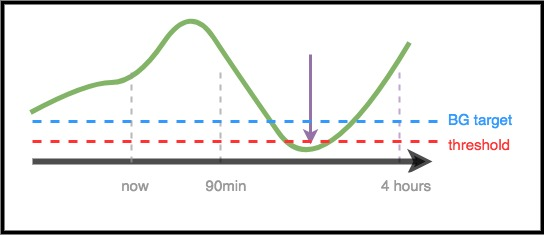

# Para médicos – Introdução geral e guia do AAPS

```{note}
Esta página é uma introdução geral para médicos. Ela foi revisada pela última vez em junho de 2026. O AAPS está em desenvolvimento contínuo; por isso, para obter os detalhes mais exatos e atualizados, consulte sempre a [documentação principal do AAPS](../index.md).
```

Esta página é destinada a médicos que se interessam por tecnologia de pâncreas artificial de código aberto, como o AAPS, ou a pacientes que querem compartilhar essas informações com os seus médicos.

Este guia traz informações gerais sobre o loop fechado DIY e, em especial, sobre como o AAPS funciona. Para mais detalhes sobre todos esses temas, consulte a [documentação completa do AAPS on-line](../index.md). Se tiver dúvidas, peça mais detalhes ao seu paciente ou, a qualquer momento, entre em contato com a comunidade. (Se você não usa redes sociais (por exemplo, [Twitter](https://twitter.com/kozakmilos) ou Facebook), pode enviar um e-mail para developers@aaps.app). [Aqui você também encontra alguns dos estudos e dados de resultados mais recentes](https://openaps.org/outcomes/).

## As etapas para montar um loop fechado DIY:

Para começar a usar o AAPS, devem ser seguidas estas etapas:

* Encontrar uma [bomba compatível](../Getting-Started/CompatiblePumps.md), um [dispositivo Android compatível](../Getting-Started/Phones.md) e uma [fonte de CGM compatível](../Getting-Started/CompatiblesCgms.md).
* [Baixar o código-fonte do AAPS e compilar o software](../SettingUpAaps/BuildingAaps.md).
* [Configurar o software para se comunicar com os seus dispositivos para diabetes e definir as configurações e as preferências de segurança](../SettingUpAaps/SetupWizard.md).

## Como funciona um loop fechado DIY

Sem um sistema de loop fechado, a pessoa com diabetes coleta os dados da bomba e do CGM, decide o que fazer e age.

Com a administração automatizada de insulina, o sistema faz a mesma coisa: coleta os dados da bomba, do CGM e de qualquer outro lugar onde as informações são registradas (como o Nightscout), usa essas informações para fazer os cálculos e decidir quanto mais ou menos insulina é necessária (acima ou abaixo da taxa basal programada) e usa taxas basais temporárias para fazer os ajustes necessários e manter a glicose na faixa-alvo ou trazê-la de volta para ela.

Se o dispositivo que executa o AAPS quebrar ou ficar fora do alcance da bomba, quando a última taxa basal temporária terminar, a bomba volta a funcionar como uma bomba comum, com as taxas basais pré-programadas.

## Como os dados são coletados:

Com o AAPS, um dispositivo Android executa um app especial que faz os cálculos; o dispositivo se comunica por Bluetooth com uma bomba compatível. O AAPS pode se comunicar com outros dispositivos e com a nuvem por Wi-Fi ou dados móveis, para coletar informações adicionais e para informar o paciente, os cuidadores e os familiares sobre o que está fazendo e por quê.

O dispositivo Android precisa:

* comunicar-se com a bomba e ler o histórico – quanta insulina foi administrada
* comunicar-se com o CGM (diretamente ou pela nuvem) – para ver o comportamento atual e passado da glicose

Depois que o dispositivo coleta esses dados, o algoritmo é executado e toma as decisões com base nas configurações (ISF, relação de carboidratos, DIA, alvo etc.). Se necessário, ele envia comandos à bomba para alterar a taxa de administração de insulina.

Ele também coleta da bomba ou do Nightscout todas as informações sobre bólus, consumo de carboidratos e ajustes de alvo temporário, para usá-las no cálculo das taxas de administração de insulina.

## Como ele sabe o que fazer?

O software de código aberto foi projetado para que o dispositivo faça facilmente o trabalho que antes as pessoas faziam (no modo manual) para calcular como ajustar a administração de insulina. Primeiro, ele coleta os dados de todos os dispositivos de apoio e da nuvem, prepara os dados e faz os cálculos, faz previsões dos níveis de glicose esperados nas próximas horas em diferentes cenários e calcula os ajustes necessários para manter a glicose na faixa-alvo ou trazê-la de volta para ela. Em seguida, ele envia à bomba os ajustes necessários. Depois, ele lê os dados de volta e repete tudo continuamente.

Como o parâmetro de entrada mais importante é o nível de glicose vindo do CGM, é importante ter dados de CGM de alta qualidade.

O AAPS foi projetado para registrar de forma transparente todos os dados de entrada que coleta, a recomendação resultante e cada ação tomada. Por isso, revisando os logs, é fácil responder a qualquer momento à pergunta “por que ele está fazendo X?”.

## Exemplos de tomada de decisão do algoritmo do AAPS:

O AAPS usa o mesmo algoritmo central e o mesmo conjunto de recursos do OpenAPS. O algoritmo faz várias previsões (com base nas configurações e na situação), que representam diferentes cenários do que pode acontecer no futuro. No Nightscout, elas são mostradas como “linhas roxas”. O AAPS usa cores diferentes para separar essas [linhas de previsão](#aaps-screens-prediction-lines). Nos logs, ele descreve quais dessas previsões e qual período de tempo estão determinando as ações necessárias.

### Aqui estão exemplos das linhas de previsão roxas e de como elas podem ser diferentes:


(clinicianguide-dosing-scenarios)=

### Aqui estão exemplos de diferentes períodos de tempo que influenciam os ajustes necessários na administração de insulina:

### Cenário 1 – Basal temporária zero por segurança

Neste exemplo, a glicose está subindo no curto prazo; no entanto, a previsão é de glicose baixa em um prazo mais longo. Na verdade, a previsão é que ela fique abaixo do alvo *e* do limite de segurança. Por segurança, para evitar a hipoglicemia, o AAPS definirá uma basal temporária zero (taxa basal temporária de 0%) até que a eventualBG (glicose prevista no final, em qualquer período de tempo) fique acima do limite.



### Cenário 2 – Basal temporária zero por segurança

Neste exemplo, a previsão é de glicose baixa no curto prazo, mas, no final, acima do alvo. No entanto, como a glicose baixa prevista no curto prazo fica de fato abaixo do limite de segurança, o AAPS definirá uma basal temporária zero até que nenhum ponto da linha de previsão fique abaixo do limite.


### Cenário 3 – Mais insulina necessária

Neste exemplo, uma previsão de curto prazo mostra uma queda abaixo do alvo. No entanto, a previsão não indica que ela ficará abaixo do limite de segurança. A glicose prevista no final (eventual BG) está acima do alvo. Por isso, o AAPS não adicionará nenhuma insulina que possa contribuir para uma hipoglicemia no curto prazo (ou seja, insulina que faria a previsão ficar abaixo do limite). Depois, ele avaliará adicionar insulina para trazer o menor nível da glicose prevista no final até o alvo, assim que for seguro fazer isso. *(Dependendo das configurações e da quantidade e do momento da insulina necessária, essa insulina pode ser administrada por basais temporárias ou por SMBs (super microbólus)).*


### Cenário 4 – Basal temporária baixa por segurança

Neste exemplo, o AAPS vê que a glicose está subindo muito acima do alvo. No entanto, por causa do tempo de ação da insulina, já há insulina suficiente no corpo para, no final, trazer a glicose para a faixa-alvo. Na verdade, a previsão é que a glicose fique, no final, abaixo do alvo. Por isso, o AAPS não fornecerá insulina extra, para não contribuir para uma hipoglicemia em um prazo mais longo. Embora a glicose esteja alta ou subindo, aqui é provável uma taxa basal temporária baixa.


## Otimização das configurações e alterações

Como médico, talvez sem experiência com o AAPS ou com loops fechados DIY, você pode achar difícil ajudar o seu paciente a otimizar as configurações ou a fazer alterações para melhorar os resultados. Na comunidade, temos várias ferramentas e [guias](https://openaps.readthedocs.io/en/latest/docs/Customize-Iterate/optimize-your-settings.html) que ajudam os pacientes a fazer pequenos ajustes testados para melhorar as suas configurações.

O mais importante para os pacientes é fazer uma alteração de cada vez e observar o efeito por 2–3 dias antes de decidir alterar ou ajustar outra configuração (a menos que seja claramente uma alteração ruim, que piora a situação; nesse caso, devem voltar imediatamente à configuração anterior). A tendência humana é mexer em todos os ajustes e mudar tudo de uma vez; mas, se alguém fizer isso, pode acabar com configurações ainda menos adequadas no futuro e ter dificuldade para voltar a um estado conhecido e bom.

Uma das ferramentas mais poderosas para alterar configurações é uma ferramenta de cálculo automatizado para taxas basais, ISF e relação de carboidratos. Isso se chama “[Autotune](#autotune-how-autotune-calculates-adjustments)”. Ela foi projetada para ser executada de forma independente/manual e para deixar que os dados orientem você ou o seu paciente a fazer alterações graduais nas configurações. Na comunidade, a boa prática é executar (ou revisar) primeiro os relatórios do Autotune, antes de tentar ajustar as configurações manualmente. O Autotune está integrado ao AAPS como um plugin (**Configuração** → **Geral** → **Autotune**); veja [Autotune](../AdvancedOptions/Autotune.md). Ele pode ser executado sob demanda ou automaticamente. Como esses parâmetros são um pré-requisito tanto para a administração de insulina com a bomba comum quanto com o loop fechado, a discussão dos resultados do Autotune e o ajuste desses parâmetros seriam o ponto de contato natural com o médico.

Além disso, o comportamento humano (aprendido no tratamento manual do diabetes) muitas vezes influencia os resultados, mesmo com um loop fechado DIY. Por exemplo, se a previsão for de glicose baixa e o AAPS reduzir a insulina durante a queda, pode ser necessária apenas uma pequena quantidade de carboidratos (por exemplo, 3–4 g) para elevar a glicose de 70 mg/dl (3,9 mmol/l). No entanto, em muitos casos, a pessoa pode tratar com muito mais carboidratos (por exemplo, seguindo a regra dos 15), o que causa um pico mais rápido, tanto pela glicose extra quanto porque a insulina já tinha sido reduzida no período que antecedeu a hipoglicemia.

## OpenAPS

**Este guia foi adaptado de [The clinician's guide to OpenAPS](https://openaps.readthedocs.io/en/latest/docs/Resources/clinician-guide-to-OpenAPS.html) (guia do OpenAPS para médicos).** O OpenAPS é um sistema desenvolvido para ser executado em um pequeno computador portátil (em geral chamado de "rig"). O AAPS usa muitas das técnicas implementadas no OpenAPS e compartilha grande parte da lógica e dos algoritmos; por isso, este guia é muito parecido com o guia original. Grande parte das informações sobre o OpenAPS pode ser facilmente adaptada ao AAPS; a principal diferença é a plataforma de hardware em que cada software é executado.

## Resumo

Esta é uma visão geral de como o AAPS funciona. Para mais detalhes, pergunte ao seu paciente, entre em contato com a comunidade ou leia a documentação completa do AAPS disponível on-line.

Leitura adicional recomendada:

* A [documentação completa do AAPS](../index.md)
* O [OpenAPS Reference Design](https://OpenAPS.org/reference-design/) (projeto de referência do OpenAPS), que explica como o OpenAPS foi projetado para a segurança: https://openaps.org/reference-design/
* A [documentação completa do OpenAPS](https://openaps.readthedocs.io/en/latest/index.html) 
  * Veja [como o AAPS transforma as previsões em uma decisão de dose](#aaps-screens-how-predictions-become-a-dosing-decision) nesta documentação, ou a [documentação do determine-basal do OpenAPS](https://openaps.readthedocs.io/en/latest/docs/While%20You%20Wait%20For%20Gear/Understand-determine-basal.html#understanding-the-determine-basal-logic) para ver o algoritmo em todos os detalhes técnicos