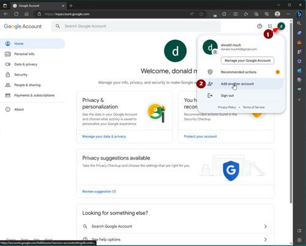

# A dedicated Google account for AAPS (optional)

Alguns usuários do **AAPS** preferem usar também a sua conta de e-mail principal para o **AAPS**. Outros usuários do **AAPS** (ou os seus cuidadores) criam uma conta de e-mail dedicada ao **AAPS**. Isso é opcional; abaixo mostramos um exemplo de como fazer.

Se você não quiser criar uma conta Gmail dedicada ao **AAPS**, pode ir direto para a próxima seção, [Compilar o AAPS](../SettingUpAaps/BuildingAaps.md).

```{admonition} Advantages of a dedicated Google account for AAPS
:class: dropdown

- Um espaço dedicado no Google Drive significa que você não corre o risco de encher o limite do seu Google Drive pessoal com **Exportar configurações**.
- Cada versão do **AAPS** (e de apps de apoio como xDrip, BYODA etc.) ficará guardada em um único lugar, que não depende do hardware do seu computador. Se o seu PC ou telefone for roubado, perdido ou quebrar, você ainda terá acesso.
- Com uma configuração padronizada, o suporte on-line fica mais simples entre usuários com uma estrutura de pastas parecida.
- Dependendo da configuração (veja abaixo), você terá uma identidade separada, como um apelido, para se comunicar na comunidade, o que pode proteger a sua privacidade. 
- Crianças com DM1 podem manter a sua própria conta de e-mail do “dia a dia” como menores de idade e, ao mesmo tempo, usar o **AAPS** e os recursos ligados a ele que exigem uma conta de adulto.
- O Gmail permite registrar até 4 contas com o mesmo número de telefone.
```

## How to set up a dedicated Google account for AAPS

(⌛About 10 minutes)


Requirements:

* Você tem um PC com Windows (Windows 10 ou mais recente) e um telefone Android (Android 12 ou mais recente) onde o app **AAPS** será instalado. These both have all the latest security updates, internet access and admin privileges, since some steps require downloading and installing programs.
* O telefone Android já está configurado com o seu endereço de e-mail pessoal do ”dia a dia”, como uma conta Gmail.

```{admonition} Things to consider when setting up your new account
:class: dropdown
- Por motivos de privacidade, você pode usar um nome diferente do seu, que tenha relação com a conta (por exemplo, t1dsuperstar). Assim, você pode usá-lo nos fóruns públicos do **AAPS** e manter a sua identidade privada. Como o Google exige um e-mail de recuperação e um número de telefone, ainda é possível rastrear você.
- A nova conta do **AAPS** usará para a verificação o mesmo número de telefone que a sua conta do “_dia a dia_”. Ela usará o endereço de e-mail do “dia a dia” para a verificação;
- Vamos configurar o encaminhamento de e-mails, para que todo e-mail enviado para a nova conta dedicada ao AAPS seja encaminhado para a conta principal (assim você não precisa verificar duas caixas de e-mail diferentes);
- Use senhas diferentes para a sua conta Gmail do _dia a dia_ e para a conta Gmail dedicada ao AAPS
- Se você usa a autenticação “2-step verification” (verificação em duas etapas, também chamada de autenticação multifator) do Google em uma conta Gmail, use-a também nas duas contas Gmail.
- Se você pretende usar as “Passkeys” (chaves de acesso) do Google, registre vários dispositivos. Assim você não fica sem acesso à sua conta. Faça isso apenas em dispositivos que ninguém mais pode acessar (_ou seja_, não em um PC com uma conta compartilhada que outras pessoas podem desbloquear).
```


```{admonition} Video Walkthrough!
:class: note
Clique [aqui](<https://drive.google.com/file/d/1dMZTIolO-kd2eB0soP7boEVtHeCDEQBF/view?usp=drive_link>) para ver um vídeo que mostra passo a passo como criar uma conta Google dedicada.
```

 These are the steps outlined in the video:

Neste exemplo: 
- A sua conta Google atual do “_dia a dia_” é <donald.muck42@gmail.com> ; 
- A sua nova conta Gmail do “_AAPS_” será: <donald.muck42.aaps@gmail.com>; 


### Acesse <https://account.google.com> 

 Se você já estiver conectado ao Google, isso vai levar você à página **My Account** (Minha conta) da sua conta do “dia a dia”. (1) Clique na foto do seu perfil, no canto superior direito da página (neste caso, um simples  (2) selecione “_add another account_” (adicionar outra conta).




### Digite os dados da sua NOVA conta dedicada: 

- Digite os dados da nova conta: 
- Create Account
- for my personal use (para uso pessoal). 


### Enter your persona:
 - Enter firstname
 - lastname
 - birthdate (needs to be an Adult age)

### Escolha o seu NOVO endereço de e-mail e a senha

Este exemplo adiciona “.AAPS” ao endereço que Donald Muck já tem…\
Defina uma senha

### Digite um número de telefone que possa receber o SMS de verificação

Gmail will now send you a unique code to enter for validation.

### Digite o endereço de e-mail de recuperação

Neste caso, será o seu e-mail atual do “_dia a dia_”…

### Finish setting up the account

Gmail will display the account name. Ele vai pedir que você aceite os termos e condições do Gmail e confirme as suas configurações de personalização.

### Customize the new profile display

Agora você deve estar na página MyAccount do Gmail, que mostra a sua nova conta de e-mail dedicada ao **AAPS**. The profile picture will be set by default to the first letter of your name. Altere-a para algo único, para evitar confusão… neste exemplo, Donald.Muck.AAPS substituiu  por 

\


### Open the Gmail website on both windows to configure the new account

Para não precisar acompanhar uma conta de e-mail separada, encaminhe todos os e-mails da nova conta dedicada ao **AAPS** para a sua conta do dia a dia\
Esta parte pode ser um pouco confusa, porque você vai precisar alternar entre as duas contas várias vezes. To make it easier, open 2 separate browser windows on top of each other:

1. Mova o navegador já aberto para a parte de cima da tela e redimensione-o para que ocupe só a metade de cima da tela…
2. Clique com o botão direito no ícone do navegador na barra de tarefas
3. No menu, selecione “New Window” (Nova janela)... e ajuste-a para que ocupe só a metade de baixo da tela.

Abra <https://gmail.com> em cada janela do navegador. Verifique se a sua conta pessoal está em cima e a nova conta dedicada ao **AAPS** está embaixo, e se ela é fácil de reconhecer pela foto do perfil no canto superior direito. (if needed you can always switch accounts by clicking on the profile picture and selecting the correct one.


As telas iniciais do Gmail devem ficar assim:\


 ### Na nova conta Gmail (janela de baixo), abra as configurações do Gmail…

- Clique na engrenagem à esquerda da foto do perfil
- depois selecione “**See all Settings**” (Ver todas as configurações)


### Setup forwarding…

- Click on the “Forwarding and POP/IMAP” Setting tab
- Click on “add a forwarding address”
- Add your “everyday” email address
- O Gmail enviará um código de verificação para o seu endereço de e-mail do “dia a dia”.
- You will switch back to your everyday profile and click on the link to verify that you accept the forwarding (or get the code from Gmail’s verification email in your “everyday” Gmail window and cut and paste it in your “new AAPS dedicated” Gmail window).

There is quite a bit of back and forth between the windows but this will ensure that when you check your “everyday” account emails you will also see the emails forwarded from your AAPS dedicated account such as Gmail alerts.


### Verify the forwarded email address

- No Gmail do “dia a dia” (janela de cima), você vai receber o e-mail “Gmail forwarding Confirmation” (confirmação de encaminhamento do Gmail).
- Open it and “click the link to confirm the request”

### Archive forwarded emails in the new dedicated Gmail account (bottom window)

<!---->

1. Refresh the bottom window
2. Check “forward incoming email”
3. And archive Gmail’s copy (to keep your new dedicated mailbox clean)
4. Role até o final da página para salvar as alterações\
   


Parabéns! Now you have created an AAPS-dedicated Google account. O próximo passo é [compilar o app AAPS](../SettingUpAaps/BuildingAaps.md).