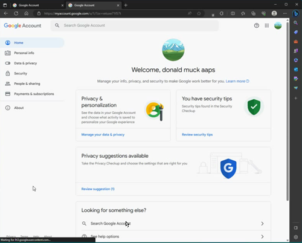
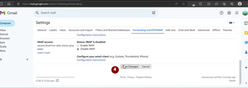

# Uma conta Google dedicada ao AAPS (opcional)

Alguns usuários do **AAPS** preferem usar também a sua conta de e-mail principal para o **AAPS**. Outros usuários do **AAPS** (ou os seus cuidadores) criam uma conta de e-mail dedicada ao **AAPS**. Isso é opcional; abaixo mostramos um exemplo de como fazer.

Se você não quiser criar uma conta Gmail dedicada ao **AAPS**, pode ir direto para a próxima seção, [Compilar o AAPS](../SettingUpAaps/BuildingAaps.md).

```{admonition} Advantages of a dedicated Google account for AAPS
:class: dropdown

- Dedicated Google Drive space means you will not risk filling up your personal Google Drive limit with **Export settings**.
- Cada versão do **AAPS** (e de apps de apoio como xDrip, BYODA etc.) ficará guardada em um único lugar, que não depende do hardware do seu computador. Se o seu PC ou telefone for roubado, perdido ou quebrar, você ainda terá acesso.
- Com uma configuração padronizada, o suporte on-line fica mais simples entre usuários com uma estrutura de pastas parecida.
- Dependendo da configuração (veja abaixo), você terá uma identidade separada, como um apelido, para se comunicar na comunidade, o que pode proteger a sua privacidade. 
- Crianças com DM1 podem manter a sua própria conta de e-mail do “dia a dia” como menores de idade e, ao mesmo tempo, usar o **AAPS** e os recursos ligados a ele que exigem uma conta de adulto.
- O Gmail permite registrar até 4 contas com o mesmo número de telefone.
```

## Como configurar uma conta Google dedicada ao AAPS

(⌛Cerca de 10 minutos)


Requisitos:

* Você tem um PC com Windows (Windows 10 ou mais recente) e um telefone Android (Android 12 ou mais recente) onde o app **AAPS** será instalado. Os dois têm todas as atualizações de segurança mais recentes, acesso à internet e permissões de administrador, porque algumas etapas exigem baixar e instalar programas.
* O telefone Android já está configurado com o seu endereço de e-mail pessoal do ”dia a dia”, como uma conta Gmail.

```{admonition} Things to consider when setting up your new account
:class: dropdown
- Por motivos de privacidade, você pode usar um nome diferente do seu, que tenha relação com a conta (por exemplo, t1dsuperstar). Assim, você pode usá-lo nos fóruns públicos do **AAPS** e manter a sua identidade privada. Como o Google exige um e-mail de recuperação e um número de telefone, ainda é possível rastrear você.
- A nova conta do **AAPS** usará para a verificação o mesmo número de telefone que a sua conta do “_dia a dia_”. Ela usará o endereço de e-mail do “dia a dia” para a verificação;
- Vamos configurar o encaminhamento de e-mails, para que todo e-mail enviado para a nova conta dedicada ao AAPS seja encaminhado para a conta principal (assim você não precisa verificar duas caixas de e-mail diferentes);
- Use senhas diferentes para a sua conta Gmail do _dia a dia_ e para a conta Gmail dedicada ao AAPS
- Se você usa a autenticação “2-step verification” (verificação em duas etapas, também chamada de autenticação multifator) do Google em uma conta Gmail, use-a também nas duas contas Gmail.
- Se você pretende usar as “Passkeys” (chaves de acesso) do Google, registre vários dispositivos. Assim você não fica sem acesso à sua conta. Faça isso apenas em dispositivos que ninguém mais pode acessar (_ou seja_, não em um PC com uma conta compartilhada que outras pessoas podem desbloquear).
```


```{admonition} Video Walkthrough!
:class: note
Clique [aqui](<https://drive.google.com/file/d/1dMZTIolO-kd2eB0soP7boEVtHeCDEQBF/view?usp=drive_link>) para ver um vídeo que mostra passo a passo como criar uma conta Google dedicada.
```

 Estas são as etapas mostradas no vídeo:

Neste exemplo: 
- Your existing “_Everyday_” Google account is <donald.muck42@gmail.com>; 
- A sua nova conta Gmail do “_AAPS_” será: <donald.muck42.aaps@gmail.com>; 


### Go to <https://myaccount.google.com> 

 Se você já estiver conectado ao Google, isso vai levar você à página **My Account** (Minha conta) da sua conta do “dia a dia”. (1) Click on the top right of the page on your profile picture (in this case, a simple ) (2) select “_add another account_”.


### Digite os dados da sua NOVA conta dedicada: 

- Digite os dados da nova conta: 
- Criar conta
- for my personal use (para uso pessoal). 


### Digite os seus dados:
 - Digite o nome
 - sobrenome
 - data de nascimento (precisa ser de um adulto)

### Escolha o seu NOVO endereço de e-mail e a senha

Este exemplo adiciona “.AAPS” ao endereço que Donald Muck já tem…\
Defina uma senha

### Digite um número de telefone que possa receber o SMS de verificação

O Gmail vai enviar um código único para você digitar na verificação.

### Digite o endereço de e-mail de recuperação

Neste caso, será o seu e-mail atual do “_dia a dia_”…

### Termine a configuração da conta

O Gmail vai mostrar o nome da conta. Ele vai pedir que você aceite os termos e condições do Gmail e confirme as suas configurações de personalização.

### Personalize a exibição do novo perfil

Agora você deve estar na página MyAccount do Gmail, que mostra a sua nova conta de e-mail dedicada ao **AAPS**. Por padrão, a foto do perfil será a primeira letra do seu nome. Change it to something unique to avoid confusion… in this example, Donald.Muck.AAPS has replaced  with .

\


### Abra o site do Gmail nas duas janelas para configurar a nova conta

Para não precisar acompanhar uma conta de e-mail separada, encaminhe todos os e-mails da nova conta dedicada ao **AAPS** para a sua conta do dia a dia\
Esta parte pode ser um pouco confusa, porque você vai precisar alternar entre as duas contas várias vezes. Para facilitar, abra 2 janelas do navegador separadas, uma em cima da outra:

1. Mova o navegador já aberto para a parte de cima da tela e redimensione-o para que ocupe só a metade de cima da tela…
2. Clique com o botão direito no ícone do navegador na barra de tarefas
3. No menu, selecione “New Window” (Nova janela)... e ajuste-a para que ocupe só a metade de baixo da tela.

Abra <https://gmail.com> em cada janela do navegador. Verifique se a sua conta pessoal está em cima e a nova conta dedicada ao **AAPS** está embaixo, e se ela é fácil de reconhecer pela foto do perfil no canto superior direito. If needed, you can always switch accounts by clicking on the profile picture and selecting the correct one.


As telas iniciais do Gmail devem ficar assim:\


 ### Na nova conta Gmail (janela de baixo), abra as configurações do Gmail…

- Clique na engrenagem à esquerda da foto do perfil
- depois selecione “**See all Settings**” (Ver todas as configurações)


### Configure o encaminhamento…

- Clique na aba de configuração “Forwarding and POP/IMAP” (Encaminhamento e POP/IMAP)
- Clique em “add a forwarding address” (adicionar um endereço de encaminhamento)
- Adicione o seu endereço de e-mail do “dia a dia”
- O Gmail enviará um código de verificação para o seu endereço de e-mail do “dia a dia”.
- Você vai voltar ao seu perfil do dia a dia e clicar no link para confirmar que aceita o encaminhamento (ou pegar o código no e-mail de verificação do Gmail na janela do Gmail do “dia a dia” e recortar e colar na janela do Gmail da “nova conta dedicada ao AAPS”).

Você vai alternar bastante entre as janelas, mas assim, quando você ler os e-mails da conta do “dia a dia”, também vai ver os e-mails encaminhados da sua conta dedicada ao AAPS, como os alertas do Gmail.


### Confirme o endereço de e-mail de encaminhamento

- No Gmail do “dia a dia” (janela de cima), você vai receber o e-mail “Gmail forwarding Confirmation” (confirmação de encaminhamento do Gmail).
- Abra-o e clique no link para confirmar a solicitação (“click the link to confirm the request”)

### Arquive os e-mails encaminhados na nova conta Gmail dedicada (janela de baixo)

<!---->

1. Atualize a janela de baixo
2. Marque “forward incoming email” (encaminhar e-mails recebidos)
3. E arquive a cópia do Gmail (para manter limpa a sua nova caixa de e-mail dedicada)
4. Role até o final da página para salvar as alterações\
   



Parabéns! Agora você criou uma conta Google dedicada ao AAPS. O próximo passo é [compilar o app AAPS](../SettingUpAaps/BuildingAaps.md).