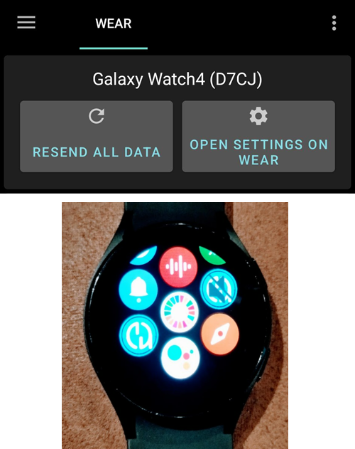

# Configurar o AAPS no seu relógio Wear OS

As instruções abaixo valem para o apk do **AAPS Wear** que você precisa compilar. Se você ainda não o compilou, veja o guia [aqui](../WearOS/BuildingAapsWearOS.md). Na compilação, use o mesmo arquivo keystore que você usou para o apk do **AAPS** do telefone.

Você também pode usar parte destas informações para o apk **Wear** do **AAPSClient** e do **PumpControl**. Cada app **Wear** se comunica com o app do telefone correspondente. Por exemplo: o app **AAPSClient Wear** pode ser usado para mostrar os dados do **AAPSClient**, e não os dados do **AAPS**. Quando várias variantes do cliente (**AAPSClient**, **AAPSClient2**, **AAPSClient3**) estão instaladas lado a lado, os blocos de cada uma têm um pequeno cabeçalho na cor de destaque dessa variante, para você poder diferenciá-las ao deslizar.

## Versões do Wear OS e compatibilidade

(wearos-watchface-changes)=

### Mudanças nos mostradores do Wear OS (impacto nos mostradores do AAPS)

```{admonition} Why newer Wear OS watches break AAPS watchfaces
:class: warning

Em junho de 2025, o Google [anunciou mudanças](https://android-developers.googleblog.com/2025/06/upcoming-changes-to-wear-os-watch-faces.html) que eliminam aos poucos o mecanismo antigo de mostradores (o mecanismo AndroidX / Wearable Support Library, ou "WSL") e o substituem pelo novo formato declarativo **Watch Face Format**. Os mostradores personalizados do **AAPS** são feitos com o mecanismo antigo. Por isso, quanto mais nova a versão do Wear OS, maior a chance de um mostrador do AAPS funcionar mal ou parar de funcionar.

Isso afeta especificamente os **mostradores** — as **complicações**, os blocos e as funções de controle remoto do AAPS não são afetados. É também por isso que **uma atualização de firmware/sistema em um relógio Wear OS pode quebrar os mostradores do AAPS**, e depois não é possível voltar o relógio para uma versão mais antiga do Wear OS. Se o seu mostrador do AAPS funciona agora, **desative as atualizações automáticas do relógio**.
```

A tabela abaixo resume como a mudança do Google afeta os mostradores do AAPS (mecanismo antigo) em cada versão do Wear OS:

| Versão do Wear OS       | Android base | Nível de API | Impacto nos mostradores (antigos) do AAPS                                                                                                                                                                               |
| ----------------------- | ------------ | ------------ | ----------------------------------------------------------------------------------------------------------------------------------------------------------------------------------------------------------------------- |
| Wear OS 6               | Android 16   | 36           | **Mostradores antigos não estão mais disponíveis** — o AAPS instala no lugar deles um [mostrador no Watch Face Format](#wearos-aaps-v4-watchface): o seu mostrador personalizado ou o mostrador de complicações AAPS V4 |
| Wear OS 5               | Android 14   | 34           | **Grave** — o modo ativo (interativo) falha com frequência, as complicações congelam, as animações param                                                                                                                |
| Wear OS 4               | Android 13   | 33           | **Moderado** — limitação de atualizações, atualizações perdidas, falhas parciais                                                                                                                                        |
| Wear OS 3.0 / 3.2 / 3.5 | Android 11   | 30           | **Baixo** — o mecanismo antigo ainda é compatível                                                                                                                                                                       |

Se o seu relógio tem uma versão em que os mostradores do AAPS não são confiáveis, você pode mostrar os dados do AAPS por meio de **complicações** em um mostrador compatível, ou usar o [GlucoDataHandler](https://play.google.com/store/apps/details?id=de.michelinside.glucodatahandler) com uma complicação, alimentado pelo plugin [Apps companheiros externos](#external-companion-apps) do **AAPS**. No **Wear OS 6 e mais novo**, o AAPS instala um mostrador substituto feito no novo formato — veja abaixo.

(wearos-aaps-v4-watchface)=

### Wear OS 6 e mais novo — o mostrador que o AAPS instala

Relógios com **Wear OS 6 ou mais novo** não conseguem usar os mostradores clássicos do AAPS como mostradores. Para esses relógios, o app do AAPS no relógio traz dois mostradores feitos no novo **Watch Face Format** do Google. O Wear OS permite que um app instale apenas **um** mostrador, então você escolhe qual dos dois fica no relógio:

- **Mostrador personalizado** (padrão): mostra o mostrador personalizado que você carregou no telefone com **Carregar Watchface** (veja [Mudar para um mostrador do AAPS](#WearOS_changing-to-AAPS-watchface)). O relógio desenha o seu design como uma imagem, então todos os mostradores personalizados existentes funcionam. Os espaços de complicação que um mostrador personalizado pode definir **não estão disponíveis** nesta imagem, porque o Wear OS só entrega dados de complicações a um mostrador de verdade. Toque e segure no mostrador para abrir a sua única configuração: se a tela sempre ativa mostra um relógio simples ou o seu próprio design, escurecido.
- **Mostrador de complicações** (o mostrador **AAPS V4**): os seus **sete espaços de complicação** já vêm **configurados com dados do AAPS**: valor de glicemia, IOB, COB, a [complicação Gráfico de BG](#Watchfaces-complications), taxa basal / alvo temporário e o ícone **Modo de operação** no espaço superior esquerdo (toque nele para mudar o modo do loop pelo relógio). Toque na hora, no alto, para abrir o app de alarmes do relógio. Você pode mudar o que cada espaço mostra no editor do mostrador.

Você escolhe no telefone: abra o plugin **Wear** e, em **Mostrador instalado no relógio**, selecione um dos dois. Este cartão só aparece enquanto um relógio com Wear OS 6 ou mais novo está conectado. O **AAPS** pede que você confirme, porque o relógio troca o mostrador na hora. Ao sair do **Mostrador de complicações**, as complicações que você mudou no editor do mostrador também voltam ao padrão, e a confirmação avisa isso. Enquanto o **Mostrador de complicações** está selecionado, os botões do mostrador personalizado ficam ocultos e, no lugar deles, aparece uma prévia do mostrador. Se você carregar um mostrador personalizado enquanto o **Mostrador de complicações** está selecionado, o **AAPS** lembra você de mudar para **Mostrador personalizado** para vê-lo no relógio.

- O mostrador selecionado é **instalado e ativado automaticamente** na primeira vez que o app do AAPS roda nesse relógio, e é **atualizado automaticamente** junto com o app do relógio.
- Se você removeu o mostrador, aparece um item **Instalar mostrador** no fim do **menu principal** do AAPS no relógio — toque nele para reinstalar.

Enquanto um relógio com Wear OS 5 ou mais antigo está conectado, o cartão **Mostrador instalado no relógio** não aparece (o mecanismo que ele usa precisa do Wear OS 6); lá os mostradores clássicos funcionam como antes.

(wearos-complications-watchface-setup)=

### Mostrador de complicações — configuração recomendada

O **Mostrador de complicações** tem sete espaços de complicação. Toque e segure no mostrador, toque em **Customize** (Personalizar) e escolha uma fonte de dados para cada espaço. Os espaços são numerados como no editor do mostrador: **1** à esquerda, **2** no centro, **3** à direita, **4** o gráfico, **5** embaixo, **6** no alto à esquerda e **7** no alto à direita.

| Configuração padrão                                                                                     | Configuração alternativa                                                                                         |
| ------------------------------------------------------------------------------------------------------- | ---------------------------------------------------------------------------------------------------------------- |
|  |  |

| Espaço | Posição           | Padrão                                                                                        | Alternativa                                  |
| ------ | ----------------- | --------------------------------------------------------------------------------------------- | -------------------------------------------- |
| 1      | Esquerda          | Ícone de IOB                                                                                  | COB & IOB                                    |
| 2      | Centro            | Glicemia                                                                                      | Glicemia                                     |
| 3      | Direita           | Ícone de COB                                                                                  | BR & alvo                                    |
| 4      | Gráfico           | Gráfico de BG                                                                                 | Gráfico de BG                                |
| 5      | Inferior          | BR & alvo                                                                                     | Bateria do dispositivo de upload/telefone    |
| 6      | Superior esquerdo | Modo de operação                                                                              | Modo de operação                             |
| 7      | Superior direito  | Bateria do dispositivo de upload/telefone, ou um atalho de app para **Alerta de Soneca AAPS** | Atalho de app para **Alerta de Soneca AAPS** |

O atalho **Alerta de Soneca AAPS** é escolhido nas complicações **App shortcut** (Atalho de app) do próprio relógio. Ao tocar nele, você silencia o alarme que está tocando no telefone.

```{tip}
Ative a **Always-on display** (tela sempre ativa) no relógio (**Settings** (Configurações) > **Display** (Tela)). Assim o mostrador continua mostrando a sua glicose quando o pulso está abaixado, em vez de uma tela vazia ou de um relógio simples.
```

```{admonition} No complication data while the watch is locked
:class: note
Se um **Lock type** (tipo de bloqueio) estiver definido em **Settings** (Configurações) > **Security and privacy** (Segurança e privacidade), o relógio esconde os dados das complicações enquanto está bloqueado, e o mostrador mostra espaços vazios até você desbloqueá-lo. Para manter os dados visíveis, desative **Hide information** (Ocultar informações) no mesmo menu.
```

### Wear OS 3

Instale o apk do **AAPS Wear** usando o [Wear Installer 2](https://youtu.be/abgN4jQqHb0?si=5L7WUeYMSd_8IdPV), o Easy Fire Tools (descrito abaixo) ou o ADB.  
Nenhuma limitação no uso do **AAPS Wear**.

(BuildingAapsWearOs-WearOS5)=

### Wear OS 4 e Wear OS 5

Exemplo: Galaxy Watch 4, 5, 6, 7 e Ultra ou Pixel Watch que **ainda não** foram atualizados para o Wear OS 6. Verifique a versão em **Settings** (Configurações) > **About watch** (Sobre o relógio) > **Software**.

Instale o apk do **AAPS Wear** usando o [Wear Installer 2](https://youtu.be/abgN4jQqHb0?si=5L7WUeYMSd_8IdPV) (para o Wear OS 5, siga [este vídeo](https://www.youtube.com/watch?v=yef_qGvcCnk)). Todas as funções do **AAPS Wear** funcionam, mas os mostradores clássicos do **AAPS** são limitados, como descrito na tabela acima: atualizações limitadas no Wear OS 4, falhas frequentes no Wear OS 5.

```{admonition} Wear OS 5
:class: warning
No Wear OS 5, o mostrador do AAPS precisa ser selecionado com o Wear Installer 2 logo depois de instalar o app Wear: o instalador oferece o mostrador **AAPS (Custom)** no fim da instalação. Se você mudar para outro mostrador sem querer, repita a instalação. Talvez não seja possível mudar as configurações do mostrador (Escuro, Watchdivider etc.).

Se o mostrador clássico funciona para você agora, **desative as atualizações automáticas do relógio**: a próxima atualização de firmware provavelmente vai quebrá-lo. Se mesmo assim você atualizar para o Wear OS 6, leia a seção acima: o **AAPS** então instala o seu próprio mostrador no novo formato.
```

Se o mostrador não for confiável o suficiente, considere usar o [GlucoDataHandler](https://play.google.com/store/apps/details?id=de.michelinside.glucodatahandler) com uma complicação. Ele precisa do plugin [Apps companheiros externos](#external-companion-apps) ativado no **AAPS**.

### Wear OS 6 e mais novo

Exemplo: Galaxy Watch 4 e mais novos com One UI 8 Watch, Pixel Watch depois da atualização de 2025. A maioria dos relógios Galaxy e Pixel já recebeu essa atualização.

Instale o apk do **AAPS Wear** usando o [Wear Installer 2](https://youtu.be/abgN4jQqHb0?si=5L7WUeYMSd_8IdPV). Os mostradores clássicos não estão disponíveis; o **AAPS** instala automaticamente o mostrador selecionado no telefone, veja [o mostrador que o AAPS instala](#wearos-aaps-v4-watchface). Nenhuma limitação no uso do **AAPS Wear**.

## Como configurar um smartwatch Samsung Galaxy Watch 4 com o **AAPS**

Esta seção é para quem nunca usou um smartwatch. Ela dá uma orientação básica sobre um relógio popular, o **Galaxy Watch 4**, e depois um guia passo a passo para configurar o **AAPS** no relógio.

_Este guia foi escrito para um Galaxy Watch com Wear OS 3._ No Wear OS 4 e mais novos, o relógio pede um **código de pareamento** quando um telefone ou computador se conecta por ADB. O Wear Installer 2 e o procedimento pelo terminal [abaixo](#BuildingAapsWearOs-WearOS5-TShoot) suportam isso.

Aqui estão guias básicos de configuração para o [Galaxy Watch 5](https://www.youtube.com/watch?v=Y5upzOIxwTU) e o [Galaxy Watch 6](https://www.youtube.com/watch?v=D6bq20KzPW0)

## Primeiros passos com o smartwatch

Depois da configuração básica do seu relógio, como no vídeo acima, abra a Play Store no telefone e baixe os seguintes apps: "Galaxy Wearable", “Samsung” e “Easy Fire tools” ou "Wear Installer 2".

Há muitos vídeos de terceiros no YouTube que ajudam você a conhecer o seu novo smartwatch, por exemplo:

[https://www.youtube.com/watch?v=tSVkqWNmO2c](https://www.youtube.com/watch?v=tSVkqWNmO2c)

O app “Galaxy Wearable” também tem uma seção com o manual de instruções. Abra o Galaxy Wearable no telefone, procure o relógio e tente parear o relógio com o telefone. Dependendo da sua versão, ele pode pedir para você instalar mais um app, o “galaxy watch 4 plugin”, da Play Store (o download demora um pouco). Instale-o no telefone e depois tente parear o relógio e o telefone de novo no app Wearable. Passe por uma série de menus e marque várias preferências.

## Configurar uma conta Samsung

A conta de e-mail que você usa para configurar a conta Samsung precisa ter uma data de nascimento em que o usuário tenha 13 anos ou mais. Se não, é muito difícil aprovar as permissões da Samsung. Se você deu ao seu filho com menos de 13 anos uma conta Gmail e usa esse endereço de e-mail, não é possível simplesmente mudá-la para uma conta de adulto. Uma forma de contornar isso é mudar a data de nascimento atual para que a idade atual seja 12 anos e 364 dias. No dia seguinte, a conta vai ser convertida em conta de adulto e você pode continuar a configuração da conta Samsung.

(remote-control-transferring-the-aaps-wear-app-onto-your-aaps-phone)=

## Transferir o app Wear do **AAPS** para o seu telefone com o **AAPS**

Você pode levar o Wear.apk do Android Studio para o seu telefone de duas formas:

a) usando um cabo USB para colocar o arquivo apk do Wear do **AAPS** no telefone e depois instalá-lo no relógio por “side-load” (instalação manual). Transfira o Wear.apk para o telefone por USB, para a pasta de downloads; ou

b) recorte e cole o Wear.apk do Android Studio no seu Google Drive.


Para instalar o AAPS no relógio por side-load, você pode usar: 1) Wear Installer 2 2) Easy Fire tools 3) Android Debug Bridge (ADB) Aqui recomendamos o Wear Installer 2, porque as instruções e o processo no vídeo são muito claros e bem explicados. Se o Wear Installer 2 não funcionar para você, tente o Easy Fire Tools ou o ADB, ambos descritos abaixo.

### Usar o Wear Installer 2 para instalar o **AAPS** Wear do telefone no relógio por side-load

 

O Wear Installer 2, desenvolvido por [Malcolm Bryant](https://www.youtube.com/@Freepoc), pode ser baixado do Google Play no seu telefone e pode ser usado para instalar o app Wear do AAPS no relógio por side-load. O app tem um [vídeo](https://youtu.be/abgN4jQqHb0?si=5L7WUeYMSd_8IdPV) prático sobre ‘como fazer o side-load’.

```{tip}
Para relógios com Wear OS 5, siga [este vídeo](https://www.youtube.com/watch?v=yef_qGvcCnk).
Veja as dicas de resolução de problemas [abaixo](#BuildingAapsWearOs-WearOS5-TShoot).
```

Ele dá todos os detalhes necessários (é melhor abrir o vídeo em outro dispositivo para poder assisti-lo enquanto configura o telefone).

Como dito no vídeo, quando terminar, desligue o ADB debugging (depuração ADB) no relógio, para não gastar a bateria do smartwatch.

Como alternativa, mas não para o Wear OS 5, você pode:

### Usar o Easy Fire tools para instalar o **AAPS** Wear no relógio por side-load

1) Baixe o _[Easy Fire Tools](https://play.google.com/store/apps/details?id=de.agondev.easyfiretools&hl=en)_ da Play Store no telefone


2) Torne-se desenvolvedor no relógio (depois de configurá-lo e conectá-lo ao telefone):

Vá em **Settings** (Configurações) > **System** (Sistema) > **About** (Sobre) > **Versions** (Versões) (os nomes dos menus mudam conforme a marca do relógio — em alguns relógios é **About watch** (Sobre o relógio) > **Software info** (Informações do software) > **Software version** (Versão do software)).


Toque rapidamente várias vezes em **Build number** (Número da versão) (ou **Software version**) até uma mensagem dizer que agora você é desenvolvedor.


Volte para **Settings** (Configurações) > **System** (Sistema): agora aparece um novo menu **Developer options** (Opções do desenvolvedor).

Em **Developer options**, ative **ADB debugging** (depuração ADB) e **Wireless debugging** (depuração por Wi-Fi) e confirme as perguntas. A depuração por Wi-Fi então mostra o **IP address & Port** (endereço IP e porta) do relógio, algo como: **192.168.1.214** : 5555. Você só precisa do endereço IP (aqui **192.168.1.214**), não do número da porta depois dos dois-pontos. Observe que o endereço IP pode mudar, por exemplo sempre que você trocar para um novo telefone para o AAPS.


PASSO 3) Digite o endereço IP, _por exemplo_ **192.168.1.214**, no Easy Fire tools no telefone (abra o menu hambúrguer à esquerda, as configurações e digite o endereço IP).


Depois toque no ícone de tomada no canto superior direito. Ele fica verde quando está conectado.


PASSO 4) Siga as instruções [aqui](https://wearablestouse.com/blog/2022/01/04/install-apps-apk-samsung-galaxy-watch-4/?utm_content=cmp-true) para instalar por side-load (ou seja, transferir) o aaps-wear.apk no smartwatch usando o Easy Fire tools


(BuildingAapsWearOs-WearOS5-TShoot)=

### Usar o terminal
Conecte o seu smartwatch e o computador à mesma rede Wi-Fi.

- Para instalar o ADB, baixe-o em: https://developer.android.com/tools/releases/platform-tools
- Abra um terminal.
- No Windows, crie uma nova pasta chamada `adb` no seu disco `C:`. Abra o arquivo `platform-tools-latest-windows.zip` que você baixou acima. Copie todos os arquivos de dentro de `platform-tools` para `C:\adb` e abra esta pasta em um prompt de comando (clique com o botão direito e escolha Open in Terminal (Abrir no Terminal)). Digite o comando abaixo para definir o caminho da pasta onde o ADB está: `setx PATH "%PATH%;C:\adb"`
- No Mac, em vez de instalar manualmente, você pode usar o homebrew: `brew install android-platform-tools`

No relógio:
- Vá em Settings (Configurações) → About watch (Sobre o relógio) → **Software Information** (Informações do software)
- Toque 7 vezes em Software version (Versão do software) até ver Developer mode enabled (Modo de desenvolvedor ativado).
- Vá em Settings (Configurações) → Developer options (Opções do desenvolvedor). Ative **ADB debugging** (depuração ADB)
- Vá em Settings (Configurações) → Developer options (Opções do desenvolvedor) → Wireless debugging (Depuração por Wi-Fi) → **Pair new device** (Parear novo dispositivo)

Você vai ver um código de pareamento Wi-Fi, o endereço IP e a porta:


- No terminal: `adb pair ipaddress:port` Por exemplo: `adb pair 10.10.1.125:36299`
- Será pedido o código de pareamento. Digite-o.
- Você vai ver uma resposta:<br> `Successfully paired to 10.10.1.125:36299 [guid=adb-RXXXW20LMKJY-eh5zBj]`<br>
- No terminal, digite: <br>`adb devices`.<br> Você deve ver algo como:<br> `List of devices attached`<br> `10.10.1.125:36299  offline`<br> `adb-RFAW20LMKJY-eh5zBj._adb-tls-connect._tcp   device`<br>

- Agora vá até a pasta do seu computador onde está o apk do Wear e digite<br> `adb install wear-full.apk` <br>trocando wear-full.apk pelo nome do seu arquivo apk.
- Você vai ver:<br> `Performing Streamed Install`<br> `Success`


(wear-os-5-troubleshooting)=

### Recomendações gerais de resolução de problemas para o Wear OS 5

- Não use o Wi-Fi Tethering (roteador Wi-Fi do telefone). Isso não vai funcionar.
- Você não precisa ativar a depuração adb no telefone (só no relógio). Desative a depuração adb no telefone.
- Conecte-se à sua rede local, onde o telefone e o relógio podem se ver (não use a sua rede Wi-Fi de visitantes para conectar).
- O relógio e o telefone devem estar na mesma rede e no mesmo dispositivo Wi-Fi. Principalmente repetidores Wi-Fi ou pontos de acesso podem causar problemas.
- Fique perto do seu roteador principal e depois reinicie o telefone e o relógio.

**Pareamento:**

- Relógio: Wireless debugging (Depuração por Wi-Fi): anote o endereço IP.
- Wear Installer: digite o IP no app Wear Installer.
- Selecione Pair new (Parear novo), anote o código de pareamento e o número da porta mostrados.
- Wear Installer: digite o código de pareamento + espaço + número da porta.
- O Wear Installer deve informar que o pareamento deu certo. Se não informar, saia do Wear Installer e tente de novo.

Depois de pareado, você pode instalar o apk do Wear do AAPS:

- Saia/feche e depois abra o Wear Installer de novo.
- Em Wireless debugging (Depuração por Wi-Fi), anote o IP e o número da porta e confira/digite o IP e o número da porta no Wear Installer.
- Observação: o número da porta é diferente do usado para o pareamento!

## Configurar a conexão entre o relógio e o telefone a partir do **AAPS**

O último passo é configurar o **AAPS** no telefone para interagir com o **Wear.apk** no relógio. Para isso, ative o plugin Wear:

* Abra o app **AAPS** no telefone

* Abra o **menu** (☰) no canto superior esquerdo e vá em **Configuração** > **Comunicação**

* Marque a caixa **Wear**


Para dar bólus ou fazer outras ações pelo relógio, ative também **Controle do Wear** em [Configurações > Wear](#preferences-wear).

Para mudar para outro mostrador do **AAPS**, toque e segure na tela inicial do relógio e ele vai abrir “customise” (personalizar). Depois deslize para a direita até chegar a todos os mostradores do **AAPS**.

Se o Wear.apk do **AAPS** foi instalado com sucesso no smartwatch por side-load, ele vai ficar assim:





Em alguns smartwatches, como o Samsung Galaxy, a opção 'Remote Connection' (Conexão remota) em Advanced Features (Recursos avançados) do Samsung Galaxy precisa estar **ligada** para usar o **Wear.apk** & o **AAPS** remotamente por Wi-Fi.


(wear-os-watch-phone-communication)=

### Resolução de problemas da comunicação entre o relógio com o **AAPS** e o telefone com o **AAPS**

1.  Se o EasyFire tools não conectar ou se você receber ‘authorisation failed’ (falha na autorização) > verifique se o endereço IP foi digitado corretamente.
2.  Verifique se o smartwatch está conectado à internet (e não apenas conectado ao telefone por Bluetooth).
3.  Verifique se o telefone com o **AAPS** e o smartwatch estão pareados ou vinculados no app Samsung.
4.  Também pode ajudar reiniciar completamente o telefone e o smartwatch (ou seja, desligar e ligar o telefone)
5.  Se você conseguiu baixar o Wear.apk no seu telefone, mas não está recebendo nenhum dado de glicose, _verifique_ se você instalou por side-load o apk do Wear do **AAPS** correto no relógio: o app do relógio de uma compilação no navegador é o arquivo `aaps-wear-….apk`, veja [Compilar o app AAPS para Wear](../WearOS/BuildingAapsWearOS.md). Se o arquivo que você instalou for um destes: a) um apk do Wear do **AAPSClient** (enquanto o telefone executa o **AAPS**); b) um arquivo `.aab`; ou c) um arquivo com a palavra ‘debug’ no nome, você não selecionou o apk do Wear OS correto durante a compilação.
6.  Verifique se o seu roteador não está isolando os dispositivos uns dos outros.

Mais dicas de resolução de problemas podem ser encontradas [aqui](https://freepoc.org/wear-installer-help-page/#:~:text=If%20you%20are%20having%20problems,your%20phone%20and%20your%20watch.)

(WearOS_changing-to-AAPS-watchface)=

## Mudar para um mostrador do AAPS no seu relógio Wear OS

Há vários mostradores disponíveis na compilação padrão do APK do AAPS para Wear OS. Depois de instalar o APK do Wear do AAPS no seu relógio, eles ficam disponíveis. Estes são os passos para selecionar um deles:

1. No seu relógio (com Wear OS), toque e segure no mostrador atual para abrir a tela de seleção de mostradores, role até o fim para a direita até ver o botão "Add Watch Face" (Adicionar mostrador) e selecione-o


2. Role a lista até encontrar "AAPS (Custom)" (dependendo do relógio, os mostradores dos apps instalados aparecem em uma seção "Downloaded" (Baixados) ou agrupados por app) e toque no meio da imagem para adicioná-lo à sua lista de mostradores atuais. Não se preocupe com a aparência atual do mostrador "AAPS (Custom)"; vamos selecionar o visual que você prefere no próximo passo.


3. Agora abra o AAPS no seu telefone e abra o plugin Wear: **Configuração** > **Comunicação** > **Wear** > **Abrir plugin** (marque **Wear** antes, se não estiver ativado).


4. Toque no botão "Carregar Watchface" e selecione o mostrador que você quer


5. Olhe o seu relógio: o mostrador "AAPS (Custom)" agora deve mostrar o visual que você selecionou. Espere alguns segundos para ele atualizar. A tela **Wear** no telefone agora mostra o nome do mostrador carregado e uma prévia dele. **Infos Watchface** mostra os detalhes do mostrador e os campos que ele contém, e **Mais mostradores** abre o [site de troca](../ExchangeSiteCustomWatchfaces/index.md), onde você pode baixar outros mostradores personalizados. Agora você pode personalizar as complicações etc.: toque e segure no mostrador e depois toque no botão "Customize" (Personalizar) na imagem do mostrador.

```{admonition} Complications on a custom watchface
:class: note
Mostradores personalizados feitos com a versão 3.0 ou mais nova do formato Custom Watchface podem ter até cinco espaços de complicação, com posição e tamanho definidos pelo mostrador (**Layout da complicação**). No relógio, toque e segure no mostrador, toque em **Customize** (Personalizar) e toque em **Complicação 1** até **Complicação 5** para escolher a fonte de dados mostrada em cada espaço. As mesmas linhas aparecem no app do AAPS no relógio, em **Configurações** > **AAPS (Personalizado)**; tocar em uma delas ali abre o mesmo seletor. **Prioridade do tipo de complicação** define se um espaço prefere um valor ou indicador, um texto ou um ícone quando a fonte de dados oferece vários. Uma prioridade alterada só vale na próxima vez que você escolher uma fonte de dados para esse espaço.

Esses espaços só funcionam em relógios com **Wear OS 5 ou mais antigo**, onde o mostrador personalizado roda como um mostrador de verdade. No **Wear OS 6 e mais novo**, o mostrador personalizado aparece como uma imagem sem os seus espaços de complicação, e os passos 1 e 2 acima não são necessários: verifique se **Mostrador personalizado** está selecionado em **Mostrador instalado no relógio** no plugin **Wear** do telefone (veja [o mostrador que o AAPS instala](#wearos-aaps-v4-watchface)).
```

## Mostrador AAPSv2 - Legenda


A - tempo desde a última execução do loop

B - leitura do CGM

C - minutos desde a última leitura do CGM

D - variação em relação à última leitura do CGM (em mmol/l ou mg/dl)

E - variação média da leitura do CGM nos últimos 15 minutos

F - bateria do telefone

G - taxa basal (mostrada em U/h com a taxa padrão e em % durante uma TBR)

H - BGI (blood glucose interaction, impacto na glicose) -> o quanto a glicose "deveria" estar subindo ou caindo com base apenas na atividade da insulina.

I - carboidratos (carboidratos ativos | e-carbs no futuro)

J - insulina ativa (do bólus | da basal)
