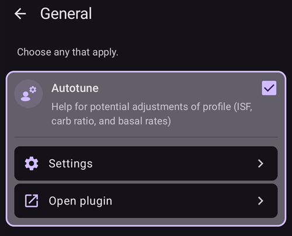

# Jak używać wtyczki Autotune

Wtyczka Autotune to implementacja algorytmu OpenAPS autotune w AAPS. Wtyczka analizuje twoją ostatnią historię AAPS i proponuje zmiany dawek bazowych, ISF i współczynnika węglowodanów (IC).

Autotune Plugin is available in AAPS releases since [3.4](#version3400) but is hidden by default.

(autotune-how-autotune-calculates-adjustments)=
## Jak Autotune oblicza zmiany

Autotune przegląda twoją ostatnią historię AAPS (odczyty CGM, bolusy, węglowodany i bazy tymczasowe) i ustala, w których miejscach twój **Profil** (dawki bazowe, ISF, współczynnik węglowodanów) nie do końca pasuje do tego, co naprawdę działo się z twoją glikemią.

Dla każdego 5-minutowego punktu danych porównuje **rzeczywistą zmianę glikemii** ze zmianą przewidzianą przez twój profil i przydziela powstałe odchylenie do jednej z trzech grup:

* odchylenia bez węglowodanów w organizmie i bez działania insuliny (służą do dostrajania **dawek bazowych**, godzina po godzinie),
* odchylenia po bolusie/korekcie bez węglowodanów (służą do dostrajania **ISF**) lub
* odchylenia podczas wchłaniania węglowodanów (służą do dostrajania **współczynnika węglowodanów**).

Następnie analizuje wzorzec odchyleń w każdej grupie (używa percentyli zamiast prostej średniej, aby kilka zaszumionych punktów danych nie zniekształciło wyniku) i proponuje nową wartość dla danej godziny/danego parametru.

Aby pojedyncze obliczenie nie wprowadziło zbyt dużej korekty, każde uruchomienie Autotune przesuwa wartość tylko o część drogi w stronę tego, co sugerują dane: o maksymalnie 10% dla ISF i współczynnika węglowodanów oraz o maksymalnie 20% dla każdego odcinka bazy. Całkowite przesunięcie jest dodatkowo ograniczone ustawieniami **Autosens maks.** / **Autosens min** (zobacz [Inne ustawienia](#autotune-other-settings) poniżej). To te same granice, które ograniczają Autosens. Dlatego Autotune należy uruchamiać wielokrotnie (dzień po dniu lub co noc), a nie ufać mu po jednym obliczeniu: wyniki powinny stopniowo się zbliżać do stałej wartości. Duży skok w jednym obliczeniu to sygnał, aby jeszcze raz sprawdzić dane (brakujące węglowodany, dzień ze złym sensorem _itp._), a nie ufać mu w ciemno.

Autotune można uruchomić na trzy sposoby: ręcznie, jednorazowo z poziomu wtyczki (jak opisano poniżej), automatycznie co noc przez [regułę automatyzacji](#autotune-run-autotune-with-an-automation-rule) lub całkowicie poza AAPS, jako samodzielne narzędzie wiersza poleceń na wyeksportowanych danych. W ten sposób niektóre poradniki społeczności opisują używanie go bez telefonu z działającym AAPS.

*Pełny matematyczny opis algorytmu oref0, na którym się opiera, znajdziesz w [dokumentacji Autotune w OpenAPS](https://openaps.readthedocs.io/en/latest/docs/Customize-Iterate/autotune.html).*

## Wyświetlanie wtyczki Autotune

Utwórz pusty plik o nazwie `enable_autotune` w podfolderze `extra` [katalogu AAPS](#preferences-maintenance-settings) na telefonie.

***NOTE: Ensure you check in the AAPS settings where your AAPS Directory is, and that you placed the file in the correct one. Several users have put the file into the wrong folder.***


Uruchom ponownie **AAPS**. Następnie otwórz **menu** (☰), wybierz **Konfiguracja**, potem kategorię **Ogólne** i zaznacz **Autotune**. Karta pokazuje wtedy **Ustawienia** i **Otwórz wtyczkę**:



## Interfejs użytkownika Autotune

Dotknij **Otwórz wtyczkę** na karcie **Autotune**, aby otworzyć ekran Autotune:


- W rozwijanym menu Profil możesz wybrać profil wejściowy, który chcesz dostroić (domyślnie wybrany jest twój aktualnie aktywny profil)
  - Uwaga: za każdym razem, gdy wybierzesz nowy profil, poprzednie wyniki zostaną usunięte, a **Liczba uwzględnianych dni danych** zostanie ustawiona na wartość domyślną
- Następnie w polu **Liczba uwzględnianych dni danych** (w starszych wersjach **Dni do dostrojenia**) wybierasz liczbę dni używanych w obliczeniu do dostrojenia profilu. Najmniejsza wartość to 1 dzień, a największa to 30 dni. Ta liczba nie powinna być zbyt mała, aby uzyskać poprawne, iteracyjne i wygładzone wyniki (powyżej 7 dni dla każdego obliczenia)
  - Uwaga: za każdym razem, gdy zmienisz **Liczbę uwzględnianych dni danych**, poprzednie wyniki zostaną usunięte
- „Ostatnio uruchomiono” to link, który przywraca twoje ostatnie poprawne obliczenie. Jeśli nie uruchomiłeś Autotune w bieżącym dniu lub poprzednie wyniki zostały usunięte przez zmianę parametru obliczenia powyżej, możesz przywrócić parametry i wyniki ostatniego udanego obliczenia.
- Ostrzeżenie pokazuje na przykład informacje o wybranym profilu (jeśli masz kilka wartości IC lub kilka wartości ISF)
  - Uwaga: obliczenie Autotune działa tylko z jedną wartością IC i jedną wartością ISF. Obecnie nie istnieje algorytm Autotune, który dostraja dobową zmienność IC lub ISF. Jeśli twój profil wejściowy ma kilka wartości, w sekcji ostrzeżenia zobaczysz średnią wartość, która jest brana pod uwagę przy dostrajaniu profilu.
- Przycisk „Sprawdź profil wejściowy” otwiera podgląd profilu, abyś mógł szybko sprawdzić swój profil (jednostki, IC, ISF, bazę i cel)
  - Uwaga: Autotune dostroi tylko IC (jedna wartość), ISF (jedna wartość) i bazę (ze zmiennością dobową). Jednostki i cel pozostaną w profilu wyjściowym bez zmian.

- „Uruchom Autotune” uruchamia obliczenie Autotune z wybranym profilem i wybraną liczbą dni danych
  - Uwaga: obliczenie Autotune może trwać długo. Po uruchomieniu możesz przejść do innego widoku (ekran główny, ...) i wrócić później do wtyczki Autotune, aby zobaczyć wyniki

  

- Podczas obliczenia poniżej zobaczysz wyniki częściowe

  - Uwaga: podczas obliczenia ustawienia są zablokowane, więc nie możesz już zmienić wybranego profilu wejściowego ani liczby dni. Jeśli chcesz uruchomić kolejne obliczenie z innymi parametrami, musisz poczekać na koniec bieżącego obliczenia.

  

- Gdy obliczenie Autotune się zakończy, zobaczysz wynik (dostrojony profil) i poniżej cztery przyciski.

  

- Zawsze ważne jest porównanie profilu wejściowego (kolumna „Profil”), profilu wyjściowego (kolumna „Dostrojono”) i procentowej zmiany każdej wartości (kolumna „%”).

- Dla dawek bazowych widzisz też liczbę „brakujących dni”. Brakujące dni pojawiają się, gdy Autotune nie ma wystarczająco dużo danych zakwalifikowanych jako „Baza”, aby dostroić dawkę bazową dla tego okresu (na przykład po każdym posiłku, gdy trwa wchłanianie węglowodanów). Ta liczba powinna być jak najmniejsza, szczególnie wtedy, gdy baza jest ważna (na przykład w nocy lub pod koniec popołudnia)

- Przycisk „Porównaj profile” otwiera widok porównania profili. Profil wejściowy jest niebieski, a profil wyjściowy (o nazwie „Dostrojono”) jest czerwony.

  - Uwaga: w poniższym przykładzie profil wejściowy ma zmienność dobową IC i ISF, ale obliczony profil wyjściowy ma jedną wartość. Jeśli zależy ci na profilu wyjściowym ze zmiennością dobową, zobacz [Profil z dobową zmiennością IC lub ISF](#autotune-circadian-ic-or-isf-profile) poniżej.

  

- Jeśli ufasz wynikom (mała procentowa zmiana między profilem wejściowym a wyjściowym), możesz kliknąć przycisk „Aktywuj profil”, a następnie kliknąć OK, aby potwierdzić.

  - "Activate profile" will automatically create a new profile "Tuned" in your profile list (**Manage → Profile**).
  - Jeśli masz już profil o nazwie „Dostrojono” w **Zarządzaj → Profil**, ten profil zostanie przed aktywacją zaktualizowany profilem obliczonym przez Autotune

  

- Jeśli uważasz, że dostrojony profil trzeba poprawić (na przykład gdy niektóre zmiany są twoim zdaniem zbyt duże), możesz kliknąć przycisk „Skopiuj do profilu lokalnego”

  - W **Zarządzaj → Profil** zostanie utworzony nowy profil z przedrostkiem „Dostrojono” oraz datą i godziną obliczenia

  

- Następnie możesz edytować dostrojony profil: otwórz **Zarządzaj** > **Profil**, przesuń do karty o nazwie „Dostrojono” z datą i godziną obliczenia i dotknij przycisku **Edytuj** (ołówek)

  - wartości w profilu zostaną w interfejsie użytkownika zaokrąglone zgodnie z możliwościami twojej pompy

  

- Jeśli chcesz zastąpić profil wejściowy wynikiem Autotune, kliknij przycisk „Zaktualizuj profil wejściowy” i potwierdź okno, klikając OK

  - Note: if you click on "Activate profile" after "Update input profile", then you will activate your updated profile and not the default "Tuned" profile.

  

- Jeśli zaktualizowałeś profil wejściowy, przycisk „Zaktualizuj profil wejściowy” zostaje zastąpiony przyciskiem „Przywróć profil wejściowy” (zobacz zrzut ekranu poniżej). W ten sposób od razu widzisz, czy twój obecny profil wejściowy w **Zarządzaj → Profil** zawiera już wynik ostatniego obliczenia, czy nie. You also have the possibility to recover your input profile without autotune result with this button

  


## Ustawienia Autotune

(autotune-plugin-settings)=

### Ustawienia wtyczki Autotune

  

```{admonition} Only DEV
:class: note
Funkcja **Automatyczna zmiana profilu** jest dostępna tylko w trybie Dev/Inżynierskim.
```

- **Automatyczna zmiana profilu** (domyślnie wył.): zobacz [Uruchamianie Autotune regułą automatyzacji](#autotune-run-autotune-with-an-automation-rule) poniżej. Jeśli włączysz to ustawienie, profil wejściowy zostanie automatycznie zaktualizowany dostrojonym profilem i aktywowany.
  - **Uważaj: po aktualizacji i aktywacji dostrojonego profilu bez zmian musisz przez kilka kolejnych dni sprawdzać i upewnić się, że poprawia to działanie twojej pętli**

- **Categorize UAM as basal** (default Off): This setting is for the users using AAPS without any carbs entered (Full UAM). Gdy jest wyłączone, UAM nie będzie kwalifikowany jako baza.
  - Uwaga: jeśli w ciągu jednego dnia wykryto co najmniej godzinę wchłaniania węglowodanów, wszystkie dane zakwalifikowane jako „UAM” zostaną zakwalifikowane jako baza, niezależnie od tego ustawienia (wł. lub wył.)
- **Domyślna liczba dni Autotune** (domyślnie 5): tym ustawieniem określasz wartość domyślną. Za każdym razem, gdy wybierzesz nowy profil we wtyczce Autotune, **Liczba uwzględnianych dni danych** zostanie zastąpiona tą wartością domyślną
- **Użyj IC/ISF w rytmie dobowym** (domyślnie wył.): zobacz [Profil z dobową zmiennością IC lub ISF](#autotune-circadian-ic-or-isf-profile) poniżej.

(autotune-other-settings)=
### Inne ustawienia

- Autotune używa też Max autosens ratio i Min autosens ratio (Autosens maks. i Autosens min), aby ograniczyć zmiany. Te wartości możesz zobaczyć i zmienić w [**Ustawienia** > **Ustawienia wchłaniania** > **Ustawienia zaawansowane**](../SettingUpAaps/Preferences.md) (**Autosens maks.** i **Autosens min**).

  


## Funkcja zaawansowana

(autotune-circadian-ic-or-isf-profile)=

### Profil z dobową zmiennością IC lub ISF

- Jeśli w twoim profilu IC i/lub ISF bardzo się zmieniają w ciągu doby i w pełni ufasz tym godzinom i zmianom, możesz włączyć **Użyj IC/ISF w rytmie dobowym** (w starszych wersjach „Apply average result in circadian IC/ISF”)

  - Pamiętaj, że obliczenie Autotune zawsze odbywa się z jedną wartością, a Autotune nie dostraja zmienności dobowej. To ustawienie tylko stosuje średnią zmianę, obliczoną dla IC i/lub ISF, do twoich wartości dobowych

- Na zrzucie ekranu poniżej widać dostrojony profil z wyłączonym (po lewej) i włączonym (po prawej) stosowaniem średniej zmiany

  


### Dostrajanie dla wybranych dni tygodnia

- Jeśli dotkniesz ikony **oka** po prawej stronie pola **Liczba uwzględnianych dni danych**, zobaczysz wybór dni. Możesz wskazać, które dni tygodnia mają być uwzględnione w obliczeniu Autotune (na zrzucie ekranu poniżej widać przykład dla „dni roboczych”, z sobotą i niedzielą usuniętymi z obliczenia Autotune)
  - Jeśli liczba dni uwzględnionych w obliczeniu Autotune jest mniejsza niż **Liczba uwzględnianych dni danych**, po prawej stronie wyboru dni zobaczysz, ile dni zostanie uwzględnionych (w przykładzie poniżej 10 dni)
  - This setting gives good results only if the number of remaining days is not too small (for example if you Tune a specific profile for week end days with only Sunday and Saturday selected, you should set **Number of days of data** to at least 21 or 28 to have 6 or 8 days included in Autotune calculation)

  

- Podczas obliczenia Autotune możesz śledzić postęp obliczeń („Wynik częściowy - dostrojono dzień 1 / 4” w przykładzie poniżej, z wykluczoną sobotą i niedzielą)

  


(autotune-run-autotune-with-an-automation-rule)=

## Uruchamianie Autotune regułą automatyzacji

```{admonition} Only DEV
:class: note
Funkcja **Automatyczna zmiana profilu** jest dostępna tylko w trybie Dev/Inżynierskim.
```

Pierwszym krokiem jest ustawienie właściwego wyzwalacza dla reguły automatyzacji z Autotune:

Uwaga: więcej informacji o ustawianiu reguły automatyzacji znajdziesz [tutaj](../DailyLifeWithAaps/Automations.md).

- Wybierz wyzwalacz „Powtarzający się czas”: uruchamiaj Autotune tylko raz dziennie. Autotune jest zaprojektowany do codziennego uruchamiania (każde nowe obliczenie przesuwa się o jeden dzień dalej, a zmiany profilu powinny szybko stać się bardzo małe)

  

- Na początku lepiej uruchamiać Autotune w ciągu dnia, aby móc sprawdzić wyniki. Jeśli chcesz uruchamiać Autotune w nocy, wybierz w wyzwalaczu godzinę 4:00 lub późniejszą, aby bieżący dzień został uwzględniony w następnym obliczeniu Autotune.

  

- Then you can select the **Run Autotune** action (in the **Loop & insulin** group)

  

- Potem możesz dostosować parametry akcji dla swojego obliczenia. W nowej akcji pole **Wybierz profil do dostrojenia** pokazuje pierwszy profil z twojej listy profili lokalnych, pole **Dni do dostrojenia** jest puste, a wszystkie dni są zaznaczone. Wybierz profil do dostrojenia i wpisz liczbę w polu **Dni do dostrojenia** (od 1 do 30).

  

- Po kilku dniach, jeśli w pełni ufasz wynikom Autotune, a procentowa zmiana jest mała, możesz w [ustawieniach Autotune](#autotune-plugin-settings) włączyć „**Automatyczna zmiana profilu**”, aby po obliczeniu profil był automatycznie aktualizowany i aktywowany.

Uwaga: jeśli chcesz automatycznie dostrajać profile dla wybranych dni tygodnia (na przykład jeden profil dla „weekendu” i drugi dla „dni roboczych”), utwórz jedną regułę dla każdego profilu i wybierz te same dni w wyzwalaczu i w akcji Autotune. Liczba dni do dostrojenia musi być na tyle duża, aby dostrajanie na pewno objęło co najmniej 6 lub 8 dni. Nie zapomnij też wybrać w wyzwalaczu godziny po 4:00...

- Poniżej przykład reguły, która działa w każdy dzień roboczy (od poniedziałku do piątku) o 04:00 i dostraja profil „Normal” z wartością 14 w polu **Dni do dostrojenia**, tylko dla dni roboczych (więc w obliczeniu Autotune uwzględnionych jest tylko 10 dni).

  


## Wskazówki i porady

Autotune działa na danych zapisanych w twojej bazie danych. Jeśli dopiero zainstalowałeś AAPS na nowym telefonie, musisz poczekać kilka dni, zanim uruchomisz Autotune z wystarczającą liczbą dni, aby uzyskać sensowne wyniki.

Autotune to tylko pomoc. Ważne jest, aby regularnie sprawdzać, czy zgadzasz się z obliczonym profilem. Jeśli masz jakiekolwiek wątpliwości, zmień ustawienia Autotune (na przykład liczbę dni) lub skopiuj wyniki do profilu lokalnego i popraw profil, zanim go użyjesz.

Zawsze uruchamiaj Autotune ręcznie przez kilka dni i sprawdzaj wyniki, zanim je zastosujesz. And it's only when you fully trust Autotune results, and when variation becomes tiny between previous profile and calculated profile then you start to use Automation (Never before)

- Autotune może działać bardzo dobrze u niektórych użytkowników, a u innych nie, więc: **jeśli nie ufasz wynikowi Autotune, nie używaj go**

Ważne jest też analizowanie wyników Autotune, aby zrozumieć (lub spróbować zrozumieć), dlaczego Autotune proponuje takie zmiany

- może pojawić się ogólne zwiększenie lub zmniejszenie siły twojego profilu (na przykład zwiększenie całkowitej bazy połączone ze zmniejszeniem wartości ISF i IC). może to być związane z kilkoma kolejnymi dniami z korektą autosens powyżej 100% (potrzebne bardziej agresywne działanie) lub poniżej 100% (jesteś bardziej wrażliwy na insulinę)
- Czasem Autotune proponuje inny podział między dawkami bazowymi a IC/ISF (na przykład niższą bazę i bardziej agresywne IC/ISF)

Nie zalecamy używania Autotune w następujących przypadkach:

- Nie wpisujesz wszystkich węglowodanów
  - Jeśli nie wpisujesz węglowodanów zjedzonych dla korekty hipoglikemii, Autotune zobaczy nieoczekiwany wzrost twojej glikemii i zwiększy dawki bazowe 4 godziny wcześniej. Może to być przeciwieństwo tego, czego potrzebujesz, aby uniknąć hipoglikemii, szczególnie w środku nocy. Dlatego ważne jest, aby wpisywać wszystkie węglowodany, szczególnie te zjedzone dla korekty hipoglikemii.
- Masz w ciągu dnia dużo okresów z wykrytym UAM.
  - Czy wpisałeś wszystkie węglowodany i poprawnie je oszacowałeś?
  - Wszystkie okresy UAM (chyba że w ciągu dnia nie wpisujesz żadnych węglowodanów, a opcja kwalifikowania UAM jako bazy jest wyłączona) zostaną zakwalifikowane jako baza. To może bardzo zwiększyć twoją bazę (dużo bardziej, niż potrzeba)

- Twoje wchłanianie węglowodanów jest bardzo wolne: jeśli większość wchłaniania węglowodanów jest obliczana z parametrem min_5m_carbimpact (te okresy widać jako małą pomarańczową kropkę na górze krzywej COB), obliczenie COB może być błędne i prowadzić do błędnych wyników.
  - Gdy uprawiasz sport, zwykle jesteś bardziej wrażliwy na insulinę, a twoja glikemia nie rośnie dużo, więc w czasie wysiłku lub po nim często widać okresy wolnego wchłaniania węglowodanów. Jeśli jednak zbyt często masz nieoczekiwanie wolne wchłanianie węglowodanów, może być potrzebna zmiana profilu (wyższa wartość IC) albo min_5m_carbimpact jest nieco za wysoki.
- Masz „bardzo złe dni”, na przykład wiele godzin w hiperglikemii z ogromną ilością insuliny, aby wrócić do zakresu, albo po zmianie sensora masz długie okresy błędnych wartości glikemii. Jeśli w ostatnich tygodniach masz tylko jeden lub 2 „złe dni”, możesz ręcznie wyłączyć te dni w obliczeniu Autotune, aby je wykluczyć, i znowu **dokładnie sprawdź, czy możesz ufać wynikom**
- Jeśli procentowa zmiana jest zbyt duża
  - Możesz spróbować zwiększyć liczbę dni, aby uzyskać bardziej wygładzone wyniki
