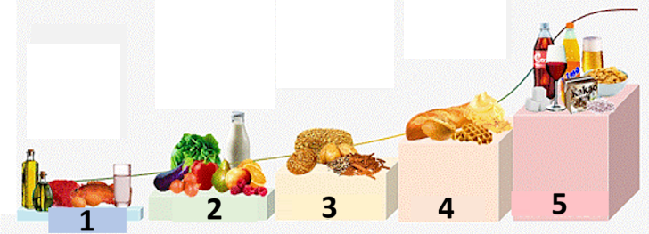

# W pełni zamknięta pętla

```{contents} In this page
:backlinks: entry
:depth: 2
```

Główną zaletą w pełni zamkniętej pętli **FCL** jest to, że może ona naśladować sztuczną trzustkę i ułatwić codzienne leczenie bez potrzeby podawania bolusów na posiłki.

Choć **hybrydowa zamknięta pętla** („HCL”) działa na podstawie algorytmu, nadal wymaga od użytkownika ręcznego podawania bolusów przed posiłkami. W efekcie pętla może chwilowo wstrzymać podawanie insuliny (tymczasowa baza zerowa), aby nie podać jej za dużo.

W **FCL** bolusy zależne od wielkości posiłku nie są już potrzebne: zostaw to algorytmowi!  **AAPS** can handle meals without the user giving any bolus, and without making carb inputs, in a mode called ‘un-announced meals’ **(‘UAM’)**. **UAM** pozwala **AAPS** lepiej radzić sobie z błędnie wpisanymi węglowodanami, bo działa bardziej agresywnie.

## Czego się spodziewać?

Istnieje wiele opublikowanych badań o dobrych wynikach, jakie można osiągnąć z **FCL**. Więcej informacji znajdziesz tutaj:

1)   National Library of Medicine, PubMed [First Use of Open-Source Automated Insulin Delivery AndroidAPS in Full Closed-Loop Scenario: Pancreas4ALL Randomized Pilot Study](https://pubmed.ncbi.nlm.nih.gov/36826996/);

2)  ClinicalTrials.gov National Library of Medicine, badanie kliniczne [Feasibility and Safety Study of the Automated Insulin Delivery Closed Loop System Pancreas4ALL (ASAP)](https://www.clinicaltrials.gov/study/NCT04835350?term=Feasibility%20and%20Safety%20Study%20of%20the%20Automated%20Insulin%20Delivery%20Closed%20Loop%20System%20Pancreas4ALL%20(ASAP)&rank=1)

Aby odnieść sukces z **FCL**, użytkownik musi:

- sprawdzić, czy spełnia wymagania **FCL**;
- ustawić **automatyzacje** dopasowane do potrzeb swojego codziennego leczenia; oraz
- dostroić i dopasować ustawienia **AAPS** (zwłaszcza **automatyzacje**).


## Ogólne powody, dla których warto (lub nie warto) przejść z HCL na FCL

**FCL** nie jest dla każdego:

- Niektórzy użytkownicy **FCL** osiągają TIR (70-180) około 90% i HbA1c poniżej 6%, ale inni wolą ściślejszą kontrolę. Zwłaszcza ograniczenie wartości powyżej 140 mg/dl przy diecie z szybkimi węglowodanami prawdopodobnie wymaga bolusa przed posiłkiem.
- Dostrajanie **AAPS** może być trudne. It is not for those users who feel overwhelmed by AAPS.  Na dopasowanie i dostrojenie **FCL** musisz poświęcić kilka tygodni. Taki czas może dać lepsze wyniki i lepszą kontrolę **BG**.
- Postępowanie z posiłkami może być łatwiejsze, ale wysiłek fizyczny nadal może być trudny w **FCL**. Większość z nas chce ograniczać przekąski przy sporcie, aby kontrolować masę ciała.
- Nadal trudno jest stosować **FCL** u dzieci (opisane niżej).


## Dobrze dostrojona hybrydowa zamknięta pętla

It is advisable to first establish a well-tuned **HCL** before considering the transition to **FCL**.  Sukces z **FCL** wymaga bardzo indywidualnego dostrojenia ustawień użytkownika, aby **AAPS** mógł podawać insulinę, dokładnie naśladując TWOJĄ dobrze działającą hybrydową zamkniętą pętlę.

**FCL** wymaga od użytkownika ustawienia i dostrojenia **automatyzacji**. Jednak przed rozpoczęciem **FCL** użytkownik musi dobrze rozumieć swoje potrzeby insulinowe. Błędy mogą być ukryte przez inne, przeciwne błędy. Może to dać niestabilny system **FCL**, który trudno potem poprawić. Z FCL możesz oczekiwać podobnego %TIR, jaki masz dziś w **HCL**.

**FCL to samodzielnie (DIY) zbudowany zestaw automatyzacji, które użytkownik ustala, analizując swoje dane z udanej HCL i z pierwszych doświadczeń z FCL podczas dostrajania ustawień.**

## Szybka insulina (Lyumjev, Fiasp)

**FCL** wymaga szybkiej insuliny.  Chodzi o to, aby na początku wzrostu **BG** po posiłku **FCL** mogła utrzymać **BG** w zakresie (według powszechnej definicji poniżej 180 mg/dl (10 mmol/l)).

Badanie modelowe (szczegóły: LINK FullLoop V2/March2023, tam rozdział 2.2) pokazuje w liczbach, że *szybsze insuliny*

Źródło:

 


IEEE Control Systems Magazine, ResearchGate [The Artificial Pancreas and Meal Control: An Overview of Postprandial Glucose Regulation in Type 1 Diabetes](https://www.researchgate.net/publication/322866519_The_Artificial_Pancreas_and_Meal_Control_An_Overview_of_Postprandial_Glucose_Regulation_in_Type_1_Diabetes);

- will result in significantly lower **BG** peaks than slower insulins;
- pozwalają podać pierwszy bolus posiłkowy kilka minut później bez zbyt wysokich szczytów; oraz
- zmniejszają wpływ różnych ilości węglowodanów (wielkości posiłków) na szczyt **BG**.

**FCL** raczej nie będzie skuteczna z insuliną inną niż Lyumjev lub Fiasp, chyba że użytkownik stosuje dietę z umiarkowaną lub niską ilością węglowodanów.

Jednak Fiasp lub Lyumjev mogą powodować częste zatkania pompy, nawet po dopasowaniu np. długości igły. Ważne jest, aby pilnować czasu noszenia kaniuli lub poda. Wielu użytkowników uważa, że po 48 godzinach insulina działa gorzej i zaczynają się problemy z kaniulą/podem.

## Wymagania wstępne

Wartości **BG** i stabilne połączenie Bluetooth są potrzebne, aby **AAPS** mógł działać optymalnie i nie tracić cennego czasu. **FCL** wymaga systemu stabilnego technicznie 24/7:

- your **CGM’s performance**. Your CGM should not produce jumpy **BG** values that could be misinterpreted by **FCL** as a sign of a starting meal. Podobnie kalibracje **CGM** mogą dawać skaczące wyniki.
- jak i gdzie odbywa się wygładzanie danych **CGM** i co to może oznaczać dla Twojego dostrajania. Zwłaszcza to, jak jest określona delta i czy AAPS rozpozna ją jako oznakę początku posiłku.
- Bluetooth stability for the pump and CGM;
- unikanie (albo przynajmniej wczesne wykrycie) zatkania pompy;
- przepływ danych, używane aplikacje w telefonie i różnice między kolejnymi dniami noszenia sensora;
- utrzymywanie wszystkich elementów **AAPS** dobrze naładowanych i posiadanie części zapasowych pod ręką; oraz
- wymiana kaniuli (lub poda) zawsze odpowiednio wcześnie, aby zmniejszyć ryzyko zatkania;

Powyższe zależy od elementów Twojego systemu **AAPS** i od Twojego stylu życia.

## Ograniczenia związane z posiłkami

- Ustawienie **FCL** może być łatwiejsze dla osób, których dieta nie zawiera produktów szybko i mocno podnoszących **BG**, i których posiłki nie zmieniają się bardzo z dnia na dzień. Nie musi to oznaczać diety niskowęglowodanowej.

- Dieta bogata w tłuszcz lub białko, albo wolne trawienie/gastropareza, raczej ułatwiają niż utrudniają **FCL**, bo późne węglowodany dobrze pokrywają nieuniknione „ogony” późnego działania bolusa potrzebnego w czasie szczytu.

### Indeks glikemiczny i wpływ na glukozę we krwi

The challenge for the **UAM** mode rises with rising 'Effect on Blood Glucose' ('EBG')

- Zacznij od posiłków o umiarkowanym/niskim EBG i dostrój ustawienia swojego **profilu**. Dopiero potem „testuj” posiłki o wysokim **EBG**.
- Przy posiłkach o bardzo wysokim **EBG** rozważ bolus początkowy < 50%.

1) **Brak EBG**: np. świeże mięso, ryby, jajka, boczek, oleje, ser. 2) **Niskie EBG**: np. świeże warzywa i jagody, grzyby, orzechy, mleko, jogurt, twarożek. 3) **Umiarkowane EBG**: np. pełnoziarnisty chleb/makaron, ziemniaki, dziki ryż, owies, suszone owoce. 4) **High EBG**: e.g. wheat breads, baguette, toast, waffles, cookies, mash potatoes, noodles, rice. 5) **Bardzo wysokie EBG**: np. cukier, słodkie napoje, soki owocowe, płatki kukurydziane, cukierki, słodycze, chipsy, słone paluszki.



Najtrudniejsze posiłki dla **FCL** to te, które składają się wyłącznie ze składników o bardzo wysokim i wysokim **EBG** (zobacz na czerwono na obrazku): **BG** nie tylko szybko rośnie, ale też jest mało tłuszczu, białka i błonnika, które mogłyby zrównoważyć nieunikniony „ogon” działania insuliny podanej wcześniej, aby opanować wysoką glukozę.

Nieregularne jedzenie przekąsek i picie słodkich napojów z szybko wchłanianymi węglowodanami jest problemem dla **FCL**.


## Przygotowanie do aktywności/sportu

Przy pompie lub hybrydowej zamkniętej pętli zaleca się, aby przed wysiłkiem fizycznym lub aktywnością zmniejszyć **IOB**.

W **FCL** algorytm jest dostrojony tak, aby wykrywać **UAM** i automatycznie podawać insulinę przeciw wzrostom **BG**.  Wysoki **cel tymczasowy** i niższy **procent profilu** (działający już około początku posiłku) trzeba ustawić z dużym wyprzedzeniem przed każdą aktywnością.

Nietypowy lub nieregularny poziom aktywności fizycznej jest trudny dla **FCL**. Wysiłek fizyczny wymaga planowania (zwłaszcza jeśli chcesz zmniejszyć potrzebę jedzenia ratunkowych węglowodanów/przekąsek przy niskiej glikemii w czasie sportu). After an active day it is recommended that a lower  **Percentage Profile** is set for overnight after the evening meal is fully digested: set in **Automations** an elevated (>100 mg/dL) **BG**  target, with **Enable SMB with high temp target** switched off in **AAPS** **Settings**.

## Przeszkody u dzieci

**FCL** może stawiać dodatkowe wyzwania u dzieci, między innymi:

- Lyumjev or Fiasp may not be available or well tolerated.
- Hourly basal rate may be very low, providing a poor basis for big **SMBs**.
- Dieta może zawierać dużo słodkich składników. Przy typowo małej objętości krwi małego ciała występuje silna skłonność do bardzo wysokich skoków **BG**.
- Hormony wzrostu i wyraźne zmiany wrażliwości na insulinę utrudniają dokładne dostrojenie **FCL**.


## Włączenie wzmocnionych SMB: bezpieczeństwo

W **HCL** działają ograniczenia bezpieczeństwa dotyczące wielkości bolusów, które pętla może podać automatycznie.

Użytkownicy **FCL** nie muszą już podawać dużego bolusa na początku posiłku. Oznacza to, że ograniczenia wielkości **SMB** trzeba poszerzyć, aby pętla mogła podawać wystarczająco duże **SMB**.

Jeśli używasz **AAPS** w wersji Master, zaleca się ustawić w **Ustawieniach** **AAPS** maksymalną dozwoloną wielkość **SMB**, jaką może podać **FCL** (maxUAMSMBBasalMinutes=120, czyli 2 godziny dawki bazowej o tej porze dnia).

Jeśli Twoja dawka bazowa jest bardzo niska, wynikające z niej limity **SMB** mogą być zbyt niskie, aby wystarczająco opanować wzrosty **BG** po posiłku. Jednym z możliwych rozwiązań jest unikanie diety, która powoduje silne skoki **BG**. Algorytm [Auto ISF](#Open-APS-features-auto-isf) (dostępny tylko w wersji rozwojowej (dev) z trybem inżynierskim) ma ustawienie **Rozszerzenie maks. zakresu SMB**, które zwiększa standardowe maksimum 2 godzin dawki bazowej o współczynnik >1, i pozwala podnieść domyślny 50% **Współczynnik dostarczania SMB**.

**Postępuj według instrukcji, aby AAPS mógł naśladować Twój bolus za pomocą kilku SMB**.

Co jakiś czas sprawdzaj ekran wtyczki **APS** (**Konfiguracja → APS → Otwórz wtyczkę**), aby zobaczyć, czy Twoje **SMB** mogą być na tyle duże, aby podać insulinę potrzebną pętli na początku posiłków.

Jeśli nie, Twoje dostrajanie czasem nic nie da!


```{admonition} Boosting **ISF** can become dangerous
:class: danger

Uważnie obserwuj i analizuj wielkość **SMB** krótko po rozpoczęciu posiłku. Dostrajaj krok po kroku i nie zmieniaj więcej niż 1 lub 2 parametrów naraz.

Ustawienia Twojego **AAPS** muszą być na tyle dobre, aby radzić sobie z (Twoją!) różnorodnością posiłków.
```

## Wykrywanie posiłków/Twoje automatyzacje do wzmacniania

Dla udanej **FCL** kluczowym parametrem dostrajania jest **ISF**. Gdy używasz **AAPS** Master + **automatyzacji**, **zmiana profilu na > 100% musi być uruchamiana automatycznie po rozpoznaniu posiłku** (na podstawie delt glukozy) i dawać wyostrzony **ISF**.

**AAPS** Master allows up to 130% temporary **Profile** in **HCL** mode. Wzmocnienie **ISF** odbywa się w 3 krokach:

- Step 1 -  review the **ISF** applicable for this meal time hour within the **Profile**, and see whether e.g. Autosens suggest a modification that takes care of the current (last few hours’) insulin sensitivity status of the body.
- Krok 2 – zastosuj współczynnik (1/procent profilu, ustawiony w **automatyzacji**), aby wzmocnić **ISF**.
- Krok 3 – sprawdź, czy proponowany **ISF** mieści się w ustawionych limitach bezpieczeństwa.

### Szablony automatyzacji dla FCL

Pola do zaznaczenia na górze. Masz do wyboru:

- Na liście **automatyzacji** możesz odznaczyć pole wyboru (po lewej stronie każdego pola) => To wyłącza daną **automatyzację**. Możesz to zrobić np. dla wszystkich **automatyzacji** **FCL** związanych ze śniadaniem, aby na śniadanie przejść na **HCL**.

- Dla każdej reguły **automatyzacji** możesz zaznaczyć pole Akcja użytkownika => wtedy zdefiniowane akcje nie będą wykonywane automatycznie, gdy warunki są spełnione. Zamiast tego ekran główny **AAPS** powiadomi Cię za każdym razem, gdy Twoja **FCL** chciałaby automatycznie podać **SMB**. Wtedy możesz powiedzieć „tak” lub „nie”. Jest to bardzo przydatne w fazie dostrajania.

This feature can be useful for certain situations like “foot to floor” syndrome where there is a sudden rise in **BG** when getting up in the morning, but the user wants to prevent a fully automatic “breakfast started” response.

Poniższa część opisuje, jak łączyć warunki **automatyzacji** i jak radzić sobie w sytuacjach, w których **AAPS** powinien zwiększyć (lub zmniejszyć) podawanie insuliny. Ponieważ **ISF** nie można dostroić bezpośrednio, zwiększenie **procentu profilu** powyżej 100% da w naszym przypadku ten sam efekt.

### Automatyczne duże SMB przy wzroście BG

The key to successful **FCL**: **at the beginning of BG increases from meals, very large automatic SMBs must be given by the loop as quickly as possible** “to catch up” with the required **IOB** needed (compare with your typical administered bolus for similar meal in **HCL**!)

To achieve this, data from your **HCL** should be analyzed to determine which **deltas** might not be meal-related and which might be.

- Ponieważ **automatyzację** możesz ustawić w określonym przedziale czasu, wystarczy analizować tylko ten przedział.
- Jeśli jesz bardzo różne posiłki (np. śniadanie z dużą ilością węglowodanów, ale obiad niskowęglowodanowy), możesz zrobić dwie różne **automatyzacje** (lub ich zestawy) dla każdego przedziału czasu.
- Pomiń noce, jeśli widzisz czasem skoki spowodowane fałszywymi niskimi odczytami z ucisku (compression lows).
- Zwykle wystarczy delta z ostatnich 5 minut.
- Możesz jednak użyć też jednej z delt średnich. Porównując delty w warunkach swoich **automatyzacji**, możesz nawet ustawić akcje o różnej agresywności w zależności od tego, czy **BG** rośnie coraz szybciej, czy nie.

> ( delta – short avg delta )>n   to wyrażenie, którego można użyć do wykrycia przyspieszenia, aby uruchomić pierwszy **SMB** przy najwcześniejszym znaku wzrostu **BG**. -                                                                             
> Caution: not possible to use with poor or highly smoothened **CGM** values!

**CGM** z niepełnymi danymi stawia użytkownika w złej sytuacji, bo dla bezpieczeństwa musisz „z zapasem” określić, która delta na pewno oznacza początek posiłku. To oznacza:

- **FCL** traci dodatkowy czas, co daje wyższe szczyty **BG** i niższy %**TIR**;
- nie możesz użyć wcześniejszej lub mniejszej delty, która mogłaby także bez posiłku uruchomić **SMB** mające w **FCL** zastąpić bolus użytkownika.

Ponadto pierwsze wzrosty po posiłku mają **niskie iob**. Mając to na uwadze, automatyzacja (#1) dla kolacji może wyglądać tak:


Automatyzacja #1

Jeśli warunki są spełnione, **AAPS** poda 1 lub 2 **SMB** w ciągu następnych 12 minut, używając wzmocnionego **ISF** zgodnie z ustawionym podwyższonym **procentem profilu** (w przykładzie wzmocnienie insulinReq o 30%). Dopóki te warunki są spełnione, reguła **automatyzacji** przedłuża się o kolejne 12 minut. Posiłek niskowęglowodanowy może powodować wolniejszy wzrost **BG**. Warto dodać drugą automatyzację (#2), która uruchamia się przy mniejszej delcie i daje słabsze wzmocnienie insuliny.


Ta sama **automatyzacja** prawdopodobnie zadziała też przy posiłkach z większą ilością węglowodanów, gdy skończy się stromy wzrost określony w automatyzacji #1.

Musisz „ułożyć” te dwie (+ może trzecią) **automatyzacje** tak, aby pasowały do tego, co widzisz przy swoich (różnych) posiłkach => ustawienie odpowiednich wielkości skoków, kryteriów **iob** i wzmocnień to proces dostrajania krok po kroku.  Jeśli w warunkach ustawisz odpowiednie przedziały czasu, możesz łatwo zrobić różne automatyzacje dla różnych pór posiłków (śniadanie, obiad, kolacja).

Pamiętaj, że jeszcze w fazie wzrostu (!) trzeba zablokować „nadmiar” **iob**, aby późne działanie **insuliny** („**ogon**” po 3–5 godz.) nie przekroczyło możliwości hamowania pętli przez zerową bazę tymczasową („zabieranie” bazy, aby zmniejszyć ryzyko hipoglikemii).

Przy dużych posiłkach **czasem pojawia się drugi wzrost**. Do tego czasu iob zwykle trochę spada i bardziej agresywne automatyzacje znów zaczynają działać. (Check that your iob condition in Automation #2 is not set too low for this to happen).

Krótko po podaniu kilku pierwszych **SMB** przychodzi **faza równowagi**, w której umiarkowane podawanie insuliny powinno pokryć dodatkowo wchłaniane węglowodany. (Except in low carb meals, where the loop might see too weak of a **BG** rise, and go into zero-temping right away already now).

Ekran główny **AAPS** (na którym w pełnej pętli **UAM** widzisz cob=0) może w tej fazie prosić o więcej wymaganych węglowodanów. W trybie **UAM** oznacza to po prostu, że możesz zrobić bardzo przybliżone sprawdzenie: czy taka ilość węglowodanów może jeszcze być w Twoim organizmie, niewchłonięta z posiłku sprzed około godziny (o którym pętla nic nie wie)?


### Próg iob

Często **automatyzacje** #1 i/lub #2 podnoszą iob do poziomów, które zwykle wystarczają na **Twoje** posiłki. Aby dostroić to indywidualnie, sprawdź w swoich danych z **HCL** maksymalne wartości iob przy dobrze opanowanych posiłkach (często: Twój bolus posiłkowy) oraz od jakiej wielkości na końcu pojawiała się hipoglikemia (lub potrzeba dodatkowych węglowodanów).

Rozsądne **progi iob**, przy których należy zmniejszyć agresywność pętli, mogą być różne dla różnych posiłków. Ale zwłaszcza w pierwszej godzinie po rozpoczęciu posiłku, która jest bardzo ważna w trybie **UAM**. It will differ for each user. U niektórych użytkowników wchłania się tylko około 30 g/godz. i wtedy można określić sensowne **iob** niezależnie od dokładnego posiłku.

Przy nietypowych posiłkach, albo aby go obniżyć, gdy po posiłku planujesz sport, próg **iob** możesz szybko zmienić w swojej **automatyzacji**.

Automation (#3), "iobTH reached => **SMBs** off”, is defined to end (or pause, until another wave of carb-related rise hits) the aggressive **SMB** boosting.


Automatyzacja #3

Mówi pętli, że powyżej ustawionego **progu iob** lepiej nie podawać już **SMB**

- W podanym przykładzie robi się to przez ustawienie TT=111 (wartość dość dowolna; wybierz liczbę >100, którą łatwo rozpoznasz jako automatyczne wyłączenie **SMB**)
- W **AAPS** w [Ustawienia → OpenAPS SMB](#Preferences-openaps-smb-settings) zwykle nie pozwalaj na **SMB** przy podwyższonym celu.                                                                                                                   
  Wymagana insulina będzie wtedy podawana dużo ostrożniej, przez wąskie gardło **TBR**

**Uwaga: automatyzacja #3 działa tylko wtedy, gdy nie ma aktywnego TT.** Jeśli więc używasz EatingSoonTT, musi on być zakończony do tego czasu, czyli zwykle 30–40 minut po rozpoczęciu posiłku.

Jednym ze sposobów jest ustawienie w **automatyzacji** warunku, który kończy ewentualnie działający EatingSoonTT, gdy **iob**>65% * iobTH.
> Sposoby pracy z EatingSoonTT Niektórzy użytkownicy pętli ustawiają EatingSoonTT mniej więcej godzinę lub więcej przed posiłkiem (przyciskiem TT albo automatycznie przez obniżony cel **BG** w **profilu**, jeśli pory posiłków są dość stałe), tylko po to, aby mieć niską **BG** na starcie i trochę wyższe **iob**. But, assuming the **FCL** is always en route towards target, this might not yield much and you may prefer to define an **Automation** that sets an EatingSoonTT at recognition of meal start (glucose delta, or acceleration = delta > avg delta). Niski **TT** jest na tym etapie ważny, bo każdy **SMB** pętla oblicza jako (prognozowana glukoza minus TT)/sens, więc niski TT zwiększa wynikowe insulinReq.

Po podaniu pierwszych wzmocnionych **SMB** ustawiony iobTH i **automatyzacja** #3 powinny dobrze wyważyć ograniczenie szczytu glukozy i uniknięcie hipoglikemii po posiłku.

Jeśli Twoje śniadanie ma zupełnie inną ilość węglowodanów niż przeciętna kolacja, warto ustawić **automatyzacje** działające w odpowiednich porach dnia, z różnymi **iobTH** (może też z różnymi deltami i różnym **procentem profilu**). Zarówno Ty, ustawiając zakres posiłków i ustawienia (zwłaszcza **iobTH**), jak i pętla, prowadząc rosnącą krzywą **BG**, musicie zaakceptować pewną wysokość szczytów, aby zmniejszyć ryzyko hipoglikemii pod koniec czasu działania insuliny (**DIA**) z **SMB**.

### Długo utrzymująca się wysoka BG

Jeśli po „bogatym” posiłku widzisz długo utrzymującą się **wysoką BG**, pomaga **automatyzacja** #4 (poniżej), „post-meal High” (wysoka glikemia po posiłku), która radzi sobie z opornością wywołaną tłuszczem: po posiłkach z wielu dań, dużej tłustej pizzy czy wieczorze z raclette krzywa glukozy może mieć dwa garby albo, bardzo często, długi wysoki płaskowyż.


Automatyzacja #4


Automatyzacja #5

Automatyzacja #4, „post-meal High” (wysoka glikemia po posiłku), nadaje się też do hybrydowej zamkniętej pętli.

Dodatkowo potrzebna jest automatyzacja kończąca #5, „Stop pmH”, aby zmniejszyć agresywność podawania insuliny, gdy tylko glukoza zaczyna spadać. (Często jednak pętla i tak ograniczy podawanie insuliny, aby zapobiec hipoglikemii, bo prognozowana glukoza jest już niska).

## Zapobieganie hipoglikemii

Główny problem polega na tym, że **UAM** **FCL** (bez wpisywania węglowodanów) **nie wie, ile gramów węglowodanów jest jeszcze do wchłonięcia** i czy mogą one zużyć ten „ogon” insuliny, tak aby nie doszło do hipoglikemii.

Dzięki wzmocnionym **SMB** **FCL** „dogoniła” to, co wcześniej robiliśmy bolusem posiłkowym. Ale **pod koniec działania insuliny (jej „ogon”) zapobieganie hipoglikemii może stać się poważnym problemem**.

Przygotowując się do **FCL**, użytkownik musi dokładnie przyjrzeć się **przebiegowi iob w czasie** przy typowych posiłkach i ocenić, **kiedy jest go za dużo i jak możesz to wyłapać, dostrajając swoje automatyzacje**. Jest to możliwe, bo mamy kilka „śrub” do regulacji. Dobre ustawienie tego może być trudne

Zwykle nie ma sensu wciąż poprawiać ustawień dla jednego rodzaju posiłku. Gdy masz już wystarczająco dobre ustawienia np. dla jednego rodzaju obiadu, który często jesz, sprawdź, jak działają przy innych posiłkach i jaki „kompromis” wybrać.

Aby zapobiec hipoglikemii w 3–5 godz. po posiłku, zmniejsz agresywność, zanim zbierze się zbyt dużo iob. Konkretne sposoby:

- Łagodź **ISF** coraz bardziej już w czasie wzrostu glukozy, jak w podanych przykładach automatyzacji #1 i #2.
- Określ próg iob, od którego **AAPS** działa wyraźnie ostrożniej (automatyzacja #3, powyżej). Note this **iob** can be exceeded, by the last **SMB** before it went into effect; and then further by TBRs if the loop sees insulinReq. Carbs getting absorbed will provide a counter-movement towards lower iob.
- Próg iob można różnicować według posiłków: klonując automatyzacje, łatwo zrobisz osobne ustawienia dla śniadania, obiadu i kolacji (albo nawet dla miejsc, np. stołówka w pracy, wizyta u teściowej itp.)
> W tych przedziałach czasu możesz różnicować jeszcze bardziej, ustawiając różne TT dla posiłków niskowęglowodanowych i z szybkimi węglowodanami itd. W ten sposób możesz „zakodować” różne rodzaje posiłków, które mogą wystąpić o tej porze dnia, i wywołać je **automatyzacjami** specjalnie do nich dostrojonymi. Prawdopodobnie nie jest to potrzebne, chyba że Twoje nawyki jedzenia bardzo się zmieniają.

Przed wyjątkowym posiłkiem możesz podnieść próg **iob** albo zmienić coś w dowolnej automatyzacji w mniej niż 5 sekund, bezpośrednio na telefonie z AAPS (**Zarządzaj → Automatyzacja**).

Ryzyko hipoglikemii kilka godzin po posiłku zależy głównie od tego, czy skład posiłku był taki, że **„ogony” insuliny podanej na główną część węglowodanów** zostaną **zużyte przez „przedłużone węglowodany”** (nadmierne/opóźnione wchłanianie węglowodanów, białko, tłuszcz, błonnik).

Z czasem poznasz wzorce i dostroisz swoje automatyzacje – może nawet trochę zmienisz nawyki jedzenia, np. zjesz czasem małą(!) przekąskę później. Może ona pomóc utrzymać dobrą **równowagę działania insuliny i wchłaniania węglowodanów** przez **cały** czas trawienia i wchłaniania posiłku. W ten sposób ułatwisz życie pętli (i sobie).

### Kolejność zaprogramowanych automatyzacji

Problemy mogą się pojawić, gdy definicje w **automatyzacjach** się nakładają. Przykład: problem polega na tym, że delta >8 jest też deltą >5, czyli mogą istnieć dwie konkurujące **automatyzacje**. Co wtedy robi pętla? Pętla zawsze decyduje według kolejności, w jakiej Twoje **automatyzacje** są wyświetlane w **Zarządzaj → Automatyzacja**.  Przykład: reguła delta > +8 musi być pierwsza (i uruchamiać najsilniejsze wzmocnienie, jeśli wszystkie warunki są spełnione); potem następuje sprawdzenie delta >5 (i łagodniejsza reakcja). W odwrotnej kolejności reguła delta>8 nigdy by nie zadziałała, bo reguła delta>5 jest już spełniona i sprawa jest zamknięta.
> Wskazówka dla automatyzacji: kolejność zmienia się bardzo łatwo. W **Zarządzaj → Automatyzacja** dotknij i przytrzymaj uchwyt **=** po prawej stronie reguły i przeciągnij ją w inne miejsce.

Poza tym bardzo łatwo i szybko możesz w każdej chwili zmienić dowolne warunki lub akcje, w kilka sekund, na swoim smartfonie z AAPS; np. przed bardzo nietypowym posiłkiem. (Ale nie zapomnij przywrócić normalnych ustawień na następny dzień).

(full-closed-loop-troubleshooting)=

## Rozwiązywanie problemów

### Jak wrócić do hybrydowej zamkniętej pętli

Możesz odznaczyć pola wyboru **automatyzacji** związanych z **FCL**, wrócić do podawania bolusów na posiłki i znów wpisywać węglowodany. Jeśli przyciski **Insulina** lub **Kalkulator** zostały usunięte z ekranu głównego, dodaj je z powrotem w konfiguracji [paska QuickLaunch](#quicklaunch) (zawsze są też dostępne w **Leczenie** na dolnym pasku nawigacji). Pamiętaj, że teraz znów Ty musisz podawać bolusy na posiłki.

Rozsądnie może być stosować **FCL** tylko dla posiłków (przedziałów czasu), dla których **automatyzacje** są w pełni ustawione i zaznaczone, a odznaczyć tylko te dla innych pór posiłków, w których chcesz używać **HCL** (albo jeszcze nie masz żadnych ustawionych, w okresie przejściowym).

Na przykład po ustawieniu **automatyzacji** dla pory kolacji można bez dodatkowych kroków stosować **FCL** tylko do kolacji, a śniadanie i obiad prowadzić w **HCL**, tak jak dotąd.


### Czy wymagania dla FCL są nadal spełnione?

- Czy podstawowy **profil** jest nadal poprawny?
- Czy jakość **CGM** się pogorszyła?
- Zobacz wymagania wstępne (powyżej).

### Glukoza rośnie za wysoko

- Posiłki nie są rozpoznawane wystarczająco szybko
    - Sprawdź (nie)stabilność połączenia Bluetooth
    - Sprawdź, czy możesz ustawić mniejsze delty, aby uruchomić pierwszy **SMB**
    - Experiment with an aperitif, soup a couple of minutes before meal start
- SMB są zbyt słabe
    - Sprawdź kolejność **automatyzacji** (np.: duża delta przed małą deltą)
    - Sprawdź (na bieżąco) na ekranie wtyczki **APS**, czy godzinowa baza z profilu i ustawione minuty (maks. 120) ograniczają dozwoloną wielkość SMB
    - Sprawdź (na bieżąco) na ekranie wtyczki **APS**, czy procent profilu trzeba ustawić wyżej
- Jeśli wszystkie ustawienia są już na granicy, może musisz zaakceptować chwilowo wysoką glikemię albo zmienić dietę.
> Jeśli chcesz testować wersję rozwojową (dev), [Auto ISF](#Open-APS-features-auto-isf) pozwala też na jeszcze większe SMB. Niektórzy użytkownicy stosują też mały bolus przed posiłkiem w swojej „FCL”. Wpływa to jednak na przebieg krzywej glukozy, a więc też na wykrywanie wzrostów i uruchamianie **SMB**, dlatego trudno to wdrożyć z przekonującą ogólną korzyścią.
- Ważna obserwacja pilotażowych użytkowników: to, jak krzywe glukozy i iob wyglądają na początku posiłku, ma duży wpływ na szczyt po węglowodanach: Spadek (np. w kierunku ustawionego EatingSoonTT), zbudowanie trochę iob i krzywa już wyginająca się w stronę silnego dodatniego przyspieszenia bardzo pomagają utrzymać niskie szczyty.

### Glukoza spada za nisko

- Posiłki są rozpoznawane błędnie
    - Sprawdź, czy możesz ustawić większe delty, aby uruchomić pierwszy **SMB**
    - Click “User action” in the related Automation, so in the future you can ad hoc decide to block execution of the Automation if not meal-related
    - Aby przekąski nie uruchamiały **SMB** jak przy posiłku, ustaw TT>100 podczas jedzenia przekąski (tak jak i tak robisz przy sporcie i przy przekąskach przeciw hipoglikemii)
- SMB podają w sumie za dużo insuliny
    - Sprawdź (na bieżąco) na ekranie wtyczki **APS**, czy **Rozszerzenie maks. zakresu SMB** trzeba ustawić niżej
    - Sprawdź (na bieżąco) na ekranie wtyczki **APS**, czy **procent profilu** trzeba ustawić niżej
    - Współczynnik dostarczania SMB można prawdopodobnie ustawić niżej. Pamiętaj, że w tym przypadku działa to dla wszystkich **SMB** (we wszystkich przedziałach czasu),
- Problemy z „ogonem” insuliny po posiłkach
    - Może być potrzebna przekąska (gdy widzisz prognozę hipoglikemii) lub tabletki glukozy (jeśli już jesteś w strefie hipoglikemii). Pamiętaj jednak, że wymagane węglowodany, o których pętla może Cię w pewnym momencie informować, są najpewniej zawyżone. Pętla nie ma bowiem żadnych informacji o tym, ile węglowodanów zjadłeś i ile jeszcze czeka na wchłonięcie (Ty możesz to oszacować, także z tłuszczów i białek).
    - Cenną informacją byłoby to, czy problem powstaje głównie już w fazie wzrostu BG. Wtedy łatwym rozwiązaniem może być niższy iobTH.
    - Jeśli często potrzebujesz dodatkowych węglowodanów, zapisz, ile gramów było potrzebne (nie licz tego, co zjadłeś za dużo i co znów wymagało dodatkowej insuliny).  Następnie użyj wartości IC z profilu, aby oszacować, o ile mniej insuliny powinien był podać **SMB**, i wykorzystaj tę informację przy dostrajaniu (**procentu profilu** w **automatyzacjach**, a może też ustawionego iobTH). This may relate to the **SMBs** given when glucose was high, or also to the **SMBs** during the **BG** rise.
    - Może się okazać, że po prostu musisz zaakceptować wyższe szczyty **BG**, aby nie spaść za nisko. Or change diet to something with lower amounts of carbs, and higher amount of protein and fats.


### Więcej informacji

Pamiętaj, aby być w kontakcie z innymi użytkownikami **FCL**.

Dyskusja o w pełni zamkniętej pętli z użyciem automatyzacji:

- Angielski:   [kanał Discord](https://discord.gg/ChXj8BaKwA)

- Niemiecki:  [German Looper Community](https://de.loopercommunity.org/t/ueber-die-kategorie-full-loop/10107)
