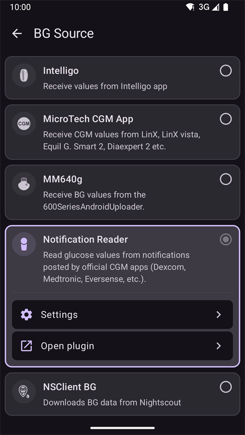

# Dexcom G6 i ONE

## Najpierw podstawy

-   Postępuj zgodnie z ogólnymi zasadami higieny CGM i zaleceniami dotyczącymi zakładania sensora, które znajdziesz [tutaj](../CompatibleCgms/GeneralCGMRecommendation.md).

## Ogólne wskazówki dotyczące pętli z G6 i ONE

- Nowsze nadajniki nazywają się Firefly. Sensorów nie można zrestartować bez zdjęcia nadajnika, a samego nadajnika nie można zresetować. Te nadajniki nie dają też surowych danych (raw data).

- Jeśli restartujesz sensory, bądź gotowy do kalibracji i obserwuj różnice we wskazaniach.

- Namaczanie wstępne (pre-soak) G6/ONE z kalibracją fabryczną prawdopodobnie da różne wyniki. Jeśli pracujesz z namaczaniem wstępnym, aby uzyskać najlepsze wyniki, prawdopodobnie będziesz musiał skalibrować sensor.

Więcej przeczytasz w [artykule](https://www.diabettech.com/artificial-pancreas/diy-looping-and-cgm/) Tima Streeta na stronie [www.diabettech.com](https://www.diabettech.com).

## Jeśli używasz G6 lub ONE z xDrip

- Jeśli jeszcze tego nie zrobiłeś, pobierz [xDrip](https://github.com/NightscoutFoundation/xDrip) i dostosuj jego ustawienia według [strony z ustawieniami xDrip](../CompatibleCgms/xDrip.md).
- Wybierz xDrip w [**Konfiguracja → Źródło BG**](#Config-Builder-bg-source).
- Nadajniki Dexcom G6 i ONE mogą być połączone jednocześnie z odbiornikiem Dexcom (lub zamiast niego z pompą t:slim) i z jedną aplikacją na telefonie.
- Jeśli używasz xDrip jako odbiornika, najpierw odinstaluj aplikację Dexcom. **Nie możesz połączyć xDrip i aplikacji Dexcom z nadajnikiem w tym samym czasie!**
- Jeśli potrzebujesz Clarity i chcesz korzystać z alarmów xDrip, użyj [BYODA](#DexcomG6-if-using-g6-with-build-your-own-dexcom-app) (tylko G6) z lokalnym rozgłaszaniem (local broadcast) do xDrip.
- You can also use xDrip as a companion app of the official Dexcom app, but you might experience delays in BG readings. To read the Dexcom app notifications without xDrip, as a trusted data source, use the [Notification Reader](#DexcomG6-notification-reader).
- Z obecnymi nadajnikami xDrip zawsze używa [natywnego algorytmu](https://navid200.github.io/xDrip/docs/Native-Algorithm.html) nadajnika. Nie ma powodu, aby go wyłączać. [Restarty wyprzedzające (preemptive restarts)](https://navid200.github.io/xDrip/docs/Preemptive-Restart.html) działają tylko na starych nadajnikach (oprogramowanie 1.6.5.25 lub starsze). Tam są potrzebne, aby sensor nie zatrzymał się po 10 dniach. Nowe nadajniki (Firefly) je ignorują. Zanim spróbujesz zrestartować sensor, przeczytaj [Restart a sensor](https://navid200.github.io/xDrip/docs/Restart-G6-sensor.html).
- Wszystko, co dotyczy samego sensora i nadajnika, opisano na [stronie xDrip o Dexcom](https://navid200.github.io/xDrip/docs/Dexcom_page.html).

(DexcomG6-if-using-g6-with-build-your-own-dexcom-app)=
## Jeśli używasz G6 z aplikacją Build Your Own Dexcom App (BYODA)

```{admonition} Old app version
:class: warning
Dexcom BYODA to teraz bardzo stara wersja aplikacji i nie można jej zaktualizować.
```

-   [Build Your Own Dexcom App](https://docs.google.com/forms/d/e/1FAIpQLScD76G0Y-BlL4tZljaFkjlwuqhT83QlFM5v6ZEfO7gCU98iJQ/viewform?fbzx=2196386787609383750) (BYODA) obsługuje lokalne rozgłaszanie (local broadcast) do AAPS i/lub xDrip

-   Ta aplikacja pozwala używać Dexcom G6 z każdym smartfonem z Androidem.
-   Odinstaluj oryginalną aplikację Dexcom lub zmodyfikowaną aplikację Dexcom, jeśli używałeś jednej z nich wcześniej (**nie zatrzymuj** aktualnie działającego sensora)
-   Zainstaluj pobrany plik apk
-   Wpisz kod sensora i numer seryjny nadajnika w zmodyfikowanej aplikacji.
-   W ustawieniach telefonu przejdź do Aplikacje > Dexcom G6 > Uprawnienia > Dodatkowe uprawnienia i naciśnij 'Access Dexcom app'.
-   Po krótkim czasie BYODA powinna odebrać sygnał z nadajnika.

### Ustawienia w AAPS

-   Wybierz **BYODA** w [**Konfiguracja → Źródło BG**](#Config-Builder-bg-source).

-   Jeśli nie dostajesz żadnych wartości, wybierz dowolne inne źródło danych, a potem ponownie wybierz **BYODA**. Wtedy AAPS poprosi o uprawnienia, aby połączyć AAPS z rozgłaszaniem BYODA.

### Ustawienia w xDrip

-   Wybierz '640G/Eversense' jako źródło danych.
-   Aby otrzymywać wartości, musisz wykonać w xDrip polecenie 'start sensor'. Nie wpłynie to na Twój obecny sensor, którym steruje aplikacja Build Your Own Dexcom App.

(DexcomG6-notification-reader)=
## If using G6 or ONE with the Notification Reader

The official Dexcom G6 or ONE app stays connected to the transmitter. **AAPS** reads the glucose value directly from the notification of the Dexcom app, without any other app in between.

```{admonition} Trusted data source
:class: note
Readings from the Dexcom G6 and ONE apps are a [trusted BG data source](#GettingStarted-TrustedBGSource): SMBs can be allowed all the time.
```

Compared to BYODA or xDrip, the Notification Reader has limits:

- **No trend arrow** and **no backfill**: readings missed while the phone was off or out of range are lost.
- Each reading gets the time the notification appeared, not the exact time of the sensor reading.
- Only values between 40 and 405 mg/dL (2.2 and 22.5 mmol/L) are read. "LOW" and "HIGH" are not read.

### Set up the Dexcom app

-   Keep the Dexcom app installed and connected to the transmitter.
-   Make sure the Dexcom app shows the current glucose value in its notification. Jej powiadomienia muszą być widoczne: nie wyciszaj ich i nie ukrywaj.
-   Use the same glucose units (mg/dL or mmol/L) in the Dexcom app as in **AAPS**. Otherwise **AAPS** cannot read the value.

### Konfiguracja w AAPS

-   Select **Notification Reader** in [**Configuration → BG Source**](#Config-Builder-bg-source) and confirm the switch.

    

-   Back on the main screen, **AAPS** shows **Permissions Required**. Next to **Notification Access**, tap **Grant**.

    

-   Android opens its notification access list (its name depends on your Android version, for example *Notification read, reply & control*). Select **AAPS**, turn on **Allow notification access** and confirm with **Allow**.

    

    Android warns that **AAPS** could read all your notifications. **AAPS** only reads the notifications of supported CGM apps and ignores all others.

    

-   If **Allow notification access** is greyed out (*Controlled by Restricted Setting*), Android blocks it because **AAPS** was not installed from the Play Store. Open the **AAPS** app info (long press the **AAPS** icon > **App info**), tap the three dots menu at the top right and select **Allow restricted settings**. Potem wróć do ekranu dostępu do powiadomień i zezwól na dostęp.
-   Readings appear in **AAPS** when the Dexcom app shows a new value.

```{warning}
If the Dexcom app notification shows more than one glucose number, or none, **AAPS** skips that notification.
```


(DexcomG6-troubleshooting-g6)=
## Rozwiązywanie problemów z G6 i ONE

### Rozwiązywanie problemów specyficznych dla Dexcom G6/ONE

-   Przewiń w dół do sekcji **Troubleshooting** [tutaj](https://navid200.github.io/xDrip/docs/Dexcom_page.html).

### Ogólne rozwiązywanie problemów

Ogólne rozwiązywanie problemów z CGM znajdziesz [tutaj](#general-cgm-troubleshooting).

### Nowy nadajnik z działającym sensorem

Jeśli zmieniasz nadajnik w trakcie sesji sensora, możesz spróbować zdjąć nadajnik bez uszkodzenia mocowania sensora. Film znajdziesz [tutaj](https://navid200.github.io/xDrip/docs/Remove-transmitter.html). Jeśli zamiast tego wybierzesz [to rozwiązanie](https://youtu.be/tx-kTsrkNUM), musisz uważać, aby paskiem nie [uszkodzić styków sensora](https://navid200.github.io/xDrip/docs/Petroleum-jelly-in-Dexcom-G6-Sensor.html).
