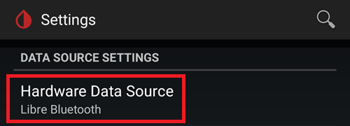
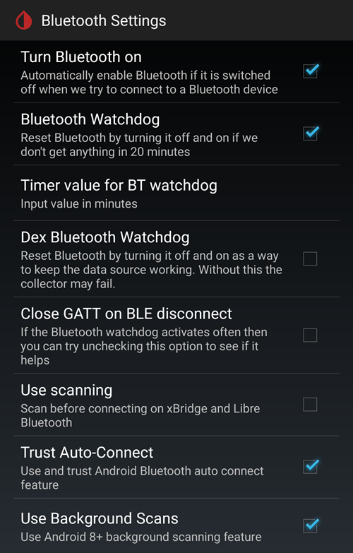
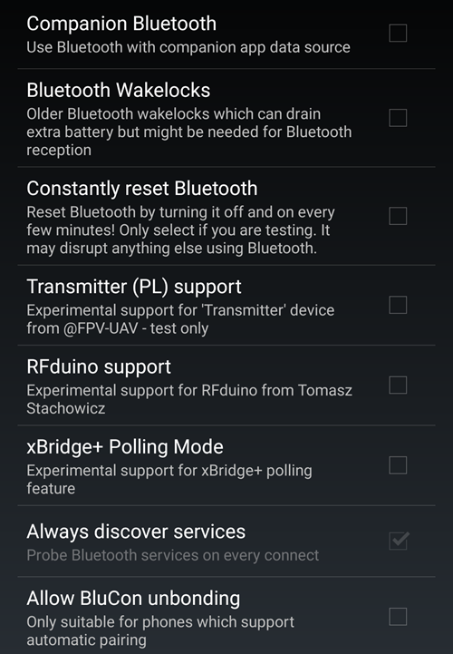

# Jak skonfigurować FSL 2 i OOP2, aby używać bezpośredniego połączenia Bluetooth w xDrip

Przeniesione z [MinimalL00per](https://www.minimallooper.com/post/how-to-setup-freestyle-libre-2-and-oop2-to-use-a-native-Bluetooth-connection-in-xdrip) do formatu markdown i **poprawione/zaktualizowane**: 25 sierpnia 2025, psonnera

Na końcu tego dokumentu jest lista definicji. Jeśli nie znasz jakiegoś pojęcia lub skrótu, *[przejdź niżej](#minimallooper-definitions)*, aby je sprawdzić.

 

## Konfiguracja

### Sprzęt

- *FSL2 i 2+* **UWAGA: wersje US, CAN, NZ, AUS NIE są obsługiwane**

**(OPCJONALNIE) Czytnik** (nie działa z FSL2+)

- Czytnik 1 (ze zaktualizowanym oprogramowaniem)

- Czytnik 2

*UWAGA: Jeśli chcesz używać czytnika w tym rozwiązaniu, MUSISZ NAJPIERW URUCHOMIĆ sensor CZYTNIKIEM. Jeśli tego nie zrobisz, nie będziesz mógł używać czytnika do odczytów z aktywowanego sensora. Gdy sensor się rozgrzeje, możesz wykonywać odczyty w aplikacji LL lub w xDrip.*

### Oprogramowanie

**OOP** - Out of Process Algorithm (zewnętrzny algorytm), osobna aplikacja Android (APK), która pomaga odczytać surowe dane z sensora i uzyskać z nich wartości glukozy. xDrip wysyła zebrane surowe dane BT z FSL2 do OOP, a wartości glukozy wracają do xDrip.

- **OOP2**

  - **Działa tylko z europejskimi sensorami FSL2/2+**

  - Kod zamknięty (niedostępny na GitHub)

  - Celem jest odszyfrowanie zaszyfrowanych surowych wartości z sensora i przekazanie ich do xDrip. Następnie xDrip może używać surowych danych (wymagają kalibracji) albo podawać wartości glukozy podobne do czytnika Reader 1.

[***xDrip***](https://jamorham.github.io/)

- [*Nightly*](https://github.com/NightscoutFoundation/xDrip/releases) najnowszy kod źródłowy, budowany każdej nocy. Nie w pełni przetestowana

- [*Stable*](https://xdrip-plus-updates.appspot.com/stable/xdrip-plus-latest.apk) najnowsza stabilna, przetestowana wersja.

- **NOTE: new sensors require an updated OOP2 app, for this it is recommended to use at least the latest xDrip release (Stable) version, matching the latest OOP2.**

 

## Procedura

- *Najpierw pobierz i zainstaluj poniższe aplikacje*
- *Odinstaluj aplikacje, które mogą powodować konflikty*
- *Jak uruchomić sensor FSL2 w trybie bezpośredniego Bluetooth przy użyciu LL i xDrip
  - [*Krok 1: Instalacja i konfiguracja aplikacji*](#minimallooper-step1)
  - [*Krok 2: Konfiguracja ustawień xDrip*](#minimallooper-step2)
  - [*Krok 3: Fizycznie załóż sensor*](#minimallooper-step3)
  - [*Krok 4: Uruchom aplikację LL i uruchom sensor pierwszym skanem NFC*](#minimallooper-step4)
  - [*Krok 5: Otwórz xDrip i zeskanuj sensor FSL2 przez NFC*](#minimallooper-step5)
  - [*Krok 6: Uruchom nowy sensor w xDrip*](#minimallooper-step6)
  - [*Krok 7: Odczekaj 60 sekund i ponownie zeskanuj sensor przez NFC*](#minimallooper-step7)
  - [*Krok 8: Zbieranie danych przez 3 do 15 minut*](#minimallooper-step8)
  - [*Krok 9: Sprawdź, czy sensor jest połączony i przesyła dane*](#minimallooper-step9)

- *[Notatki](#minimallooper-notes)*
- *[Zalety](#minimallooper-advantages)*
- *[Wady](#minimallooper-disadvantages)*
- <u>*\[Rozwiązywanie problemów\](#minimallooper-troubleshooting)*</u>

## Zanim zaczniesz

Zdecydowanie zalecamy wykonanie tej procedury z **nowym sensorem**. Są doniesienia, że połączenie można nawiązać z już działającym sensorem (***zobacz [niżej](#minimallooper-started-sensor)***), ale jest bardzo prawdopodobne, że aplikacja LL lub czytnik utworzy podczas połączenia nowy prywatny klucz do komunikacji. Oznacza to, że po powiązaniu (bonding) xDrip nie zna nowego klucza i nie będzie mógł komunikować się z sensorem. Próbę połączenia z działającym sensorem podejmujesz na własne ryzyko, najlepiej pod koniec życia sensora.

### Najpierw pobierz i zainstaluj poniższe aplikacje

(Libre2_OOP2)=

- **OOP2** - wersje OOP2 znajdziesz tutaj:

  (*Uwaga: aby otworzyć link, musisz być zalogowany do Google.*)

*[oop2.apk](https://drive.google.com/file/d/1106h2s12b3Ev9gKCTU2G75q8h9ChHjcz/view?usp=sharing)* - OOP2_21_09_25 (05d1989) **2025.09.21** (najnowsza wersja)

- **xDrip** - **<u>najnowszą wersję</u>** (minimum wersja 2025.09.26) znajdziesz tutaj:

[*xDrip.apk*](https://github.com/NightscoutFoundation/xDrip/releases)

(minimallooper-started-sensor)=

### Co, jeśli mój sensor jest już uruchomiony? Czy nadal mogę otrzymywać odczyty w xDrip? TAK!

Wiele osób pytało, czy tej metody można użyć z już aktywnym sensorem. Odpowiedź brzmi zdecydowanie **TAK**, możesz uruchomić sensor, który już działa.

1.  **NAJPIERW** upewnij się, że zmieniłeś konfigurację i ustawienia xDrip oraz zainstalowałeś i skonfigurowałeś OOP2, jak pokazano niżej.

2.  **NASTĘPNIE** przejdź do *kroku 5* i **UPEWNIJ SIĘ**, że przed rozpoczęciem wymusiłeś zatrzymanie LL. Potem wykonaj procedurę do końca.

*UWAGA: Nie będziesz mógł używać aktywowanego sensora FSL2 z czytnikiem FSLReader, JEŚLI nie został on najpierw uruchomiony czytnikiem FSLReader. Jeśli sensor ZOSTAŁ najpierw uruchomiony czytnikiem FSLReader, będziesz mógł **skanować** sensor i otrzymywać odczyty ZARÓWNO z sensora, jak i w aplikacjach takich jak LL i xDrip.*

## Jak uruchomić sensor FSL2 w trybie bezpośredniego Bluetooth przy użyciu LL i xDrip

*UWAGA: Jeśli na zrzutach ekranu są ustawienia, które nie są wyróżnione RAMKĄ i są NIEZAZNACZONE (czyli wyłączone), to POZOSTAW JE WYŁĄCZONE. Zrzuty ekranu pokazują działającą konfigurację dla WSZYSTKICH widocznych ustawień. Jeśli po uruchomieniu działającego sensora chcesz eksperymentować z włączaniem/wyłączaniem innych funkcji, możesz to zrobić na własne ryzyko.*

(minimallooper-step1)=

### Krok 1: Instalacja i konfiguracja aplikacji

**Zainstaluj i skonfiguruj OOP2** i sprawdź, czy działa, po prostu otwierając aplikację.


**Ustawienia**

- *Use service* **on**

- *Use foreground service* **on**

- *Timer Duration* **5 minutes**

  - Zmień na **1 sec**, jeśli wyniki nie pojawiają się wystarczająco szybko (zrzut ekranu poniżej pokazuje to ustawienie).

**Wersja 2: 93e5cac-2020.12.08 (najnowsza wersja)**


**Zainstaluj xDrip**, minimalna wersja: najnowsze wydanie. Więcej informacji o instalacji i konfiguracji xDrip znajdziesz [*tutaj*](../CompatibleCgms/xDrip.md).

(minimallooper-step2)=

### Krok 2: Konfiguracja ustawień xDrip

**Hardware Data Source**: Libre Bluetooth



**NFC Scan features**: *ustawienia, o których nie ma mowy, powinny być wyłączone.*

- *Use NFC feature*: **on**
- *Sensor Age or Expiry*: **on**
- *Scan when not in xDrip*: **on**
- *Use Any-tag optimized reading method*: **off**, ale jeśli skanowanie sprawia problemy, spróbuj **on**


- *Starting Bluetooth connection with FSL2 sensor*: **Always connect to libre2 sensors**


- *Smooth libre 3 data when using xxx method*: zostaw wartość domyślną. Zwiększ wartość dla sensorów z dużymi zakłóceniami, zmniejsz dla stabilnych.


**Less Common Settings -\> Bluetooth Settings** (*są ważne i mogą się różnić zależnie od telefonu/konfiguracji*)

- *Turn Bluetooth on*: **on**
- *Trust Auto-Connect*: **on**
- *Use Background Scans*: **on**
- *Always discover services*: **on**

Możesz skonfigurować xDrip za pomocą poniższego kodu QR. Zeskanuj go (lub wczytaj obraz) w xDrip -> Auto Configure.

```{admonition} QR Code
:class: dropdown


```





Po zeskanowaniu powyższego kodu QR, jeśli masz telefon Samsung (pomaga to też w wielu chińskich markach), zeskanuj drugi kod QR poniżej, aby zmienić ustawienia na bardziej niezawodne połączenie:

- *Trust Auto-Connect*: **off**
- *Use Background Scans*: **off**

```{admonition} QR Code
:class: dropdown


```


**Advanced settings for FSL2** (*opcjonalne, ale pomocne*)

- *show Raw values in Graph*: **on**

- *show Sensor info in Status*: **on**


**Extra Logging Settings** (*potrzebne do szukania błędów, jeśli coś nie działa*)

- *Extra tags for logging*: wpisz tę wartość

`BgReading:d,jamorham librereceiver:v,LibreOOPAlgorithm:v,jamorham nsemulator:v,DexCollectionService:v`


(minimallooper-OOPsettings)=

**Less Common Settings -\> Other misc options**

> **Ustawienia konfiguracji OOP2**

- *Out of process Libre algorithm*: **OFF**

(*DLA OOP2 TO USTAWIENIE MUSI BYĆ **OFF**, W PRZECIWNYM RAZIE NIE BĘDZIESZ OTRZYMYWAĆ ODCZYTÓW!*)


(minimallooper-step3)=

### Krok 3: Fizycznie załóż sensor

(minimallooper-step4)=

### Krok 4: Uruchom aplikację LL i uruchom sensor pierwszym skanem NFC

Uruchom aplikację LL, zeskanuj nowo założony sensor, a potem zamknij i wyłącz albo odinstaluj aplikację LL. **Zanim przejdziesz dalej i uruchomisz sensor w xDrip, nadal musisz odczekać pełne 60 minut na rozgrzanie sensora**. Nie polegaj na wcześniejszych odczytach, ponieważ sensor nadal kalibruje się wewnętrznie, a wartości bardzo się wahają.

#### Krok 4a (OPCJONALNIE, użycie FSLReader):

**Uruchom sensor FSL2 (nie 2+), skanując go czytnikiem FSLReader pierwszym skanem NFC**

Jeśli chcesz odczytywać wartości z sensora FSL2 czytnikiem **FSLReader**, a także aplikacją LL lub xDrip, to **musisz NAJPIERW zeskanować nowo założony sensor FSL2 czytnikiem FSL Reader.** Po zakończeniu rozgrzewania sensora możesz skanować odczyty aplikacją LL lub xDrip.

*UWAGA: Aplikacja LL jest potrzebna tylko do PIERWSZEGO skanu NFC po założeniu sensora. Wysyła ona sygnał rozpoczęcia rozgrzewania. Potem aplikację MUSISZ wyłączyć (ustawienia aplikacji -\> wymuś zatrzymanie) albo odinstalować. Możesz użyć aplikacji Patched 2.3 lub wersji oficjalnych, to nie ma znaczenia. Najważniejsze jest, aby aplikacja LL nie działała, gdy xDrip próbuje rozpocząć powiązanie BT (bonding) z sensorem, ponieważ aplikacja LL zakłóca komunikację i przeszkadza w ponownym połączeniu Bluetooth.*

*Są doniesienia, że wystarczy wyłączyć **uprawnienie do lokalizacji** dla aplikacji LL w ustawieniach systemu Android, aby nie przeszkadzała w połączeniu. Kilku użytkowników zgłosiło, że to działa. Jeszcze raz: **zalecam wyłączenie lub odinstalowanie aplikacji**, ale jeśli chcesz eksperymentować, możesz spróbować tego sposobu.*

(minimallooper-step5)=

### Krok 5: Otwórz xDrip i zeskanuj sensor FSL2 przez NFC

(*Przypomnienie! Upewnij się, że LL jest wyłączona (lokalizacja wyłączona) lub odinstalowana ORAZ że odczekałeś pełne 60 minut na rozgrzanie i wewnętrzną kalibrację sensora.*)

**ZESKANUJ PRZEZ NFC** sensor FSL2 w xDrip. To wysyła do sensora sygnał, aby włączył parowanie Bluetooth i rozpoczął proces wiązania (bonding). Na dole ekranu głównego xDrip na chwilę pojawi się małe powiadomienie **Scanning**, a po udanym skanie NFC sensora FSL 2 powiadomienie **Scanned OK!**.


(minimallooper-step6)=

### Krok 6: Uruchom nowy sensor w xDrip

Na **ekranie głównym xDrip** naciśnij **menu (☰)** w lewym górnym rogu. Następnie wybierz **Start Sensor**.

Na ekranie **Start New Sensor** naciśnij **Start Sensor**. Pojawi się pytanie **Did you insert it today?** (Czy założyłeś go dzisiaj?). Odpowiedz, naciskając **NOT TODAY**.


*UWAGA: Jeśli przez pomyłkę naciśniesz „YES, TODAY”, musisz w menu głównym xDrip wybrać „stop sensor”, a potem „start sensor”, wykonując ponownie krok 5.*

(minimallooper-step7)=

### Krok 7: Odczekaj 60 sekund i ponownie zeskanuj sensor przez NFC

Drugi skan NFC jest potrzebny, aby **DODAĆ** sensor jako urządzenie Bluetooth, z którego xDrip będzie pobierać odczyty. Po zakończeniu zobaczysz powiadomienie **NEW SENSOR STARTED**.


Musisz odczekać 60 sekund, ponieważ podczas tego procesu sensora nie można skanować częściej niż raz na minutę. Jeśli zeskanujesz sensor za wcześnie, na ekranie głównym xDrip pojawi się ostrzeżenie **Not so quickly, wait 60 seconds**.


Otwórz dziennik zdarzeń xDrip (event logs) i sprawdź, czy sensor poprawnie sparował się z xDrip.


(minimallooper-step8)=

### Krok 8: Zbieranie danych przez 3 do 15 minut

W ciągu 3 do 15 minut zbiera się wystarczająco dużo danych, aby pokazać pierwsze wartości. *Jeśli nadal nie otrzymujesz odczytów, czasem pomaga ponowne uruchomienie telefonu.*

Jeśli masz telefon Samsung (lub wiele telefonów chińskich marek) i masz problemy z odbieraniem danych, zeskanuj poniższy kod QR w xDrip -> Auto Configure.

```{admonition} QR Code
:class: dropdown


```

Zmieni on ustawienia Bluetooth w xDrip na:

- *Trust Auto-Connect*: **off**
- *Use Background Scans*: **off**

(minimallooper-step9)=

### Krok 9: Sprawdź, czy sensor jest połączony i przesyła dane

Naciśnij menu (☰) w lewym górnym rogu ekranu głównego xDrip i wybierz **System Status**. Na ekranie System Status w polu **Bluetooth Device:** widać nazwę Bluetooth sensora FSL2 w formacie **ABB___XXXXXXXXXXX**, gdzie XXX to numer seryjny sensora. Pole **Connection Status** pokazuje **Connected**, a pole **Sensor Start:** pokazuje czas uruchomienia sensora.


Na ekranie **BT Device** (przesuń w lewo) możesz sprawdzić dalsze szczegóły połączenia z sensorem. Ten ekran przydaje się też przy rozwiązywaniu problemów z połączeniem. Poniżej jest lista pól i ich znaczenie, która pomoże w rozwiązywaniu problemów z połączeniem.

*UWAGA: **<u>NIE DOTYKAJ</u> I NIE ZMIENIAJ Bluetooth Pairing z <u>Disabled</u>** w tym oknie. Spowoduje to próbę bezpośredniego parowania, która się nie uda (Not bonded), i całą procedurę trzeba będzie zacząć od nowa od kroku 5.*


- **Phone Service State:** ostatni raz, gdy telefon połączył się z sensorem przez BT (powinno to być mniej niż 5 minut temu)
- **Bluetooth Device:** pokazuje aktualny stan połączenia (**Connected** lub **Disconnected**)
- **Device Mac Address**: identyfikator sprzętowy sensora
- **Bluetooth Pairing**:  powinno być **<u>Disabled, tap to enable</u>**. Uważaj, aby tego NIE dotknąć. Jeśli dotkniesz przez pomyłkę, dotykaj ponownie, aż wróci do stanu wyłączonego (Disabled).
- **Slowest wake up**: możesz to zignorować. xDrip nie czeka cały czas na odczyty: zaczyna ich oczekiwać po określonym czasie (zwykle 5 minut). Jeśli w tym czasie dane nie przyjdą, zobaczysz „Woke up early”, co oznacza, że xDrip oczekiwał gotowych danych, ale ich nie ma. Slowest wake up to największe opóźnienie, jakie wystąpiło przed normalnym otrzymaniem danych.
- **Next Wake up**: powinno pokazywać 5 minut


(minimallooper-notes)=

### Notatki

- **Skany NFC w LL PO zakończeniu powiązania/parowania w xDrip**: możesz wykonywać skany NFC, ale najpierw musi się zakończyć powiązanie/parowanie z xDrip. Zawsze sprawdź w xDrip, czy zbliża się 5-minutowy odczyt (np. 4 minuty temu). Jeśli zbliża się 5 min, poczekaj na nowy odczyt BT i dopiero wtedy wykonaj skan NFC. Jeśli trafisz na zły moment, zakłócisz proces BT w xDrip i nie otrzymasz odczytów BT. Ponowne powiązanie i przesyłanie może zająć trochę czasu, a czasem LL może „przejąć” połączenie BT z sensorem. Jednak między tymi odczytami BT nie miałem żadnych problemów ze skanem NFC, po którym od razu wyłączałem aplikację. Nie jestem pewien, czy LL trzeba wyłączać za każdym razem, ale wyłączam ją dla bezpieczeństwa.

- - **Co się dzieje?** Przy nawiązaniu połączenia Bluetooth tworzony jest prywatny wspólny klucz. Jest on potrzebny do komunikacji między sensorem a aplikacją/urządzeniem, które się z nim łączy. Jest duże prawdopodobieństwo, że aplikacja LL lub czytnik utworzy podczas połączenia nowy prywatny wspólny klucz do komunikacji. Oznacza to, że po powiązaniu (bonding) xDrip nie zna nowego klucza i nie będzie mógł komunikować się z sensorem.

  - Several users have reported that the LL app can be restarted after successfully starting the sensor and receiving readings in xDrip. W uprawnieniach Android dla aplikacji LL wystarczy wyłączyć ustawienie **Allow Location** (Zezwalaj na lokalizację). Potem powinieneś móc używać aplikacji LL i xDrip jednocześnie. Zalecam, aby nie wybierać domyślnej aplikacji do skanowania NFC, tylko przy każdym skanie NFC wybierać aplikację, która ma odczytać sensor. NIE ZAPOMNIJ też przy następnej zmianie sensora wymusić zatrzymania aplikacji LL po pierwszym skanie NFC rozgrzewania nowego sensora. Gdy sensor jest skonfigurowany i xDrip otrzymuje odczyty, możesz ponownie uruchomić aplikację LL.

&nbsp;

- **Ponowne uruchomienie telefonu**: po ponownym uruchomieniu oraz po wyłączeniu lub wymuszeniu zatrzymania aplikacji PAMIĘTAJ, aby sprawdzić, czy aplikacja LL NIE działa. Proponuję sprawdzić po ponownym uruchomieniu, czy LL nie uruchamia się znowu automatycznie. Możesz to sprawdzić w ustawieniach aplikacji LL w ustawieniach aplikacji Android na telefonie. Jeśli nadal jest włączona, wyłącz aplikację LL ponownie. Odinstalowanie aplikacji LL może być jedynym sposobem, aby tego uniknąć. Chodzi o to, aby LL przypadkiem nie przejęła połączenia BT (bond). Po ponownym uruchomieniu odczyty BT z sensora pojawią się znowu dopiero po 3–15 minutach. Bądź cierpliwy i zaplanuj to, jeśli uruchamiasz telefon ponownie blisko chwili, gdy potrzebujesz odczytu BG do bolusa, posiłku itp.

&nbsp;

- **Ustawienia optymalizacji baterii**: upewnij się, że te aplikacje są WYKLUCZONE z optymalizacji baterii w telefonie

  - xDrip

  - OOP 2

  - LL

  - AAPS

&nbsp;

- **Tryb samolotowy:** W niektórych sytuacjach trzeba włączyć tryb samolotowy (gdy lecisz samolotem ;-) albo w nocy, gdy nie chcesz, aby sygnały Wi-Fi lub sieci komórkowej działały w telefonie blisko głowy). Włączenie trybu samolotowego może powodować problemy z komunikacją Bluetooth. Jeśli włączysz w telefonie tryb samolotowy, a potem włączysz Bluetooth, odczyty glukozy zostaną utracone. Jedynym obejściem jest ponowne uruchomienie kolektora w xdrip+ -\> System Status -\> Classic Status Page. Po ponownym uruchomieniu kolektora odczyty glukozy pojawiły się znowu.

 

(minimallooper-advantages)=

### Zalety

- **Zmodyfikowana (patched) aplikacja LL nie jest już potrzebna** Nie potrzebujesz już zmodyfikowanej wersji aplikacji LL, aby odczytywać wartości z sensora FSL2. Możesz używać zmodyfikowanej aplikacji LL, ale oficjalne wersje aplikacji LL wykonują pierwszy skan inicjalizujący NFC tak samo jak wersja zmodyfikowana. Przy skanie inicjalizującym NFC, który uruchamia sensor, nie ma żadnej różnicy.

&nbsp;

- **Zewnętrzne urządzenie do skanowania NFC nie jest już potrzebne** Zewnętrzne urządzenia do skanowania NFC (np. Miaomiao, Bubble lub Blucon) nie są już potrzebne *(ale nadal można ich używać)* do zbierania odczytów, ponieważ sam sensor może je teraz wysyłać przez Bluetooth. Mniej sprzętu to mniej rzeczy, które mogą się zepsuć, mniej urządzeń do ładowania i prostsza konfiguracja.

&nbsp;

- **Nadal będziesz mógł skanować odczyty przez NFC czytnikiem FSL2 (wersja 1 ze zaktualizowanym oprogramowaniem lub wersja 2), JEŚLI sensor FSL2 został NAJPIERW uruchomiony czytnikiem FSL Reader.** Samodzielnego czytnika FSL2 można nadal używać do skanowania aktywnego sensora, gdy jest on już powiązany przez Bluetooth z xDrip.

  - You **MUST** start the sensor with the very first NFC scan to initiate sensor warmup **with the FSL Reader FIRST**. Potem także inne aplikacje będą mogły odczytywać przez NFC dane z aktywowanego już sensora.
- O ile wiem, sensor FSL2 (dopóki nie nawiązał połączenia i nie próbuje go nawiązać) zawsze ogłasza swoją obecność (i dostępność) przez BLE dokładnie co 2 minuty (widać to na każdym urządzeniu, które potrafi wyszukiwać urządzenia Bluetooth). Urządzenie, które pierwsze odpowie na to ogłoszenie, wygrywa i jest *jedynym* urządzeniem, które może połączyć się z sensorem i go odczytywać. Podczas połączenia przy skanie NFC tworzony jest prywatny wspólny klucz, który służy do odszyfrowania komunikacji FSL 2. Wtedy sensor jest niedostępny dla innych urządzeń, które nie mają tego prywatnego klucza, a też mogą próbować się połączyć. Wygląda na to, że czytnik FSL 2 zawsze wygrywa, niezależnie od „przeciwnika”.

&nbsp;

- **Minimalny zestaw urządzeń** Moim celem zawsze było mieć na ciele jak najmniej urządzeń medycznych. FSL2 razem z systemem Omnipod pozwolił to osiągnąć. Jest to jeszcze ważniejsze, gdy podróżuję (blisko i daleko), bo mam mniej rzeczy i mniej zestawów do wymiany, więc w bagażu jest więcej miejsca na inne rzeczy. Mam nadzieję, że w przyszłości pojawi się pompa typu patch, w której wymienia się tylko zbiornik, a elektronika i silnik będą osobną częścią do wielokrotnego użytku. To zmniejszyłoby ilość odpadów i opakowań przy zmianie wkłucia, co znowu daje więcej miejsca w walizce na inne rzeczy.

&nbsp;

- **Koniec z godzinnymi przerwami przy zmianie sensora** Ponieważ możesz uruchomić kolejny sensor w aplikacji LL pierwszym skanem NFC, obecny sensor może w tym czasie dalej działać i wysyłać odczyty przez Bluetooth. Po 20 minutach możesz otrzymywać odczyty z nowego sensora, ale najlepiej odczekać 1 godzinę, aby sensor dobrze skalibrował się wewnętrznie. Oznacza to, że możesz zatrzymać obecny sensor i uruchomić nowy (gdy został założony i rozgrzany skanem NFC w LL godzinę wcześniej), a w ciągu 3 do 15 minut otrzymasz pierwsze kalibracje i odczyty.

&nbsp;

(minimallooper-disadvantages)=

### Wady

- **Ponowne uruchomienie telefonu:** Ponieważ po ponownym uruchomieniu telefonu proces Bluetooth musi zacząć się od nowa, musisz najpierw ręcznie wyłączyć aplikację LL (jeśli jej nie odinstalowałeś) i cierpliwie czekać na pierwsze odczyty (3 do 15 min). Dlatego planuj ponowne uruchomienie telefonu tak, aby nie wypadło w ważnych chwilach, np. przy bolusie korekcyjnym, posiłku lub przekąsce.

&nbsp;

- **Nie możesz używać LL i xDrip równocześnie do odczytów Bluetooth**. LL zawsze będzie próbować „przejąć” połączenie Bluetooth z sensorem i powiązanie (bond). Jeśli tak się stanie, do końca życia sensora będziesz skazany na LL. Dlatego równoczesne działanie aplikacji nie zawsze się sprawdza. Jak piszę niżej, możesz włączyć aplikację LL i wykonać skan NFC, aby uzyskać odczyt w LL (jeśli chcesz porównać wartości albo pobrać historię dla siebie lub do raportów dla diabetologa). Wyłącz ją jednak od razu po odczycie i nie rób tego w ciągu minuty przed chwilą, gdy xDrip pobiera odczyt przez Bluetooth. Nie wiem jeszcze, jak w tej sytuacji działa czytnik FSL2, ale sprawdzę to później.
- Several users have reported that the LL app can be restarted after successfully starting the sensor and receiving readings in xDrip. W uprawnieniach Android dla aplikacji LL wystarczy wyłączyć ustawienie **Allow Location** (Zezwalaj na lokalizację). Potem powinieneś móc używać aplikacji LL i xDrip jednocześnie. Zalecam, aby nie wybierać domyślnej aplikacji do skanowania NFC, tylko przy każdym skanie NFC wybierać aplikację, która ma odczytać sensor. NIE ZAPOMNIJ też przy następnej zmianie sensora wymusić zatrzymania aplikacji LL po pierwszym skanie NFC rozgrzewania nowego sensora. Gdy sensor jest skonfigurowany i xDrip otrzymuje odczyty, możesz ponownie uruchomić aplikację LL.

&nbsp;

- **Nadal można używać zewnętrznych urządzeń do skanowania NFC**. Tak, podałem to jako wadę, ale chcę też zaznaczyć, że jeśli coś pójdzie nie tak z sensorem i LL przejmie nad nim kontrolę, zawsze możesz wrócić do założenia na sensor urządzenia do skanowania NFC, aby otrzymywać odczyty w xDrip. Możesz też używać takiego urządzenia zamiast bezpośredniego połączenia Bluetooth, jeśli wolisz zestaw z zewnętrznym urządzeniem do skanowania NFC (Miaomiao, Bubble, Blucon). Niektóre telefony nie działają dobrze z bezpośrednim powiązaniem Bluetooth z sensorem i pobieraniem danych. Możesz używać tych urządzeń jako zapasowych albo na co dzień. W obu przypadkach nadal masz taką możliwość.
- If you are planning on using the **FSL Reader** as an NFC scanning device to take readings, you MUST start the FSL2 sensor with the **VERY FIRST NFC scan** to warm up the sensor with the **READER FIRST**.

&nbsp;

- **Dane nie będą automatycznie wysyłane do LV** Aplikacja LL nie ma stałego połączenia Bluetooth (bo LL nie powinna działać równocześnie z xDrip, gdy sensor aktywnie wysyła odczyty przez Bluetooth), więc nie otrzymuje automatycznie odczytów z sensora. Oznacza to, że dane o glukozie nie są automatycznie wysyłane do LV, a przez to także do innych telefonów z LL. Uważam to za wadę, ponieważ wielu rodziców polega na tej funkcji, a niektóre osoby muszą używać raportów LV dla swojego lekarza. Nadal możesz otworzyć aplikację LL i skanować sensor co 8 godzin, aby przenieść do LL uzupełnione dane z sensora (3 razy dziennie, co najmniej co 8 godzin, ale aby mieć dane z całych 24 godzin, prawdopodobnie trzeba więcej skanów). Jest to jednak czynność ręczna.

&nbsp;

(minimallooper-definitions)=

### Definicje

- **BT** - Bluetooth

- **BLE** - Bluetooth Low Energy

- **FSL** - FreeStyle Libre
  - **Libre 1 (FSL1)** - tylko NFC. Pierwsza wersja sensora

  - **FSL2 (FSL2)** - Bluetooth i NFC. Druga wersja sensora.

  - **Libre 3 (FSL3)** - Bluetooth i NFC. Trzecia, mniejsza wersja sensora. Nie jest obsługiwany przez OOP2 (zobacz Juggluco).

- **LL** - LibreLink, **aplikacja** używana do uruchomienia sensora pierwszym skanem NFC

- **LV** - LibreView, usługa w chmurze do udostępniania danych zespołowi diabetologicznemu (możesz też użyć Tidepool lub Nightscout)

- **MM** - MiaoMiao, nazwa i producent zewnętrznego urządzenia do skanowania NFC, które wysyła odczyty przez Bluetooth do xDrip.

- **NFC** - Near Field Communication (komunikacja bliskiego zasięgu), czynność, w której zbliżasz czytnik NFC telefonu do sensora, aby wykonać odczyt. Często nazywa się to „skanowaniem sensora”, „skanem sensora” lub „skanem NFC”. Ten proces w ogóle nie używa Bluetooth.

- **OOP1** - Out of Process Algorithm w wersji 1, zewnętrzna aplikacja, która odbiera surowe wartości (wysyłane z sensora do xDrip przez Bluetooth lub skan NFC), przetwarza je algorytmem (bardzo podobnym do algorytmu w chipie sensora) i zwraca do xDrip skalibrowaną wartość glukozy (skalibrowaną przez algorytm OOP1, nie przez kalibrację xDrip). xDrip może ją pokazać albo w razie potrzeby dalej przetworzyć własną kalibracją (pomiarem z palca).

- **OOP2** - Out of Process Algorithm w wersji 2, zewnętrzna aplikacja, która odbiera zaszyfrowane dane z sensora FSL 2 (przez Bluetooth lub skan NFC) i je odszyfrowuje. Po odszyfrowaniu dane są wysyłane do xDrip.

 

(minimallooper-troubleshooting)=

### Rozwiązywanie problemów

#### Nie udaje się zeskanować sensora przez NFC

- Upewnij się, że czytnik NFC w telefonie jest włączony w ustawieniach Android.
- Czytnik NFC musi obsługiwać tagi **ISO 15693**. Niektóre telefony Cubot są bardzo trudne w użyciu.
- Look into your phone documentation to identify the NFC antenna position. Zbliż telefon do sensora i przytrzymaj przez 10 sekund: odczyt NFC w xDrip trwa dłużej niż w aplikacji producenta lub czytniku.
- Spróbuj zamknąć xDrip przed skanowaniem sensora.
- Upewnij się, że żadna inna aplikacja nie chce odczytać sensora (przy skanie może pojawić się wybór różnych aplikacji: wybierz xDrip, ale nie ruszaj telefonem).
- Wypróbuj wszystkie kombinacje ustawień NFC w xDrip *Use faster multi-block reading method* i *Use Any-tag optimized reading method*. Pamiętaj, że skany NFC są zwykle bardziej niezawodne, gdy obie opcje są **off**.

#### Zatrzymanie na zbieraniu pierwszych odczytów

*Uwaga: FSL 2 nie jest uznawany za zaufane źródło danych, gdy jest kalibrowany ręcznie.*

Ustaw sposób [kalibracji OOP2](#minimallooper-OOPsettings) na „No calibration”, dopóki wszystko nie zacznie działać.

Potem możesz zdecydować, czy kalibrować.


#### Sensor jest rozpoznawany jako FSL1


Upewnij się, że używasz najnowszych wersji xDrip i OOP2.

#### Nie udaje się połączyć z sensorem

- Sprawdź, czy OOP1 jest wyłączone (zobacz [tutaj](#minimallooper-OOPsettings))


- Sprawdź, czy OOP2 nie jest usypiane przez aplikacje i ustawienia oszczędzania baterii w telefonie
- Sprawdź, czy Google Play Protect jest wyłączony, ponieważ zamyka on OOP2
- Czy zmieniłeś Bluetooth Pairing w System Status? Dotknij go ponownie, aby wrócił do **<u>Disabled</u>**


#### Brakujące odczyty

Upewnij się, że OOP2 pokazuje wartości inne niż 0 lub -1. Takie wartości mogą oznaczać, że sensor się psuje (przykład poniżej w mmol/l).


Jeśli wiek sensora (Sensor age) nie rośnie, może to też oznaczać problem z sensorem. Oznacza to, że xDrip otrzymał wartość, ale ją odrzucił, ponieważ była nieprawidłowa (błąd sensora).


#### Parowanie sensora od początku

1. Menu xDrip -> Stop sensor (nie zatrzymuje to FSL2, tylko zmienia stan w xDrip na „nieuruchomiony”)
2. Menu xDrip -> System status -> Forget device
3. Zeskanuj sensor przez NFC w xDrip. Odczekaj co najmniej minutę
4. Menu xDrip -> Start sensor. Odczekaj co najmniej minutę
5. Zeskanuj sensor przez NFC w xDrip kilka razy, zawsze odczekując co najmniej minutę między skanami
