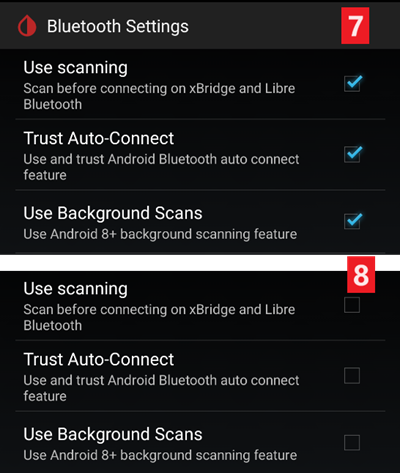
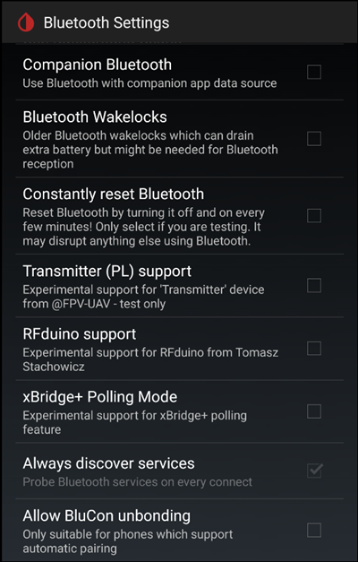

# Ustawienia xDrip

Jeśli xDrip nie jest jeszcze skonfigurowany, pobierz i zainstaluj najnowszą wersję xDrip ze [strony wydań xDrip](https://github.com/NightscoutFoundation/xDrip/releases).

Wyłącz optymalizację baterii i pozwól aplikacji xDrip działać w tle.

## Podstawowe ustawienia dla wszystkich systemów CGM i FGM

### Wyłącz wysyłanie do Nightscout

Nie pozwalaj żadnej innej aplikacji wysyłać danych (glikemii i leczenia) do Nightscout.

→ Hamburger Menu (1) → Settings (2) → Cloud Upload (3) -> Nightscout Sync (REST-API)(4) → przełącz `Enabled` na **OFF** (5)

#### Wyłącz automatyczną kalibrację i wpisy leczenia (treatments)

Upewnij się, że `Automatic Calibration` (7) jest wyłączone. Jeśli pole `Automatic Calibration` jest zaznaczone, włącz raz `Download treatments` (6), potem odznacz `Automatic Calibration` i ponownie wyłącz `Download treatments`.

Dotknij `Extra Options`(8)

    {admonition} Ostrzeżenie dotyczące bezpieczeństwa
    :class: warning
    Musisz wyłączyć „Upload treatments” w xDrip, w przeciwnym razie wpisy leczenia mogą zostać podwojone w AAPS, co da błędne COB i IOB.

Wyłącz `Upload treatments`(9) i upewnij się, że **NIE** będziesz używać `Back-fill data` (11).

Opcja `Alert on failures` też powinna być wyłączona (10). W przeciwnym razie co 5 minut dostaniesz alarm, gdy wystąpią problemy z Wi-Fi lub siecią komórkową albo gdy serwer nie będzie dostępny.

### **Inter-app Settings** (Broadcast)

Jeśli będziesz używać AAPS i dane mają być przekazywane np. do AAPS, musisz włączyć wysyłanie (broadcast) w xDrip w Inter-App settings.

→ Hamburger Menu (1) → Settings (2) → Inter-app settings (3) → Broadcast locally **ON** (4)

Aby wartości w AAPS były takie same jak w xDrip, włącz `Send the displayed glucose value` (5).

Włącz Compatible Broadcast (6).

Jeśli włączysz też `Accept treatments` w xDrip i `Enable broadcasts to xDrip` we wtyczce xDrip w AAPS, xDrip będzie otrzymywać z AAPS informacje o insulinie, węglowodanach i dawce bazowej.

Jeśli włączysz `Accept Calibrations`, xDrip będzie używać kalibracji z AAPS. Uważaj, gdy używasz tej funkcji z sensorami Dexcom: najpierw przeczytaj [ten tekst](https://navid200.github.io/xDrip/docs/Calibrate-G6.html).

Pamiętaj, aby wyłączyć Import Sounds, aby xDrip nie odtwarzał dzwonka za każdym razem, gdy AAPS wysyła zmianę bazy lub profilu.

(xdrip-identify-receiver)=

#### Identify receiver (identyfikacja odbiorcy)

- Jeśli masz problemy z lokalnym wysyłaniem danych (AAPS nie otrzymuje wartości BG z xDrip), przejdź do → Hamburger Menu (1) Settings (2) → Inter-app settings (3) → Identify receiver (7) i wpisz `info.nightscout.androidaps` dla wersji AAPS (jeśli używasz wersji PumpControl, wpisz zamiast tego `info.nightscout.aapspumpcontrol`!!).
- Uwaga: autokorekta czasem zmienia „i” na wielką literę. Wpisując `info.nightscout.androidaps` (lub `info.nightscout.aapspumpcontrol` dla PumpControl), **musisz używać tylko małych liter**. Wielka litera „I” sprawi, że aplikacja nie będzie otrzymywać wartości BG z xDrip.
    
    

## Kalibracja xDrip za pomocą AAPS

- Jeśli chcesz kalibrować za pomocą AAPS, w xDrip przejdź do Settings → Interapp Compatibility → Accept Calibrations i wybierz ON. 
- Możesz też przejrzeć opcje w Settings → Less Common Settings → Advanced Calibration Settings.

## Sensory Dexcom

Wszystko, co dotyczy samego sensora i nadajnika Dexcom (uruchamianie, zatrzymywanie, wymiana, kalibracja, rozwiązywanie problemów), jest opisane i aktualizowane w [dokumentacji xDrip dla Dexcom](https://navid200.github.io/xDrip/docs/Dexcom_page.html). Dla sensora postępuj według tych instrukcji; jedyną częścią dotyczącą AAPS są ustawienia łączące xDrip z **AAPS** (opisane wyżej na tej stronie).

### Dexcom G6 i ONE

- Skonfiguruj xDrip według [zalecanych ustawień](https://navid200.github.io/xDrip/docs/G6-Recommended-Settings.html).
- Nadajniki Dexcom G6 i ONE mogą być połączone jednocześnie z odbiornikiem Dexcom (lub zamiast niego z pompą t:slim) i z jedną aplikacją na telefonie.
- Jeśli używasz xDrip jako odbiornika, najpierw odinstaluj aplikację Dexcom. **Nie możesz połączyć z nadajnikiem jednocześnie xDrip i aplikacji Dexcom!**
- Jeśli potrzebujesz Clarity i chcesz korzystać z funkcji xDrip, użyj [Build Your Own Dexcom App (BYODA)](#DexcomG6-if-using-g6-with-build-your-own-dexcom-app) z lokalnym wysyłaniem danych do xDrip albo używaj xDrip jako aplikacji Companion, która odbiera powiadomienia z oficjalnej aplikacji Dexcom (odczyty BG mogą wtedy przychodzić z opóźnieniem).

#### Ponowne uruchamianie sensora

- Z obecnymi nadajnikami xDrip zawsze używa [natywnego algorytmu](https://navid200.github.io/xDrip/docs/Native-Algorithm.html) nadajnika. Nie ma powodu, aby go wyłączać.
- [Wyprzedzające restarty (preemptive restarts)](https://navid200.github.io/xDrip/docs/Preemptive-Restart.html) działają tylko na starych nadajnikach (firmware 1.6.5.25 lub starszy), gdzie są potrzebne, aby sensor nie zatrzymał się po 10 dniach. Nowe nadajniki (Firefly) je ignorują.
- Ponowne uruchomienie sensora na nadajniku Firefly wymaga [zdjęcia nadajnika](https://navid200.github.io/xDrip/docs/Remove-transmitter.html), a odczyty po restarcie mogą być bardzo błędne, co jest niebezpieczne przy używaniu pętli: przeczytaj w całości [Restart a sensor](https://navid200.github.io/xDrip/docs/Restart-G6-sensor.html) i [kalibruj ostrożnie](https://navid200.github.io/xDrip/docs/Calibrate-after-G6Restart.html).

(xdrip-connect-g6-transmitter-for-the-first-time)=

#### Uruchamianie, zatrzymywanie i wymiana sensorów

Postępuj według instrukcji:

- [Uruchomienie nadajnika G6 lub ONE](https://navid200.github.io/xDrip/docs/Starting-G6.html)
- [Zatrzymanie i uruchomienie sensora G6 lub ONE](https://navid200.github.io/xDrip/docs/Dexcom/StartG6Sensor.html)
- [Zdjęcie nadajnika z sensora](https://navid200.github.io/xDrip/docs/Remove-transmitter.html)
- [Czas życia nadajnika](https://navid200.github.io/xDrip/docs/Transmitter-lifetime.html) można przedłużyć ([hard reset](https://navid200.github.io/xDrip/docs/Hard-Reset.html)) tylko w nadajnikach z wymienioną baterią lub zmodyfikowanych, nie w Firefly.

(xdrip-replace-transmitter)=

#### Wymiana nadajnika

- Wyłącz oryginalny odbiornik Dexcom (jeśli go używasz) i nie włączaj go ponownie, zanim xDrip nie pokaże odczytów.
- Forget the device in xDrip (System Status → Forget Device) AND in the smartphone's Bluetooth settings (shown as DexcomXX where XX are the last two digits of the transmitter serial number).
- Trzymaj stary nadajnik poza zasięgiem Bluetooth, aby nie połączył się ponownie.
- Następnie postępuj według [Uruchomienie nadajnika G6 lub ONE](https://navid200.github.io/xDrip/docs/Starting-G6.html).

### Dexcom G7, ONE+ i Stelo

- Postępuj według [instrukcji dla G7, ONE+ i Stelo](https://navid200.github.io/xDrip/docs/Dexcom/G7.html) (wymagana jest nowa wersja xDrip – zobacz stronę pod linkiem).
- Zobacz też [stronę Dexcom G7, ONE+ i Stelo](../CompatibleCgms/DexcomG7.md), gdzie opisano dostępne konfiguracje z **AAPS**.

(xdrip-troubleshooting-dexcom-g5-g6-and-xdrip)=

### Rozwiązywanie problemów z Dexcom i xDrip

- [Rozwiązywanie problemów z połączeniem G6/ONE](https://navid200.github.io/xDrip/docs/Connectivity-troubleshoot.html)
- [Rozwiązywanie problemów z G7/ONE+/Stelo](https://navid200.github.io/xDrip/docs/Dexcom/G7_Troubleshooting.html)
- [Problem przy uruchamianiu nowego sensora](https://navid200.github.io/xDrip/docs/Dexcom/SensorFailedStart.html)
- Pełna lista: zobacz **Troubleshooting** na [stronie xDrip o Dexcom](https://navid200.github.io/xDrip/docs/Dexcom_page.html).

## Libre 1

- Skonfiguruj w xDrip swój mostek NFC–Bluetooth
    
    → Hamburger Menu (1) → Settings (2) → Less common settings (3) → Bluetooth Settings (4)

- W Bluetooth Settings zaznacz pola dokładnie tak, jak na zrzutach ekranu poniżej (5)
    
    - Wyłącz watchdogi, bo resetują Bluetooth telefonu i przerywają połączenie z pompą.
    
    

- Możesz spróbować włączyć następujące ustawienia (7)
    
    - Use scanning (użyj skanowania)
    - Trust Auto-Connect
    - Use Background Scans

- Jeśli łatwo tracisz połączenie z mostkiem (bridge) albo masz trudności z jego przywróceniem, **WYŁĄCZ JE** (8).
    
    

- Pozostałe opcje zostaw wyłączone, chyba że wiesz, po co je włączasz.
    
    

### Poziom baterii czytnika Libre Smart Reader

- Poziom baterii mostków, takich jak MiaoMiao i Bubble, może być wyświetlany w AAPS (nie dotyczy Blucon).
- Szczegóły znajdziesz na [stronie ze zrzutami ekranu](#screens-sensor-level-battery).

### Połącz nadajnik Libre i uruchom sensor

- Jeśli Twój sensor tego wymaga (Libre 2 EU i Libre 1 US), zainstaluj najnowszy algorytm „out of process”.

- Twój sensor musi być już uruchomiony aplikacją producenta lub czytnikiem (xDrip nie może uruchamiać ani zatrzymywać sensorów Libre).

- Ustaw źródło danych na Libre Bluetooth.
    
    → Hamburger Menu (1) → Settings (2) → wybierz Libre Bluetooth w Hardware Data source (3)
    
    

- Wyszukaj urządzenia Bluetooth i połącz mostek.
    
    → Hamburger Menu (1) → Scan Bluetooth (2) → Scan (3)
    
    - Jeśli xDrip nie może znaleźć mostka, upewnij się, że nie jest połączony z aplikacją producenta. Podłącz go do ładowania i zresetuj.
    
    

- Uruchom sensor w xDrip.
    
        {admonition} Ostrzeżenie dotyczące bezpieczeństwa
        :class: warning
        Nie używaj danych z sensora, zanim minie godzinna rozgrzewka: wartości mogą być bardzo wysokie i powodować złe decyzje AAPS.
    
    → Hamburger Menu (1) → Start sensor (2) → Start sensor (3) → ustaw dokładny czas, w którym uruchomiono sensor czytnikiem lub aplikacją producenta. Jeśli nie uruchomiono go dzisiaj, odpowiedz „Not Today” (4).

(xdrip-libre2-patched-app)=

## Zmodyfikowana aplikacja Libre 2 (patched)

- Ustaw źródło danych na Libre patched app.
    
    → Hamburger Menu (1) → Settings (2) → wybierz Libre (patched App) w Hardware Data source (3)
    
    

- Możesz dodać `BgReading:d,xdrip libre_receiver:v` w Less Common Settings->Extra Logging Settings->Extra tags for logging. Dzięki temu w logach pojawią się dodatkowe komunikaty o błędach, pomocne przy rozwiązywaniu problemów.

